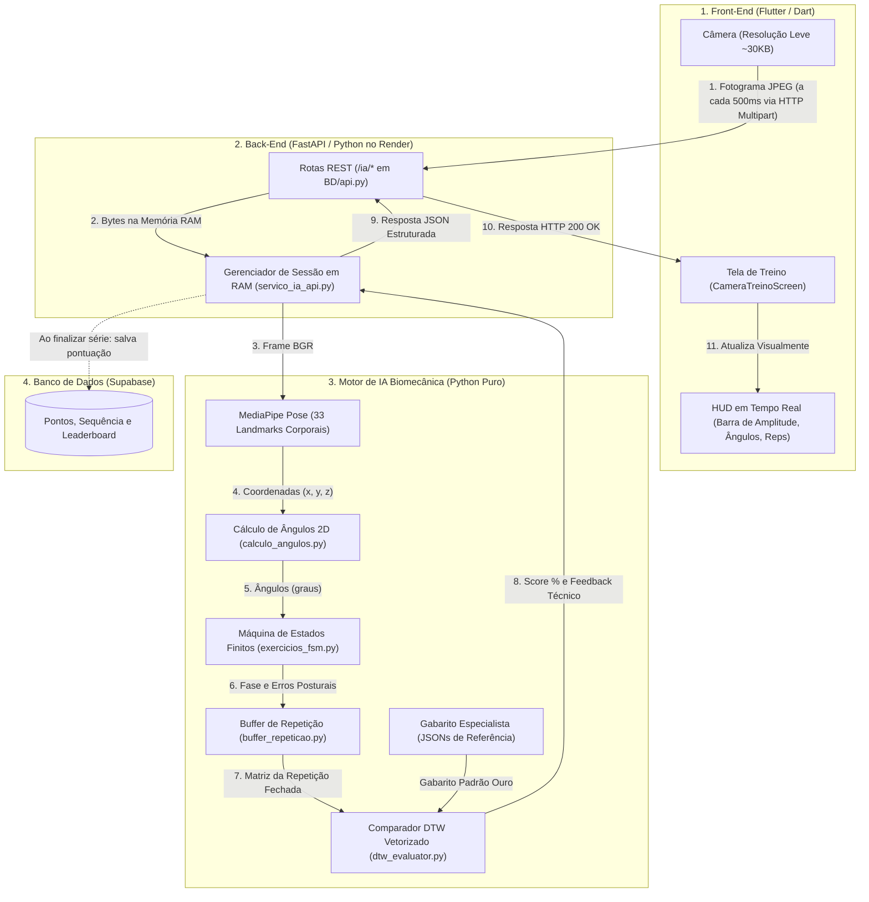
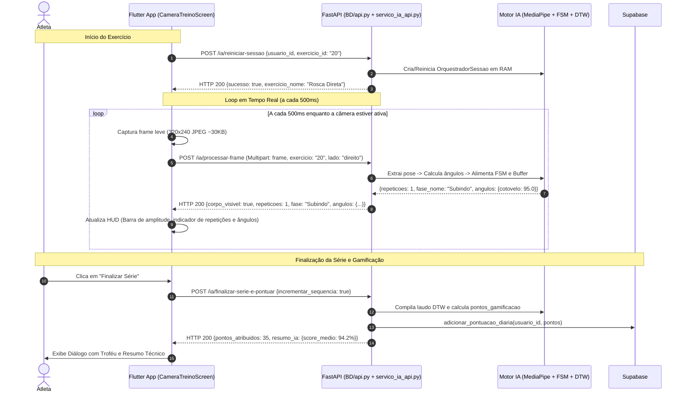

# Arquitetura e Comunicação da IA — Personal Trainer IA

Este documento explica de forma didática, visual e completa como a **Inteligência Artificial (IA)** do projeto funciona, como ela se comunica com o **Back-End (FastAPI)** e como tudo se conecta em tempo real com o **Front-End (Aplicativo Flutter)**.

---

## 1. Visão Geral da Arquitetura em 3 Camadas

O sistema opera no modelo **Cliente-Servidor de Baixa Latência**:



---

## 2. Como Funciona a IA por Dentro? (Camada Biomecânica)

A IA não é uma "caixa preta" arbitrária. Ela foi construída com **visão computacional determinística e explicável**, dividida em 5 etapas fundamentais:

### Etapa 2.1: Estimação de Pose (MediaPipe)
- O modelo do **Google MediaPipe Pose** processa o fotograma e detecta **33 pontos anatômicos** (*landmarks*) no corpo do atleta (ombros, cotovelos, punhos, quadris, joelhos, tornozelos).
- Cada ponto possui coordenadas $(x, y, z)$ normalizadas e um índice de visibilidade.

### Etapa 2.2: Cálculo Geométrico dos Ângulos (`calculo_angulos.py`)
- Em vez de usar posições de pixels na tela (que variam conforme a distância da pessoa até a câmera), a IA converte os pontos em **ângulos articulares em graus** usando álgebra vetorial e trigonometria ($\text{arctan2}$):
  - **Rosca Direta e Desenvolvimento:** Ângulo do cotovelo ($\text{ombro} \rightarrow \text{cotovelo} \rightarrow \text{punho}$) e ombro ($\text{quadril} \rightarrow \text{ombro} \rightarrow \text{cotovelo}$).
  - **Agachamento:** Ângulo do joelho ($\text{quadril} \rightarrow \text{joelho} \rightarrow \text{tornozelo}$) e quadril ($\text{ombro} \rightarrow \text{quadril} \rightarrow \text{joelho}$).
- **Suporte Bilateral Inteligente:** Para a Rosca Direta e Desenvolvimento, a IA analisa ambos os braços e seleciona automaticamente o braço ativo que está em movimento, funcionando perfeitamente mesmo com webcams espelhadas ou se o praticante for canhoto.

### Etapa 2.3: Máquina de Estados Finitos — FSM (`exercicios_fsm.py`)
Cada repetição é modelada como um ciclo de 4 fases biomecânicas:
1. **Fase 0 (Repouso):** Posição inicial estável (ex.: braço estendido ou atleta em pé).
2. **Fase 1 (Subindo / Descendo):** Início da fase concêntrica/excêntrica.
3. **Fase 2 (Pico de Contração / Fundo):** Ponto de máxima amplitude e esforço muscular.
4. **Fase 3 (Retorno Controlado):** Retorno em direção à posição inicial.
5. **Retorno à Fase 0:** Repetição completada! O contador de repetições é incrementado em $+1$.

> [!NOTE]
> **Detecção Instantânea de Erros:** Se o praticante abortar a subida antes do pico e voltar ao repouso, a FSM detecta a transição inválida ($1 \rightarrow 3$) e registra imediatamente o erro (ex.: `REPETICAO_INCOMPLETA` ou `AGACHAMENTO_CURTO`), avisando o usuário na tela no mesmo instante.

### Etapa 2.4: O Buffer de Repetição (`buffer_repeticao.py`)
- Enquanto a repetição está em andamento (fases 1, 2 e 3), o *Buffer* armazena em memória todos os ângulos daquele ciclo.
- No momento exato em que a FSM confirma o retorno à fase 0, o Buffer "empacota" essa trajetória em uma matriz numérica e entrega para a avaliação global.

### Etapa 2.5: DTW e Comparação com o Gabarito (`dtw_evaluator.py`)
- O atleta pode fazer o movimento mais rápido ou mais devagar que o especialista.
- O algoritmo **DTW (Dynamic Time Warping)** alinha elasticamente a curva de movimento do atleta com o **Gabarito Padrão Ouro** gravado previamente por um treinador profissional.
- A partir dessa comparação, a IA calcula:
  1. **Score DTW (0 a 100%):** Quão próxima a trajetória esteve da perfeição biomecânica.
  2. **Penalidades por erros posturais:** Desconto proporcional para cada erro detectado pela FSM.
  3. **Diagnóstico pedagógico prioritário:** Mensagem técnica construtiva (ex.: *"Mantenha o cotovelo fixo ao tronco e evite projetar o ombro"*).

---

## 3. O Ciclo de Comunicação Passo a Passo

O fluxo de comunicação segue uma sequência de 3 etapas principais durante o treino:



---

## 4. Estrutura dos Contratos de Comunicação (Payloads JSON)

### 4.1. Iniciar ou Trocar Exercício
- **Endpoint:** `POST /ia/reiniciar-sessao`
- **Corpo da Requisição (JSON):**
  ```json
  {
    "usuario_id": "usr_12345",
    "exercicio_id": "20"
  }
  ```
- **Resposta do Servidor:**
  ```json
  {
    "sucesso": true,
    "mensagem": "Sessão reiniciada com sucesso para o exercício 'Rosca Direta'",
    "exercicio_id": "20",
    "exercicio_nome": "Rosca Direta",
    "articulacoes_monitoradas": ["cotovelo", "ombro"]
  }
  ```

---

### 4.2. Envio de Fotograma em Tempo Real
- **Endpoint:** `POST /ia/processar-frame`
- **Formato:** `multipart/form-data`
  - `frame`: Arquivo binário da imagem JPEG (otimizado em 320x240, ~30KB).
  - `usuario_id`: `"usr_12345"`
  - `exercicio`: `"20"`
  - `lado`: `"direito"`
- **Resposta do Servidor (HTTP 200 OK):**
  ```json
  {
    "sucesso": true,
    "corpo_visivel": true,
    "repeticoes": 3,
    "fase_numero": 1,
    "fase_nome": "Subindo",
    "alerta_imediato": null,
    "angulos": {
      "cotovelo": 82.5,
      "ombro": 18.0
    },
    "repeticao_concluida": false,
    "ultima_repeticao": {
      "score_dtw": 96.0,
      "score_final": 96.0,
      "classificacao": "Excelente",
      "recomendacoes": ["Excelente cadência e amplitude de movimento."]
    }
  }
  ```

---

### 4.3. Finalização da Série e Pontuação no Banco
- **Endpoint:** `POST /ia/finalizar-serie-e-pontuar`
- **Corpo da Requisição (JSON):**
  ```json
  {
    "usuario_id": "usr_12345",
    "incrementar_sequencia": true
  }
  ```
- **Resposta do Servidor (HTTP 200 OK):**
  ```json
  {
    "sucesso": true,
    "pontos_atribuidos": 35,
    "resumo_ia": {
      "total_repeticoes": 10,
      "repeticoes_aprovadas": 9,
      "repeticoes_reprovadas": 1,
      "taxa_aprovacao": 90.0,
      "score_medio": 93.4,
      "recomendacao_prioritaria": "Mantenha o cotovelo colado ao tronco na descida."
    }
  }
  ```

---

## 5. Como o Front-End Conecta Tudo Visualmente

No aplicativo móvel ([`CameraTreinoScreen`](./lib/screens/camera_treino_screen.dart)), os dados recebidos da IA alimentam os seguintes elementos visuais:

1. **Barra de Amplitude em Tempo Real (0% a 100%):**
   - O aplicativo calcula a proporção do ângulo recebido em relação à amplitude máxima daquele exercício.
   - À medida que o atleta flexiona o braço na Rosca Direta, a barra se preenche em tempo real (0% no repouso $\rightarrow$ 100% no pico de contração), mudando de cor (Ciano $\rightarrow$ Âmbar $\rightarrow$ Verde).
2. **Pílula de Telemetria:**
   - Exibe a latência em milissegundos da resposta da nuvem (ex.: `🟢 IA Conectada • 120ms • 45 frames`).
   - Se a internet oscilar ou o servidor Render estiver acordando do modo de espera, exibe: `🟠 Conectando ao servidor...`, garantindo que o usuário saiba o status exato da conexão.
3. **Chips de Ângulos e Fase:**
   - Exibe os ângulos exatos das articulações na tela (`Cotovelo: 84° • Ombro: 18°`).
   - Chip dinâmico colorido indicando a fase motora atual (`Fase: Subindo ⬆️`, `Pico de Contração 🔥`, `Descendo ⬇️`).
4. **Alerta Postural Instantâneo:**
   - Se o corpo sair do enquadramento: banner laranja instrui *"Afaste-se da câmera (~1.5m a 2m) para enquadrar corpo e braços"*.
   - Se houver erro técnico (ex.: cotovelo desceu demais ou ombro projetou): banner vermelho avisa na mesma hora.
5. **Transição Contínua *In-Place* entre Exercícios:**
   - Ao concluir a série de um exercício, o modal oferece o botão *"Próximo Exercício"*.
   - A tela **não fecha a câmera**: ela apenas atualiza o exercício internamente, mantendo o hardware da webcam ativo e eliminando qualquer erro de concorrência de driver no sistema operacional.

---

## 6. Mapeamento dos Arquivos Principais

| Camada | Arquivo Principal | Responsabilidade |
| :--- | :--- | :--- |
| **Front-End** | [`lib/screens/camera_treino_screen.dart`](./lib/screens/camera_treino_screen.dart) | Captura de vídeo a 500ms, HUD interativo, telemetria e transição in-place. |
| **Front-End** | [`lib/screens/treino_selecionado_screen.dart`](./lib/screens/treino_selecionado_screen.dart) | Lista de exercícios do treino, controle de conclusão e salvamento de pontos. |
| **Front-End** | [`lib/services/api_service.dart`](./lib/services/api_service.dart) | Cliente HTTP Dart que chama as rotas `/ia/*` do backend. |
| **Back-End** | [`BD/api.py`](./BD/api.py) | Servidor FastAPI com rotas REST e suporte a healthcheck `HEAD`/`GET`. |
| **Back-End** | [`servico_ia_api.py`](./servico_ia_api.py) | Gerenciador de sessões de IA em memória RAM e decodificação em tempo real. |
| **Motor IA** | [`calculo_angulos.py`](./calculo_angulos.py) | Extração de ângulos articulares 2D e suporte bilateral a ambos os braços. |
| **Motor IA** | [`exercicios_fsm.py`](./exercicios_fsm.py) | Máquinas de Estados Finitos com fases motoras e limiares biomecânicos. |
| **Motor IA** | [`buffer_repeticao.py`](./buffer_repeticao.py) | Isolamento e empacotamento matricial temporal de cada repetição. |
| **Motor IA** | [`dtw_evaluator.py`](./dtw_evaluator.py) | Algoritmo Dynamic Time Warping vetorizado que compara com o gabarito. |
| **Deploy** | [`Dockerfile`](./Dockerfile) | Container Linux oficial no Render com bibliotecas gráficas `libgles2`, `libegl1` e `libgl1`. |

---

## 7. Resiliência, Tratamento de Falhas e Otimizações

A arquitetura foi desenhada considerando os desafios comuns em aplicações de visão computacional em nuvem com dispositivos móveis:

### 7.1. Decodificação Direta em RAM (Zero I/O em Disco)
- Quando o fotograma chega na rota `/ia/processar-frame`, ele é lido como um fluxo de bytes (`bytes = await frame.read()`).
- O OpenCV decodifica a imagem instantaneamente na memória RAM (`cv2.imdecode(np.frombuffer(bytes, np.uint8), cv2.IMREAD_COLOR)`).
- **Vantagem:** Nenhuma imagem é gravada no disco rígido do servidor. Isso garante altíssima velocidade, previne vazamento de dados de imagem dos usuários (privacidade/LGPD) e evita estouro de cota de armazenamento na nuvem.

### 7.2. Resolução Reduzida e Compressão JPEG (`ResolutionPreset.low`)
- A câmera do Flutter foi configurada para capturar em resolução ultraleve (~320x240 pixels), gerando arquivos de apenas ~30 KB por frame.
- **Por que isso é suficiente?** A rede neural do MediaPipe Pose opera internamente reescalando a imagem para uma matriz quadrada de 256x256 pixels. Enviar resoluções em Full HD (1080p, ~2 a 4 MB) apenas desperdiçaria largura de banda de internet móvel e aumentaria o tempo de upload sem qualquer ganho de precisão anatômica.

### 7.3. Tolerância a Oscilação de Rede e "Cold Start" da Nuvem
- No plano gratuito do Render, o servidor web entra em modo de hibernação (*spin down*) após 15 minutos de inatividade.
- Quando o usuário abre a câmera, o app Flutter exibe a telemetria `"🟠 Conectando ao servidor..."` enquanto o backend "acorda".
- Se uma requisição de frame sofrer timeout ou oscilação de 4G/Wi-Fi, o Flutter simplesmente ignora aquele frame específico e continua no próximo intervalo de 500ms, sem travar a tela e sem derrubar o preview da câmera.

### 7.4. Detecção de Desalinhamento Corporal (`corpo_visivel: false`)
- Se o usuário estiver muito próximo da câmera ou fora do enquadramento, o MediaPipe não detecta os pontos articulares necessários.
- O backend responde com `corpo_visivel: false`, e o HUD exibe um alerta orientador: *"Afaste-se da câmera (~1.5m a 2m) para enquadrar corpo e braços"*. O contador de repetições e a FSM mantêm o estado anterior congelado sem registrar repetições fantasmas ou quebrar a série.

---

## 8. Calibração Biomecânica dos Exercícios Nativos

Abaixo está o resumo dos limiares de movimento calibrados no motor matemático (`exercicios_fsm.py` e `calculo_angulos.py`):

| Exercício | Articulações Analisadas | Posição de Repouso (Fase 0) | Pico de Contração (Fase 2) | Erros Técnicos Detectados |
| :--- | :--- | :--- | :--- | :--- |
| **Rosca Direta** *(Bíceps)* | Cotovelo e Ombro (Bilateral automático) | Cotovelo $\ge 135^\circ$ (braço estendido) | Cotovelo $\le 70^\circ$ (braço flexionado) | • Cotovelo projetado para frente (ombro $> 35^\circ$)<br>• Repetição incompleta (retorno precoce sem atingir pico) |
| **Agachamento** *(Pernas/Glúteos)* | Joelho e Quadril | Joelho $\ge 160^\circ$ (atleta ereto em pé) | Joelho $\le 85^\circ$ (quadril paralelo ao solo) | • Agachamento curto / parcial (joelho $> 95^\circ$)<br>• Tronco excessivamente curvado |
| **Desenvolvimento** *(Ombros)* | Ombro e Cotovelo | Cotovelo $\le 85^\circ$ (halteres na altura dos ombros) | Cotovelo $\ge 150^\circ$ (braços estendidos para o alto) | • Extensão incompleta<br>• Assimetria entre braço esquerdo e direito |

---

## 9. Como Executar e Testar o Pipeline Completo

### 9.1. Testando o Motor de IA Offline (Testes Automatizados com Pytest)
O motor de visão biomecânica possui desacoplamento total da interface gráfica, permitindo validação sintética de ângulos, FSM e DTW sem precisar de webcam:
```powershell
# Executa todos os testes unitários do motor de IA
pytest tests/ -v
```

### 9.2. Executando o Back-End FastAPI Localmente
```powershell
# Inicializa o servidor FastAPI com recarregamento automático
uvicorn BD.api:app --reload --host 0.0.0.0 --port 8000
```
- A documentação interativa com Swagger/OpenAPI fica acessível em: `http://localhost:8000/docs`
- Nela é possível testar a rota `/ia/processar-frame` enviando uma imagem JPEG diretamente pelo navegador.

### 9.3. Executando os Testes do Front-End Flutter
```powershell
# Valida a compilação, mocks e telas do app
flutter test
```

---

## 10. Resumo Executivo para Apresentações e Avaliações

Se precisar explicar a arquitetura em 1 minuto para avaliadores ou professores:

> *"O aplicativo utiliza uma arquitetura Cliente-Servidor de baixa latência em 3 camadas. O Front-End Flutter captura fotogramas ultra-leves a cada 500ms e os envia para a API FastAPI. O servidor processa os frames em memória RAM com o MediaPipe Pose, extrai ângulos articulares em 2D e alimenta uma Máquina de Estados Finitos que monitora as 4 fases da repetição. Ao término do movimento, o algoritmo Dynamic Time Warping (DTW) compara a curva de execução contra um gabarito padrão-ouro gravado por um treinador especialista, gerando pontuações, detecção de erros posturais imediatos e salvando os pontos de gamificação no Supabase."*
