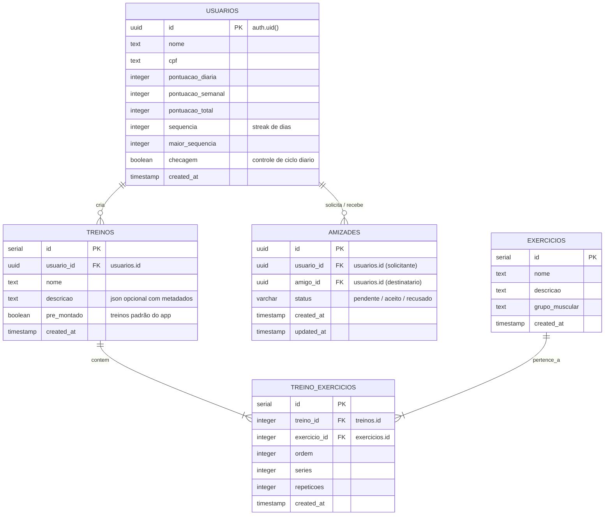

# 🏛️ Guia de Contexto de Banco de Dados & APIs: Personal Trainer IA

> **Última Atualização:** 2026-10-23  
> **Camada:** Back-end (FastAPI) & SGBD (Supabase / PostgreSQL)  
> **Status:** Ativo / Consolidado  

---

## 1. 📖 Visão Geral da Arquitetura

O ecossistema do **Personal Trainer IA** adota uma arquitetura em camadas cliente-servidor:
1. **Front-end (Flutter/Dart):** Aplicativo móvel para o usuário final.
2. **Back-end (FastAPI/Python):** Servidor intermediário REST assíncrono que centraliza as regras de negócio, validação com Pydantic e segurança.
3. **Database & Auth (Supabase/PostgreSQL):** Gerencia autenticação de usuários (JWT), persistência em tabelas relacionais, regras de segurança em nível de linha (RLS) e procedimentos armazenados (RPC).

```mermaid
flowchart LR
    Flutter["App Flutter (Mobile/Web)"] -->|HTTP / JSON (REST)| FastAPI["API REST (BD/api.py)"]
    FastAPI -->|Lógica de Negócio| Core["Core Backend (BD/main.py)"]
    Core -->|supabase-py (Service Role)| Supabase["Supabase (PostgreSQL 15+)"]
    
    subgraph SupabaseDB["Banco de Dados & Autenticação"]
        Auth["Supabase Auth (auth.users)"]
        Tables["Tabelas Relacionais (public.*)"]
        RPC["Funções RPC / Triggers"]
    end

    Supabase --> Auth
    Supabase --> Tables
    Supabase --> RPC
```

---

## 2. 🗄️ Esquema Relacional (Diagrama ERD)



---

## 3. 📋 Dicionário de Dados Detalhado

### A. Tabela `public.usuarios`
Armazena dados cadastrais e as métricas de gamificação e uso contínuo do app.
* `id` (`UUID`, PK): Vinculado diretamente ao ID da conta no `auth.users`.
* `nome` (`TEXT`): Nome de exibição do usuário.
* `cpf` (`TEXT`): CPF do usuário.
* `pontuacao_diaria` (`INTEGER`, Default `0`): Pontos acumulados no dia corrente.
* `pontuacao_semanal` (`INTEGER`, Default `0`): Pontos acumulados na semana (usado para o Leaderboard).
* `pontuacao_total` (`INTEGER`, Default `0`): Pontuação histórica vitalícia.
* `sequencia` (`INTEGER`, Default `0`): Streak diário consecutivo de treinos concluídos.
* `maior_sequencia` (`INTEGER`, Default `0`): Recorde histórico de streak consecutivo.
* `checagem` (`BOOLEAN`, Default `FALSE`): Flag que se torna `TRUE` quando uma pontuação diária é computada, controlando o ciclo diário.

### B. Tabela `public.treinos`
Define os treinos customizados e os treinos públicos predefinidos.
* `id` (`INTEGER`, PK): Identificador sequencial.
* `usuario_id` (`UUID`, FK): Criador do treino (nulo ou usuário admin para treinos pré-montados).
* `nome` (`TEXT`): Título do treino (ex: "Treino A - Peito e Tríceps").
* `descricao` (`TEXT`): Metadados complementares ou serialização JSON de auxílio.
* `pre_montado` (`BOOLEAN`, Default `FALSE`): Se `TRUE`, é um treino público do catálogo disponível para todos os alunos.

### C. Tabela `public.exercicios`
Catálogo de exercícios físicos disponíveis para seleção.
* `id` (`INTEGER`, PK): Identificador do exercício.
* `nome` (`TEXT`): Nome do exercício (ex: "Supino Reto com Barra").
* `descricao` (`TEXT`): Orientações de execução e postura.
* `grupo_muscular` (`TEXT`): Agrupamento anatômico (ex: "Peito", "Costas", "Pernas", "Ombros", "Braços", "Abdômen").

### D. Tabela `public.treino_exercicios`
Tabela associativa que vincula exercícios aos treinos com parâmetros de carga e repetição.
* `id` (`INTEGER`, PK): Identificador do item.
* `treino_id` (`INTEGER`, FK): Referência a `treinos.id`.
* `exercicio_id` (`INTEGER`, FK): Referência a `exercicios.id`.
* `ordem` (`INTEGER`): Posição de execução na rotina.
* `series` (`INTEGER`): Número de séries recomendadas.
* `repeticoes` (`INTEGER`): Número de repetições por série.

### E. Tabela `public.amizades`
Relacionamento social bilateral entre praticantes.
* `id` (`UUID`, PK): Identificador do relacionamento.
* `usuario_id` (`UUID`, FK): Usuário que enviou o convite.
* `amigo_id` (`UUID`, FK): Usuário destinatário do convite.
* `status` (`VARCHAR(20)`): Situação do convite (`'pendente'`, `'aceito'`, `'recusado'`, `'bloqueado'`).
* `created_at` / `updated_at` (`TIMESTAMP`): Registro temporal automatizado por trigger.
* *Restrições:* Impede auto-amizade e duplicação bidirecional (`uq_amizade_par_bidirecional`).

---

## 4. ⚡ Funções RPC no Banco de Dados (Procedimentos Armazenados)

Para máxima performance nas telas de ranking sem onerar o Flutter, o banco de dados processa os rankings nativamente via **RPC**:

### 1. `obter_leaderboard_amigos(p_usuario_id UUID)`
* **Objetivo:** Retorna a lista de amigos confirmados (`status = 'aceito'`) somados ao próprio usuário logado.
* **Retorno:** `posicao`, `id`, `nome`, `pontuacao_semanal`, `sequencia`, `maior_sequencia` (ordenado por `pontuacao_semanal DESC, sequencia DESC`).

### 2. `obter_leaderboard_global(p_limite INTEGER DEFAULT 100)`
* **Objetivo:** Retorna o Top Geral de todos os praticantes cadastrados no aplicativo.
* **Retorno:** `posicao`, `id`, `nome`, `pontuacao_semanal`, `sequencia`, `maior_sequencia`.

### 3. `obter_minha_posicao_global(p_usuario_id UUID)`
* **Objetivo:** Calcula a colocação exata do usuário logado no ranking geral do app (mesmo que ele esteja fora do Top 100).
* **Retorno:** `BIGINT` representando o número da colocação (ex: `142`).

---

## 5. 🛡️ Segurança e Políticas RLS (Row-Level Security)

* **Segurança Centralizada:** O backend FastAPI se conecta ao Supabase utilizando a chave `SUPABASE_SERVICE_ROLE_KEY` (mantida no arquivo `.env`), permitindo orquestrar operações autorizadas de forma segura.
* **RLS Ativado (`ENABLE ROW LEVEL SECURITY`):** Todas as tabelas possuem RLS habilitado para garantir proteção contra acessos diretos não autenticados via PostgREST.
  * `usuarios`: Edição restrita ao próprio usuário (`id = auth.uid()`).
  * `treinos`: Leitura permitida para treinos próprios ou pré-montados (`usuario_id = auth.uid() OR pre_montado = true`).
  * `treino_exercicios`: Leitura permitida apenas para exercícios de treinos que o usuário tem acesso.
  * `amizades`: Acesso restrito aos participantes da relação (`usuario_id = auth.uid() OR amigo_id = auth.uid()`).

---

## 6. 🌐 Catálogo de Endpoints da API REST (FastAPI)

Todos os endpoints respondem em JSON seguindo a estrutura padrão:
```json
{
  "sucesso": true,
  "mensagem": "Descrição da operação",
  "dados": { ... }
}
```

### Autenticação & Sessão
* `POST /auth/criar-conta`: Registra usuário no Supabase Auth e insere na tabela `usuarios`.
* `POST /auth/login`: Autentica usuário e retorna JWT de sessão.
* `POST /auth/logout`: Encerra a sessão ativa.
* `GET  /auth/usuario-atual`: Retorna o perfil autenticado na sessão.
* `POST /auth/esqueceu-senha`: Dispara email de recuperação de senha com código OTP.
* `POST /auth/redefinir-senha`: Valida código e grava nova senha.

### Perfil & Gamificação
* `GET /perfil/{usuario_id}`: Retorna os dados do perfil, pontuações e streak.
* `PUT /perfil/{usuario_id}`: Edita dados de perfil (nome, cpf, sequência, checagem).
* `GET /pontuacao/{usuario_id}`: Retorna pontuação diária, semanal e sequências.
* `POST /pontuacao/diaria`: Adiciona pontos do dia, ativa `checagem = true` e atualiza a sequência.

### Treinos & Exercícios
* `GET /exercicios?grupo_muscular=...`: Lista exercícios do catálogo com filtro opcional.
* `GET /treinos/pre-montados`: Lista os treinos públicos do aplicativo com exercícios aninhados.
* `GET /treinos/usuario/{usuario_id}`: Lista treinos personalizados criados pelo usuário.
* `POST /treinos`: Cria treino com lista de exercícios vinculados.
* `PUT /treinos/{treino_id}`: Altera nome, descrição ou lista de exercícios do treino.
* `DELETE /treinos/{treino_id}`: Exclui treino e desvincula seus exercícios.

### Amizades & Leaderboard
* `GET /usuarios/buscar?nome=...`: Pesquisa usuários por nome para envio de convites.
* `POST /amigos/solicitar`: Envia pedido de amizade.
* `GET /amigos/solicitacoes/pendentes`: Lista convites recebidos aguardando resposta.
* `PATCH /amigos/solicitacoes/{id}`: Aceita ou recusa convite pendente.
* `GET /amigos`: Lista amigos confirmados.
* `DELETE /amigos/{id}`: Remove vínculo de amizade.
* `GET /leaderboard/amigos`: Retorna o ranking entre o usuário e seus amigos.
* `GET /leaderboard/global?limite=100`: Retorna o Top 100 do ranking geral.
* `GET /leaderboard/global/minha-posicao`: Retorna a colocação individual do usuário logado.

---

## 7. 🚀 Como Executar o Back-end Localmente

```bash
# 1. Acessar a pasta BD
cd BD

# 2. Instalar dependências
pip install -r requirements.txt

# 3. Iniciar o servidor com recarga automática
uvicorn api:app --reload --host 0.0.0.0 --port 8000
```

### URLs de Acesso no Desenvolvimento
* **Documentação Interativa (Swagger):** `http://127.0.0.1:8000/docs`
* **Documentação Alternativa (Redoc):** `http://127.0.0.1:8000/redoc`
* **Acesso via Flutter Web / Windows:** `http://127.0.0.1:8000`
* **Acesso via Emulador Android:** `http://10.0.2.2:8000`
