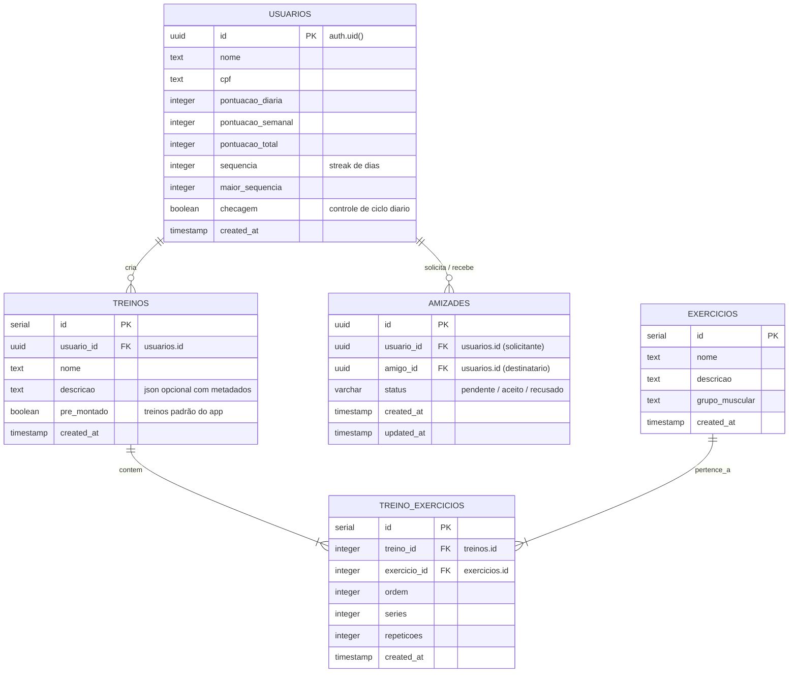

# 🏛️ Guia de Contexto de Banco de Dados & APIs: Personal Trainer IA

> **Última Atualização:** 2026-10-24  
> **Camada:** Back-end (FastAPI) & SGBD (Supabase / PostgreSQL)  
> **Status:** Ativo / Consolidado  

---

## 1. 📖 Visão Geral da Arquitetura

O ecossistema do **Personal Trainer IA** adota uma arquitetura em camadas cliente-servidor:
1. **Front-end (Flutter/Dart):** Aplicativo móvel para o usuário final.
2. **Back-end (FastAPI/Python):** Servidor intermediário REST assíncrono que centraliza as regras de negócio, validação com Pydantic e segurança.
3. **Database & Auth (Supabase/PostgreSQL):** Gerencia autenticação de usuários (JWT), persistência em tabelas relacionais, regras de segurança em nível de linha (RLS) e procedimentos armazenados (RPC).

```mermaid
flowchart LR
    Flutter["App Flutter (Mobile/Web)"] -->|HTTP / JSON (REST)| FastAPI["API REST (BD/api.py)"]
    FastAPI -->|Lógica de Negócio| Core["Core Backend (BD/main.py)"]
    Core -->|supabase-py (Service Role ou Anon)| Supabase["Supabase (PostgreSQL 15+)"]
    
    subgraph SupabaseDB["Banco de Dados & Autenticação"]
        Auth["Supabase Auth (auth.users)"]
        Tables["Tabelas Relacionais (public.*)"]
        RPC["Funções RPC SECURITY DEFINER\n(obter_leaderboard_global, etc.)"]
    end

    Supabase --> Auth
    Supabase --> Tables
    Supabase --> RPC
```

---

## 2. 🗄️ Esquema Relacional (Diagrama ERD)



---

## 3. 📋 Dicionário de Dados Detalhado

### A. Tabela `public.usuarios`
Armazena dados cadastrais e as métricas de gamificação e uso contínuo do app.
* `id` (`UUID`, PK): Vinculado diretamente ao ID da conta no `auth.users`.
* `nome` (`TEXT`): Nome completo do atleta.
* `cpf` (`TEXT`): Documento cadastral (opcional).
* `pontuacao_diaria` (`INTEGER`): Pontos acumulados no dia de hoje.
* `pontuacao_semanal` (`INTEGER`): Pontos acumulados no ciclo semanal atual (usado para o Leaderboard).
* `pontuacao_total` (`INTEGER`): Pontuação histórica acumulada.
* `sequencia` (`INTEGER`): Quantidade de dias consecutivos treinando (**Streak**).
* `maior_sequencia` (`INTEGER`): Recorde pessoal de dias seguidos de treino.
* `checagem` (`BOOLEAN`): Indicador de treino concluído no dia atual.
* `created_at` (`TIMESTAMPTZ`): Data de registro do usuário.

### B. Tabela `public.treinos`
Define os treinos, podendo ser padrão do sistema (*pre_montado = true*) ou criados pelo usuário.
* `id` (`SERIAL`, PK): Identificador numérico do treino.
* `usuario_id` (`UUID`, FK): Criador do treino (nulo para treinos nativos do app).
* `nome` (`TEXT`): Título do treino (ex: "Peito e Tríceps Monstro").
* `descricao` (`TEXT`): Metadados estruturados (dificuldade, duração, pontos).
* `pre_montado` (`BOOLEAN`): `true` para catálogo geral; `false` para treinos customizados.
* `created_at` (`TIMESTAMPTZ`): Data de criação.

### C. Tabela `public.exercicios`
Catálogo mestre dos movimentos e atividades de musculação/fitness.
* `id` (`SERIAL`, PK): Identificador do exercício.
* `nome` (`TEXT`): Nome da atividade (ex: "Supino Reto").
* `descricao` (`TEXT`): Orientações de execução.
* `grupo_muscular` (`TEXT`): Categoria (ex: "Peito", "Costas", "Pernas", "Cardio").

### D. Tabela `public.treino_exercicios`
Tabela associativa que relaciona quais exercícios compõem cada rotina de treino.
* `id` (`SERIAL`, PK): Identificador da linha.
* `treino_id` (`INTEGER`, FK): Referência ao treino.
* `exercicio_id` (`INTEGER`, FK): Referência ao exercício.
* `ordem` (`INTEGER`): Sequência de execução na rotina.
* `series` (`INTEGER`): Número de séries recomendadas.
* `repeticoes` (`INTEGER`): Número de repetições por série.

### E. Tabela `public.amizades`
Controla os relacionamentos e conexões sociais entre os atletas da comunidade.
* `id` (`UUID`, PK): Identificador único da relação.
* `usuario_id` (`UUID`, FK): Atleta que enviou o convite.
* `amigo_id` (`UUID`, FK): Atleta que recebeu o convite.
* `status` (`VARCHAR(20)`): Status atual (`pendente`, `aceito`, `recusado`, `bloqueado`).
* `created_at` (`TIMESTAMPTZ`): Data de envio da solicitação.
* `updated_at` (`TIMESTAMPTZ`): Data da última atualização de status.
* **Restrição de Unicidade:** Índice único bidirecional `LEAST(usuario_id, amigo_id), GREATEST(usuario_id, amigo_id)` impedindo duplicidades A->B e B->A.

---

## 4. ⚡ Funções de Banco e Stored Procedures (RPC com `SECURITY DEFINER`)

As rotas e cálculos complexos de classificação e amizades utilizam funções PostgreSQL criadas em [`BD/script_amizades_leaderboard.sql`](BD/script_amizades_leaderboard.sql). Todas possuem `SECURITY DEFINER` para executar com privilégios de administrador e permitir a leitura correta de nomes e pontuações mesmo sob políticas restritivas de RLS:

### 1. `obter_leaderboard_global(p_limite INTEGER DEFAULT 100)`
* **Objetivo:** Retorna o ranking geral da comunidade ordenado por pontuação semanal e streak.
* **Retorno:** `posicao`, `id`, `nome`, `pontuacao_semanal`, `sequencia`, `maior_sequencia`.

### 2. `obter_leaderboard_amigos(p_usuario_id UUID)`
* **Objetivo:** Retorna o ranking exclusivo entre o usuário e seu círculo de amigos confirmados (`status = 'aceito'`).
* **Retorno:** `posicao`, `id`, `nome`, `pontuacao_semanal`, `sequencia`, `maior_sequencia`.

### 3. `obter_minha_posicao_global(p_usuario_id UUID)`
* **Objetivo:** Retorna a colocação ordinal exata do usuário logado no ranking global.
* **Retorno:** `BIGINT` representando o número da colocação (ex: `4`).

### 4. `buscar_usuarios(p_termo TEXT, p_limite INTEGER DEFAULT 20)`
* **Objetivo:** Busca atletas cadastrados por aproximação de nome (`LIKE %termo%`) contornando o RLS da tabela de usuários.
* **Retorno:** `id`, `nome`, `pontuacao_semanal`, `sequencia`, `maior_sequencia`.

### 5. `enviar_solicitacao_amizade(p_usuario_id UUID, p_amigo_id UUID)`
* **Objetivo:** Insere ou reativa uma solicitação de amizade com status `pendente`.
* **Retorno:** `JSONB` com o registro criado.

### 6. `responder_solicitacao(p_solicitacao_id UUID, p_novo_status TEXT)`
* **Objetivo:** Aceita (`aceito`) ou recusa (`recusado`) um pedido pendente.
* **Retorno:** `JSONB` atualizado.

### 7. `listar_amigos(p_usuario_id UUID)`
* **Objetivo:** Retorna amigos confirmados com nome real, streak e pontuação semanal.
* **Retorno:** `amizade_id`, `id`, `nome`, `sequencia`, `pontos`.

### 8. `listar_solicitacoes_pendentes(p_usuario_id UUID)`
* **Objetivo:** Retorna convites recebidos com o nome real do solicitante, streak e pontos.
* **Retorno:** `id`, `solicitante_id`, `nome`, `sequencia`, `pontos`, `created_at`.

### 9. `remover_amigo(p_usuario_id UUID, p_amigo_id UUID)`
* **Objetivo:** Remove o vínculo de amizade entre dois usuários em qualquer sentido.
* **Retorno:** `BOOLEAN`.

---

## 5. 🛡️ Segurança e Políticas RLS (Row-Level Security)

* **Estratégia de Resolução de Nomes no Backend (`BD/main.py`):**
  * Para contornar a regra restritiva de que um usuário comum só pode fazer `select` em sua própria linha na tabela `usuarios`, o backend implementa o helper analítico `_obter_mapa_usuarios()`.
  * Esse helper obtém o mapa `{id: {nome, sequencia, pontos}}` através da RPC `obter_leaderboard_global` (que roda como `SECURITY DEFINER`), garantindo que tanto a lista de convites quanto a lista de amigos resolvam o nome real de qualquer atleta cadastrado, evitando exibições anônimas como "Usuário" ou "Amigo".
* **Service Role:** Caso o arquivo `BD/.env` contenha a chave `SUPABASE_SERVICE_ROLE_KEY`, o cliente Supabase do backend opera com privilégios totais de administrador em todas as rotas.

---

## 6. 🌐 Catálogo de Endpoints da API REST (FastAPI)

Todos os endpoints respondem em JSON seguindo o formato padronizado:
```json
{
  "sucesso": true,
  "mensagem": "Descrição da operação",
  "dados": { ... }
}
```

### Autenticação & Sessão
* `POST /auth/criar-conta`: Registra usuário no Supabase Auth e insere na tabela `usuarios`.
* `POST /auth/login`: Autentica usuário e retorna JWT de sessão.
* `POST /auth/logout`: Encerra a sessão ativa.
* `GET  /auth/usuario-atual`: Retorna o perfil autenticado na sessão.
* `POST /auth/esqueceu-senha`: Dispara email de recuperação de senha com código OTP.
* `POST /auth/redefinir-senha`: Valida código e grava nova senha.

### Perfil & Gamificação
* `GET /perfil/{usuario_id}`: Retorna os dados do perfil, pontuações e streak.
* `PUT /perfil/{usuario_id}`: Edita dados de perfil (nome, cpf, sequência, checagem).
* `GET /pontuacao/{usuario_id}`: Retorna pontuação diária, semanal e sequências.
* `POST /pontuacao/diaria`: Adiciona pontos do dia, ativa `checagem = true` e atualiza a sequência.
* `POST /pontuacao/sequencia`: Atualiza diretamente a sequência em dias.
* `POST /pontuacao/{usuario_id}/resetar-checagem`: Reseta a checagem diária.

### Treinos & Exercícios
* `GET /exercicios?grupo_muscular=...`: Lista exercícios do catálogo com filtro opcional.
* `GET /treinos/pre-montados`: Lista os treinos públicos do aplicativo com exercícios aninhados.
* `GET /treinos/usuario/{usuario_id}`: Lista treinos personalizados criados pelo usuário.
* `POST /treinos`: Cria treino com lista de exercícios vinculados.
* `PUT /treinos/{treino_id}`: Altera nome, descrição ou lista de exercícios do treino.
* `DELETE /treinos/{treino_id}`: Exclui treino e desvincula seus exercícios.

### Amizades & Conexões
* `GET /amigos/buscar?nome=...&usuario_id=...`: Pesquisa usuários cadastrados por aproximação de nome.
* `POST /amigos/solicitar`: Envia solicitação de amizade (`usuario_id`, `amigo_id`).
* `GET /amigos/solicitacoes/pendentes?usuario_id=...`: Lista convites recebidos com o nome real do solicitante.
* `PATCH /amigos/solicitacoes/{id}`: Aceita (`status: "aceito"`) ou recusa (`status: "recusado"`).
* `GET /amigos/?usuario_id=...`: Lista amigos confirmados do usuário.
* `DELETE /amigos/{amigo_id}?usuario_id=...`: Remove o vínculo de amizade.

### Leaderboard & Classificação
* `GET /leaderboard/global?limite=...`: Retorna o ranking global dos usuários.
* `GET /leaderboard/amigos?usuario_id=...`: Retorna o ranking restrito ao usuário e seus amigos.
* `GET /leaderboard/minha-posicao?usuario_id=...`: Retorna a posição ordinal exata do usuário no ranking geral.

---

## 7. 🚀 Como Executar o Back-end Localmente

```bash
# 1. Acessar a pasta BD
cd BD

# 2. Instalar dependências
pip install -r requirements.txt

# 3. Iniciar o servidor com recarga automática
uvicorn api:app --reload --host 0.0.0.0 --port 8000
```

### URLs de Acesso no Desenvolvimento
* **Documentação Interativa (Swagger):** `http://127.0.0.1:8000/docs`
* **Documentação Alternativa (Redoc):** `http://127.0.0.1:8000/redoc`
* **Acesso via Flutter Web / Windows:** `http://127.0.0.1:8000`
* **Acesso via Emulador Android:** `http://10.0.2.2:8000`
