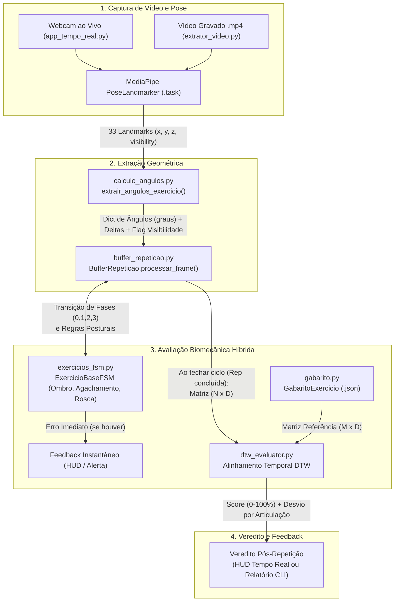

# Contextualização Técnica e Arquitetural — Branch `IA` (Estimação de Pose e Avaliação de Exercícios)

> **Propósito deste documento:** Permitir que qualquer agente de IA ou desenvolvedor recupere imediatamente 100% do contexto técnico, arquitetural e histórico da frente de **Inteligência Artificial e Visão Computacional** do projeto **Personal Trainer IA**.
>
> **Última atualização:** 2026-10-27 (branch `IA` em `af9b3b6`; Sprint `US-01` concluída e homologada com 39 testes; pronta para demo `US-02`)

---

## 1. Visão Geral do Projeto e Escopo da Branch `IA`

O projeto **Personal Trainer IA** tem como objetivo auxiliar usuários na execução correta de exercícios físicos por meio de visão computacional, fornecendo contagem automática de repetições, detecção de erros posturais em tempo real e avaliação quantitativa da qualidade biomecânica do movimento.

Enquanto outras branches do repositório tratam de interface mobile/multiplataforma (Flutter), banco de dados e autenticação, a **branch `IA`** concentra todo o motor de **Estimação de Pose Humana (Human Pose Estimation)** e **Classificação/Avaliação Biomecânica de Exercícios** desenvolvido em **Python**.

### Abordagem Técnica Atual (Arquitetura Híbrida: FSM + DTW)

O sistema utiliza uma arquitetura híbrida em dois níveis complementares sobre os *landmarks* extraídos pelo **MediaPipe Pose Landmarker**:

1. **Avaliação Instantânea e Segmentação via Máquina de Estados Finitos (FSM):**
   - Opera **frame a frame** ($O(1)$ por fotograma).
   - Identifica em qual fase biomecânica o aluno está (`0: Repouso`, `1: Concêntrica/Excêntrica Inicial`, `2: Pico/Fundo`, `3: Retorno`).
   - Conta repetições completas ao detectar o ciclo `0 -> 1 -> 2 -> 3 -> 0`.
   - Emite **alertas posturais imediatos** baseados em regras geométricas e transições anômalas (ex.: `REPETICAO_INCOMPLETA` quando o usuário interrompe a fase `1` e vai direto para a `3` sem atingir o pico `2`; `DESCIDA_EXCESSIVA`, `OMBRO_CAIDO`, `TRONCO_MUITO_INCLINADO`, `OMBRO_INSTAVEL`).

2. **Avaliação Global de Trajetória via Dynamic Time Warping (DTW):**
   - Opera **ao término de cada repetição completa**, recortada pelo `BufferRepeticao`.
   - Compara a matriz temporal multivariada do aluno ($N \times D$, onde $N$ é o número de frames da repetição e $D$ é o número de articulações monitoradas) contra o **Gabarito do Especialista** ($M \times D$).
   - Como o DTW realiza alinhamento elástico não-linear no tempo, ele avalia a qualidade da trajetória angular **independentemente da velocidade/cadência** do aluno.
   - Produz um **Score de Similaridade Técnica** ($0\%$ a $100\%$) via decaimento exponencial:
     $$\text{Score} = 100 \cdot \exp\left(-\frac{d_{\text{norm}}}{\tau}\right)$$
     onde $d_{\text{norm}}$ é a distância euclidiana acumulada dividida pelo comprimento do *warping path* e $\tau$ é a tolerância em graus (padrão: $15.0^\circ$).
   - Calcula o **desvio médio absoluto em graus por articulação** ao longo do caminho ótimo alinhado, apontando qual articulação mais divergiu do padrão ouro.

---

## 2. Fluxo Arquitetural do Pipeline



---

## 3. Mapeamento Completo e Taxonomia dos Arquivos do Repositório

> [!IMPORTANT]
> **Portabilidade Multiplataforma & Caminhos Relativos:**
> O desenvolvimento deste projeto é compartilhado entre diferentes máquinas e sistemas operacionais (Windows, Linux, macOS). **Todos os arquivos, imports e referências devem ser manipulados estritamente através de caminhos relativos à raiz do repositório** (ex.: `./calculo_angulos.py`, `tests/test_pipeline_pontuacao.py`). Nunca utilize caminhos absolutos locais de sistema de arquivos.

### 3.1. Núcleo em Desenvolvimento Ativo (Sprint `US-01` Concluída)

Estes arquivos compõem a frente de trabalho imediata da branch, homologada por testes automatizados e evolução direta de contratos:

| Arquivo Relativo | Responsabilidade Principal | Classes / Funções-Chave | Status Atual |
| :--- | :--- | :--- | :--- |
| [`./calculo_angulos.py`](./calculo_angulos.py) | Cálculo vetorial 2D de ângulos articulares em $[0^\circ, 180^\circ]$, checagem de visibilidade de marcos e **cálculo de deltas angulares com âncora de ruído** (`calcular_deltas_angulares`), eliminando a perda de detecção em cadências lentas. | `MAPA_ARTICULACOES`, `calcular_angulo()`, `extrair_angulos_exercicio()`, `calcular_deltas_angulares()` | **Concluído na `TASK-02`** |
| [`./exercicios_fsm.py`](./exercicios_fsm.py) | Máquinas de Estados Finitos com **acumulador de erros por repetição** (`consumir_erros_repeticao`), penalidades por exercício (`PENALIDADES_ERRO`), checagens sem mascaramento e catálogo extensível (`obter_config_exercicio`). | `ExercicioBaseFSM`, `DesenvolvimentoOmbro`, `Agachamento`, `RoscaBiceps`, `CATALOGO_EXERCICIOS`, `obter_config_exercicio()` | **Concluído na `TASK-03`** |
| [`./dtw_evaluator.py`](./dtw_evaluator.py) | Motor único de alinhamento temporal multivariado vetorizado via NumPy 3D *broadcasting*, restrição dinâmica de Sakoe-Chiba, tolerância $\tau$ e contrato `@dataclass DTWResult` com suporte a tupla e degradação graciosa. | `DTWComparator`, `DTWResult`, `DTW` | **Concluído na `TASK-04`** |
| [`./buffer_repeticao.py`](./buffer_repeticao.py) | Acumulador de fotogramas e segmentador canônico de repetições com cálculo automático de deltas com âncora de ruído e interface polimórfica. | `BufferRepeticao`, `extrair_primeira_repeticao()` | **Concluído na `TASK-05`** |
| [`./gabarito.py`](./gabarito.py) | Persistência, carregamento JSON e geração de curvas de referência padrão ouro com recorte idêntico ao do aluno via FSM canônica. | `GabaritoExercicio`, `garantir_gabaritos_padrao()` | **Concluído na `TASK-05`** |
| [`./avaliador_pontuacao.py`](./avaliador_pontuacao.py) | Motor central de pontuação (`ResultadoPontuacaoRepeticao`), laudos pedagógicos hierárquicos, gamificação e `OrquestradorSessao` com interface **frame a frame**. | `calcular_pontuacao()`, `OrquestradorSessao`, `ResultadoPontuacaoRepeticao`, `ResumoPontuacaoSessao` | **Concluído na `TASK-06`** |
| [`tests/test_pipeline_pontuacao.py`](tests/test_pipeline_pontuacao.py) | Suíte de testes automatizados com `pytest` cobrindo geometria, deltas acumulados, transições de fase, retenção de erros, DTW vetorizado, segmentação canônica, orquestração, contrato do extrator, integrações sintéticas e suíte end-to-end de aceite AC1 a AC7. | Testes sem dependência de câmera | **Concluído na `TASK-10` (39 testes aprovados)** |
| [`./pytest.ini`](./pytest.ini) | Configuração de execução do `pytest` com inclusão automática do diretório raiz no `pythonpath`. | Configuração de testes | **Ativo** |
| [`./requirements.txt`](./requirements.txt) | Especificação das dependências oficiais da branch `IA` (`numpy`, `opencv-python`, `mediapipe`, `pytest`). | Gerenciamento de ambiente | **Ativo** |

---

### 3.2. Módulos Funcionais Integrados

| Arquivo Relativo | Responsabilidade no Pipeline | Status da Sprint US-01 | Observações Técnicas |
| :--- | :--- | :--- | :--- |
| [`./comparar_exercicio.py`](./comparar_exercicio.py) | CLI multi-exercício para avaliar vídeos gravados (`.mp4`) contra especialista. | **Concluído (`TASK-07`)** | Integrado ao `OrquestradorSessao`; suporta `--exercicio`, lado, relatório por repetição e resumo da sessão. |
| [`./extrator_video.py`](./extrator_video.py) | Extrai séries temporais de vídeos `.mp4` em modo `IMAGE`, retornando `frame`, `angulos` e `visivel`. | **Concluído (`TASK-07`)** | Não calcula deltas; estes são centralizados no orquestrador durante a avaliação. A extração de gabarito usa o segmentador canônico. |
| [`./exemplo_integracao.py`](./exemplo_integracao.py) | Demonstração sintética sem webcam dos fluxos ideal, lento e incompleto usando o orquestrador oficial. | **Concluído (`TASK-08`)** | Envia ângulos por frame ao `OrquestradorSessao` e apresenta laudo e resumo de cada cenário. |
| [`./app_tempo_real.py`](./app_tempo_real.py) | Aplicação em tempo real com webcam, desenho de esqueleto e HUD OpenCV. | **Concluído no Código (`TASK-09`)** | Envia ângulos e visibilidade ao `OrquestradorSessao`; mostra nota, feedback e média. Coberto por testes automatizados de adaptador. |

---

### 3.3. Arquivos de Dados, Modelos e Gabaritos JSON Oficiais

| Arquivo Relativo | Descrição | Status no Repositório |
| :--- | :--- | :--- |
| [`./gabarito_especialista_ombro.json`](./gabarito_especialista_ombro.json) | Curva padrão ouro para Desenvolvimento de Ombro (features: `["cotovelo", "ombro"]`). | **Ativo (Versionado)** |
| [`./gabarito_especialista_agachamento.json`](./gabarito_especialista_agachamento.json) | Curva padrão ouro para Agachamento Livre (features: `["joelho", "quadril"]`). | **Ativo (Versionado)** |
| [`./gabarito_especialista_rosca.json`](./gabarito_especialista_rosca.json) | Curva padrão ouro para Rosca Direta de Bíceps (features: `["cotovelo", "ombro"]`). | **Ativo (Versionado)** |
| [`./pose_landmarker_lite.task`](./pose_landmarker_lite.task) | Modelo oficial MediaPipe Pose Landmarker Lite (~5.8 MB), padrão para tempo real e CLI. | **Ativo (Versionado)** |
| [`./pose_landmarker_full.task`](./pose_landmarker_full.task) | Modelo MediaPipe Pose Landmarker Full (~9.4 MB), alta precisão. | **Versionado** |

---

### 3.4. Arquivos Legados Preservados (NÃO DELETAR até Validação Completa da Demo)

> [!CAUTION]
> **Política Inegociável de Legados:**
> Em conformidade com a diretriz de engenharia de software do projeto, **nenhum arquivo legado ou protótipo deve ser removido ou descartado prematuramente**. Eles devem permanecer preservados como referência e salvaguarda até que todos os novos módulos substitutos estejam completamente implementados, integrados e validados por suítes de testes automatizados.

| Arquivo Relativo | Papel Histórico / Diagnóstico Técnico | Política de Tratamento |
| :--- | :--- | :--- |
| [`./exercícios_fsm.py`](./exercícios_fsm.py) (com acento) | Cópia idêntica de `exercicios_fsm.py` criada antes da correção do nome em ASCII puro. | **Legado Preservado:** Manter intacto no repositório. |
| [`./dev_ombro-inicial.py`](./dev_ombro-inicial.py) | Primeira versão isolada da FSM de Desenvolvimento de Ombro. | **Legado Preservado:** Manter intacto enquanto houver referências históricas. |
| [`./dtw_inicial.py`](./dtw_inicial.py) | Primeira versão do DTW por loops manuais em Python puro. | **Legado Preservado:** Desacoplado do app; mantido como salvaguarda histórica. |
| [`./Modularização.py`](./Modularização.py) | Protótipo antigo de extração pontual `min/max` com classificador tabular scikit-learn. | **Legado Preservado:** Mantido apenas como referência histórica. |
| [`./dataset_pronto_para_ia.csv`](./dataset_pronto_para_ia.csv) e [`./relatorio_avaliacoes_ia.csv`](./relatorio_avaliacoes_ia.csv) | Datasets tabulares gerados durante os experimentos com `Modularização.py`. | **Legado Preservado.** |

---

### 3.5. Governança, Diretrizes e Documentação Viva

| Arquivo Relativo | Função e Responsabilidade |
| :--- | :--- |
| [`./AGENTS.md`](./AGENTS.md) | Ponto de entrada obrigatório para agentes autônomos de IA, contendo as regras inegociáveis do repositório. |
| [`./CONTEXTO_IA.md`](./CONTEXTO_IA.md) | *(Este documento)* Fotografia arquitetural completa, contratos de classes e taxonomia de arquivos. |
| [`./DIRETRIZES_DESENVOLVIMENTO.md`](./DIRETRIZES_DESENVOLVIMENTO.md) | Protocolo de Engenharia de Software (SOLID, testes automatizados, commits incrementais, portabilidade). |
| [`./PLANO_SPRINT_US01.md`](./PLANO_SPRINT_US01.md) | Plano técnico da sprint concluída (`US-01`) com detalhamento de tasks, critérios de aceite e status por commit. |
| [`./DEVLOG.md`](./DEVLOG.md) | Diário de bordo cronológico das alterações, decisões técnicas tomadas e histórico de commits. |
| [`./EXPLICACAO_IA.md`](./EXPLICACAO_IA.md) | Guia didático acessível para humanos, membros da equipe, avaliadores e professores. |
| [`./README.md`](./README.md) | Página inicial do repositório da branch `IA` com instruções de instalação, testes e mapa de documentação. |

---

### 3.6. Arquivos e Diretórios Fora do Escopo da IA

| Diretório / Arquivo | Contexto |
| :--- | :--- |
| `android/`, `windows/`, `pubspec.yaml`, `pubspec.lock` | Resquícios do template Flutter original na raiz (a ser integrado posteriormente). |
| `EngSoftTrabalho_Personal_TrainerIA/` | Cópia aninhada não rastreada do app Flutter (ignorada via `.gitignore`). |
| `*.mp4`, `*.avi`, `gabarito_especialista_gerado.json` | Vídeos locais pesados e artefatos temporários de teste (ignorados via `.gitignore`). |

---

## 4. Especificações Técnicas do Domínio Biomecânico Atual

### 4.1. Mapeamento Anatômico (`calculo_angulos.py`)
Os ângulos são calculados em 2D usando `np.arctan2` sobre os pontos `(A, B, C)` do MediaPipe Pose, onde `B` é o vértice da articulação:

| Articulação | Lado Direito `(A, B, C)` | Lado Esquerdo `(A, B, C)` | Referência Anatômica |
| :--- | :---: | :---: | :--- |
| **`cotovelo`** | `(12, 14, 16)` | `(11, 13, 15)` | Ombro $\rightarrow$ Cotovelo $\rightarrow$ Punho |
| **`ombro`** | `(24, 12, 14)` | `(23, 11, 13)` | Quadril $\rightarrow$ Ombro $\rightarrow$ Cotovelo |
| **`joelho`** | `(24, 26, 28)` | `(23, 25, 27)` | Quadril $\rightarrow$ Joelho $\rightarrow$ Tornozelo |
| **`quadril`** | `(12, 24, 26)` | `(11, 23, 25)` | Ombro $\rightarrow$ Quadril $\rightarrow$ Joelho |

### 4.2. Catálogo de Exercícios e Regras das FSMs (`exercicios_fsm.py`)

Todas as classes herdam de `ExercicioBaseFSM` e seguem o ciclo de 4 estados (`0 -> 1 -> 2 -> 3 -> 0`), incrementando `self.repeticoes` na transição `3 -> 0`:

1. **Desenvolvimento de Ombro (`tecla "1"`, `DesenvolvimentoOmbro`)**
   - **Articulações:** `["cotovelo", "ombro"]`
   - **Transições (guiadas por `cotovelo` e `delta_cotovelo`):**
     - `0 -> 1` (Início da subida): `cotovelo > 100°` e `delta_cotovelo > 0`
     - `1 -> 2` (Topo alcançado): `cotovelo >= 150°`
     - `1 -> 3` (Transição anômala): `delta_cotovelo < 0` e `cotovelo < 130°`
     - `2 -> 3` (Início da descida): `cotovelo < 140°` ou `delta_cotovelo < 0`
     - `3 -> 0` (Fim da repetição): `cotovelo <= 100°` (`repeticoes += 1`)
   - **Erros detectados:**
     - `REPETICAO_INCOMPLETA`: transição direta `1 -> 3`.
     - `DESCIDA_EXCESSIVA`: na fase `3`, `cotovelo < 70°`.
     - `OMBRO_CAIDO`: nas fases `1, 2, 3`, `ombro < 60°`.

2. **Agachamento Livre (`tecla "2"`, `Agachamento`)**
   - **Articulações:** `["joelho", "quadril"]`
   - **Transições (guiadas por `joelho` e `delta_joelho`):**
     - `0 -> 1` (Início da descida): `joelho < 155°` e `delta_joelho < 0`
     - `1 -> 2` (Fundo do agachamento): `joelho <= 105°`
     - `1 -> 3` (Subida precoce): `delta_joelho > 0` e `joelho > 120°`
     - `2 -> 3` (Início da subida): `joelho > 112°` ou `delta_joelho > 0`
     - `3 -> 0` (Retorno em pé): `joelho >= 160°` (`repeticoes += 1`)
   - **Erros detectados:**
     - `AGACHAMENTO_CURTO`: transição direta `1 -> 3`.
     - `TRONCO_MUITO_INCLINADO`: nas fases `1, 2, 3`, `quadril < 55°`.

3. **Rosca Direta de Bíceps (`tecla "3"`, `RoscaBiceps`)**
   - **Articulações:** `["cotovelo", "ombro"]`
   - **Transições (guiadas por `cotovelo` e `delta_cotovelo`):**
     - `0 -> 1` (Início da flexão): `cotovelo < 145°` e `delta_cotovelo < 0`
     - `1 -> 2` (Contração máxima): `cotovelo <= 65°`
     - `1 -> 3` (Retorno precoce): `delta_cotovelo > 0` e `cotovelo > 95°`
     - `2 -> 3` (Início da extensão): `cotovelo > 75°` ou `delta_cotovelo > 0`
     - `3 -> 0` (Braço estendido): `cotovelo >= 150°` (`repeticoes += 1`)
   - **Erros detectados:**
     - `SUBIDA_INCOMPLETA`: transição direta `1 -> 3`.
     - `OMBRO_INSTAVEL`: nas fases `1, 2, 3`, `ombro > 40°`.

---

## 5. Diagnóstico de Débitos Técnicos e Estado de Fechamento

1. **Integração do comparador de vídeo:**
   - A `TASK-07` corrigiu a assinatura de `ExtratorVideo`, conectou a CLI ao `OrquestradorSessao` e adicionou seleção por `--exercicio`.
2. **Unificação do Motor DTW:**
   - Padronizado o `DTWComparator` vetorizado com Sakoe-Chiba em `dtw_evaluator.py`. O legado `dtw_inicial.py` foi desacoplado de todos os consumidores e preservado como salvaguarda histórica.
3. **Suíte Automatizada de Testes (`pytest`):**
   - Suíte `tests/test_pipeline_pontuacao.py` ativa com **39 testes automatizados** aprovados com 100% de sucesso, cobrindo geometria, deltas acumulados, FSM, segmentação canônica, DTW vetorizado, orquestrador desacoplado, contrato do extrator e critérios de aceite AC1 a AC7 (incluindo extensibilidade OCP).
4. **Prontidão para Integração Front + IA (Demo):**
   - O pipeline está 100% desacoplado de hardware e pronto para ser exposto por rotas REST no FastAPI e consumido pelo app Flutter.

---

## 6. Como Executar os Fluxos Existentes

- **Executar a Suíte de Testes Automatizados:**
  ```bash
  pytest
  ```

- **Avaliação em Tempo Real (Webcam):**
  ```bash
  python app_tempo_real.py
  ```
  *Atalhos na janela OpenCV:* `[1]` Desenvolvimento de Ombro, `[2]` Agachamento, `[3]` Rosca Bíceps, `[L]` Alternar lado (Direito/Esquerdo), `[R]` Resetar sessão, `[Q]` Sair.

- **Gerar/Verificar Gabaritos Padrão JSON:**
  ```bash
  python gabarito.py
  ```

- **Extrair Gabarito JSON a partir de Vídeo de Especialista:**
  ```bash
  python extrator_video.py especialista.mp4 --exercicio 1 --lado direito
  ```

- **Executar Simulação de Cenários pelo Orquestrador (sem câmera):**
  ```bash
  python exemplo_integracao.py
  ```

---

## 7. Documentos Complementares Obrigatórios

- **[`DIRETRIZES_DESENVOLVIMENTO.md`](./DIRETRIZES_DESENVOLVIMENTO.md):** Protocolo obrigatório de engenharia de software.
- **[`DEVLOG.md`](./DEVLOG.md):** Diário de bordo cronológico com histórico de commits e homologação da sprint US-01.
- **[`AGENTS.md`](./AGENTS.md):** Instruções rápidas de inicialização para agentes de IA.
