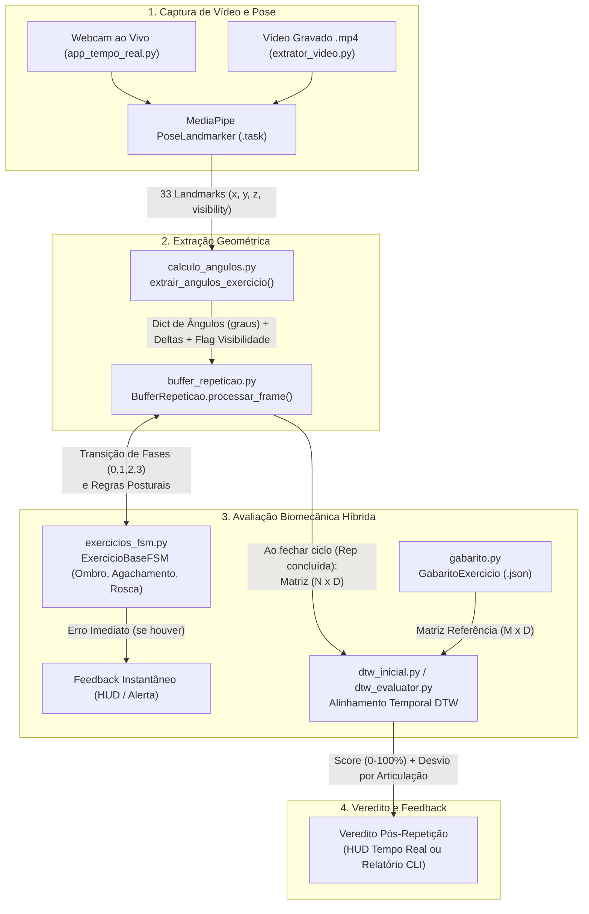

# Contextualização Técnica e Arquitetural — Branch `IA` (Estimação de Pose e Avaliação de Exercícios)

> **Propósito deste documento:** Permitir que qualquer agente de IA ou desenvolvedor recupere imediatamente 100% do contexto técnico, arquitetural e histórico da frente de **Inteligência Artificial e Visão Computacional** do projeto **Personal Trainer IA**.
>
> **Última atualização:** 2026-10-21 (Commit base: `f085106` na branch `IA`)

---

## 1. Visão Geral do Projeto e Escopo da Branch `IA`

O projeto **Personal Trainer IA** tem como objetivo auxiliar usuários na execução correta de exercícios físicos por meio de visão computacional, fornecendo contagem automática de repetições, detecção de erros posturais em tempo real e avaliação quantitativa da qualidade biomecânica do movimento.

Enquanto outras branches do repositório tratam de interface mobile/multiplataforma (Flutter), banco de dados e autenticação, a **branch `IA`** concentra todo o motor de **Estimação de Pose Humana (Human Pose Estimation)** e **Classificação/Avaliação Biomecânica de Exercícios** desenvolvido em **Python**.

### Abordagem Técnica Atual (Arquitetura Híbrida: FSM + DTW)

O sistema utiliza uma arquitetura híbrida em dois níveis complementares sobre os *landmarks* extraídos pelo **MediaPipe Pose Landmarker**:

1. **Avaliação Instantânea e Segmentação via Máquina de Estados Finitos (FSM):**
   - Opera **frame a frame** ($O(1)$ por fotograma).
   - Identifica em qual fase biomecânica o aluno está (`0: Repouso`, `1: Concêntrica/Excêntrica Inicial`, `2: Pico/Fundo`, `3: Retorno`).
   - Conta repetições completas ao detectar o ciclo `0 -> 1 -> 2 -> 3 -> 0`.
   - Emite **alertas posturais imediatos** baseados em regras geométricas e transições anômalas (ex.: `REPETICAO_INCOMPLETA` quando o usuário interrompe a fase `1` e vai direto para a `3` sem atingir o pico `2`; `DESCIDA_EXCESSIVA`, `OMBRO_CAIDO`, `TRONCO_MUITO_INCLINADO`, `OMBRO_INSTAVEL`).

2. **Avaliação Global de Trajetória via Dynamic Time Warping (DTW):**
   - Opera **ao término de cada repetição completa**, recortada pelo `BufferRepeticao`.
   - Compara a matriz temporal multivariada do aluno ($N \times D$, onde $N$ é o número de frames da repetição e $D$ é o número de articulações monitoradas) contra o **Gabarito do Especialista** ($M \times D$).
   - Como o DTW realiza alinhamento elástico não-linear no tempo, ele avalia a qualidade da trajetória angular **independentemente da velocidade/cadência** do aluno.
   - Produz um **Score de Similaridade Técnica** ($0\%$ a $100\%$) via decaimento exponencial:
     $$\text{Score} = 100 \cdot \exp\left(-\frac{d_{\text{norm}}}{\tau}\right)$$
     onde $d_{\text{norm}}$ é a distância euclidiana acumulada dividida pelo comprimento do *warping path* e $\tau$ é a tolerância em graus (padrão: $15.0^\circ$).
   - Calcula o **desvio médio absoluto em graus por articulação** ao longo do caminho ótimo alinhado, apontando qual articulação mais divergiu do padrão ouro.

---

## 2. Fluxo Arquitetural do Pipeline



---

## 3. Mapeamento Completo dos Arquivos do Repositório

### 3.1. Núcleo Ativo — Pipeline Multi-Exercício em Tempo Real e Extração

Estes arquivos formam a versão mais recente, coesa e funcional do sistema (consolidada no commit `c992f15`):

| Arquivo | Responsabilidade Principal | Classes / Funções-Chave | Status |
| :--- | :--- | :--- | :--- |
| `app_tempo_real.py` | Aplicação principal com webcam (OpenCV), MediaPipe em modo `VIDEO`, desenho de esqueleto, HUD interativo e avaliação híbrida (FSM + DTW) ao vivo. | `main()`, `inicializar_sessao_exercicio()`, `desenhar_esqueleto()`, `desenhar_painel_hud()` | **Ativo (Produção)** |
| `calculo_angulos.py` | Cálculo vetorial 2D (`arctan2`) de ângulos articulares em $[0^\circ, 180^\circ]$ para lados direito e esquerdo, validação de `visibility` mínima dos *landmarks*, e cálculo de deltas angulares com âncora de ruído (`calcular_deltas_angulares`). | `MAPA_ARTICULACOES`, `calcular_angulo()`, `extrair_angulos_exercicio()`, `calcular_deltas_angulares()` | **Ativo (Produção)** |
| `exercicios_fsm.py` | Contrato base e implementações das Máquinas de Estados Finitos para 3 exercícios com acúmulo de erros por repetição (`consumir_erros_repeticao`), penalidades (`PENALIDADES_ERRO`), checagens sem mascaramento e catálogo extensível. | `ExercicioBaseFSM`, `DesenvolvimentoOmbro`, `Agachamento`, `RoscaBiceps`, `CATALOGO_EXERCICIOS`, `obter_config_exercicio()` | **Ativo (Produção)** |
| `tests/test_pipeline_pontuacao.py` | Suíte de testes automatizados unitários e de integração (`pytest`) para geometria, deltas com acúmulo lento, FSMs e integridade do catálogo. | Testes unitários com `pytest` | **Ativo (Testes Automatizados)** |
| `buffer_repeticao.py` | Acumula os vetores de ângulos frame a frame enquanto o usuário está fora do repouso (`fase != 0`) e entrega a matriz numpy $(T \times D)$ quando uma repetição se completa. | `BufferRepeticao`, `processar_frame()` | **Ativo (Produção)** |
| `dtw_inicial.py` | Implementação direta do Dynamic Time Warping multidimensional por programação dinâmica, retornando distância total, normalizada, score percentual, *path* e desvios por articulação. | `DTW`, `DTW.calcular()` | **Ativo (Produção)** |
| `gabarito.py` | Persistência (leitura/escrita em JSON) das séries temporais de referência e geração de curvas senoidais padrão ouro caso os JSONs não existam. | `GabaritoExercicio`, `garantir_gabaritos_padrao()` | **Ativo (Produção)** |
| `extrator_video.py` | Processa vídeos `.mp4` em modo `IMAGE`, extrai séries temporais de ângulos/deltas e gera automaticamente arquivos JSON de gabarito a partir da 1ª repetição de um especialista. | `ExtratorVideo`, `gerar_gabarito_de_video_especialista()`, `garantir_modelo_pose()` | **Ativo (Produção)** |

### 3.2. Arquivos de Dados, Modelos e Gabaritos JSON

| Arquivo | Descrição | Status |
| :--- | :--- | :--- |
| `gabarito_especialista_ombro.json` | Curva padrão ouro para Desenvolvimento de Ombro (40 frames, features: `["cotovelo", "ombro"]`). | **Ativo (Versionado)** |
| `gabarito_especialista_agachamento.json` | Curva padrão ouro para Agachamento Livre (40 frames, features: `["joelho", "quadril"]`). | **Ativo (Versionado)** |
| `gabarito_especialista_rosca.json` | Curva padrão ouro para Rosca Direta de Bíceps (40 frames, features: `["cotovelo", "ombro"]`). | **Ativo (Versionado)** |
| `gabarito_especialista_gerado.json` | Gabarito extraído de vídeo real (`especialista.mp4`, 41 frames) para desenvolvimento de ombro. | **Untracked (Gerado em teste)** |
| `pose_landmarker_lite.task` | Modelo oficial MediaPipe Pose Landmarker Lite (~5.8 MB), usado por padrão em `extrator_video.py` e `app_tempo_real.py`. Baixado automaticamente se ausente. | **Ativo (Versionado)** |
| `pose_landmarker_full.task` | Modelo oficial MediaPipe Pose Landmarker Full (~9.4 MB), mais pesado e preciso, usado anteriormente em `Modularização.py`. | **Versionado** |

### 3.3. Módulos Complementares / Protótipos de Integração e Comparação Offline

| Arquivo | Descrição e Contexto | Status e Observações Técnicas |
| :--- | :--- | :--- |
| `dtw_evaluator.py` | Implementação avançada e orientada a objetos do DTW, com cálculo de matriz de custo vetorizado no NumPy, suporte a restrição temporal **Janela de Sakoe-Chiba** (`window_ratio`) e dataclasses estruturadas. | **Untracked (Protótipo OO avançado)**. Possui arquitetura superior ao `dtw_inicial.py`, sendo ótimo candidato para unificação futura. |
| `exemplo_integracao.py` | Script de demonstração arquitetural que conecta `dev_ombro-inicial.py` ao `dtw_evaluator.py` através de um `SessionOrchestrator`, simulando 3 cenários (execução ideal, lenta e incompleta). | **Untracked (Script de validação/demo)**. Roda de forma autônoma sem webcam. |
| `comparar_exercicio.py` | CLI para comparar vídeo de aluno (`.mp4`) contra vídeo/JSON de especialista e imprimir um laudo detalhado no terminal. | **Versionado, porém com quebra de contrato parcial** (ver seção 5 de Débitos Técnicos: chama `ExtratorVideo(lado=lado)` sem passar `articulacoes`). |
| `dev_ombro-inicial.py` | Primeira versão isolada da FSM de `DesenvolvimentoOmbro`. | **Legado funcional**. Foi evoluída e incorporada dentro de `exercicios_fsm.py` herdando de `ExercicioBaseFSM`, mas ainda é importada por `comparar_exercicio.py` e `exemplo_integracao.py`. |

### 3.4. Arquivos Legados, Duplicados ou Fora do Escopo de IA

| Arquivo / Diretório | Contexto Histórico e Diagnóstico | Recomendação |
| :--- | :--- | :--- |
| `exercícios_fsm.py` (com acento) | Cópia idêntica de `exercicios_fsm.py` criada no commit `65b5a83` antes da correção do nome sem acento em `c992f15`. | **Remover do git** para evitar duplicidade e problemas de encoding entre sistemas operacionais. |
| `Modularização.py` | Script da abordagem antiga (commit `435c481`) que extraía apenas `cotovelo_min`, `cotovelo_max` e `ombro_variacao` a cada 10 frames e usava um classificador tabular `meu_personal_trainer_ia.pkl` + `maquina_estados.py` (ambos já removidos no commit `65b5a83`). | **Legado depreciado / quebrado** (`import maquina_estados` falha pois o módulo foi deletado). Manter apenas como referência histórica ou remover em limpeza. |
| `dataset_pronto_para_ia.csv` e `relatorio_avaliacoes_ia.csv` | Datasets tabulares gerados durante a fase antiga de testes com `Modularização.py` sobre vídeos genéricos (`band_pull_apart.mp4`, `warmup_1.mp4`, etc.). | **Legado da abordagem anterior**. |
| `devombro.mp4`, `especialista.mp4`, `ex.mp4` | Vídeos locais de teste para extração e comparação de exercícios. | **Untracked**. Úteis para testes locais do pipeline de vídeo; não devem ser commitados se forem pesados, salvo definição de fixtures leves. |
| `EngSoftTrabalho_Personal_TrainerIA/` (subpasta) | Clone/cópia aninhada não rastreada do projeto Flutter dentro da própria raiz. | **Untracked (Artefato acidental)**. Deve ser removida ou ignorada. |
| `android/`, `windows/`, `pubspec.yaml`, `README.md` | Resquícios do template inicial Flutter na raiz do repositório (a maior parte do código Flutter de `lib/`, `ios/`, `web/`, `linux/`, `macos/` foi removida desta branch no commit `65b5a83` para focar em IA). | Fora do escopo da branch `IA` (integração com o app ocorrerá em etapa posterior). |

---

## 4. Especificações Técnicas do Domínio Biomecânico Atual

### 4.1. Mapeamento Anatômico (`calculo_angulos.py`)
Os ângulos são calculados em 2D usando `np.arctan2` sobre os pontos `(A, B, C)` do MediaPipe Pose, onde `B` é o vértice da articulação:

| Articulação | Lado Direito `(A, B, C)` | Lado Esquerdo `(A, B, C)` | Referência Anatômica |
| :--- | :---: | :---: | :--- |
| **`cotovelo`** | `(12, 14, 16)` | `(11, 13, 15)` | Ombro $\rightarrow$ Cotovelo $\rightarrow$ Punho |
| **`ombro`** | `(24, 12, 14)` | `(23, 11, 13)` | Quadril $\rightarrow$ Ombro $\rightarrow$ Cotovelo |
| **`joelho`** | `(24, 26, 28)` | `(23, 25, 27)` | Quadril $\rightarrow$ Joelho $\rightarrow$ Tornozelo |
| **`quadril`** | `(12, 24, 26)` | `(11, 23, 25)` | Ombro $\rightarrow$ Quadril $\rightarrow$ Joelho |

### 4.2. Catálogo de Exercícios e Regras das FSMs (`exercicios_fsm.py`)

Todas as classes herdam de `ExercicioBaseFSM` e seguem o ciclo de 4 estados (`0 -> 1 -> 2 -> 3 -> 0`), incrementando `self.repeticoes` na transição `3 -> 0`:

1. **Desenvolvimento de Ombro (`tecla "1"`, `DesenvolvimentoOmbro`)**
   - **Articulações:** `["cotovelo", "ombro"]`
   - **Transições (guiadas por `cotovelo` e `delta_cotovelo`):**
     - `0 -> 1` (Início da subida): `cotovelo > 100°` e `delta_cotovelo > 0`
     - `1 -> 2` (Topo alcançado): `cotovelo >= 150°`
     - `1 -> 3` (Transição anômala): `delta_cotovelo < 0` e `cotovelo < 130°`
     - `2 -> 3` (Início da descida): `cotovelo < 140°` ou `delta_cotovelo < 0`
     - `3 -> 0` (Fim da repetição): `cotovelo <= 100°` (`repeticoes += 1`)
   - **Erros detectados:**
     - `REPETICAO_INCOMPLETA`: transição direta `1 -> 3`.
     - `DESCIDA_EXCESSIVA`: na fase `3`, `cotovelo < 70°`.
     - `OMBRO_CAIDO`: nas fases `1, 2, 3`, `ombro < 60°`.

2. **Agachamento Livre (`tecla "2"`, `Agachamento`)**
   - **Articulações:** `["joelho", "quadril"]`
   - **Transições (guiadas por `joelho` e `delta_joelho`):**
     - `0 -> 1` (Início da descida): `joelho < 155°` e `delta_joelho < 0`
     - `1 -> 2` (Fundo do agachamento): `joelho <= 105°`
     - `1 -> 3` (Subida precoce): `delta_joelho > 0` e `joelho > 120°`
     - `2 -> 3` (Início da subida): `joelho > 112°` ou `delta_joelho > 0`
     - `3 -> 0` (Retorno em pé): `joelho >= 160°` (`repeticoes += 1`)
   - **Erros detectados:**
     - `AGACHAMENTO_CURTO`: transição direta `1 -> 3`.
     - `TRONCO_MUITO_INCLINADO`: nas fases `1, 2, 3`, `quadril < 55°`.

3. **Rosca Direta de Bíceps (`tecla "3"`, `RoscaBiceps`)**
   - **Articulações:** `["cotovelo", "ombro"]`
   - **Transições (guiadas por `cotovelo` e `delta_cotovelo`):**
     - `0 -> 1` (Início da flexão): `cotovelo < 145°` e `delta_cotovelo < 0`
     - `1 -> 2` (Contração máxima): `cotovelo <= 65°`
     - `1 -> 3` (Retorno precoce): `delta_cotovelo > 0` e `cotovelo > 95°`
     - `2 -> 3` (Início da extensão): `cotovelo > 75°` ou `delta_cotovelo > 0`
     - `3 -> 0` (Braço estendido): `cotovelo >= 150°` (`repeticoes += 1`)
   - **Erros detectados:**
     - `SUBIDA_INCOMPLETA`: transição direta `1 -> 3`.
     - `OMBRO_INSTAVEL`: nas fases `1, 2, 3`, `ombro > 40°`.

---

## 5. Diagnóstico de Débitos Técnicos e Pontos de Atenção Atuais

Qualquer agente que iniciar uma nova tarefa nesta branch deve estar ciente dos seguintes pontos:

1. **Incompatibilidade de assinatura em `comparar_exercicio.py`:**
   - No commit `c992f15`, `ExtratorVideo.__init__` (em `extrator_video.py`) passou a exigir `articulacoes: List[str]` como primeiro argumento posicional.
   - Porém, `comparar_exercicio.py` (linhas 106 e 166) ainda instancia `ExtratorVideo(lado=lado)` sem passar `articulacoes`, além de estar acoplado exclusivamente a `dev_ombro-inicial.py` em vez de usar o `CATALOGO_EXERCICIOS` de `exercicios_fsm.py`.
2. **Duplicidade de Implementações DTW (`dtw_inicial.py` vs. `dtw_evaluator.py`):**
   - `app_tempo_real.py` e `comparar_exercicio.py` usam `DTW` de `dtw_inicial.py` (loops aninhados em Python puro para matriz de custo).
   - `dtw_evaluator.py` (não rastreado no git) implementa `DTWComparator`, `DTWResult`, `MovementTemplate` e `ExerciseDTWEvaluator` com matriz de custo vetorizada em NumPy e janela de Sakoe-Chiba.
3. **Arquivos duplicados com acentuação e artefatos legados:**
   - `exercícios_fsm.py` (com acento) coexiste com `exercicios_fsm.py` (sem acento).
   - `Modularização.py` importa `maquina_estados` (módulo inexistente, removido em `65b5a83`).
   - `.gitignore` atual é o padrão do Flutter e **não ignora** `__pycache__/`, ambientes virtuais Python (`.venv/`, `venv/`), ou arquivos de vídeo locais pesados (`*.mp4`), embora ignore `*.pyc`.
4. **Ausência de Suíte Automatizada de Testes (`pytest` / `unittest`):**
   - Existem simulações demonstrativas em `comparar_exercicio.py` e `exemplo_integracao.py`, mas ainda não há uma pasta `tests/` com testes unitários automatizados para garantir regressão zero nas FSMs, no cálculo de ângulos e no DTW.
5. **Ruído de Sensor e Suavização Temporal:**
   - `app_tempo_real.py` aplica um limiar simples de variação (`LIMIAR_MOVIMENTO = 1.2` graus) sobre os deltas, mas os ângulos brutos ainda podem sofrer *jitter* frame a frame sem um filtro de suavização (ex.: Média Móvel Exponencial - EMA ou filtro One-Euro).

---

## 6. Como Executar os Fluxos Existentes

- **Avaliação em Tempo Real (Webcam):**
  ```bash
  python app_tempo_real.py
  ```
  *Atalhos na janela OpenCV:* `[1]` Desenvolvimento de Ombro, `[2]` Agachamento, `[3]` Rosca Bíceps, `[L]` Alternar lado (Direito/Esquerdo), `[R]` Resetar sessão, `[Q]` Sair.

- **Gerar/Verificar Gabaritos Padrão JSON:**
  ```bash
  python gabarito.py
  ```

- **Extrair Gabarito JSON a partir de Vídeo de Especialista:**
  ```bash
  python extrator_video.py especialista.mp4 --exercicio 1 --lado direito
  ```

- **Executar Simulação de Cenários (FSM + DTW OO):**
  ```bash
  python exemplo_integracao.py
  ```

---

## 7. Documentos Complementares Obrigatórios

- **[`DIRETRIZES_DESENVOLVIMENTO.md`](./DIRETRIZES_DESENVOLVIMENTO.md):** Protocolo obrigatório de engenharia de software (como transformar Histórias de Usuário em Tasks Atômicas com Artefatos, planejamento técnico, commits incrementais e padrões de qualidade).
- **[`DEVLOG.md`](./DEVLOG.md):** Diário de bordo cronológico com todas as alterações, decisões arquiteturais, tasks concluídas e commits realizados no projeto.
- **[`AGENTS.md`](./AGENTS.md):** Instruções rápidas de inicialização para agentes de IA.
