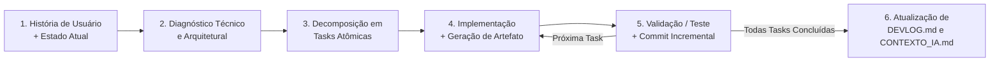

# Diretrizes de Desenvolvimento e Engenharia de Software — Personal Trainer IA (`Branch IA`)

> **Instrução Normativa para Agentes e Desenvolvedores:** Todo desenvolvimento realizado nesta branch deve seguir rigorosamente a metodologia descrita neste documento. Nenhuma implementação deve começar diretamente no código sem antes passar pelo ciclo de **Contextualização $\rightarrow$ Planejamento Técnico $\rightarrow$ Decomposição em Tasks Atômicas com Artefatos $\rightarrow$ Execução com Commits Incrementais $\rightarrow$ Registro no Devlog**.

---

## 1. Visão Geral do Ciclo de Desenvolvimento

O desenvolvimento é guiado por **Histórias de Usuário (User Stories)** ancoradas no **Estado Atual do Projeto** (documentado em [`CONTEXTO_IA.md`](./CONTEXTO_IA.md) e [`DEVLOG.md`](./DEVLOG.md)).



---

## 2. Etapa 1: Recebimento e Refinamento da História de Usuário

Sempre que o usuário fornecer uma demanda, ideia ou História de Usuário (mesmo que descrita informalmente), o agente deve estruturá-la formalmente antes de codificar:

### 2.1. Estrutura Padrão da História de Usuário (US)
- **ID e Título:** `US-XX: [Título curto da funcionalidade]`
- **Narrativa:**
  > **Como** *[persona: ex. aluno praticante / personal trainer especialista / sistema integrador]*,
  > **Quero** *[ação ou capacidade desejada]*,
  > **Para que** *[benefício biomecânico, pedagógico ou técnico alcançado]*.
- **Critérios de Aceitação (BDD — Given/When/Then):**
  - *Dado que* [pré-condição / entrada de vídeo ou sensores], *Quando* [evento/movimento ocorrer], *Então* [resultado mensurável esperado].
- **Requisitos Não-Funcionais e Restrições Técnicas:**
  - Impacto em performance de tempo real (FPS na webcam, complexidade do DTW $O(N \cdot M)$).
  - Compatibilidade com os contratos existentes (`ExercicioBaseFSM`, `BufferRepeticao`, `GabaritoExercicio`, `MAPA_ARTICULACOES`).
  - Tratamento de falhas (oclusão de pontos do MediaPipe, vídeos sem repetição completa, ruído de câmera).

---

## 3. Etapa 2: Planejamento Técnico e Decomposição em Tasks Atômicas

A partir da História de Usuário e da inspeção do estado atual do repositório, o agente deve elaborar um **Plano Técnico de Implementação** quebrado em **Tasks Factíveis, Atômicas e Orientadas a Artefatos**.

### 3.1. O que define uma Task Factível e Atômica?
1. **Responsabilidade Única (Atomicidade):** A task altera ou cria um único conceito lógico (ex.: adicionar cálculo de uma nova articulação em `calculo_angulos.py` é uma task; criar a FSM de um novo exercício em `exercicios_fsm.py` é outra task; integrar no HUD de `app_tempo_real.py` é outra task).
2. **Factibilidade e Isolamento:** Pode ser implementada e verificada de forma independente, sem deixar o projeto em estado inconsistente ou quebrado ao final de sua conclusão.
3. **Geração Obrigatória de Artefato de Desenvolvimento:** **Toda task deve produzir ou atualizar pelo menos um artefato concreto e verificável no repositório**, tais como:
   - **Artefato de Código:** Novo módulo `.py`, nova classe/função com *type hints* e *docstrings*, ou refatoração de contrato.
   - **Artefato de Dados/Configuração:** Arquivo de gabarito `.json` validado, entrada em `CATALOGO_EXERCICIOS`, ou atualização de `.gitignore`/`requirements.txt`.
   - **Artefato de Verificação/Teste:** Script de teste automatizado (`tests/test_*.py`), simulação determinística de série temporal ou relatório de validação.
   - **Artefato de Documentação:** Atualização em `DEVLOG.md`, `CONTEXTO_IA.md` ou diagramas de estado/fluxo.

### 3.2. Template Obrigatório para Planejamento de Tasks

Ao apresentar ou estruturar o plano de uma História de Usuário, utilize o seguinte formato para cada task:

```markdown
#### [TASK-XX.Y] Nome Objetivo da Task
- **Escopo Técnico:** O que será feito exatamente e como se conecta aos módulos atuais.
- **Artefatos Gerados/Modificados:**
  - `caminho/do/arquivo.py` (Criação / Modificação: classes/funções X, Y)
  - `tests/test_modulo.py` (Artefato de teste/validação)
- **Critério de Pronto (DoD - Definition of Done):** Condição objetiva e comando de terminal para provar que a task funciona.
- **Commit Incremental Planejado:** `tipo(escopo): descrição concisa da mudança`
```

---

## 4. Etapa 3: Estratégia de Execução e Commits Incrementais

O desenvolvimento **nunca** deve ser feito em um único commit monolítico ("big bang") ao final da História de Usuário. A construção deve ser **progressiva e incremental**, onde cada degrau consolida a base para o próximo.

### 4.1. Ordem Recomendada de Construção Incremental (Bottom-Up / Contract-First)
Para funcionalidades de IA e Biomecânica neste projeto, planeje a sequência de tasks e commits nesta ordem lógica:

1. **Passo 1 — Contratos Base e Geometria (`calculo_angulos.py`, `gabarito.py`):**
   - Mapear novas articulações ou estruturas de dados necessárias.
   - *Commit 1:* Garante que a extração geométrica e persistência funcionam isoladamente.
2. **Passo 2 — Regras de Domínio Biomecânico (`exercicios_fsm.py`, `dtw_*.py`, `buffer_repeticao.py`):**
   - Implementar ou ajustar a Máquina de Estados Finitos (fases `0, 1, 2, 3` e detecção de erros) ou o algoritmo de alinhamento temporal (DTW).
   - *Commit 2:* Garante que a lógica biomecânica responde corretamente a entradas sintéticas.
3. **Passo 3 — Verificação Automatizada / Simulação Sintética (`tests/` ou scripts de validação):**
   - Criar testes injetando curvas senoidais/vetores conhecidos (execução ideal, execução curta, execução com erro postural) para validar FSM + DTW sem depender de câmera física.
   - *Commit 3:* Congela a qualidade com testes reproduzíveis.
4. **Passo 4 — Integração no Pipeline de Vídeo e Tempo Real (`extrator_video.py`, `comparar_exercicio.py`, `app_tempo_real.py`):**
   - Conectar o domínio validado à captura OpenCV/MediaPipe e ao HUD/CLI.
   - *Commit 4:* Entrega o valor final visível ao usuário.
5. **Passo 5 — Documentação Viva e Fechamento (`DEVLOG.md`, `CONTEXTO_IA.md`):**
   - Registrar tudo o que foi feito, decisões técnicas tomadas e atualizar o mapa arquitetural se necessário.
   - *Commit 5:* `docs(devlog): registra entrega da US-XX e atualiza contexto`

### 4.2. Padrão de Mensagens de Commit (Conventional Commits)
Todos os commits incrementais devem seguir o padrão semântico em português:

- `feat(escopo): ...` — Nova funcionalidade (ex.: `feat(fsm): implementa classe ElevacaoLateral e registra no catalogo`).
- `fix(escopo): ...` — Correção de bug ou quebra de contrato (ex.: `fix(comparar): passa lista de articulacoes ao instanciar ExtratorVideo`).
- `refactor(escopo): ...` — Melhoria interna de código sem alterar comportamento externo (ex.: `refactor(dtw): vetoriza calculo da matriz de custo com numpy`).
- `test(escopo): ...` — Adição ou correção de testes/validações sintéticas (ex.: `test(fsm): adiciona testes de transicao de fases para agachamento`).
- `docs(escopo): ...` — Alterações em `CONTEXTO_IA.md`, `DEVLOG.md`, `DIRETRIZES_DESENVOLVIMENTO.md` ou docstrings.
- `chore(escopo): ...` — Limpeza de repositório, `.gitignore`, remoção de arquivos legados/duplicados.

> **Regra de Ouro dos Commits:** Cada commit incremental deve deixar a árvore de código em estado **executável e íntegro**. Antes de realizar o `git commit` de uma task, execute o script ou teste correspondente para comprovar que não há erros de sintaxe, importação ou regressão.

---

## 5. Boas Práticas de Engenharia de Software no Domínio do Projeto

### 5.1. Princípios Arquiteturais e SOLID
- **Separação Estrita de Camadas (SRP - Single Responsibility Principle):**
  - **Camada de Visão / Sensor (`extrator_video.py`, captura em `app_tempo_real.py`):** Conhece OpenCV e MediaPipe (`mp.Image`, `PoseLandmarker`), mas **não** contém regras de exercícios específicos.
  - **Camada Geométrica (`calculo_angulos.py`):** Transforma coordenadas `(x, y, z, visibility)` em dicionários de ângulos em graus (`Dict[str, float]`).
  - **Camada de Domínio Biomecânico (`exercicios_fsm.py`, `buffer_repeticao.py`, `dtw_*.py`, `gabarito.py`, `avaliador_pontuacao.py`):** Opera puramente sobre números, dicionários de ângulos e arrays NumPy (`np.ndarray`). **Nunca** importe `cv2` ou `mediapipe` dentro de `exercicios_fsm.py`, `buffer_repeticao.py`, `gabarito.py` ou dos módulos de `DTW`/pontuação. Isso garante alta coesão, baixo acoplamento e testabilidade 100% offline.
  - **Camada de Apresentação (`desenhar_esqueleto`, `desenhar_painel_hud`, `formatar_relatorio`):** Apenas consome os resultados estruturados do domínio e os exibe ao usuário.
- **Princípio Aberto/Fechado (OCP) e Substituição de Liskov (LSP) para Exercícios Quaisquer:**
  - O motor de avaliação biomecânica é extensível para **quaisquer novos exercícios físicos**.
  - Toda nova máquina de estados de exercício deve herdar de `ExercicioBaseFSM` (`exercicios_fsm.py`) e implementar:
    1. `identificar_fase(angulos, posicoes, angulos_deltas) -> int`: seguindo as fases padronizadas `0: Repouso`, `1: Fase Inicial/Ida`, `2: Pico/Fundo` e `3: Retorno`, incrementando `self.repeticoes` ao fechar o ciclo (`3 -> 0`).
    2. `classificar(angulos, posicoes, angulos_deltas) -> Optional[str]`: detectando erros usando verificações `if` independentes e acumulando em `self.erros_repeticao_atual`.
    3. `PENALIDADES_ERRO: Dict[str, float]`: mapeando as penalidades específicas de cada erro daquele exercício.
  - Para cadastrar um novo exercício, basta registrá-lo em `CATALOGO_EXERCICIOS` com sua chave, nome, classe de FSM, articulações e arquivo de gabarito JSON. Nenhuma linha do orquestrador ou motor DTW precisa ser modificada.
- **Inversão de Dependência (DIP - Dependency Inversion Principle):**
  - Módulos de alto nível (ex.: `OrquestradorSessao`) dependem da abstração base `ExercicioBaseFSM` e do contrato de dados `GabaritoExercicio`, e não de implementações concretas ou canais de hardware.
  - O contrato padrão de entrada é agnóstico ao canal de origem:
    ```python
    alerta_imediato, resultado_rep = orquestrador.processar_frame(angulos: Dict[str, float], visivel: bool = True)
    ```

### 5.2. Padrões de Codificação Python
1. **Nomes de Arquivos sem Acentuação (ASCII puro + `snake_case`):**
    - **Proibido** criar arquivos `.py` com acentos, cedilhas, espaços ou letras maiúsculas (ex.: nunca criar `exercícios_fsm.py` ou `Modularização.py`; usar sempre `exercicios_fsm.py`, `modularizacao.py`).
2. **Tipagem Explícita (Type Hints):**
    - Todas as funções e métodos devem declarar tipos de entrada e saída usando `typing` (`Dict`, `List`, `Optional`, `Tuple`, `Union`, `Any`) e `np.ndarray`.
3. **Docstrings Padronizadas e Unidades Explícitas:**
    - Documentar classes e funções indicando claramente a unidade matemática dos parâmetros (ex.: ângulos em graus no intervalo `[0.0, 180.0]`, coordenadas normalizadas `[0.0, 1.0]`, tempo em `ms`).
4. **Encoding UTF-8 Explícito:**
    - Sempre especificar `encoding="utf-8"` ao abrir arquivos (`open(..., encoding="utf-8")`) e `ensure_ascii=False` no `json.dump()` para preservar a acentuação correta nos relatórios e JSONs em máquinas Windows e Linux.

### 5.3. Estratégia de Testes e Validação Biomecânica
Como testes automatizados não podem depender de uma pessoa real fazendo exercícios na frente da webcam a cada commit:
- **Testes com Séries Temporais Sintéticas:** Para cada exercício ou regra biomecânica, crie funções geradoras de curvas (ex.: usando `np.linspace` e `np.sin`) que simulem:
  1. **Execução Padrão Ouro:** Deve resultar em `repeticoes == 1`, `erro_fsm is None` e `score_dtw >= 95%`.
  2. **Execução com Cadência Diferente (Mais lenta / Mais rápida):** Deve resultar em `repeticoes == 1`, `erro_fsm is None` e `score_dtw >= 85%` (comprovando invariância temporal do DTW).
  3. **Execução com Amplitude Incompleta:** Deve acionar o erro de transição correspondente na FSM (`REPETICAO_INCOMPLETA`, `AGACHAMENTO_CURTO`, `SUBIDA_INCOMPLETA`) e reduzir a pontuação final com reprovação da repetição.
  4. **Execução com Compensação Postural:** Deve acionar o alerta biomecânico imediato (`OMBRO_CAIDO`, `DESCIDA_EXCESSIVA`, `TRONCO_MUITO_INCLINADO`, `OMBRO_INSTAVEL`) e reter a penalidade ao final do ciclo.
  5. **Extensibilidade (AC7):** Deve instanciar um novo exercício registrado dinamicamente no catálogo para provar que o motor avalia qualquer exercício sem alteração de código central.

### 5.4. Gestão de Documentação e Rastreabilidade (`DEVLOG.md`, `CONTEXTO_IA.md` e `PLANO_SPRINT_*.md`)
- **Sincronização Viva do Planejamento da Sprint (`PLANO_SPRINT_*.md`):** O documento de planejamento da sprint não é estático. A cada commit incremental realizado, o desenvolvedor/agente deve atualizar o plano marcando as tasks correspondentes como `[CONCLUÍDA]`, registrando o hash do commit e atualizando a tabela resumo com o status real do repositório (`git log`).
- **Atualização do `DEVLOG.md`:** Ao concluir uma História de Usuário (ou sessão de desenvolvimento), adicione uma nova entrada no topo da seção cronológica do [`DEVLOG.md`](./DEVLOG.md) contendo:
  - Data, Identificador da US/Demanda e Resumo do Objetivo.
  - Lista de Tasks Atômicas executadas e Artefatos gerados/modificados.
  - Hashes/Mensagens dos commits incrementais realizados.
  - Decisões técnicas tomadas, problemas encontrados e próximos passos sugeridos.
- **Atualização do `CONTEXTO_IA.md`:** Sempre que novos arquivos forem criados, arquivos legados forem modificados/removidos, novos exercícios forem adicionados ao catálogo ou débitos técnicos forem sanados, atualize a tabela correspondente em [`CONTEXTO_IA.md`](./CONTEXTO_IA.md) para que o próximo agente encontre a fotografia exata do projeto.
