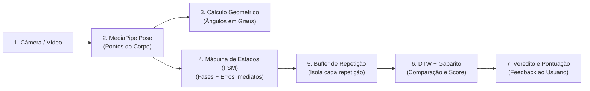

# Guia Explicativo da Inteligência Artificial — Personal Trainer IA

> **Para quem é este documento?** Este arquivo foi escrito para **humanos** (desenvolvedores, membros da equipe, avaliadores ou professores) que desejam entender, de forma intuitiva, clara e estruturada, como funciona a parte de **Inteligência Artificial e Visão Computacional** do projeto, o que já está construído e o que está planejado para ser feito.

---

## 1. Visão Geral: Qual o objetivo da IA neste projeto?

Praticar exercícios físicos com postura incorreta pode causar lesões articulares e reduzir os ganhos do treino. Muitas pessoas treinam sozinhas e não têm acesso contínuo a um treinador pessoal para corrigir seus movimentos.

O objetivo do módulo de IA do **Personal Trainer IA** é transformar uma câmera comum (webcam do computador ou câmera do celular) em um **avaliador biomecânico inteligente**. O sistema é capaz de:
1. **Enxergar o corpo** da pessoa em tempo real sem a necessidade de sensores corporais vestíveis.
2. **Entender a fase do exercício** (se está no repouso, subindo, no ponto máximo ou descendo).
3. **Contar repetições válidas** de forma automática.
4. **Detectar erros posturais imediatos** (ex.: cotovelo caindo, tronco muito inclinado, repetição incompleta).
5. **Comparar a execução com a de um especialista** e gerar uma **pontuação de qualidade técnica (0 a 100%)** com orientações pedagógicas para melhoria.

---

## 2. Como a IA funciona por dentro? (Conceitos Explicados Passo a Passo)

Em vez de usar uma rede neural "caixa preta" que apenas dá um veredito genérico sem explicar o motivo, optamos por uma **arquitetura híbrida e explicável**, dividida em 5 etapas fundamentais:



### Passo 1: Estimação de Pose (MediaPipe Pose Landmarker)
A câmera captura o vídeo a ~30 quadros por segundo (FPS). Usamos o modelo oficial do **Google MediaPipe**, que detecta **33 pontos anatômicos-chave** (chamados de *landmarks*) no corpo do praticante: ombros, cotovelos, punhos, quadris, joelhos, tornozelos, etc. Cada ponto tem coordenadas no espaço $(x, y, z)$ e um valor de visibilidade/confiança.

### Passo 2: Cálculo dos Ângulos Articulares (Geometria 2D)
Coordenadas puras na tela mudam dependendo da distância da pessoa até a câmera ou da resolução do monitor. Por isso, convertemos as posições dos pontos em **ângulos articulares em graus** (usando trigonometria e vetores).
* *Exemplo no Desenvolvimento de Ombro:* calculamos o ângulo do cotovelo (ombro $\rightarrow$ cotovelo $\rightarrow$ punho) e o ângulo do ombro (quadril $\rightarrow$ ombro $\rightarrow$ cotovelo).
* Assim, o sistema passa a trabalhar com métricas universais da biomecânica humana, independentes do tamanho da imagem.

### Passo 3: A Máquina de Estados Finitos (FSM — Finite State Machine)
Como o computador sabe quando o aluno começou e terminou uma repetição?
Cada exercício segue um ciclo previsível dividido em 4 fases:
* **Fase 0 (Repouso):** Posição inicial estável.
* **Fase 1 (Movimento Inicial / Ida):** Início da contração (ex.: braço subindo ou corpo descendo).
* **Fase 2 (Pico / Fundo):** Ponto de contração máxima ou amplitude máxima do exercício.
* **Fase 3 (Retorno / Volta):** Retorno controlado em direção à posição inicial.
* **Retorno à Fase 0:** Ciclo completado! O contador de repetições é incrementado em $+1$.

**O pulo do gato da FSM:** ela também monitora **erros de execução na hora em que acontecem**:
* Se o usuário foi da fase 1 para a 3 sem passar pela 2, ele "encurtou" o movimento $\rightarrow$ Alerta: `REPETICAO_INCOMPLETA` ou `AGACHAMENTO_CURTO`.
* Se durante a execução o ombro caiu ou o tronco inclinou demais $\rightarrow$ Alerta postural imediato na tela.

### Passo 4: O Buffer de Repetição (Recorte Temporal)
Enquanto a pessoa executa o movimento (fases 1, 2 e 3), o sistema guarda todos os ângulos daquele ciclo em uma memória temporária (o *Buffer*). No exato instante em que a FSM detecta o retorno à fase 0, o buffer "empacota" todos os quadros daquela repetição em uma matriz numérica $(N \times D)$ e a envia para a avaliação global de qualidade.

### Passo 5: O DTW (Dynamic Time Warping) e o Gabarito do Especialista
Aqui está o coração da avaliação técnica:
* Temos um **Gabarito Padrão Ouro** gravado previamente por um especialista (personal trainer), contendo a curva ideal de movimento ao longo do tempo.
* Quando o aluno faz o exercício, ele pode fazer mais rápido (ex.: 30 quadros) ou mais lento (ex.: 60 quadros).
* Se comparássemos quadro a quadro de forma rígida, o aluno que treina com cadência controlada seria penalizado injustamente.
* O **DTW (Dynamic Time Warping)** resolve isso: ele é um algoritmo matemático de alinhamento temporal que estica e comprime o tempo elasticamente para encaixar a curva do aluno na curva do especialista.
* A partir desse alinhamento elástico, calculamos:
  1. A **distância média em graus** de divergência ao longo de todo o movimento.
  2. O **Score Percentual de Técnica (0 a 100%)** via fórmula de decaimento suave.
  3. O **diagnóstico por articulação**: aponta exatamente qual parte do corpo mais divergiu (ex.: *"Cotovelo correto, mas seu ombro abriu 14° a menos que a referência"*).

---

## 3. O Que Já Está Desenvolvido e Funcional no Repositório

Neste momento, a branch `IA` já possui um conjunto robusto de ferramentas e funcionalidades implementadas:

### 3.1. Exercícios Já Mapeados
O catálogo central (`CATALOGO_EXERCICIOS`) já suporta **3 exercícios clássicos**:
1. **Desenvolvimento de Ombro (Shoulder Press):** Monitora cotovelo e ombro; detecta repetição incompleta, descida excessiva do braço e ombro caído.
2. **Agachamento Livre (Squat):** Monitora joelho e quadril; detecta agachamento curto (falta de profundidade) e inclinação excessiva do tronco.
3. **Rosca Direta de Bíceps (Bicep Curl):** Monitora cotovelo e estabilidade do ombro; detecta flexão incompleta e projeção incorreta do ombro.
* Todos os exercícios contam com alternância de lado (**Direito** ou **Esquerdo**).

### 3.2. Módulos Ativos do Sistema
* [`calculo_angulos.py`](./calculo_angulos.py): Motor geométrico que calcula ângulos articulares em 2D, verifica visibilidade dos marcos e possui o cálculo de deltas angulares com âncora de ruído (`calcular_deltas_angulares`), que preserva a detecção de movimentos lentos sem sofrer com ruído de câmera.
* [`exercicios_fsm.py`](./exercicios_fsm.py): Contrato base `ExercicioBaseFSM` e máquinas de estado dos 3 exercícios. Conta com memória isolada de erros por repetição (`consumir_erros_repeticao`), checagens sem mascaramento (`if` independentes) e dicionário formal de penalidades (`PENALIDADES_ERRO`).
* [`buffer_repeticao.py`](./buffer_repeticao.py): Coletor e recortador automático de repetições completas guiado pelas fases da FSM.
* [`dtw_evaluator.py`](./dtw_evaluator.py): **Novo motor unificado de Dynamic Time Warping.** Vetorizado em NumPy 3D *broadcasting* (até 80x mais rápido), com suporte à janela de restrição dinâmica de Sakoe-Chiba, tolerância $\tau$ configurável, contrato tipado `@dataclass DTWResult` (com desempacotamento retrocompatível como tupla) e degradação graciosa para tempo real.
* [`dtw_inicial.py`](./dtw_inicial.py): Módulo legado preservado intacto no repositório até a migração final da webcam na Task 09.
* [`gabarito.py`](./gabarito.py): Sistema de persistência em JSON e gerador automático de gabaritos padrão caso os arquivos ainda não existam.
* [`extrator_video.py`](./extrator_video.py): Extrai, por pose detectada, o número do frame, os ângulos articulares e a visibilidade. Não calcula deltas; no fluxo de avaliação, essa responsabilidade é do `OrquestradorSessao`. Também segmenta vídeos de especialistas para gerar gabaritos.
* [`comparar_exercicio.py`](./comparar_exercicio.py): CLI multi-exercício integrada ao orquestrador, com relatório por repetição e resumo da sessão.
* [`app_tempo_real.py`](./app_tempo_real.py): Aplicação completa com webcam (OpenCV), desenho do esqueleto na tela, painel HUD superior com contagem de repetições, fase atual, ângulos ao vivo, alertas vermelhos de erro e veredito final da última repetição com score DTW.
* [`tests/test_pipeline_pontuacao.py`](./tests/test_pipeline_pontuacao.py): Suíte com **31 testes automatizados** cobrindo também o contrato do extrator, modo simulado do comparador e cenários sintéticos do orquestrador.
* **Gabaritos JSON oficiais:** [`gabarito_especialista_ombro.json`](./gabarito_especialista_ombro.json), [`gabarito_especialista_agachamento.json`](./gabarito_especialista_agachamento.json) e [`gabarito_especialista_rosca.json`](./gabarito_especialista_rosca.json).

### 3.3. Como um Humano Pode Testar Hoje no Computador
Se você clonar o repositório e tiver Python instalado:

1. **Instalar Dependências Oficiais:**
   ```bash
   pip install -r requirements.txt
   ```

2. **Executar a Suíte de Testes Automatizados (Sem Câmera):**
   ```bash
   pytest
   ```
   *Roda os testes automatizados de cálculo de ângulos, FSM, DTW, segmentação, orquestração, extração e comparação simulada.*

3. **Testar com a Webcam em Tempo Real:**
   ```bash
   python app_tempo_real.py
   ```
   *Teclas de atalho na janela do vídeo:*
   * `1`: Seleciona Desenvolvimento de Ombro.
   * `2`: Seleciona Agachamento.
   * `3`: Seleciona Rosca Bíceps.
   * `L`: Alterna entre lado Direito e Esquerdo.
   * `R`: Reinicia a contagem e os erros da sessão.
   * `Q`: Fecha o programa.

---

## 4. O Diagnóstico: O Que Já Foi Corrigido e O Que Estamos Unificando?

O desenvolvimento desta sprint foi planejado sob uma premissa arquitetural essencial: **os outros módulos do projeto (como o aplicativo Flutter e o backend FastAPI) enviarão cada fotograma da gravação do usuário sequencialmente para o nosso motor de IA**.

Por isso, o sistema foi estruturado para ser totalmente desacoplado de webcam física ou leituras em lote, operando no modelo **frame a frame**:

### 4.1. Problemas Já Diagnosticados e Corrigidos Nesta Sprint:
1. **O Bug da Cadência Lenta (Resolvido na `TASK-02`):**
   * *O problema:* Ao fazer repetições lentas e controladas, a variação de ângulo por fotograma era pequena (< 1.2°). O código anterior atualizava o ângulo de referência a cada frame, zerando o delta continuamente. Resultado: o sistema "congelava" e não contava a repetição.
   * *A solução:* Criamos a função `calcular_deltas_angulares` com **âncora de ruído**. A referência só avança quando o acumulado atinge o limiar, detectando movimentos lentos perfeitamente.
2. **A Perda de Erros da FSM (Resolvido na `TASK-03`):**
   * *O problema:* Se o usuário cometesse um erro no topo do movimento (ex.: ombro caído), esse alerta aparecia naquele frame, mas quando ele voltava ao repouso (fase 0), a repetição era fechada e o erro era esquecido! Além disso, a cadeia `elif` mascarava erros simultâneos.
   * *A solução:* A `ExercicioBaseFSM` agora possui memória (`erros_repeticao_atual`), checagens independentes e entrega a lista completa de infrações via `consumir_erros_repeticao()` para desconto justo na nota final.
3. **Lentidão do DTW e Ausência de Janela Temporal (Resolvido na `TASK-04`):**
   * *O problema:* O DTW legado rodava laços `for` em Python puro ($N \times M$ iterações), consumindo CPU em repetições longas, e não possuía banda de restrição, permitindo distorções temporais irreais.
   * *A solução:* O novo `dtw_evaluator.py` utiliza vetorização em C com NumPy 3D *broadcasting*, restrição dinâmica de Sakoe-Chiba, dataclass `DTWResult` com suporte a desempacotamento de tupla e proteção contra travamentos via degradação graciosa.
4. **Alinhamento Canônico de Gabaritos e Buffer (Resolvido na `TASK-05`):**
   * *O problema:* Os gabaritos continham repouso excessivo além da transição inicial da FSM, enquanto o `BufferRepeticao` recorta estritamente do início do movimento (`0 → 1`) até a conclusão (`3 → 0`). Isso penalizava indevidamente uma execução impecável do aluno (que tirava ~90% em vez de 100%).
   * *A solução:* Criamos a função utilitária canônica `extrair_primeira_repeticao()` em `buffer_repeticao.py` e regeneramos os gabaritos em `gabarito.py`. Agora, especialista e aluno passam pelo mesmíssimo recorte da FSM, e uma repetição perfeita atinge pontuação máxima de 100.0%.
5. **Motor Central de Pontuação e Orquestrador Frame a Frame (Resolvido na `TASK-06`):**
   * *O problema:* O cálculo de notas e aprovações estava disperso por múltiplos scripts de visualização (CLI, webcam, demo), sem padrão uniforme de desconto para erros posturais e de incompletude.
   * *A solução:* Criado `avaliador_pontuacao.py`, que consolida o contrato único de entrada `orquestrador.processar_frame(angulos, visivel)`, aplica penalidades de erros únicos da FSM, gera feedbacks pedagógicos hierárquicos e calcula pontos de gamificação e resumos para o aplicativo.
6. **Bateria de Testes Unitários Automatizados (`TASK-02` a `TASK-06`):**
   * Agora temos uma suíte formal com `pytest` e 31 testes cobrindo geometria, retenção de erros na FSM, alinhamento temporal DTW, autoconsistência de gabaritos, pontuação, orquestração e demonstração sintética sem câmera.

### 4.2. O Que Está Sendo Unificado a Seguir:
1. **Demonstração Arquitetural (`TASK-08`, concluída):**
   * `exemplo_integracao.py` envia frames sintéticos ao `OrquestradorSessao` oficial e apresenta os resultados dos cenários ideal, lento, muito lento e incompleto. Os últimos dois mantêm aprovação acima de 85; o incompleto é reprovado e recebe penalidade de 25 pontos.
   * A classe local `SessionOrchestrator` e os wrappers DTW citados em rascunhos anteriores não estavam presentes na branch atual; por isso, nenhum código existente foi removido.


---

## 5. O Que Está Planejado e o Progresso da Sprint (`US-01`)

### 5.1. A História de Usuário da Sprint Atual (`US-01`)
> *"Como usuário praticante de atividades físicas, quero receber uma pontuação clara e justa a partir da comparação da minha execução com a referência de um especialista, para que eu saiba quão correto foi meu movimento em cada repetição e ao final da série."*

O plano técnico detalhado está registrado em [`PLANO_SPRINT_US01.md`](./PLANO_SPRINT_US01.md). Abaixo está o estado de progresso atual com base nos commits realizados:

* [x] **`[TASK-00]` Base Documental e Contexto:** `CONTEXTO_IA.md`, `DEVLOG.md`, `DIRETRIZES_DESENVOLVIMENTO.md`, `AGENTS.md` e `PLANO_SPRINT_US01.md` criados e versionados *(Commit `0afd9ee`)*.
* [x] **`[TASK-01]` Dependências e Proteção do Repositório:** `requirements.txt`, `.gitignore` atualizado e criação deste guia didático `EXPLICACAO_IA.md`. *Nota: Módulos legados mantidos intactos por diretriz até a conclusão e teste dos novos módulos* *(Commit `c340b65`)*.
* [x] **`[TASK-02]` Geometria com Âncora de Ruído:** Função `calcular_deltas_angulares()` em `calculo_angulos.py` e primeiros testes automatizados em `tests/test_pipeline_pontuacao.py` *(Commit `7151ad3`)*.
* [x] **`[TASK-03]` Memória de Erros e Penalidades na FSM:** Evolução de `ExercicioBaseFSM` em `exercicios_fsm.py` com acumulador de erros por repetição, penalidades por exercício e 9 testes no `pytest` *(Commit `f085106`)*.
* [x] **`[TASK-04]` Padronização do DTW Único:** Módulo `dtw_evaluator.py` implementado com vetorização 3D, Sakoe-Chiba, `DTWResult` e 16 testes no `pytest` *(Commit `d02ac24`)*.
* [x] **`[TASK-05]` Recorte Uniforme dos Gabaritos:** Alinhamento dos JSONs com o mesmo segmentador canônico do aluno em `buffer_repeticao.py`, `gabarito.py`, `extrator_video.py` e 21 testes no `pytest` *(Concluída)*.
* [x] **`[TASK-06]` Motor de Pontuação e Orquestrador Frame a Frame:** Criação de `avaliador_pontuacao.py` unificando notas, feedbacks, gamificação e sessão com 28 testes no `pytest` *(Concluída)*.
* [x] **`[TASK-07]` Integração no Comparador de Vídeo CLI:** Extração de ângulos/visibilidade e avaliação da CLI pelo orquestrador, com suporte ao catálogo de exercícios *(Concluída e publicada)*.

* [x] **`[TASK-08]` Demonstração Arquitetural:** Cenários sintéticos processados pelo `OrquestradorSessao`, com teste dos vereditos e resumo *(Implementada e validada localmente; commit pendente)*.
* [ ] **`[TASK-09]` Integração Webcam em Tempo Real:** Conexão de `app_tempo_real.py` ao orquestrador e aposentadoria segura de `dtw_inicial.py` *(Pendente)*.
* [ ] **`[TASK-10]` Bateria de Testes End-to-End:** Validação dos critérios de aceite AC1 a AC7 *(Pendente)*.
* [x] **`[TASK-11]` Gestão Viva de Logs e Contexto:** Devlog, contexto e plano da sprint mantidos rigorosamente sincronizados a cada commit *(Em andamento contínuo)*.

---

## 6. Glossário Rápido de Termos

* **Landmark (Marco Anatômico):** Ponto cartesiano $(x, y, z)$ estimado no corpo humano (ex.: ponto 14 é o cotovelo direito).
* **FSM (Máquina de Estados Finitos):** Lógica matemática que organiza o movimento em etapas bem definidas (repouso, subida, pico, descida) e só transita quando certos ângulos são atingidos.
* **DTW (Dynamic Time Warping):** Algoritmo que compara séries temporais com velocidades diferentes, encontrando o menor caminho de divergência entre elas.
* **Janela de Sakoe-Chiba:** Restrição matemática no DTW que impede distorções de tempo absurdas (ex.: comparar o início de um movimento do aluno com o final do especialista).
* **Gabarito (Template Padrão Ouro):** Sequência temporal de referência gravada por um profissional, usada como a "resposta certa" do exercício.
* **ROM (Range of Motion / Amplitude Articular):** A variação em graus entre o ponto mínimo e o ponto máximo atingido por uma articulação durante o exercício.

---

## 7. Mapeamento dos Documentos do Projeto

Para se aprofundar em qualquer aspecto específico, consulte os documentos de apoio na raiz do projeto:

| Documento | Para que serve? |
| :--- | :--- |
| **`EXPLICACAO_IA.md`** *(este documento)* | Guia didático de leitura humana sobre funcionamento, estado atual e planejamento. |
| **[`CONTEXTO_IA.md`](./CONTEXTO_IA.md)** | Documento técnico detalhado com especificações de classes, contratos e débitos técnicos. |
| **[`PLANO_SPRINT_US01.md`](./PLANO_SPRINT_US01.md)** | Plano de implementação técnica e divisão de tasks da sprint de pontuação. |
| **[`DIRETRIZES_DESENVOLVIMENTO.md`](./DIRETRIZES_DESENVOLVIMENTO.md)** | Protocolo de Engenharia de Software (SOLID, testes, commits incrementais). |
| **[`DEVLOG.md`](./DEVLOG.md)** | Diário de bordo cronológico com histórico de alterações e decisões tomadas. |
| **[`AGENTS.md`](./AGENTS.md)** | Ponto de entrada e regras obrigatórias para agentes autônomos de IA. |
