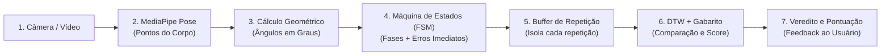

# Guia Explicativo da Inteligência Artificial — Personal Trainer IA

> **Para quem é este documento?** Este arquivo foi escrito para **humanos** (desenvolvedores, membros da equipe, avaliadores ou professores) que desejam entender, de forma intuitiva, clara e estruturada, como funciona a parte de **Inteligência Artificial e Visão Computacional** do projeto, o que já está construído e o que está planejado para ser feito.

---

## 1. Visão Geral: Qual o objetivo da IA neste projeto?

Praticar exercícios físicos com postura incorreta pode causar lesões articulares e reduzir os ganhos do treino. Muitas pessoas treinam sozinhas e não têm acesso contínuo a um treinador pessoal para corrigir seus movimentos.

O objetivo do módulo de IA do **Personal Trainer IA** é transformar uma câmera comum (webcam do computador ou câmera do celular) em um **avaliador biomecânico inteligente**. O sistema é capaz de:
1. **Enxergar o corpo** da pessoa em tempo real sem a necessidade de sensores corporais vestíveis.
2. **Entender a fase do exercício** (se está no repouso, subindo, no ponto máximo ou descendo).
3. **Contar repetições válidas** de forma automática.
4. **Detectar erros posturais imediatos** (ex.: cotovelo caindo, tronco muito inclinado, repetição incompleta).
5. **Comparar a execução com a de um especialista** e gerar uma **pontuação de qualidade técnica (0 a 100%)** com orientações pedagógicas para melhoria.

---

## 2. Como a IA funciona por dentro? (Conceitos Explicados Passo a Passo)

Em vez de usar uma rede neural "caixa preta" que apenas dá um veredito genérico sem explicar o motivo, optamos por uma **arquitetura híbrida e explicável**, dividida em 5 etapas fundamentais:



### Passo 1: Estimação de Pose (MediaPipe Pose Landmarker)
A câmera captura o vídeo a ~30 quadros por segundo (FPS). Usamos o modelo oficial do **Google MediaPipe**, que detecta **33 pontos anatômicos-chave** (chamados de *landmarks*) no corpo do praticante: ombros, cotovelos, punhos, quadris, joelhos, tornozelos, etc. Cada ponto tem coordenadas no espaço $(x, y, z)$ e um valor de visibilidade/confiança.

### Passo 2: Cálculo dos Ângulos Articulares (Geometria 2D)
Coordenadas puras na tela mudam dependendo da distância da pessoa até a câmera ou da resolução do monitor. Por isso, convertemos as posições dos pontos em **ângulos articulares em graus** (usando trigonometria e vetores).
* *Exemplo no Desenvolvimento de Ombro:* calculamos o ângulo do cotovelo (ombro $\rightarrow$ cotovelo $\rightarrow$ punho) e o ângulo do ombro (quadril $\rightarrow$ ombro $\rightarrow$ cotovelo).
* Assim, o sistema passa a trabalhar com métricas universais da biomecânica humana, independentes do tamanho da imagem.

### Passo 3: A Máquina de Estados Finitos (FSM — Finite State Machine)
Como o computador sabe quando o aluno começou e terminou uma repetição?
Cada exercício segue um ciclo previsível dividido em 4 fases:
* **Fase 0 (Repouso):** Posição inicial estável.
* **Fase 1 (Movimento Inicial / Ida):** Início da contração (ex.: braço subindo ou corpo descendo).
* **Fase 2 (Pico / Fundo):** Ponto de contração máxima ou amplitude máxima do exercício.
* **Fase 3 (Retorno / Volta):** Retorno controlado em direção à posição inicial.
* **Retorno à Fase 0:** Ciclo completado! O contador de repetições é incrementado em $+1$.

**O pulo do gato da FSM:** ela também monitora **erros de execução na hora em que acontecem**:
* Se o usuário foi da fase 1 para a 3 sem passar pela 2, ele "encurtou" o movimento $\rightarrow$ Alerta: `REPETICAO_INCOMPLETA` ou `AGACHAMENTO_CURTO`.
* Se durante a execução o ombro caiu ou o tronco inclinou demais $\rightarrow$ Alerta postural imediato na tela.

### Passo 4: O Buffer de Repetição (Recorte Temporal)
Enquanto a pessoa executa o movimento (fases 1, 2 e 3), o sistema guarda todos os ângulos daquele ciclo em uma memória temporária (o *Buffer*). No exato instante em que a FSM detecta o retorno à fase 0, o buffer "empacota" todos os quadros daquela repetição em uma matriz numérica $(N \times D)$ e a envia para a avaliação global de qualidade.

### Passo 5: O DTW (Dynamic Time Warping) e o Gabarito do Especialista
Aqui está o coração da avaliação técnica:
* Temos um **Gabarito Padrão Ouro** gravado previamente por um especialista (personal trainer), contendo a curva ideal de movimento ao longo do tempo.
* Quando o aluno faz o exercício, ele pode fazer mais rápido (ex.: 30 quadros) ou mais lento (ex.: 60 quadros).
* Se comparássemos quadro a quadro de forma rígida, o aluno que treina com cadência controlada seria penalizado injustamente.
* O **DTW (Dynamic Time Warping)** resolve isso: ele é um algoritmo matemático de alinhamento temporal que estica e comprime o tempo elasticamente para encaixar a curva do aluno na curva do especialista.
* A partir desse alinhamento elástico, calculamos:
  1. A **distância média em graus** de divergência ao longo de todo o movimento.
  2. O **Score Percentual de Técnica (0 a 100%)** via fórmula de decaimento suave.
  3. O **diagnóstico por articulação**: aponta exatamente qual parte do corpo mais divergiu (ex.: *"Cotovelo correto, mas seu ombro abriu 14° a menos que a referência"*).

---

## 3. O Que Já Está Desenvolvido e Funcional no Repositório

Neste momento, a branch `IA` já possui um conjunto robusto de ferramentas e funcionalidades implementadas:

### 3.1. Exercícios Já Mapeados
O catálogo central (`CATALOGO_EXERCICIOS`) já suporta **3 exercícios clássicos**:
1. **Desenvolvimento de Ombro (Shoulder Press):** Monitora cotovelo e ombro; detecta repetição incompleta, descida excessiva do braço e ombro caído.
2. **Agachamento Livre (Squat):** Monitora joelho e quadril; detecta agachamento curto (falta de profundidade) e inclinação excessiva do tronco.
3. **Rosca Direta de Bíceps (Bicep Curl):** Monitora cotovelo e estabilidade do ombro; detecta flexão incompleta e projeção incorreta do ombro.
* Todos os exercícios contam com alternância de lado (**Direito** ou **Esquerdo**).

### 3.2. Módulos Ativos do Sistema
* [`app_tempo_real.py`](file:///c:/Users/aihon/Desktop/EngSoftTrabalho_Personal_TrainerIA/app_tempo_real.py): Aplicação completa com webcam (OpenCV), desenho do esqueleto na tela, painel HUD superior com contagem de repetições, fase atual, ângulos ao vivo, alertas vermelhos de erro e veredito final da última repetição com score DTW.
* [`calculo_angulos.py`](file:///c:/Users/aihon/Desktop/EngSoftTrabalho_Personal_TrainerIA/calculo_angulos.py): Motor geométrico que calcula ângulos articulares e checa se as articulações estão visíveis no enquadramento da câmera.
* [`exercicios_fsm.py`](file:///c:/Users/aihon/Desktop/EngSoftTrabalho_Personal_TrainerIA/exercicios_fsm.py): Contrato base `ExercicioBaseFSM` e implementação das máquinas de estado dos 3 exercícios.
* [`buffer_repeticao.py`](file:///c:/Users/aihon/Desktop/EngSoftTrabalho_Personal_TrainerIA/buffer_repeticao.py): Coletor e recortador automático de repetições completas.
* [`dtw_inicial.py`](file:///c:/Users/aihon/Desktop/EngSoftTrabalho_Personal_TrainerIA/dtw_inicial.py): Implementação funcional do DTW com cálculo de desvios por articulação.
* [`gabarito.py`](file:///c:/Users/aihon/Desktop/EngSoftTrabalho_Personal_TrainerIA/gabarito.py): Sistema de persistência em JSON e gerador automático de gabaritos padrão caso os arquivos ainda não existam.
* [`extrator_video.py`](file:///c:/Users/aihon/Desktop/EngSoftTrabalho_Personal_TrainerIA/extrator_video.py): Ferramenta CLI para processar vídeos gravados de especialistas e extrair automaticamente a primeira repetição perfeita para salvar como arquivo JSON de referência.
* **Gabaritos JSON oficiais:** [`gabarito_especialista_ombro.json`](file:///c:/Users/aihon/Desktop/EngSoftTrabalho_Personal_TrainerIA/gabarito_especialista_ombro.json), [`gabarito_especialista_agachamento.json`](file:///c:/Users/aihon/Desktop/EngSoftTrabalho_Personal_TrainerIA/gabarito_especialista_agachamento.json) e [`gabarito_especialista_rosca.json`](file:///c:/Users/aihon/Desktop/EngSoftTrabalho_Personal_TrainerIA/gabarito_especialista_rosca.json).

### 3.3. Como um Humano Pode Testar Hoje no Computador
Se você clonar o repositório e tiver Python instalado:

1. **Testar com a Webcam em Tempo Real:**
   ```bash
   python app_tempo_real.py
   ```
   *Teclas de atalho na janela do vídeo:*
   * `1`: Seleciona Desenvolvimento de Ombro.
   * `2`: Seleciona Agachamento.
   * `3`: Seleciona Rosca Bíceps.
   * `L`: Alterna entre lado Direito e Esquerdo.
   * `R`: Reinicia a contagem e os erros da sessão.
   * `Q`: Fecha o programa.

2. **Gerar ou Validar os Gabaritos JSON:**
   ```bash
   python gabarito.py
   ```

3. **Simular o Fluxo de Integração (Sem Câmera):**
   ```bash
   python exemplo_integracao.py
   ```
   Roda 3 cenários sintéticos demonstrando a resposta da FSM e do DTW em execuções ideais, lentas e com falhas.

---

## 4. O Diagnóstico: Por que Precisamos Padronizar o Pipeline?

Embora as partes principais já existam, **elas foram construídas por desenvolvedores diferentes em momentos diferentes e possuem "pontas soltas" que ainda não se conversam perfeitamente**:

1. **Duas implementações de DTW separadas:**
   * Existe o `dtw_inicial.py` (usado na webcam) e o `dtw_evaluator.py` (uma versão orientada a objetos mais moderna, mais rápida e com restrição de janela Sakoe-Chiba, mas que não lê os arquivos JSON de gabarito).
2. **Duas FSMs de Ombro:**
   * O arquivo `dev_ombro-inicial.py` foi feito no início do projeto e ainda é importado por alguns scripts antigos, enquanto `exercicios_fsm.py` tem a versão mais recente e completa.
3. **Pequena quebra no comparador de vídeo gravado (`comparar_exercicio.py`):**
   * Ao ser atualizado para múltiplos exercícios, o extrator de vídeo passou a exigir a lista de articulações, mas o script de comparação de vídeo ainda chamava a versão antiga, causando erro de execução quando tentamos passar um `.mp4`.
4. **Falta de um Motor Central de Pontuação:**
   * Hoje o DTW dá uma nota de similaridade da curva, e a FSM apenas diz se houve erro ou não. Ainda não existia uma regra única e matemática que combinasse: `Nota Final = Técnica da Curva (DTW) - Penalidades Biomecânicas (FSM)`.

---

## 5. O Que Está Planejado para Ser Feito (Sprint Atual e Próximos Passos)

### 5.1. A História de Usuário da Sprint Atual (`US-01`)
> *"Usuário quer ter uma pontuação a partir da comparação de exercícios"*

Para atender a essa demanda e resolver de vez a fragmentação do código, criamos o plano detalhado em [`PLANO_SPRINT_US01.md`](file:///c:/Users/aihon/Desktop/EngSoftTrabalho_Personal_TrainerIA/PLANO_SPRINT_US01.md), dividido em **tasks atômicas com commits incrementais**:

1. **`TASK-00` (Concluída no Workspace):** Documentação técnica, arquitetura, diretrizes de engenharia, devlog e este guia explicativo.
2. **`TASK-01` (Limpeza e Padronização):** Remover arquivos duplicados com acentos (`exercícios_fsm.py`), subpastas acidentais e padronizar o `.gitignore` e `requirements.txt`.
3. **`TASK-02` (Geometria Centralizada):** Colocar todos os filtros de ruído de movimento e métricas de amplitude máxima/mínima dentro de `calculo_angulos.py`.
4. **`TASK-03` (Unificação das FSMs e Memória de Erros):** Fazer o `BufferRepeticao` guardar **todos** os erros posturais ocorridos durante aquela repetição específica, para que eles sejam considerados na pontuação final.
5. **`TASK-04` (Unificação do DTW):** Integrar a versão rápida e moderna do DTW (`dtw_evaluator.py`) diretamente com os gabaritos JSON de `gabarito.py`.
6. **`TASK-05` (Motor Unificado de Pontuação):** Criar o módulo `avaliador_pontuacao.py`, que aplica a fórmula oficial de pontuação:
   * **Score de Trajetória (DTW)**: de 0 a 100%.
   * **Descontos Biomecânicos da FSM**: desconta pontos se o aluno encurtou o movimento ou compensou com postura torta.
   * **Veredito Claro**: `EXCELENTE` ($\ge 85$), `BOM` ($\ge 70$), `REGULAR` ($\ge 50$) ou `INCORRETO` ($< 50$).
   * **Diagnóstico da Articulação Crítica**: aponta exatamente qual membro errou mais.
   * **Consolidação da Série**: nota média de todas as repetições do treino.
7. **`TASK-06` (Integração nos Modos Vídeo e Tempo Real):** Fazer a webcam (`app_tempo_real.py`) e o analisador de arquivos (`comparar_exercicio.py`) usarem exatamente o mesmo motor de pontuação.
8. **`TASK-07` (Testes Automatizados):** Criar bateria de testes sintéticos garantindo que uma execução perfeita tire nota alta, uma execução lenta não seja punida e execuções erradas tirem notas proporcionais à falha.
9. **`TASK-08` (Fechamento e Devlog):** Atualizar o `DEVLOG.md` e o `CONTEXTO_IA.md` com a entrega completa.

### 5.2. O Que Fica no Horizonte Futuro (Pós-Sprint)
* **Novos Exercícios no Catálogo:** Adicionar Elevação Lateral, Tríceps, Levantamento Terra, etc. (bastando criar uma nova classe na FSM e gravar o gabarito JSON).
* **Integração com o Aplicativo Mobile (Flutter):** Enviar o resultado da avaliação (repetições, score final, erros detectados) para a interface do aplicativo móvel ou salvar no banco de dados do usuário.
* **Filtros Avançados de Câmera:** Suavização One-Euro Filter para webcams com muito ruído em ambientes com pouca luz.

---

## 6. Glossário Rápido de Termos

* **Landmark (Marco Anatômico):** Ponto cartesiano $(x, y, z)$ estimado no corpo humano (ex.: ponto 14 é o cotovelo direito).
* **FSM (Máquina de Estados Finitos):** Lógica matemática que organiza o movimento em etapas bem definidas (repouso, subida, pico, descida) e só transita quando certos ângulos são atingidos.
* **DTW (Dynamic Time Warping):** Algoritmo que compara séries temporais com velocidades diferentes, encontrando o menor caminho de divergência entre elas.
* **Janela de Sakoe-Chiba:** Restrição matemática no DTW que impede distorções de tempo absurdas (ex.: comparar o início de um movimento do aluno com o final do especialista).
* **Gabarito (Template Padrão Ouro):** Sequência temporal de referência gravada por um profissional, usada como a "resposta certa" do exercício.
* **ROM (Range of Motion / Amplitude Articular):** A variação em graus entre o ponto mínimo e o ponto máximo atingido por uma articulação durante o exercício.

---

## 7. Mapeamento dos Documentos do Projeto

Para se aprofundar em qualquer aspecto específico, consulte os documentos de apoio na raiz do projeto:

| Documento | Para que serve? |
| :--- | :--- |
| **`EXPLICACAO_IA.md`** *(este documento)* | Guia didático de leitura humana sobre funcionamento, estado atual e planejamento. |
| **[`CONTEXTO_IA.md`](./CONTEXTO_IA.md)** | Documento técnico detalhado com especificações de classes, contratos e débitos técnicos. |
| **[`PLANO_SPRINT_US01.md`](./PLANO_SPRINT_US01.md)** | Plano de implementação técnica e divisão de tasks da sprint de pontuação. |
| **[`DIRETRIZES_DESENVOLVIMENTO.md`](./DIRETRIZES_DESENVOLVIMENTO.md)** | Protocolo de Engenharia de Software (SOLID, testes, commits incrementais). |
| **[`DEVLOG.md`](./DEVLOG.md)** | Diário de bordo cronológico com histórico de alterações e decisões tomadas. |
| **[`AGENTS.md`](./AGENTS.md)** | Ponto de entrada e regras obrigatórias para agentes autônomos de IA. |
