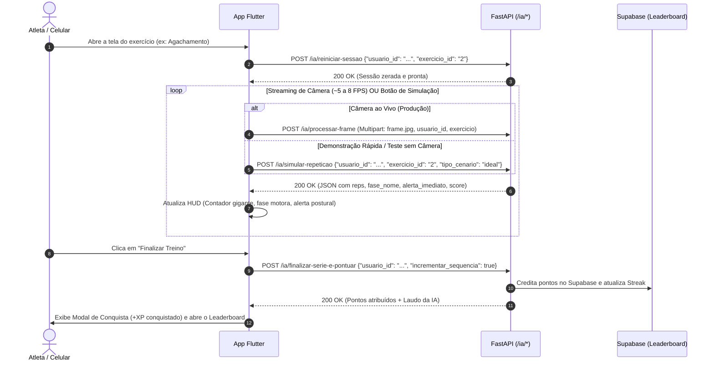

# 📱 Guia de Integração Front-end (Flutter) $\leftrightarrow$ Back-end de IA

> **Público-Alvo:** Desenvolvedores de Front-end / Flutter.  
> **Propósito:** Especificação dos contratos HTTP REST e exemplos prontos em Dart para integrar a câmera e o HUD do aplicativo às rotas do motor biomecânico de IA.  
> **Status da API:** 100% Funcional, testada e integrada ao FastAPI em `./BD/api.py`.

---

## 1. 🌐 Configuração e URLs Base

As rotas de IA estão integradas ao mesmo servidor FastAPI do banco de dados:

* **Desenvolvimento Local (Web / Windows):** `http://127.0.0.1:8000`
* **Emulador Android:** `http://10.0.2.2:8000`
* **Produção em Nuvem (Render):** `https://personai-t6mf.onrender.com`
* **Documentação Interativa (Swagger):** `http://127.0.0.1:8000/docs` (Tag: `IA & Biomecânica`)

---

## 2. 🔄 Ciclo de Vida do Treino com IA



---

## 3. 📋 Catálogo de Exercícios Suportados

Ao chamar os endpoints, utilize o identificador numérico correspondente:

| `exercicio_id` | Nome do Exercício | Articulações Monitoradas | Ângulo Crítico |
| :---: | :--- | :--- | :--- |
| `"1"` | **Desenvolvimento de Ombro** | Cotovelo, Ombro | Extensão do braço acima da cabeça |
| `"2"` | **Agachamento Livre** | Joelho, Quadril | Flexão dos membros inferiores abaixo de 100° |
| `"3"` | **Rosca Bíceps** | Cotovelo | Flexão completa do antebraço até ~45° |

---

## 4. 🚀 Especificação dos Endpoints REST

### 4.1. Iniciar ou Resetar Série: `POST /ia/reiniciar-sessao`
Prepara o motor para o exercício e zera o contador de repetições do atleta.

* **Payload (JSON):**
  ```json
  {
    "usuario_id": "uuid-do-usuario-logado",
    "exercicio_id": "2"
  }
  ```
* **Resposta (200 OK):**
  ```json
  {
    "sucesso": true,
    "mensagem": "Sessão reiniciada para o exercício 'Agachamento Livre'.",
    "usuario_id": "uuid-do-usuario-logado",
    "exercicio_id": "agachamento",
    "exercicio_nome": "Agachamento Livre",
    "repeticoes": 0
  }
  ```

---

### 4.2. Enviar Fotograma da Câmera: `POST /ia/processar-frame`
Envia o fotograma capturado pelo plugin `camera` do Flutter para avaliação em tempo real.

* **Formato:** `multipart/form-data`
* **Campos:**
  * `frame`: Arquivo em bytes da imagem (`.jpg` ou `.png`).
  * `usuario_id`: String do usuário.
  * `exercicio`: String do exercício (`"1"`, `"2"` ou `"3"`).
  * `lado`: String (`"direito"` ou `"esquerdo"`, default: `"direito"`).

* **Resposta (200 OK):**
  ```json
  {
    "sucesso": true,
    "corpo_visivel": true,
    "repeticoes": 3,
    "fase_numero": 2,
    "fase_nome": "Pico do Movimento",
    "alerta_imediato": "Mantenha o tronco alinhado",
    "angulos": {
      "joelho": 88.5,
      "quadril": 82.1
    },
    "repeticao_concluida": true,
    "ultima_repeticao": {
      "numero_repeticao": 3,
      "score_final": 94.5,
      "score_dtw": 96.2,
      "penalidade_fsm": 0.0,
      "aprovado": true,
      "classificacao": "EXCELENTE",
      "feedback_principal": "Excelente repetição! Padrão motor e amplitude alinhados à referência."
    }
  }
  ```

* **Como interpretar para o HUD:**
  * `repeticoes`: Número exibido no contador principal do HUD.
  * `fase_nome`: Badge indicativo do estado motor (`"Repouso"`, `"Fase Inicial"`, `"Pico do Movimento"`, `"Retorno"`).
  * `alerta_imediato`: Se não for `null`, exibir banner em **vermelho** com a mensagem. Se for `null`, exibir banner em **verde** (*"Postura Correta"*).
  * `repeticao_concluida`: Quando vier `true`, tocar feedback sonoro/vibração e animar o card com a nota (`score_final`).

---

### 4.3. Simulação Instantânea de Repetição (Recurso Chave para a Banca): `POST /ia/simular-repeticao`
Executa uma repetição canônica completa no motor da IA, garantindo que o avaliador veja o sistema funcionando mesmo em computadores sem webcam.

* **Payload (JSON):**
  ```json
  {
    "usuario_id": "uuid-do-usuario-logado",
    "exercicio_id": "1",
    "tipo_cenario": "ideal"
  }
  ```
  *(Opções para `tipo_cenario`: `"ideal"` para execução nota 95+, ou `"postural"` para demonstrar penalidade e alerta de erro).*

* **Resposta (200 OK):**
  ```json
  {
    "sucesso": true,
    "exercicio_nome": "Desenvolvimento de Ombro",
    "repeticoes": 1,
    "alerta_imediato": null,
    "ultima_repeticao": {
      "numero_repeticao": 1,
      "score_final": 96.0,
      "aprovado": true,
      "classificacao": "EXCELENTE",
      "feedback_principal": "Excelente repetição! Padrão motor e amplitude alinhados à referência."
    }
  }
  ```

---

### 4.4. Finalizar Treino e Gravar Pontuação: `POST /ia/finalizar-serie-e-pontuar`
Encerra a sessão de IA, calcula os pontos proporcionais às repetições aprovadas (`pontos_gamificacao`), salva automaticamente na tabela `usuarios` do Supabase e atualiza a sequência diária (*Streak*).

* **Payload (JSON):**
  ```json
  {
    "usuario_id": "uuid-do-usuario-logado",
    "incrementar_sequencia": true
  }
  ```

* **Resposta (200 OK):**
  ```json
  {
    "sucesso": true,
    "pontos_atribuidos": 28,
    "resumo_ia": {
      "nome_exercicio": "Desenvolvimento de Ombro",
      "total_repeticoes": 3,
      "repeticoes_aprovadas": 3,
      "taxa_aprovacao": 100.0,
      "score_medio": 94.2,
      "pontos_gamificacao": 28.3,
      "recomendacao_prioritaria": "Excelente consistência técnica em toda a série! Padrão motor exemplar."
    },
    "atualizacao_banco": {
      "sucesso": true,
      "mensagem": "Pontuação diária atualizada com sucesso!"
    }
  }
  ```

---

## 5. 💻 Snippets Prontos em Dart / Flutter

### 5.1. Métodos para Adicionar ao `lib/services/api_service.dart`

```dart
import 'dart:convert';
import 'package:http/http.dart' as http;

// 1. Reiniciar Sessão
Future<Map<String, dynamic>> reiniciarSessaoIA(String usuarioId, String exercicioId) async {
  final url = Uri.parse('$baseUrl/ia/reiniciar-sessao');
  final res = await http.post(
    url,
    headers: {'Content-Type': 'application/json'},
    body: jsonEncode({'usuario_id': usuarioId, 'exercicio_id': exercicioId}),
  );
  return jsonDecode(utf8.decode(res.bodyBytes));
}

// 2. Enviar Frame da Câmera (JPG)
Future<Map<String, dynamic>> processarFrameIA({
  required List<int> imageBytes,
  required String usuarioId,
  required String exercicioId,
  String lado = 'direito',
}) async {
  final url = Uri.parse('$baseUrl/ia/processar-frame');
  final request = http.MultipartRequest('POST', url);
  request.fields['usuario_id'] = usuarioId;
  request.fields['exercicio'] = exercicioId;
  request.fields['lado'] = lado;
  request.files.add(
    http.MultipartFile.fromBytes('frame', imageBytes, filename: 'frame.jpg'),
  );

  final streamedResponse = await request.send();
  final response = await http.Response.fromStream(streamedResponse);
  return jsonDecode(utf8.decode(response.bodyBytes));
}

// 3. Simular Repetição Instantânea (Demo para a Banca)
Future<Map<String, dynamic>> simularRepeticaoIA({
  required String usuarioId,
  required String exercicioId,
  String cenario = 'ideal',
}) async {
  final url = Uri.parse('$baseUrl/ia/simular-repeticao');
  final res = await http.post(
    url,
    headers: {'Content-Type': 'application/json'},
    body: jsonEncode({
      'usuario_id': usuarioId,
      'exercicio_id': exercicioId,
      'tipo_cenario': cenario,
    }),
  );
  return jsonDecode(utf8.decode(res.bodyBytes));
}

// 4. Finalizar Série e Gravar Pontos
Future<Map<String, dynamic>> finalizarSerieEPontuar(String usuarioId) async {
  final url = Uri.parse('$baseUrl/ia/finalizar-serie-e-pontuar');
  final res = await http.post(
    url,
    headers: {'Content-Type': 'application/json'},
    body: jsonEncode({
      'usuario_id': usuarioId,
      'incrementar_sequencia': true,
    }),
  );
  return jsonDecode(utf8.decode(res.bodyBytes));
}
```

---

## 6. 💡 Dicas para a Apresentação da Demo

1. **Botão de Atalho "Simulação IA":** Na tela de treino do Flutter, adicione um botão de teste chamando `simularRepeticaoIA(usuarioId, '1', 'ideal')`. Isso permite que qualquer membro da banca teste o fluxo instantaneamente, veja o contador subir de `0` para `1`, receba a nota `96%` e o feedback pedagógico.
2. **Ao Clicar em Concluir:** Invoque `finalizarSerieEPontuar(usuarioId)`. A resposta já traz os pontos gravados no Supabase e permite navegar diretamente para a tela de **Leaderboard** ou **Perfil** para mostrar a pontuação atualizada!
