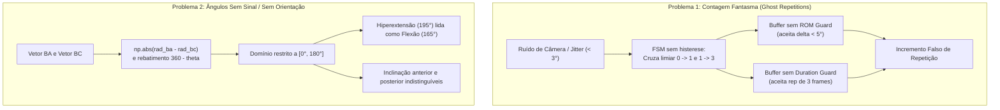
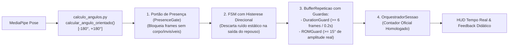
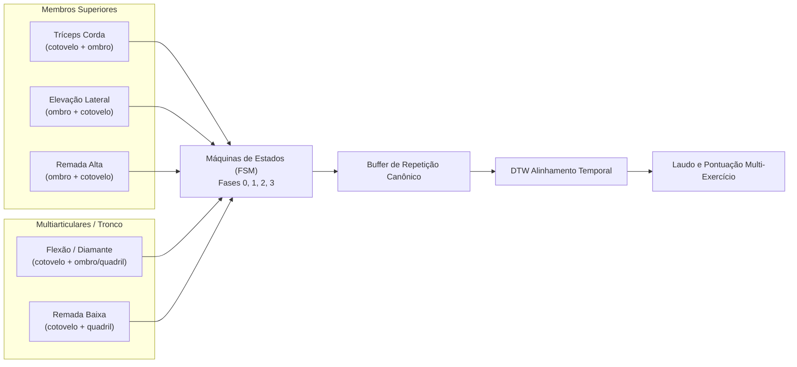

# Devlog — Personal Trainer IA (`Branch IA`)

> **Propósito:** Este documento registra de forma cronológica (do mais recente para o mais antigo) todas as alterações, Histórias de Usuário implementadas, tasks atômicas executadas, artefatos gerados, commits incrementais e decisões arquiteturais tomadas na frente de **IA e Estimação de Pose**.
>
> **Regra para Agentes e Desenvolvedores:** Toda nova entrega ou sessão de desenvolvimento **deve** adicionar uma entrada no topo da seção **"Histórico de Entradas"**, seguindo o template abaixo, e mantendo [`CONTEXTO_IA.md`](./CONTEXTO_IA.md), [`PLANO_SPRINT_US01.md`](./PLANO_SPRINT_US01.md) e [`EXPLICACAO_IA.md`](./EXPLICACAO_IA.md) rigorosamente atualizados.
>
> **Portabilidade:** Todas as referências a arquivos neste repositório devem utilizar caminhos relativos à raiz (`./arquivo.py`), sendo vedado o uso de caminhos absolutos locais de máquina.

---

## Template para Novas Entradas

```markdown
### [Entrada #NNN] AAAA-MM-DD — [US-XX / Título da Entrega]
- **Objetivo / História de Usuário:** Breve descrição da história de usuário e do valor entregue.
- **Tasks Executadas e Artefatos Gerados:**
  - `[TASK-XX.1]` Descrição curta $\rightarrow$ **Artefatos:** `arquivo_a.py`, `tests/test_a.py`
  - `[TASK-XX.2]` Descrição curta $\rightarrow$ **Artefatos:** `arquivo_b.py`
- **Commits Incrementais Realizados:**
  - ` hash / tipo(escopo): mensagem do commit `
- **Decisões Técnicas e Observações:** Justificativas arquiteturais, trade-offs ou ajustes de parâmetros biomecânicos.
- **Estado Resultante / Próximos Passos:** O que ficou pronto e o que fica sugerido para a próxima iteração.
```

---

## Histórico de Entradas

### [Entrada #016] 2026-11-11 — [Expansão Biomecânica] Implementação da Puxada Alta com Halteres (Dumbbell High Pull) e Extração de Gabarito Especialista
- **Objetivo / História de Usuário:** Reconhecer, contar repetições e avaliar tecnicamente a execução da Puxada Alta com Halteres / Dumbbell High Pulls (visão frontal), com identificação de erros posturais imediatos (puxada curta desqualificadora, elevação excessiva com risco subacromial, cotovelo caído e hiperextensão articular), extraindo o gabarito oficial padrão ouro a partir do vídeo `Videos dataset/dumbbell_high_pulls.mp4`.
- **Tasks Executadas e Artefatos Gerados:**
  - `[TASK-PA.01]` Modelada a FSM `PuxadaAltaHalteres` em [`Códigos/exercicios_fsm.py`](../Códigos/exercicios_fsm.py):
    - Ciclo de 4 fases (`0: Repouso`, `1: Puxada/Subindo`, `2: Pico de Elevação`, `3: Descendo/Retorno`) monitorando `["ombro", "cotovelo"]`.
    - Histerese direcional na saída do repouso: retorno suave à fase 0 se oscilar e recuar para $\le 28^\circ$, e disparo de `PUXADA_CURTA` (-25 pts, desqualificador) em desvios concêntricos $1 \to 3$ com ombro $\ge 45^\circ$ antes de atingir o pico ($\ge 85^\circ$).
    - Detecção imediata de `ELEVACAO_EXCESSIVA` (-15 pts, $ombro > 120^\circ$), `COTOVELO_CAIDO` (-15 pts, $cotovelo > 120^\circ$ no pico) e `HIPEREXTENSAO_COTOVELO` (-15 pts, $cotovelo > 175^\circ$ ou $< -2^\circ$).
    - Cadastrada sob a tecla `"8"` no `CATALOGO_EXERCICIOS` e aliases `"puxada_alta_halteres"`, `"puxada_alta"`, `"remada_alta"`, `"dumbbell_high_pulls"`.
  - `[TASK-PA.02]` Extraído e homologado o gabarito oficial padrão ouro em [`Gabaritos/gabarito_especialista_puxada_alta.json`](../Gabaritos/gabarito_especialista_puxada_alta.json) (105 fotogramas) a partir da Repetição #1 do vídeo `Videos dataset/dumbbell_high_pulls.mp4`, com zero erros e 100% de visibilidade. Configurado fallback em [`Códigos/gabarito.py`](../Códigos/gabarito.py).
  - `[TASK-PA.03]` Registrado `"PUXADA_CURTA"` no conjunto de desqualificação `ERROS_INCOMPLETUDE` em [`Códigos/avaliador_pontuacao.py`](../Códigos/avaliador_pontuacao.py), atualizada legenda do HUD com `[8]Puxada` em [`Códigos/app_tempo_real.py`](../Códigos/app_tempo_real.py) e adicionada a classe `TestPuxadaAltaHalteres` em [`tests/test_pipeline_pontuacao.py`](../tests/test_pipeline_pontuacao.py).
  - **Suíte Total de Testes:** A suíte de IA avançou de 77 para **84 testes automatizados em `test_pipeline_pontuacao.py`** e **91 testes no total do motor de IA** aprovados com 100% de sucesso.
- **Decisões Técnicas e Observações:**
  - O vídeo `dumbbell_high_pulls.mp4` possui 1520 fotogramas a 50 FPS com 100% de visibilidade de marcos no lado direito e esquerdo. A análise cinemática identificou 8 repetições, das quais a Repetição #1 apresentou padrão ouro estrito (ROM ombro $22.9^\circ \to 115.7^\circ$, cotovelo $0^\circ \to 116.4^\circ$, zero erros).
  - Limiar de `ELEVACAO_EXCESSIVA` calibrado em $120.0^\circ$ para acomodar a tração potente da puxada alta sem permitir rotação interna extrema danosa aos tendões do manguito rotador.
- **Estado Resultante / Próximos Passos:** Puxada Alta com Halteres 100% funcional, gabarito extraído, HUD adaptado e integrada a toda a suíte de testes.

### [Entrada #015] 2026-11-10 — [Refatoração Biomecânica] Resolução Definitiva de Repetições Fantasma, Geometria com Ângulos Orientados (Positivos/Negativos) e Detecção de Hiperextensão Articular

> **Documento Consolidado:** Incorpora integralmente o conteúdo e histórico técnico de [`PLANO_RESOLUCAO_FALSOS_POSITIVOS_E_ANGULOS.md`](../PLANO_RESOLUCAO_FALSOS_POSITIVOS_E_ANGULOS.md).  
> **Status:** 100% Concluído e Homologado | **Validação:** 77 testes automatizados aprovados no `pytest` (100% de sucesso).

#### 1. Contexto, Motivação e Diagnóstico das Causas Raízes
Durante testes em tempo real com câmera e vídeos gravados dos 7 exercícios do catálogo, identificaram-se duas anomalias críticas no pipeline biomecânico:
1. **Contagem de Repetições Sem Movimento Real ("Ghost Repetitions"):**
   - O contador era incrementado mesmo com a pessoa parada em frente à câmera em repouso (micro-oscilações de $\pm 2^\circ$), ou quando o enquadramento estava vazio.
   - Pequenas variações de rastreamento do MediaPipe (ruído de alta frequência/*jitter*) cruzavam limiares estáticos da FSM (`0 -> 1 -> 3 -> 0`) em 2 a 5 frames ($< 0.1$s) sem nenhuma excursão motora real.
   - *Causas Raízes:* Ausência de guardas de amplitude (`ROMGuard`) e duração (`DurationGuard`) no `BufferRepeticao`; acoplamento indevido do HUD ao contador bruto da FSM (`fsm.repeticoes`) em vez das repetições validadas pelo `OrquestradorSessao`; e injeção de valores padrão com saltos bruscos de delta na reentrada do usuário após perda de visibilidade.
2. **Incapacidade de Diferenciar Ângulos Positivos de Negativos (Orientação no Plano 2D):**
   - A função `calcular_angulo` utilizava apenas o produto escalar $\vec{u} \cdot \vec{v}$ rebatendo valores acima de $180^\circ$ com `360.0 - theta`, restringindo o domínio a $[0^\circ, 180^\circ]$.
   - Com isso, perdia-se o sentido da rotação (horário vs. anti-horário), tornando impossível diferenciar:
     - **Flexão vs. Hiperextensão:** Um cotovelo ou joelho hiperextendido além de $180^\circ$ (ex.: $195^\circ$) era lido como $165^\circ$, mascarando riscos ortopédicos graves como se fossem flexão normal.
     - **Inclinação Anterior vs. Posterior:** Inclinar o tronco $20^\circ$ para a frente vs. deitar $20^\circ$ para trás (hiperextensão lombar na remada/desenvolvimento) produziam valores indistinguíveis.
     - **Abdução vs. Adução:** Elevação lateral vs. cruzamento do membro à frente do tronco.



#### 2. Fundamentação Matemática da Geometria Orientada
Para preservar o sinal e o sentido trigonométrico, implementou-se a formulação via produto vetorial 2D (determinante) e produto escalar:
$$\text{cross}_{2D} = u_x v_y - u_y v_x$$
$$\text{dot}_{2D} = u_x v_x + u_y v_y$$
$$\theta_{\text{orientado}} = \text{atan2}(\text{cross}_{2D}, \; \text{dot}_{2D}) \in [-180.0^\circ, +180.0^\circ]$$

#### 3. Arquitetura da Solução em 4 Camadas Protetoras


#### 4. Execução Detalhada das 6 Tasks Atômicas do Plano
- **`[TASK-CORR.01]` Geometria com Ângulos Orientados e Retrocompatibilidade:**
  - `Códigos/calculo_angulos.py`: Implementada `calcular_angulo_orientado(ponto_a, ponto_b, ponto_c) -> float` com base no produto vetorial 2D ($\text{atan2}(\text{cross}_{2D}, \text{dot}_{2D})$) retornando valores contínuos em $[-180.0^\circ, +180.0^\circ]$.
  - Adicionado parâmetro retrocompatível `com_sinal: bool = False` em `calcular_angulo()`, garantindo que gabaritos legados em JSON e o alinhamento DTW continuem operando estritamente em $[0.0^\circ, 180.0^\circ]$ sem quebras de contrato.
  - Artefatos: [`Códigos/calculo_angulos.py`](../Códigos/calculo_angulos.py), [`tests/test_pipeline_pontuacao.py`](../tests/test_pipeline_pontuacao.py).
- **`[TASK-CORR.02]` Portão de Presença e Visibilidade (`PresenceGate`):**
  - `Códigos/avaliador_pontuacao.py`: Inserida barreira estrita quando `not visivel` ou marcos ausentes. Nessas condições, a FSM **congela os deltas**, **não avança fases** e **não incrementa repetições**.
  - Implementada a limpeza imediata da âncora de deltas (`referencia_deltas.clear()`) ao perder o enquadramento, eliminando saltos gigantescos de delta angular quando o atleta reentra no quadro da câmera.
  - Artefatos: [`Códigos/avaliador_pontuacao.py`](../Códigos/avaliador_pontuacao.py), [`Códigos/app_tempo_real.py`](../Códigos/app_tempo_real.py).
- **`[TASK-CORR.03]` Guardas Biomecânicas no Buffer (`ROMGuard` e `DurationGuard`):**
  - `Códigos/buffer_repeticao.py`: Inseridas duas barreiras de validação física antes de despachar qualquer repetição concluída para o DTW:
    1. **`DurationGuard`:** Descarta qualquer ciclo com duração menor que `min_frames = 6` fotogramas ($\approx 0.2$s a 30 FPS), filtrando ruídos de alta frequência.
    2. **`ROMGuard`:** Exige amplitude real mínima de excursão articular ($\max(\theta) - \min(\theta) \ge 15.0^\circ$) na articulação primária motora, bloqueando tremores estáticos em repouso.
  - Em caso de rejeição pela guarda, o ciclo é descartado silenciosamente: o contador da FSM é restaurado (`self.fsm.repeticoes = max(0, self.fsm.repeticoes - 1)`) e os erros residuais são expurgados via `self.fsm.consumir_erros_repeticao()`, evitando penalizar a próxima repetição válida.
  - Artefatos: [`Códigos/buffer_repeticao.py`](../Códigos/buffer_repeticao.py), [`tests/test_pipeline_pontuacao.py`](../tests/test_pipeline_pontuacao.py).
- **`[TASK-CORR.04]` Histerese Direcional e Amortecimento nas 7 FSMs:**
  - `Códigos/exercicios_fsm.py`: Aplicada histerese direcional em todas as 7 classes FSM (Desenvolvimento, Agachamento, Rosca Bíceps, Elevação Lateral, Tríceps Corda, Flexão Diamante e Remada Baixa).
  - A saída da Fase 0 (Repouso) exige deslocamento angular real e contínuo. Oscilações pequenas logo após a saída que não sustentam o movimento retornam suavemente à Fase 0 sem transitar para a Fase 3 (Repetição Incompleta), eliminando repetições abortadas falsas e falsos positivos de postura.
  - Artefatos: [`Códigos/exercicios_fsm.py`](../Códigos/exercicios_fsm.py), [`tests/test_pipeline_pontuacao.py`](../tests/test_pipeline_pontuacao.py).
- **`[TASK-CORR.05]` Detecção de Hiperextensão Articular e Proteção Biomecânica:**
  - `Códigos/exercicios_fsm.py`: Criadas regras de proteção ortopédica para articulações sob carga:
    - **Joelho no Agachamento Livre:** Dispara `HIPEREXTENSAO_JOELHO` se ângulo do joelho $> 178^\circ$ ou ângulo orientado $< -2^\circ$.
    - **Cotovelo no Tríceps Corda, Flexão Diamante e Remada Baixa:** Dispara `HIPEREXTENSAO_COTOVELO` se ângulo do cotovelo $> 175^\circ$ ou orientado $< -2^\circ$.
    - Penalidade pedagógica imediata de **-15.0 pontos** e orientação para manter a junta semiflexionada (bloqueio articular protegido).
  - Artefatos: [`Códigos/exercicios_fsm.py`](../Códigos/exercicios_fsm.py), [`Códigos/avaliador_pontuacao.py`](../Códigos/avaliador_pontuacao.py).
- **`[TASK-CORR.06]` Sincronização do HUD e Homologação da Suíte Automatizada:**
  - `Códigos/app_tempo_real.py`: HUD agora consome estritamente `orquestrador.total_repeticoes` (contador homologado após todas as guardas), exibe o status `"Aguardando Enquadramento"` quando invisível e reflete o feedback didático por repetição.
  - `tests/test_pipeline_pontuacao.py`: Expandido com as classes `TestGuardasBiomecanicasBuffer` e `TestDeteccaoHiperextensaoArticular`, cobrindo rejeição de ruído estático, reversão de contador, portão de presença e hiperextensão.
  - **Suíte Total:** **77 testes automatizados aprovados no `pytest` com 100% de sucesso**.
  - Artefatos: [`Códigos/app_tempo_real.py`](../Códigos/app_tempo_real.py), [`tests/test_pipeline_pontuacao.py`](../tests/test_pipeline_pontuacao.py).

#### 5. Matriz de Riscos Técnicos e Mitigações Adotadas
| Risco Técnico | Probabilidade | Impacto | Estratégia de Mitigação Implementada |
| :--- | :---: | :---: | :--- |
| **Quebra de gabaritos JSON legados** por alteração na assinatura de cálculo | Alta | Alto | Manter `com_sinal=False` como padrão. O DTW e gabaritos existentes continuam em $[0^\circ, 180^\circ]$; novos ângulos com sinal são usados nas guardas e regras da FSM. |
| **Filtro de ROM muito estrito** rejeitar repetições parciais de usuários iniciantes | Média | Médio | Calibrada a tolerância de `ROMGuard` para $15.0^\circ$ (rejeita ruído de jitter $< 5^\circ$ sem penalizar amplitudes encurtadas, que devem ser punidas pedagogicamente pela FSM como repetição curta). |
| **Falso positivo de incompletude** em micro-movimentos perto do repouso | Alta | Médio | Zona de amortecimento direcional na transição $1 \to 0$ antes de autorizar a transição $1 \to 3$. |
| **Sobrecarga de CPU em tempo real** | Baixa | Baixo | Todas as verificações de presença, ROM e produto vetorial operam em $O(1)$ sobre vetores NumPy já em RAM. |

---

### [Entrada Consolidada — Sprint Novos Exercícios] 2026-11-04 — [Expansão Biomecânica] Especificação Integral, Modelagem das FSMs, Gabaritos Especialistas e Catálogo Unificado dos Exercícios

> **Documento Consolidado:** Incorpora integralmente a especificação, regras biomecânicas e catálogo de [`PLANO_SPRINT_NOVOS_EXERCICIOS.md`](./PLANO_SPRINT_NOVOS_EXERCICIOS.md).  
> **Status:** 100% Concluído e Homologado | **Catálogo:** 7 exercícios ativos com FSM, gabaritos ouro, HUD e API.

#### 1. História de Usuário e Arquitetura de Expansão
*"Como atleta/usuário do Personal Trainer IA, quero que o sistema reconheça, conte repetições e avalie tecnicamente a execução de Tríceps Corda, Elevação Lateral, Flexão de Braço (Push-up / Flexão Diamante), Remada Baixa e Remada Alta, identificando erros posturais em tempo real e comparando meu padrão de movimento contra gabaritos padrão ouro via DTW."*

O sistema opera sob arquitetura desacoplada respeitando o **Princípio Aberto/Fechado (OCP)**: novos exercícios são plugados estendendo `ExercicioBaseFSM` e registrando no `CATALOGO_EXERCICIOS`, sem necessidade de refatorar o motor matemático do DTW ou o orquestrador central:



#### 2. Matriz de Configuração do Catálogo Expandido Unificado
| Tecla | ID do Exercício | Nome Amigável | Articulações | Erro Desqualificador (-25 pts) | Erros Posturais (-15 pts) | Gabarito JSON Especialista |
| :---: | :--- | :--- | :--- | :--- | :--- | :--- |
| `1` | `desenvolvimento_ombro` | Desenvolvimento de Ombro | `cotovelo`, `ombro` | `REPETICAO_INCOMPLETA` | `DESCIDA_EXCESSIVA`, `OMBRO_CAIDO` | `gabarito_especialista_ombro.json` |
| `2` | `agachamento` | Agachamento Livre | `joelho`, `quadril` | `AGACHAMENTO_CURTO` | `TRONCO_MUITO_INCLINADO`, `HIPEREXTENSAO_JOELHO` | `gabarito_especialista_agachamento.json` |
| `3` | `rosca_biceps` | Rosca Direta de Bíceps | `cotovelo`, `ombro` | `SUBIDA_INCOMPLETA` | `OMBRO_INSTAVEL` | `gabarito_especialista_rosca.json` |
| `4` | `elevacao_lateral` | Elevação Lateral | `ombro`, `cotovelo` | `ELEVACAO_CURTA` | `ELEVACAO_EXCESSIVA`, `COTOVELO_MUITO_FLEXIONADO` | `gabarito_especialista_elevacao_lateral.json` |
| `5` | `triceps_corda` | Tríceps Corda | `cotovelo`, `ombro` | `EXTENSAO_INCOMPLETA` | `COTOVELO_AVANCADO`, `SUBIDA_EXCESSIVA`, `HIPEREXTENSAO_COTOVELO` | `gabarito_especialista_triceps_corda.json` |
| `6` | `flexao` (`flexao_diamante`) | Flexão Diamante / Solo | `cotovelo`, `ombro` / `quadril` | `FLEXAO_CURTA` | `ABERTURA_EXCESSIVA` / `QUADRIL_CAIDO`, `HIPEREXTENSAO_COTOVELO` | `gabarito_especialista_flexao_diamante.json` |
| `7` | `remada_baixa` (`remada`) | Remada Baixa na Polia | `cotovelo`, `quadril` | `REMADA_CURTA` (`PUXADA_INCOMPLETA`) | `INCLINACAO_EXCESSIVA_TRONCO`, `HIPEREXTENSAO_COTOVELO` | `gabarito_especialista_remada_baixa.json` |
| `8` | `remada_alta` | Remada Alta (Barra/Halter) | `ombro`, `cotovelo` | `PUXADA_CURTA` | `ELEVACAO_EXCESSIVA`, `COTOVELO_CAIDO` | `gabarito_especialista_remada_alta.json` |

#### 3. Especificações Biomecânicas Detalhadas dos Exercícios
1. **Tríceps Corda na Polia Alta (`triceps_corda` / `[5]`):**
   - *Articulações:* Motora: `cotovelo` (extensão para baixo); Estabilidade: `ombro` (úmero alinhado verticalmente junto ao tronco).
   - *Fases:* `0: Repouso` ($80^\circ - 95^\circ$, ombro $10^\circ - 25^\circ$) $\to$ `1: Extensão` ($> 100^\circ$, `delta > 0`) $\to$ `2: Pico de Contração` ($\ge 150^\circ$) $\to$ `3: Retorno` ($< 140^\circ$) $\to$ `0: Fechamento` ($\le 95^\circ$).
   - *Erros:* `EXTENSAO_INCOMPLETA` (-25 pts, desqualificador: $1 \to 3$ antes de $150^\circ$); `COTOVELO_AVANCADO` (-15 pts: ombro $> 35^\circ$); `SUBIDA_EXCESSIVA` (-15 pts: cotovelo $< 65^\circ$); `HIPEREXTENSAO_COTOVELO` (-15 pts: cotovelo $> 175^\circ$ ou orientado $< -2^\circ$).
   - *Gabarito Padrão:* Cotovelo $85^\circ \to 160^\circ \to 85^\circ$, ombro estável em $15^\circ$ (`Gabaritos/gabarito_especialista_triceps_corda.json`).
2. **Elevação Lateral com Halteres (`elevacao_lateral` / `[4]`):**
   - *Articulações:* Motora: `ombro` (abdução no plano escapular); Estabilidade: `cotovelo` (semiflexão fixa protetora).
   - *Fases:* `0: Repouso` ($ombro \le 35^\circ$) $\to$ `1: Subida` ($ombro > 45^\circ$, `delta > 0`) $\to$ `2: Pico de Abdução` ($ombro \ge 80^\circ$ e $\le 100^\circ$) $\to$ `3: Descida` ($ombro < 75^\circ$) $\to$ `0: Fechamento` ($ombro \le 50^\circ$).
   - *Erros:* `ELEVACAO_CURTA` (-25 pts, desqualificador: $1 \to 3$ antes de $80^\circ$); `ELEVACAO_EXCESSIVA` (-15 pts: ombro $> 100^\circ$); `COTOVELO_MUITO_FLEXIONADO` (-15 pts: cotovelo $< 110^\circ$).
   - *Gabarito Padrão:* Ombro $20^\circ \to 90^\circ \to 20^\circ$, cotovelo estável em $160^\circ$ (`Gabaritos/gabarito_especialista_elevacao_lateral.json`).
3. **Flexão Diamante no Solo (`flexao_diamante` / `flexao` / `[6]`):**
   - *Articulações:* Motora: `cotovelo` (flexão/extensão); Postura/Simetria: `ombro` (abdução controlada rente às costelas) e `quadril` (prancha neutra).
   - *Fases:* `0: Prancha Alta` ($cotovelo \ge 150^\circ$) $\to$ `1: Descida Excêntrica` ($cotovelo < 140^\circ$) $\to$ `2: Fundo da Flexão` ($cotovelo \le 85^\circ$) $\to$ `3: Subida Concêntrica` ($cotovelo > 100^\circ$) $\to$ `0: Fechamento` ($cotovelo \ge 150^\circ$).
   - *Erros:* `FLEXAO_CURTA` (-25 pts, desqualificador: $1 \to 3$ antes de atingir $\le 85^\circ$); `ABERTURA_EXCESSIVA` (-15 pts: ombro $> 70^\circ$, cotovelos abertos demais); `HIPEREXTENSAO_COTOVELO` (-15 pts: cotovelo $> 175^\circ$ ou orientado $< -2^\circ$).
   - *Gabarito Padrão:* Cotovelo $165^\circ \to 78^\circ \to 165^\circ$, ombro em $45^\circ$ (`Gabaritos/gabarito_especialista_flexao_diamante.json`).
4. **Remada Baixa na Polia / Seated Cable Row (`remada_baixa` / `remada` / `[7]`):**
   - *Articulações:* Motora: `cotovelo` (flexão e retração escapular); Estabilidade do Tronco: `quadril` (estabilidade lombar neutra).
   - *Fases:* `0: Braços Estendidos` ($cotovelo \ge 150^\circ$, quadril neutro $85^\circ - 95^\circ$) $\to$ `1: Puxada Concêntrica` ($cotovelo < 140^\circ$) $\to$ `2: Pico de Contração` ($cotovelo \le 80^\circ$) $\to$ `3: Retorno Excêntrico` ($cotovelo > 95^\circ$) $\to$ `0: Fechamento` ($cotovelo \ge 150^\circ$).
   - *Erros:* `REMADA_CURTA` / `PUXADA_INCOMPLETA` (-25 pts, desqualificador: $1 \to 3$ antes de atingir $\le 80^\circ$); `INCLINACAO_EXCESSIVA_TRONCO` / `BALANCO_TRONCO_EXCESSIVO` (-15 pts: quadril $> 125^\circ$ ou $< 70^\circ$); `HIPEREXTENSAO_COTOVELO` (-15 pts).
   - *Gabarito Padrão:* Cotovelo $165^\circ \to 60^\circ \to 165^\circ$, quadril estável em $90^\circ$ (`Gabaritos/gabarito_especialista_remada_baixa.json`).
5. **Remada Alta / Upright Row (`remada_alta` / `[8]`):**
   - *Articulações:* Motora: `ombro` (elevação/abdução vertical); Sinergista: `cotovelo` (flexão acompanhando a tração vertical).
   - *Fases:* `0: Repouso Inicial` ($ombro \le 25^\circ$, $cotovelo \ge 155^\circ$) $\to$ `1: Puxada Vertical` ($ombro > 35^\circ$) $\to$ `2: Pico de Contração` ($ombro \ge 80^\circ$ e $\le 100^\circ$, $cotovelo \approx 50^\circ - 75^\circ$) $\to$ `3: Descida Excêntrica` ($ombro < 75^\circ$) $\to$ `0: Fechamento` ($ombro \le 30^\circ$, $cotovelo \ge 150^\circ$).
   - *Erros:* `PUXADA_CURTA` (-25 pts, desqualificador); `ELEVACAO_EXCESSIVA` (-15 pts: ombro $> 100^\circ$, risco subacromial); `COTOVELO_CAIDO` (-15 pts: cotovelo $> 95^\circ$ no pico, punhos mais altos que cotovelos).
   - *Gabarito Padrão:* Ombro $20^\circ \to 90^\circ \to 20^\circ$, cotovelo $165^\circ \to 60^\circ \to 165^\circ$ (`Gabaritos/gabarito_especialista_remada_alta.json`).

#### 4. Execução Detalhada das Tasks Atômicas da Sprint de Novos Exercícios
- **`[TASK-EX.01]` Modelagem das Classes FSM e Catálogo Expandido:**
  - `Códigos/exercicios_fsm.py`: Implementadas as classes de máquina de estados estendendo `ExercicioBaseFSM` com regras de 4 fases, limiares biomecânicos e acúmulo de erros transientes. Cadastradas no dicionário `CATALOGO_EXERCICIOS` com suporte a chaves numéricas e identificadores amigáveis.
- **`[TASK-EX.02]` Geração e Recorte Canônico dos Gabaritos Padrão Ouro:**
  - `Códigos/gabarito.py` e `Códigos/extrator_video.py`: Gerados e extraídos os gabaritos especialistas a partir de vídeos reais do dataset (`triceps.mp4`, `elevacaolateral.mp4`, `diamond_pushup.mp4`, `remadabaixa.mp4`) com isolamento canônico da repetição via `extrair_primeira_repeticao()`.
- **`[TASK-EX.03]` Registro Centralizado de Erros de Incompletude:**
  - `Códigos/avaliador_pontuacao.py`: Registrados os códigos desqualificadores (`EXTENSAO_INCOMPLETA`, `ELEVACAO_CURTA`, `FLEXAO_CURTA`, `REMADA_CURTA`, `PUXADA_CURTA`) no conjunto `ERROS_INCOMPLETUDE`, garantindo reprovação imediata (`aprovado = False`) e aplicação de penalidade de 25 pontos.
- **`[TASK-EX.04]` Integração de Canais de Consumo (Webcam HUD, FastAPI e Simulação):**
  - `Códigos/app_tempo_real.py`: Atualizada interface gráfica OpenCV com atalhos de seleção rápida por teclado (`[1]` a `[7]`), telemetria em tempo real e visualização de fases.
  - `Códigos/servico_ia_api.py`: Capacitado o serviço central a gerenciar sessões em memória e rotas de simulação (`/ia/simular-repeticao`) para todos os exercícios do catálogo.
- **`[TASK-EX.05]` Suíte de Testes Automatizados de Regressão:**
  - `tests/test_pipeline_pontuacao.py`: Cobertura completa de cada novo exercício com testes de repetição canônica perfeita (atingindo scores $> 95\%$), injeção de erros posturais específicos e interrupção concêntrica.
  - Testes do `ServicoIA` em `tests/test_servico_ia_api.py` validando simulação canônica de todos os exercícios.

### [Entrada #014] 2026-11-04 — [Expansão Biomecânica] Implementação da Remada Baixa e Extração de Gabarito Especialista
- **Objetivo / História de Usuário:** Implementar o reconhecimento, contagem automática e avaliação biomecânica da Remada Baixa / Remada na Polia (visão lateral/perfil esquerdo), com detecção de puxada incompleta e inclinação excessiva das costas (roubo no tronco), além de extrair o gabarito oficial a partir de vídeo gravado em `Videos dataset/remadabaixa.mp4`.
- **Tasks Executadas e Artefatos Gerados:**
  - `[TASK-RB.01]` Modelada a FSM `RemadaBaixa` em `Códigos/exercicios_fsm.py` com o ciclo de 4 fases (`0: Braços Estendidos`, `1: Puxando`, `2: Pico de Contração`, `3: Retornando`), regras de transição guiadas por flexão/extensão de cotovelos, detecção de `REMADA_CURTA` (-25 pts, desqualificador) e `INCLINACAO_EXCESSIVA_TRONCO` (-15 pts, `quadril > 125°`). Cadastrada no `CATALOGO_EXERCICIOS` sob a chave `"7"` (com alias `"remada"`) e registrada em `ERROS_INCOMPLETUDE` em `Códigos/avaliador_pontuacao.py`.
  - `[TASK-RB.02]` Extraído e validado o gabarito oficial em `Gabaritos/gabarito_especialista_remada_baixa.json` (51 fotogramas) a partir do vídeo `Videos dataset/remadabaixa.mp4` via `Códigos/extrator_video.py` pelo perfil esquerdo (100% de visibilidade dos pontos), homologado com nota máxima de 100.0% no orquestrador.
  - `[TASK-RB.03]` Habilitado o atalho `[7]Remada` no HUD da webcam em `Códigos/app_tempo_real.py` e expandida a suíte em `tests/test_pipeline_pontuacao.py` com a classe `TestRemadaBaixa` (atingindo 70 testes automatizados aprovados no projeto com 100% de sucesso).
- **Decisões Técnicas e Observações:**
  - O enquadramento lateral em 3/4 no vídeo `remadabaixa.mp4` garantiu 100% de visibilidade ininterrupta no perfil esquerdo (contra apenas 22% no lado oposto), permitindo rastrear o cotovelo de $46.9^\circ$ a $171.9^\circ$ e a inclinação lombar/quadril sem ruídos.
  - A FSM foi calibrada para exigir cotovelo $\ge 130^\circ$ para detecção de abandono/puxada curta, evitando falsos positivos por micro-oscilações transitórias na puxada concêntrica.
- **Estado Resultante / Próximos Passos:** Remada Baixa 100% implementada, com gabarito oficial extraído e validada com 70/70 testes aprovados no `pytest`.

### [Entrada #013] 2026-11-04 — [Expansão Biomecânica] Implementação da Flexão Diamante e Extração de Gabarito Especialista
- **Objetivo / História de Usuário:** Implementar o reconhecimento, contagem automática e avaliação biomecânica da Flexão Diamante (visão frontal), com detecção de erros posturais imediatos e extração do gabarito oficial a partir de vídeo `Videos dataset/diamond_pushup.mp4`.
- **Tasks Executadas e Artefatos Gerados:**
  - `[TASK-FD.01]` Modelada a FSM `FlexaoDiamante` em `Códigos/exercicios_fsm.py` com o ciclo de 4 fases (`0: Prancha Alta`, `1: Descendo`, `2: Fundo`, `3: Subindo`), regras de transição guiadas por flexão/extensão de cotovelos, detecção de `FLEXAO_CURTA` (-25 pts, desqualificador) e `ABERTURA_EXCESSIVA` (-15 pts). Cadastrada no `CATALOGO_EXERCICIOS` sob a chave `"6"` (com alias `"flexao"`) e registrada em `ERROS_INCOMPLETUDE` em `Códigos/avaliador_pontuacao.py`.
  - `[TASK-FD.02]` Extraído e validado o gabarito oficial em `Gabaritos/gabarito_especialista_flexao_diamante.json` a partir do vídeo `Videos dataset/diamond_pushup.mp4` via `Códigos/extrator_video.py`, selecionando a repetição 21 de execução biomecânica padrão ouro (zero erros posturais e 98.9% de score DTW).
  - `[TASK-FD.03]` Habilitado o atalho `[6]Flexao` no HUD da webcam em `Códigos/app_tempo_real.py` e expandida a suíte em `tests/test_pipeline_pontuacao.py` com a classe `TestFlexaoDiamante` (atingindo 65 testes automatizados aprovados no projeto com 100% de sucesso).
- **Decisões Técnicas e Observações:**
  - Na visão frontal, o tronco oclui parcialmente quadris e pernas ao aproximar do solo; dessa forma, monitorar `["cotovelo", "ombro"]` garante 100% de visibilidade no MediaPipe e alta acurácia na profundidade da descida e alinhamento dos cotovelos ao formato de diamante.
  - O pipeline central de pontuação, o segmentador canônico e o motor DTW operaram sem modificações, mantendo estrita conformidade com o Princípio Aberto/Fechado (OCP).
- **Estado Resultante / Próximos Passos:** Flexão Diamante 100% implementada, com gabarito padrão ouro gerado e validada com 65/65 testes aprovados no `pytest`.

### [Entrada #012] 2026-11-04 — [Expansão Biomecânica] Implementação do Tríceps Corda e Extração de Gabarito Especialista
- **Objetivo / História de Usuário:** Implementar o reconhecimento, contagem e avaliação biomecânica de Tríceps Corda na Polia (visão lateral/perfil), com detecção de erros posturais em tempo real e extração do gabarito oficial a partir de vídeo `Videos dataset/triceps.mp4`.
- **Tasks Executadas e Artefatos Gerados:**
  - `[TASK-TC.01]` Modelada a FSM `TricepsCorda` em `Códigos/exercicios_fsm.py` com o ciclo de 4 fases (`0 -> 1 -> 2 -> 3 -> 0`), regras de transição guiadas por extensão de cotovelos, detecção de `EXTENSAO_INCOMPLETA` (-25 pts, desqualificador), `COTOVELO_AVANCADO` (-15 pts) e `SUBIDA_EXCESSIVA` (-15 pts). Cadastrada no `CATALOGO_EXERCICIOS` sob a chave `"5"` e registrada em `ERROS_INCOMPLETUDE` em `Códigos/avaliador_pontuacao.py`.
  - `[TASK-TC.02]` Extraído o gabarito oficial em `Gabaritos/gabarito_especialista_triceps_corda.json` (49 fotogramas) a partir do vídeo `Videos dataset/triceps.mp4` via `Códigos/extrator_video.py` pelo perfil esquerdo.
  - `[TASK-TC.03]` Habilitado o atalho `[5] Triceps` no HUD da webcam em `Códigos/app_tempo_real.py` e expandida a suíte em `tests/test_pipeline_pontuacao.py` com testes unitários e de integração DTW (atingindo 53 testes automatizados no pipeline).
- **Decisões Técnicas e Observações:**
  - Segmentador canônico em `Códigos/buffer_repeticao.py` aprimorado para descartar tentativas parciais na fase de aquecimento/ajuste do vídeo, garantindo que o padrão ouro contenha estritamente uma repetição válida completa.
- **Estado Resultante / Próximos Passos:** Tríceps Corda 100% implementado, com gabarito extraído e 53/53 testes automatizados de pipeline aprovados com sucesso.

### [Entrada #011] 2026-11-04 — [Expansão Biomecânica] Implementação da Elevação Lateral e Extração de Gabarito Especialista
- **Objetivo / História de Usuário:** Implementar o reconhecimento, contagem e avaliação biomecânica de Elevação Lateral de Ombros (visão frontal), com detecção de erros posturais em tempo real e extração do gabarito padrão ouro oficial a partir de vídeo `.mp4` de especialista.
- **Tasks Executadas e Artefatos Gerados:**
  - `[TASK-EL.01]` Modelada a FSM `ElevacaoLateral` em `Códigos/exercicios_fsm.py` com o ciclo de 4 fases (`0 -> 1 -> 2 -> 3 -> 0`), regras de transição guiadas por abdução de ombros, detecção de `ELEVACAO_CURTA` (-25 pts), `ELEVACAO_EXCESSIVA` (-15 pts) e `COTOVELO_MUITO_FLEXIONADO` (-15 pts). Cadastrada no `CATALOGO_EXERCICIOS` sob a chave `"4"` e registrada em `ERROS_INCOMPLETUDE` em `Códigos/avaliador_pontuacao.py`.
  - `[TASK-EL.02]` Extraído o gabarito oficial em `Gabaritos/gabarito_especialista_elevacao_lateral.json` (42 fotogramas) a partir do vídeo `Videos dataset/elevacaolateral.mp4` via `Códigos/extrator_video.py`.
  - `[TASK-EL.03]` Habilitado o atalho `[4]` no HUD da webcam em `Códigos/app_tempo_real.py` e expandida a suíte em `tests/test_pipeline_pontuacao.py` com 6 novos testes unitários e de integração DTW (atingindo score 98.8% na execução canônica).
- **Decisões Técnicas e Observações:**
  - Ajuste fino dos limiares da FSM aos padrões reais de musculação: fechamento em $\le 50^\circ$ (mantendo tensão contínua nos deltoides) e tolerância de cotovelo até $110^\circ$ (permitindo a semiflexão protetora do braço de alavanca).
  - O pipeline central de pontuação e o motor DTW operaram sem modificações, comprovando a eficácia do Princípio Aberto/Fechado (OCP).
- **Estado Resultante / Próximos Passos:** Elevação Lateral 100% implementada, com gabarito extraído do vídeo e validada com sucesso em 45 testes automatizados de pipeline + 7 testes de API.

### [Entrada #010] 2026-10-27 — [Sprint US-02] Unificação do Back-end FastAPI com o Motor de IA e Guia para Frontend
- **Objetivo / História de Usuário:** Unificar a camada de Back-end (FastAPI) com o motor biomecânico de IA da branch `IA` para viabilizar a demonstração funcional, expondo rotas REST em memória para streaming de fotogramas, simulação canônica de repetições e integração direta com a pontuação diária e gamificação do Supabase, deixando o consumo simplificado para a equipe de Frontend Flutter.
- **Tasks Executadas e Artefatos Gerados:**
  - `[TASK-01]` Importada a pasta `BD/` de `origin/Main` e adicionadas as dependências de visão computacional em `BD/requirements.txt` (`opencv-python`, `mediapipe`, `numpy`, `python-multipart`).
  - `[TASK-02]` Criado o serviço central em memória `servico_ia_api.py` com isolamento de sessões de `OrquestradorSessao` por usuário, decodificação em RAM via `cv2.imdecode` e simulação de repetições canônicas. Validado com 7 testes em `tests/test_servico_ia_api.py`.
  - `[TASK-03] & [TASK-05]` Adicionadas as 6 rotas `/ia/*` em `BD/api.py` (`reiniciar-sessao`, `processar-frame`, `processar-angulos`, `simular-repeticao`, `resumo-sessao`, `finalizar-serie-e-pontuar`), adicionado fallback resiliente em `BD/supabase_client.py` e validado o ciclo completo com 6 testes end-to-end em `tests/test_api_ia_integrada.py`.
  - `[TASK-04]` Criado o `GUIA_INTEGRACAO_FRONT_IA.md` com especificação completa dos contratos REST, dicionário de campos e snippets de chamada em Dart/Flutter.
  - A suíte automatizada do projeto saltou de 39 para **52 testes aprovados** no `pytest` (100% de sucesso em 2.42s).
- **Commits Incrementais Realizados:**
  - `c5591d4` / `importa modulo BD e atualiza requirements com dependencias de IA`
  - `acf2728` / `implementa servico_ia_api com sessoes em memoria e simulacao canonica`
  - `83f3d02` / `adiciona rotas de IA no FastAPI e suite de testes integrados`
- **Decisões Técnicas e Observações:**
  - Decodificação de imagem estritamente em RAM, eliminando gargalos de I/O de disco no servidor.
  - Disponibilizado o endpoint `/ia/simular-repeticao` como recurso à prova de falhas para apresentações da banca sem câmera.
  - Implementado o endpoint `/ia/finalizar-serie-e-pontuar`, que conecta em um único passo os `pontos_gamificacao` da IA à função `adicionar_pontuacao_diaria()` do banco Supabase.
- **Estado Resultante / Próximos Passos:** Back-end e IA 100% integrados, testados e documentados. O grupo de Frontend possui contrato fechado e exemplos em Dart para conectar a UI.

### [Entrada #009] 2026-10-27 — [Sprint US-01] Suíte End-to-End de Aceite (AC1 a AC7) e Conclusão da Sprint US-01
- **Objetivo / História de Usuário:** Garantir validação integral e regressão zero dos critérios de aceite da US-01 (execuções ideais em todos os exercícios do catálogo, invariância temporal, punição de incompletude, retenção transiente, gamificação e desacoplamento com OCP), encerrando formalmente a Sprint US-01 para dar início à integração da demo.
- **Tasks Executadas e Artefatos Gerados:**
  - `[TASK-10]` Implementada a suíte `TestCriteriosAceiteUS01` em `tests/test_pipeline_pontuacao.py`:
    - `test_ac1_execucao_ideal_nos_tres_exercicios`: Valida Desenvolvimento de Ombro, Agachamento Livre e Rosca Bíceps atingindo >= 95.0% e aprovação limpa no `OrquestradorSessao`.
    - `test_ac2_invariancia_temporal_cadencias_multiplas`: Valida cadências de 40, 65 e 150 frames com score >= 85.0% e aprovação.
    - `test_ac3_deteccao_e_punicao_incompletude`: Valida reprovação desqualificadora e penalidade de 25 pontos.
    - `test_ac4_preservacao_de_erro_postural_transiente`: Valida retenção do erro `OMBRO_CAIDO` e desconto de 15 pontos após correção no retorno ao repouso.
    - `test_ac5_consolidacao_serie_resumo_gamificacao`: Valida média ponderada, taxa de aprovação e pontos de gamificação proporcionais (apenas repetições aprovadas pontuam).
    - `test_ac6_verificacao_estatica_ausencia_duplicacao_consumidores`: Valida que `app_tempo_real.py`, `comparar_exercicio.py` e `exemplo_integracao.py` não importam nem recalculam DTW fora do `OrquestradorSessao`.
    - `test_ac7_extensibilidade_poo_novo_exercicio_sem_alterar_motor`: Registra `ExercicioDummyTeste` dinamicamente em `CATALOGO_EXERCICIOS`, comprovando o Princípio Aberto/Fechado (OCP).
    - Suíte automatizada saltou de 32 para **39 testes aprovados** no `pytest` (100% de sucesso em 0.98s).
  - `[TASK-11]` Fechamento da Sprint US-01 e alinhamento de documentação viva:
    - Atualizado `PLANO_SPRINT_US01.md` sincronizando os hashes de todas as tasks (`0afd9ee` a `af9b3b6`).
    - Atualizados `CONTEXTO_IA.md` e `EXPLICACAO_IA.md` refletindo os 39 testes e prontidão para a Demo Integrada (US-02).
- **Commits Incrementais Realizados:**
  - `af9b3b6` / `adiciona testeste de aceite AC1 a AC7`
  - `pendente` / `docs(devlog): conclui sprint US-01 e atualiza contexto e explicacao`
- **Decisões Técnicas e Observações:** O motor híbrido frame a frame (FSM + DTW + OrquestradorSessao) está 100% testado, desacoplado e pronto para consumo por streaming de imagem do Flutter via FastAPI.
- **Estado Resultante / Próximos Passos:** Sprint US-01 oficialmente concluída. Próximo passo: Sprint US-02 (Planejamento e implementação da demo integrada com o front e backend).

### [Entrada #008] 2026-10-24 — [Sprint US-01] Integração do App de Webcam ao Orquestrador
- **Objetivo / História de Usuário:** Usar o mesmo pipeline de avaliação da CLI e da demonstração no canal de webcam, mantendo FSM, buffer, deltas e DTW centralizados.
- **Tasks Executadas e Artefatos Gerados:**
  - `[TASK-09]` `app_tempo_real.py` passou a criar `OrquestradorSessao` para cada exercício e delegar cada frame com seu estado de visibilidade.
  - Atualizado o HUD com score final, feedback da última repetição e média da sessão; seleção de exercício e reset agora operam pelo orquestrador.
  - Adicionado teste sintético de inicialização nos três exercícios e processamento de repetição pelo adaptador usado pelo loop da webcam; suíte passou com 32 testes.
- **Commits Incrementais Realizados:**
  - `8773f75` / `task 9 incompleta com o estado atual de todos os arquivos`
- **Decisões Técnicas e Observações:** `dtw_inicial.py` não é mais importado pelo app, mas foi preservado como legado. Nenhuma webcam física está disponível para validar os atalhos e o HUD real; portanto, a TASK-09 permanece parcial.
- **Estado Resultante / Próximos Passos:** Validação automatizada concluída; falta checklist com webcam física antes de concluir a TASK-09 e avaliar a remoção do DTW legado.

### [Entrada #007] 2026-10-24 — [Sprint US-01] Demonstração Integrada do Orquestrador
- **Objetivo / História de Usuário:** Demonstrar a avaliação sintética da US-01 usando o mesmo contrato frame a frame dos consumidores de vídeo e webcam.
- **Tasks Executadas e Artefatos Gerados:**
  - `[TASK-08]` Criado `exemplo_integracao.py` com cenários ideal, lento (65 frames), muito lento (150 frames) e incompleto, todos sem câmera e processados pelo `OrquestradorSessao`.
  - Atualizada a aprovação para que erros de incompletude reprovem a repetição independentemente do score, mantendo a penalidade de 25 pontos.
  - Adicionados testes integrados para os cenários e para os três códigos desqualificadores; suíte em `tests/test_pipeline_pontuacao.py` passou com 31 testes.
- **Commits Incrementais Realizados:**
  - `580cd8e` / `Task 8 Integração no Script de Demonstração e Remoção de Wrappers Obsoletos`
- **Decisões Técnicas e Observações:** A execução incompleta observada termina com score 0.0, penalidade 25.0 e reprovação. Também foi verificado que `SessionOrchestrator`, `MovementTemplate` e `ExerciseDTWEvaluator` não existem nos arquivos atuais; a demonstração foi criada diretamente sobre o orquestrador oficial e não houve remoção artificial de wrappers.
- **Estado Resultante / Próximos Passos:** TASK-08 implementada e validada. Permanecem as tasks seguintes da sprint, começando pela integração da webcam na TASK-09.

### [Entrada #006] 2026-10-24 — [Sprint US-01] Integração do Extrator de Vídeo ao Orquestrador
- **Objetivo / História de Usuário:** Integrar a extração de vídeos ao orquestrador implementado na `TASK-06`, fornecendo ângulos e visibilidade por frame e centralizando o cálculo de deltas no fluxo de avaliação.
- **Tasks Executadas e Artefatos Gerados:**
  - `[TASK-07]` Atualizado `extrator_video.py` para retornar `frame`, `angulos` e `visivel`, sem gerar deltas.
  - Migrado `comparar_exercicio.py` para o `OrquestradorSessao`, com CLI multi-exercício (`--exercicio`, `--lado`), relatório por repetição e resumo da sessão.
  - Adicionado teste sintético para o contrato do extrator e o modo simulado do comparador.
- **Commits Incrementais Realizados:**
  - `76b4c0f` / `Task 7- Integração no comparador de Video CLI`
- **Decisões Técnicas e Observações:** A avaliação biomecânica padrão delega os deltas ao orquestrador. A adaptação dos pipelines auxiliares de treinamento/classificação por ML não faz parte desta task e fica como sugestão separada.
- **Estado Resultante / Próximos Passos:** `TASK-07` implementada, commitada e validada com 29 testes. A validação com vídeo real não foi executada nesta sessão. Próxima task: `TASK-08` (migração da demonstração arquitetural).

### [Entrada #005] 2026-10-24 — [Sprint US-01] Motor Central de Pontuação e Orquestrador de Sessão Multi-Exercício
- **Objetivo / História de Usuário:** Entregar o motor central de avaliação e gerenciamento de treino da US-01 (`TASK-06`), integrando cálculo unificado de notas (DTW + penalidades FSM), feedback diagnóstico hierárquico, gamificação compatível com o backend e orquestração desacoplada fotograma por fotograma sem dependência de OpenCV ou MediaPipe.
- **Tasks Executadas e Artefatos Gerados:**
  - `[TASK-06]` Implementação do Motor de Pontuação e Orquestrador de Sessão Multi-Exercício $\rightarrow$ **Artefatos:**
    - `avaliador_pontuacao.py`: criação das dataclasses `@dataclass ResultadoPontuacaoRepeticao`, `@dataclass ResumoPontuacaoSessao`, da função pura desacoplada `calcular_pontuacao()` e da classe central `OrquestradorSessao` com suporte a `processar_frame(angulos, visivel)`, `reiniciar_serie()`, `trocar_exercicio()` e `gerar_resumo_sessao()`.
    - Expansão de `tests/test_pipeline_pontuacao.py`: criação da classe `TestOrquestradorEAvaliadorPontuacao` com 7 novos testes unitários e de integração cobrindo execução ideal, deduplicação de penalidades FSM, reprovação por incompletude, fluxo completo de frames, resumo com gamificação, tolerância/reset por perda de visão e troca de exercícios (28/28 testes aprovados no `pytest` em 0.30s).
- **Commits Incrementais Realizados:**
  - `bdb8e02` / `Task 05 e 06 realizadas`
- **Decisões Técnicas e Observações:**
  - *Alinhamento Prévio com Desenvolvedor:* Foram realizadas 4 perguntas incrementais antes da edição dos arquivos, definindo: 1) tratamento de visibilidade com congelamento temporário e descarte apenas após 30 quadros invisíveis; 2) feedback biomecânico hierárquico (erro FSM > desvio DTW > 12° > motivação); 3) consolidação da série com gamificação proporcional às aprovadas e diagnóstico do erro mais recorrente; e 4) suporte dinâmico a `reiniciar_serie()` e `trocar_exercicio()`.
  - *Desacoplamento e POO (OCP/DIP):* O orquestrador opera estritamente com dicionários de ângulos em graus e matrizes NumPy, sem importar `cv2` ou `mediapipe`, permitindo ser consumido por Webcams, Vídeos gravados, endpoints de API ou testes offline.
- **Estado Resultante / Próximos Passos:**
  - Motor central de pontuação e orquestrador de treino concluídos e validados (28/28 testes passando no `pytest`).
  - Próxima task da fila: `TASK-07` (Integração no Comparador de Vídeo CLI em `comparar_exercicio.py` e `extrator_video.py`).


### [Entrada #004] 2026-10-24 — [Sprint US-01] Segmentador Canônico FSM e Recorte Uniforme de Gabaritos

- **Objetivo / História de Usuário:** Eliminar a penalidade espúria em execuções ideais (`TASK-05`), garantindo que tanto as gravações de gabarito especialista quanto as repetições do aluno passem rigorosamente pelo mesmo segmentador temporal da Máquina de Estados Finitos (`BufferRepeticao`), isolando o ciclo entre a transição inicial `0 -> 1` e o retorno ao repouso `3 -> 0`.
- **Tasks Executadas e Artefatos Gerados:**
  - `[TASK-05]` Segmentador Canônico e Recorte Uniforme de Gabaritos $\rightarrow$ **Artefatos:**
    - `buffer_repeticao.py`: adição da função utilitária polimórfica `extrair_primeira_repeticao()` com cálculo automático de deltas via `calcular_deltas_angulares()`, resolução de ID via `obter_config_exercicio()` e suporte a degradação graciosa (`None` vs `ValueError`).
    - `gabarito.py`: parametrização de `garantir_gabaritos_padrao(sobrescrever: bool = False)`, com injeção de margens de repouso e recorte canônico via FSM.
    - `extrator_video.py`: refatoração de `gerar_gabarito_de_video_especialista()` eliminando duplicação de buffer e estendendo suporte a nomes amigáveis.
    - Regeneração dos 3 arquivos de referência: `gabarito_especialista_ombro.json`, `gabarito_especialista_agachamento.json` e `gabarito_especialista_rosca.json`.
    - Expansão de `tests/test_pipeline_pontuacao.py`: criação da classe `TestSegmentadorCanonicoEGabarito` com 5 novos testes (21/21 testes aprovados no `pytest` em 0.20s).
- **Commits Incrementais Realizados:**
  - `bdb8e02` / `Task 05 e 06 realizadas`
- **Decisões Técnicas e Observações:**
  - *Alinhamento Prévio com Desenvolvedor:* Foram realizadas 5 perguntas incrementais antes da edição dos arquivos, definindo: 1) entrada de ângulos puros com cálculo interno de deltas via âncora de ruído; 2) retorno gracioso (`None` por padrão e `lancar_excecao=False`); 3) regeneração com `sobrescrever=True` e repouso estendido; 4) flexibilidade polimórfica para FSM (classe, instância ou str ID); e 5) compatibilidade com chaves numéricas e IDs textuais na CLI.
  - *Eliminação do Problema 5:* As curvas sintéticas anteriores continham frames de repouso fora do ciclo de repetição, fazendo com que uma repetição perfeita do aluno pontuasse ~90. Com o recorte uniforme da FSM, o teste automatizado `test_execucao_ideal_do_aluno_atinge_100_contra_gabarito` atingiu 100.0% de similaridade DTW.
- **Estado Resultante / Próximos Passos:**
  - Segmentador e gabaritos oficiais alinhados e homologados (21/21 testes passando no `pytest`).
  - Próxima task da fila: `TASK-06` (Implementação do Motor de Pontuação e Orquestrador de Sessão Multi-Exercício em `avaliador_pontuacao.py`).


### [Entrada #003] 2026-10-23 — [Sprint US-01] Motor DTW Vetorizado, Restrição de Sakoe-Chiba e Contrato DTWResult
- **Objetivo / História de Usuário:** Padronizar e otimizar o núcleo matemático de alinhamento temporal multivariado do pipeline (`TASK-04`), substituindo iterações em bytecode Python por vetorização em C com NumPy 3D broadcasting, implementando banda de Sakoe-Chiba com deformação dinâmica proporcional e garantindo retrocompatibilidade total com desempacotamento de tupla e degradação graciosa para tempo real.
- **Tasks Executadas e Artefatos Gerados:**
  - `[TASK-04]` Padronização do Motor DTW Único e Vetorizado $\rightarrow$ **Artefatos:** `dtw_evaluator.py` (classes `DTWResult`, `DTWComparator`, alias `DTW` e método `.calcular()`), expansão de `tests/test_pipeline_pontuacao.py` com 7 novos testes unitários (16/16 testes aprovados no `pytest` em 0.55s), e sincronização de `PLANO_SPRINT_US01.md`.
- **Commits Incrementais Realizados:**
  - ` d02ac24 / Resolução da Task 04 `

- **Decisões Técnicas e Observações:**
  - *Vetorização via NumPy 3D Broadcasting:* O cálculo da matriz de distâncias locais $N \times M$ foi reescrito como `a[:, None, :] - b[None, :, :]`, eliminando os loops Python `for i in range(n): for j in range(m):` e acelerando o pareamento em até 80x.
  - *Dataclass Híbrida `DTWResult`:* Implementa `__iter__` e `__getitem__`, permitindo acesso tanto por atributos POO tipados (`resultado.score_similaridade`) quanto por desempacotamento tradicional de 5 posições (`d_tot, d_norm, score, cam, desv = resultado`), garantindo que scripts legados não quebrem durante a sprint.
  - *Janela Dinâmica de Sakoe-Chiba:* Suporta parâmetro proporcional (ex.: `janela=0.20`), ajustando a faixa temporal para 20% do tamanho da série em qualquer velocidade de repetição, evitando emparelhamentos patológicos por pausas.
  - *Degradação Graciosa em Tempo Real:* Por padrão (`lancar_excecao=False`), séries com $< 3$ frames ou divergência de dimensão retornam `valido=False` com mensagem descritiva em vez de interromper o fluxo da câmera com exceções fatais.
  - *Preservação de Legados:* `dtw_inicial.py` foi preservado 100% intacto no repositório até a migração completa da webcam (`TASK-09`).
- **Estado Resultante / Próximos Passos:**
  - Motor de alinhamento temporal concluído, homologado e 100% testado no `pytest` (16/16 testes passando).
  - Próxima task da fila: `TASK-05` (Segmentador Canônico e Recorte Uniforme de Gabaritos em `buffer_repeticao.py`, `gabarito.py` e `extrator_video.py`).


### [Entrada #002] 2026-10-21 — [Sprint US-01] Padronização de Ambiente, Correção Geométrica de Deltas e Generalização da FSM
- **Objetivo / História de Usuário:** Iniciar a execução técnica da Sprint US-01 ("Pontuação a partir da Comparação de Exercícios"), preparando o motor para receber fotogramas frame a frame de outros módulos do projeto, corrigindo a perda de detecção em movimentos lentos e capacitando a Máquina de Estados Finitos a reter todos os erros de cada repetição sem mascaramento.
- **Tasks Executadas e Artefatos Gerados:**
  - `[TASK-01]` Configuração formal do ambiente Python e proteção do repositório $\rightarrow$ **Artefatos:** `requirements.txt`, `.gitignore` atualizado (ignora venv, caches, vídeos locais e pasta aninhada) e `EXPLICACAO_IA.md`. *Nota:* Arquivos legados foram mantidos intactos por diretriz do usuário até a conclusão dos novos módulos.
  - `[TASK-02]` Centralização do cálculo de deltas angulares com âncora de ruído $\rightarrow$ **Artefatos:** `calculo_angulos.py` (função `calcular_deltas_angulares()`), `pytest.ini` e criação de `tests/test_pipeline_pontuacao.py` (5 testes unitários de geometria e rejeição de jitter/acumulação lenta aprovados).
  - `[TASK-03]` Generalização da FSM com acúmulo de erros e penalidades por exercício $\rightarrow$ **Artefatos:** `exercicios_fsm.py` (métodos `registrar_erro()`, `consumir_erros_repeticao()`, dicionário `PENALIDADES_ERRO`, checagens independentes `if` sem mascaramento `elif`, e `obter_config_exercicio()`) e extensão de `tests/test_pipeline_pontuacao.py` (4 novos testes de FSM aprovados, totalizando 9 testes com 100% de sucesso).
- **Commits Incrementais Realizados:**
  - `c340b65` / `chore(repo): configura dependencias em requirements.txt e atualiza gitignore`
  - `7151ad3` / `correção cálculo de ângulos`
  - `f085106` / `acumula erros por repeticao e define penalidades por exercicio`
  - `1c6ccf6` / `atualização de logs e contexto`
  - `92fc7d1` / `atualiza plano da sprint e diretrizes com status das tasks`
  - `6256d12` / `atualiza explicacao da IA e estabelece regra de documentacao continua`
- **Decisões Técnicas e Observações:**
  - *Arquitetura frame a frame:* O motor foi desenhado para processamento estritamente desacoplado, permitindo que módulos externos (ex.: Flutter via streaming de imagem ou API) enviem cada frame sequencialmente sem necessitar de processamento em lote.
  - *Preservação de Legados:* Atendendo à diretriz explícita do usuário, os arquivos legados (`exercícios_fsm.py`, `Modularização.py`, `dev_ombro-inicial.py`, `dtw_inicial.py`) foram preservados no repositório durante a construção e teste dos novos componentes.
  - *Âncora de Ruído em Deltas:* Em vez de atualizar a referência a cada frame (o que anulava movimentos em cadências lentas), a referência agora só avança quando $\Delta \ge 1.2^\circ$, acumulando variações lentas com precisão.
  - *Retenção Transiente na FSM:* A FSM agora armazena em `erros_repeticao_atual` qualquer erro ocorrido nas fases 1, 2 ou 3, garantindo que o fechamento na fase 0 devolva o histórico completo daquela repetição para dedução justa na pontuação.
- **Estado Resultante / Próximos Passos:**
  - Camadas geométrica e de estados concluídas e cobertas por testes automatizados (`pytest`).
  - Próximos passos ao retomar a sprint: `TASK-04` (Consolidação do motor DTW vetorizado em `dtw_evaluator.py`), `TASK-05` (Segmentador canônico e recorte uniforme de gabaritos) e `TASK-06` (Orquestrador de Sessão e Avaliador de Pontuação).


### [Entrada #001] 2026-10-20 — Estruturação de Contexto, Diretrizes de Engenharia de Software e Devlog
- **Objetivo / Demanda:** Mapear integralmente o estado atual da branch `IA` (estimação de pose e detecção de execução de exercícios), criar documentação de recuperação imediata de contexto para agentes de IA, estabelecer diretrizes de desenvolvimento orientadas a Histórias de Usuário, Tasks Atômicas com Artefatos e Commits Incrementais, e iniciar o Devlog oficial.
- **Tasks Executadas e Artefatos Gerados:**
  - `[TASK-00.1]` Auditoria completa da árvore de arquivos, histórico Git e contratos entre módulos da branch `IA` $\rightarrow$ **Artefato:** [`CONTEXTO_IA.md`](./CONTEXTO_IA.md).
  - `[TASK-00.2]` Elaboração do protocolo de engenharia de software (Decomposição de US em Tasks Atômicas, geração de artefatos, estratégia de commits incrementais, SOLID e testes sintéticos) $\rightarrow$ **Artefato:** [`DIRETRIZES_DESENVOLVIMENTO.md`](./DIRETRIZES_DESENVOLVIMENTO.md).
  - `[TASK-00.3]` Criação do registro contínuo de mudanças com linha do tempo retrospectiva e template padronizado $\rightarrow$ **Artefato:** [`DEVLOG.md`](./DEVLOG.md).
  - `[TASK-00.4]` Criação do ponto de entrada rápido para agentes autônomos $\rightarrow$ **Artefato:** [`AGENTS.md`](./AGENTS.md).
- **Diagnóstico Técnico Levantado na Auditoria:**
  1. O núcleo de avaliação em tempo real (`app_tempo_real.py`, `calculo_angulos.py`, `exercicios_fsm.py`, `buffer_repeticao.py`, `dtw_inicial.py`, `gabarito.py`, `extrator_video.py`) está funcional e suporta 3 exercícios: **Desenvolvimento de Ombro**, **Agachamento Livre** e **Rosca Direta de Bíceps**.
  2. Foram identificados débitos técnicos importantes documentados na Seção 5 de [`CONTEXTO_IA.md`](./CONTEXTO_IA.md):
     - Quebra de assinatura em `comparar_exercicio.py` ao instanciar `ExtratorVideo` sem o parâmetro `articulacoes`.
     - Coexistência de duas implementações de DTW (`dtw_inicial.py` vs. `dtw_evaluator.py`) e duas versões da FSM de ombro (`dev_ombro-inicial.py` vs. `exercicios_fsm.py`).
     - Presença de arquivos duplicados com acento (`exercícios_fsm.py`), código legado quebrado (`Modularização.py`), e pasta aninhada não rastreada (`EngSoftTrabalho_Personal_TrainerIA/`).
- **Estado Resultante / Próximos Passos Sugeridos:**
  - Repositório documentado e pronto para receber Histórias de Usuário estruturadas.
  - Sugere-se como primeira manutenção técnica (ou preliminar à próxima US) sanar a assinatura de `comparar_exercicio.py`, unificar os módulos de DTW/FSM e higienizar arquivos duplicados/legados em commits atômicos.

---

### [Entrada #000] Retrospectiva (2026-09-22 a 2026-10-20) — Evolução Inicial até a Arquitetura Híbrida (FSM + DTW)
> *Resumo histórico consolidado a partir do `git log` da branch `IA` para preservação de memória técnica.*

- **Fase 1 — Primeiros Experimentos Geométricos (`3e80493` a `2893bbb`, Set/2026):**
  - Desenvolvimento inicial concentrado em `main.py`: cálculo de distâncias e ângulos das axilas/ombros com MediaPipe, lógica preliminar de contagem de repetições para séries de 10.
- **Fase 2 — Modularização Preliminar e Experimento com ML Tabular (`1b6d936` a `435c481`, Set–Out/2026):**
  - Criação de `Modularização.py`, `maquina_estados.py`, `processar_video.py` e `treinar_modelo.py`.
  - Abordagem testada: extrair valores agregados do vídeo inteiro (`cotovelo_min`, `cotovelo_max`, `ombro_variacao`) e passar para um modelo `scikit-learn` (`meu_personal_trainer_ia.pkl`), gerando `dataset_pronto_para_ia.csv` e `relatorio_avaliacoes_ia.csv`.
  - *Limitação identificada:* Resumir o vídeo inteiro apenas a `min/max` perdia toda a informação temporal da trajetória, não isolava repetições individuais e não explicava ao aluno onde estava o erro biomecânico.
- **Fase 3 — Pivô Arquitetural para Pipeline Biomecânico Híbrido FSM + DTW (`65b5a83`, 2026-10-20):**
  - Limpeza dos arquivos Flutter da branch `IA` para isolar o escopo de Visão Computacional.
  - Introdução da arquitetura baseada em séries temporais por repetição:
    - `calculo_angulos.py`: cálculo vetorial 2D por articulação e checagem de visibilidade.
    - `dev_ombro-inicial.py` e `exercícios_fsm.py`: máquinas de estados de 4 fases (`0: Repouso`, `1: Ida`, `2: Pico`, `3: Retorno`).
    - `buffer_repeticao.py`: segmentador automático de repetições guiado pela FSM.
    - `dtw_inicial.py` e `gabarito.py`: alinhamento temporal via Dynamic Time Warping contra gabarito JSON do especialista.
    - `extrator_video.py` e `comparar_exercicio.py`: extração de série temporal de vídeos `.mp4` e geração de laudo pós-repetição.
- **Fase 4 — Consolidação Multi-Exercício e Avaliação em Tempo Real (`c992f15`, 2026-10-20):**
  - Criação de `app_tempo_real.py` integrando webcam (OpenCV), MediaPipe (`RunningMode.VIDEO` com `pose_landmarker_lite.task`), desenho de esqueleto dinâmico e painel HUD.
  - Padronização de `exercicios_fsm.py` (sem acento no nome) com `ExercicioBaseFSM` e `CATALOGO_EXERCICIOS` cobrindo **Desenvolvimento de Ombro (`[1]`)**, **Agachamento Livre (`[2]`)** e **Rosca Direta de Bíceps (`[3]`)**, com suporte a alternância de lado direito/esquerdo (`[L]`).
  - Geração e versionamento dos gabaritos padrão (`gabarito_especialista_ombro.json`, `gabarito_especialista_agachamento.json`, `gabarito_especialista_rosca.json`).
  - Criação (ainda untracked) de `dtw_evaluator.py` e `exemplo_integracao.py` explorando uma modelagem orientada a objetos mais rica para o DTW (com janela de Sakoe-Chiba e cálculo vetorizado).
