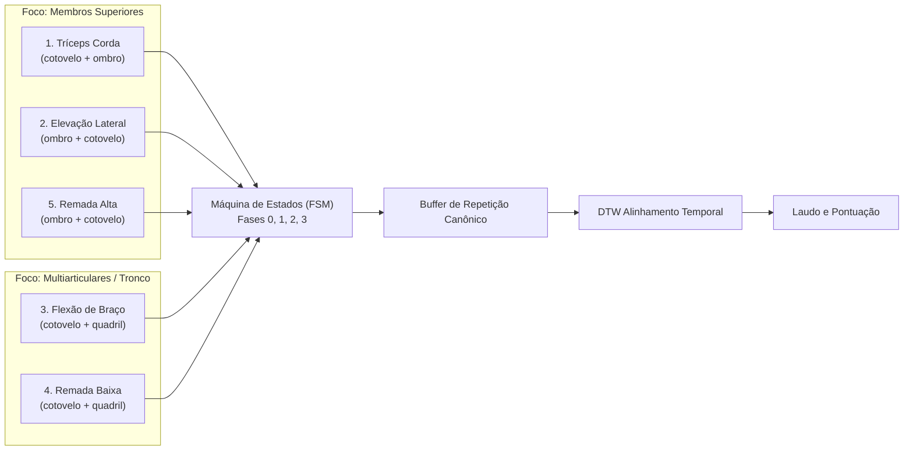
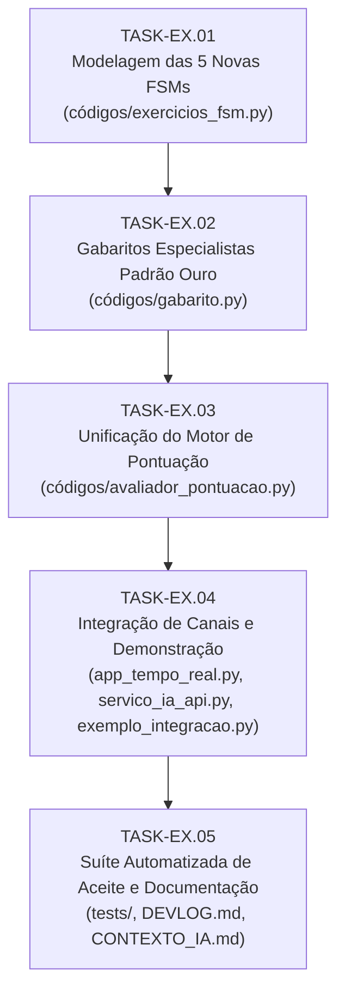

# Plano Técnico — Expansão Biomecânica de Exercícios (Sprint Novos Exercícios)

> **História de Usuário:**  
> *"Como atleta/usuário do Personal Trainer IA, quero que o sistema reconheça, conte repetições e avalie tecnicamente a execução de Tríceps Corda, Elevação Lateral, Flexão de Braço, Remada Baixa (Costas) e Remada Alta (Ombro/Trapézio), identificando erros posturais em tempo real e comparando meu padrão de movimento contra gabaritos padrão ouro via DTW."*

---

## 1. Contexto e Diagnóstico da Base Atual

O motor de IA opera sob uma **arquitetura híbrida de dois níveis** desacoplada de hardware:
1. **Frame a frame ($O(1)$) via FSM (`ExercicioBaseFSM`):** segmentação de fases (`0: Repouso`, `1: Inicial`, `2: Pico`, `3: Retorno`), contagem de repetições no ciclo `0 -> 1 -> 2 -> 3 -> 0` e alertas imediatos com retenção cumulativa de erros.
2. **Pós-repetição via DTW (`DTWComparator`):** alinhamento temporal multivariado não linear contra gabarito especialista em JSON, pontuação contínua ($0\%$ a $100\%$) com desconto de penalidades e diagnóstico pedagógico hierárquico.

### Catálogo Atual (3 Exercícios Modelados)
- **`DesenvolvimentoOmbro`** (`"1"`, `desenvolvimento_ombro`): `["cotovelo", "ombro"]` — Foco em extensão vertical de braços.
- **`Agachamento`** (`"2"`, `agachamento`): `["joelho", "quadril"]` — Foco em flexão de membros inferiores e inclinação de tronco.
- **`RoscaBiceps`** (`"3"`, `rosca_biceps`): `["cotovelo", "ombro"]` — Foco em flexão anterior de cotovelos com estabilidade do úmero.

### Organização de Código
- Os arquivos-fonte ativos residem no diretório [`./códigos/`](./códigos/) (ex.: `exercicios_fsm.py`, `calculo_angulos.py`, `gabarito.py`, `avaliador_pontuacao.py`, `buffer_repeticao.py`, `servico_ia_api.py`, `app_tempo_real.py`).
- O sistema respeita o **Princípio Aberto/Fechado (OCP)**: novos exercícios são plugados estendendo `ExercicioBaseFSM` e registrando no `CATALOGO_EXERCICIOS`, sem necessidade de refatorar o motor matemático do DTW ou o orquestrador central.

---

## 2. Especificação Biomecânica dos 5 Novos Exercícios

---

### 2.1. Exercício 4: Tríceps Corda (Polia Alta)
- **Identificador:** `triceps_corda` | **Tecla de Atalho:** `"4"`
- **Articulações Monitoradas:** `["cotovelo", "ombro"]`
  - Articulação motora primária: `cotovelo` (extensão para baixo).
  - Articulação de estabilidade: `ombro` (úmero alinhado verticalmente junto ao tronco).
- **Mapeamento de Fases:**
  - `Fase 0 (Repouso Inicial)`: Cotovelo flexionado a $\approx 80^\circ - 90^\circ$, úmero colado ao tronco ($10^\circ - 25^\circ$).
  - `Fase 1 (Subida/Início da Extensão)`: Cotovelo estendendo ($> 100^\circ$ e `delta_cotovelo > 0`).
  - `Fase 2 (Pico de Contração)`: Braços quase estendidos no fundo ($\ge 150^\circ$).
  - `Fase 3 (Retorno Excêntrico)`: Cotovelo flexionando controladamente ($< 140^\circ$ ou `delta_cotovelo < 0`).
  - `3 -> 0 (Fechamento de Repetição)`: Cotovelo $\le 95^\circ$ (`repeticoes += 1`).
- **Detecção de Erros e Penalidades:**
  - `EXTENSAO_INCOMPLETA` (Penalidade: **25.0 pts**, Desqualificador de Reprovação): Transição anômala $1 \to 3$ antes de atingir $\ge 150^\circ$.
  - `COTOVELO_AVANCADO` / `OMBRO_INSTAVEL` (Penalidade: **15.0 pts**): Ombro $> 35^\circ$ nas fases 1, 2 ou 3 (atleta jogando o cotovelo para frente ou usando peitoral/peso do corpo).
  - `SUBIDA_EXCESSIVA` (Penalidade: **15.0 pts**): Cotovelo $< 65^\circ$ na fase 3 (permitindo que o cabo suba demais, perdendo a tensão e sobrecarregando a articulação).
- **Curva Gabarito Padrão:** Cotovelo de $85^\circ \to 160^\circ \to 85^\circ$; Ombro estável em $15^\circ$.

---

### 2.2. Exercício 5: Elevação Lateral (Halteres)
- **Identificador:** `elevacao_lateral` | **Tecla de Atalho:** `"5"`
- **Articulações Monitoradas:** `["ombro", "cotovelo"]`
  - Articulação motora primária: `ombro` (abdução no plano coronal/escapular).
  - Articulação de estabilidade: `cotovelo` (semiflexionado e fixo).
- **Mapeamento de Fases:**
  - `Fase 0 (Repouso Inicial)`: Braços ao lado do corpo ($ombro \le 25^\circ$).
  - `Fase 1 (Subida Concêntrica)`: Abdução dos braços ($ombro > 35^\circ$ e `delta_ombro > 0`).
  - `Fase 2 (Pico de Abdução)`: Halteres na linha dos ombros ($ombro \ge 80^\circ$ e $\le 100^\circ$).
  - `Fase 3 (Descida Excêntrica)`: Retorno controlado ($ombro < 75^\circ$ ou `delta_ombro < 0`).
  - `3 -> 0 (Fechamento de Repetição)`: Ombro $\le 30^\circ$ (`repeticoes += 1`).
- **Detecção de Erros e Penalidades:**
  - `ELEVACAO_CURTA` (Penalidade: **25.0 pts**, Desqualificador): Transição $1 \to 3$ sem atingir $80^\circ$ de abdução.
  - `ELEVACAO_EXCESSIVA` (Penalidade: **15.0 pts**): Ombro $> 105^\circ$ na fase 2 (risco de pinçamento subacromial).
  - `COTOVELO_MUITO_FLEXIONADO` (Penalidade: **15.0 pts**): Cotovelo $< 130^\circ$ nas fases 1, 2 ou 3 (flexão excessiva encurtando o braço de alavanca para roubar carga).
- **Curva Gabarito Padrão:** Ombro de $20^\circ \to 90^\circ \to 20^\circ$; Cotovelo estável em $160^\circ$.

---

### 2.3. Exercício 6: Flexão de Braço (Push-up no Solo)
- **Identificador:** `flexao` | **Tecla de Atalho:** `"6"`
- **Articulações Monitoradas:** `["cotovelo", "quadril"]`
  - Articulação motora primária: `cotovelo` (flexão/extensão).
  - Articulação de postura do core: `quadril` (manutenção de prancha neutra).
- **Mapeamento de Fases:**
  - `Fase 0 (Prancha Alta / Repouso)`: Braços estendidos ($cotovelo \ge 160^\circ$), corpo em linha reta ($quadril \approx 165^\circ - 180^\circ$).
  - `Fase 1 (Descida Excêntrica)`: Flexão dos braços em direção ao chão ($cotovelo < 150^\circ$ e `delta_cotovelo < 0`).
  - `Fase 2 (Fundo da Flexão)`: Peito rente ao solo ($cotovelo \le 90^\circ$).
  - `Fase 3 (Subida Concêntrica)`: Empurrando o solo ($cotovelo > 105^\circ$ ou `delta_cotovelo > 0`).
  - `3 -> 0 (Fechamento de Repetição)`: Retorno à prancha alta com cotovelo $\ge 155^\circ$ (`repeticoes += 1`).
- **Detecção de Erros e Penalidades:**
  - `FLEXAO_CURTA` (Penalidade: **25.0 pts**, Desqualificador): Transição $1 \to 3$ antes de atingir $\le 90^\circ$ no cotovelo.
  - `QUADRIL_CAIDO` (Penalidade: **15.0 pts**): Quadril em hiperextensão/lordose lombar excessiva ($quadril > 185^\circ$ ou perda de tensão de glúteo/abdômen).
  - `QUADRIL_ELEVADO` (Penalidade: **15.0 pts**): Quadril em "V" invertido ($quadril < 145^\circ$) para aliviar a carga nos braços.
- **Curva Gabarito Padrão:** Cotovelo de $170^\circ \to 85^\circ \to 170^\circ$; Quadril estável em $175^\circ$.

---

### 2.4. Exercício 7: Remada Baixa (Seated Cable Row)
- **Identificador:** `remada_baixa` | **Tecla de Atalho:** `"7"`
- **Articulações Monitoradas:** `["cotovelo", "quadril"]`
  - Articulação motora primária: `cotovelo` (flexão e retração de braços).
  - Articulação de postura do tronco: `quadril` (estabilidade da coluna e inclinação lombar).
- **Mapeamento de Fases:**
  - `Fase 0 (Braços Estendidos à Frente)`: Cotovelo $\ge 160^\circ$, tronco alinhado ($quadril \approx 85^\circ - 95^\circ$).
  - `Fase 1 (Puxada Concêntrica)`: Cotovelos puxando o cabo para trás ($cotovelo < 150^\circ$ e `delta_cotovelo < 0`).
  - `Fase 2 (Pico de Contração)`: Manopla no abdômen com cotovelos ultrapassando o tronco ($cotovelo \le 85^\circ$).
  - `Fase 3 (Retorno Excêntrico)`: Braços estendendo à frente ($cotovelo > 100^\circ$ ou `delta_cotovelo > 0`).
  - `3 -> 0 (Fechamento de Repetição)`: Cotovelo $\ge 155^\circ$ (`repeticoes += 1`).
- **Detecção de Erros e Penalidades:**
  - `PUXADA_INCOMPLETA` (Penalidade: **25.0 pts**, Desqualificador): Transição $1 \to 3$ antes de atingir $\le 85^\circ$ no cotovelo.
  - `BALANCO_TRONCO_EXCESSIVO` (Penalidade: **15.0 pts**): Quadril $> 115^\circ$ (jogando o tronco para trás na puxada) ou $< 70^\circ$ (curvando a coluna lombar para frente).
  - `HIPEREXTENSAO_LOMBAR` (Penalidade: **15.0 pts**): Uso de impulso lombar brusco no início da fase concêntrica.
- **Curva Gabarito Padrão:** Cotovelo de $165^\circ \to 80^\circ \to 165^\circ$; Quadril estável em $90^\circ$.

---

### 2.5. Exercício 8: Remada Alta (Upright Row)
- **Identificador:** `remada_alta` | **Tecla de Atalho:** `"8"`
- **Articulações Monitoradas:** `["ombro", "cotovelo"]`
  - Articulação motora primária: `ombro` (abdução e elevação com tração vertical dos cotovelos).
  - Articulação sinergista/flexora: `cotovelo` (flexão acompanhando a subida vertical da barra/halteres rente ao tronco).
- **Mapeamento de Fases:**
  - `Fase 0 (Repouso Inicial)`: Barra ou halteres à frente das coxas com braços estendidos ($ombro \le 25^\circ$, $cotovelo \ge 155^\circ$).
  - `Fase 1 (Puxada Concêntrica / Subida)`: Tração vertical puxando pelos cotovelos ($ombro > 35^\circ$ e `delta_ombro > 0`, cotovelos flexionando).
  - `Fase 2 (Pico de Contração)`: Cotovelos elevados até a linha dos ombros / barra na altura do esterno ($ombro \ge 80^\circ$ e $\le 100^\circ$, $cotovelo \approx 50^\circ - 75^\circ$).
  - `Fase 3 (Descida Excêntrica)`: Retorno controlado descendo a carga rente ao tronco ($ombro < 75^\circ$ ou `delta_ombro < 0`).
  - `3 -> 0 (Fechamento de Repetição)`: Retorno completo à extensão com $ombro \le 30^\circ$ e $cotovelo \ge 150^\circ$ (`repeticoes += 1`).
- **Detecção de Erros e Penalidades:**
  - `PUXADA_CURTA` (Penalidade: **25.0 pts**, Desqualificador de Reprovação): Transição $1 \to 3$ antes de atingir elevação mínima no ombro ($ombro < 80^\circ$).
  - `ELEVACAO_EXCESSIVA` (Penalidade: **15.0 pts**): Ombro $> 100^\circ$ na fase 2 (elevação exagerada dos cotovelos acima da linha clavicular com rotação interna, gerando risco severo de impacto/pinçamento subacromial).
  - `COTOVELO_CAIDO` (Penalidade: **15.0 pts**): Cotovelo $> 95^\circ$ durante o pico de contração na fase 2 (atleta não lidera o movimento com os cotovelos, deixando os punhos mais altos que os cotovelos).
- **Curva Gabarito Padrão:** Ombro de $20^\circ \to 90^\circ \to 20^\circ$; Cotovelo de $165^\circ \to 60^\circ \to 165^\circ$.

---

## 3. Matriz de Configuração do Catálogo Expandido

| Tecla | ID do Exercício | Nome Amigável | Articulações | Erro Desqualificador (-25 pts) | Erros Posturais (-15 pts) | Gabarito JSON |
| :---: | :--- | :--- | :---: | :--- | :--- | :--- |
| `1` | `desenvolvimento_ombro` | Desenvolvimento de Ombro | `cotovelo`, `ombro` | `REPETICAO_INCOMPLETA` | `DESCIDA_EXCESSIVA`, `OMBRO_CAIDO` | `gabarito_especialista_ombro.json` |
| `2` | `agachamento` | Agachamento Livre | `joelho`, `quadril` | `AGACHAMENTO_CURTO` | `TRONCO_MUITO_INCLINADO` | `gabarito_especialista_agachamento.json` |
| `3` | `rosca_biceps` | Rosca Direta de Bíceps | `cotovelo`, `ombro` | `SUBIDA_INCOMPLETA` | `OMBRO_INSTAVEL` | `gabarito_especialista_rosca.json` |
| `4` | `triceps_corda` | Tríceps Corda | `cotovelo`, `ombro` | `EXTENSAO_INCOMPLETA` | `COTOVELO_AVANCADO`, `SUBIDA_EXCESSIVA` | `gabarito_especialista_triceps_corda.json` |
| `5` | `elevacao_lateral` | Elevação Lateral | `ombro`, `cotovelo` | `ELEVACAO_CURTA` | `ELEVACAO_EXCESSIVA`, `COTOVELO_MUITO_FLEXIONADO` | `gabarito_especialista_elevacao_lateral.json` |
| `6` | `flexao` | Flexão de Braço | `cotovelo`, `quadril` | `FLEXAO_CURTA` | `QUADRIL_CAIDO`, `QUADRIL_ELEVADO` | `gabarito_especialista_flexao.json` |
| `7` | `remada_baixa` | Remada Baixa | `cotovelo`, `quadril` | `PUXADA_INCOMPLETA` | `BALANCO_TRONCO_EXCESSIVO`, `HIPEREXTENSAO_LOMBAR` | `gabarito_especialista_remada_baixa.json` |
| `8` | `remada_alta` | Remada Alta | `ombro`, `cotovelo` | `PUXADA_CURTA` | `ELEVACAO_EXCESSIVA`, `COTOVELO_CAIDO` | `gabarito_especialista_remada_alta.json` |

---

## 4. Decomposição em Sprints e Tasks Atômicas

O desenvolvimento segue a divisão em 5 tarefas atômicas sequenciais e independentes:

---

### `[TASK-EX.01]` Modelagem das 5 Novas Classes FSM e Catálogo Expandido
- **Objetivo:** Implementar as classes de máquina de estados dos 5 novos exercícios e integrá-las ao catálogo central de seleção.
- **Escopo Técnico:**
  - Em [`./códigos/exercicios_fsm.py`](./códigos/exercicios_fsm.py):
    - Implementar `TricepsCorda(ExercicioBaseFSM)`.
    - Implementar `ElevacaoLateral(ExercicioBaseFSM)`.
    - Implementar `Flexao(ExercicioBaseFSM)`.
    - Implementar `RemadaBaixa(ExercicioBaseFSM)`.
    - Implementar `RemadaAlta(ExercicioBaseFSM)`.
    - Atualizar o dicionário `CATALOGO_EXERCICIOS` adicionando as chaves `"4"`, `"5"`, `"6"`, `"7"`, `"8"` e os respectivos identificadores textuais (`triceps_corda`, `elevacao_lateral`, `flexao`, `remada_baixa`, `remada_alta`).
    - Configurar `NOMES_FASES`, `MENSAGENS_ERRO` e `PENALIDADES_ERRO` específicas para cada um.
- **Artefatos:**
  - [`./códigos/exercicios_fsm.py`](./códigos/exercicios_fsm.py)
- **Critério de Aceite (DoD):**
  - Instanciação polimórfica via `obter_config_exercicio()` funcionando para as 8 opções sem quebra de contrato.
- **Commit Semântico:** `feat(fsm): adiciona FSMs de triceps corda, elevacao lateral, flexao, remada baixa e remada alta`

---

### `[TASK-EX.02]` Geração e Recorte Canônico dos Gabaritos Padrão Ouro
- **Objetivo:** Gerar curvas temporais de referência matemática pura para os 5 exercícios, processadas pelo mesmo segmentador FSM do usuário (`extrair_primeira_repeticao`).
- **Escopo Técnico:**
  - Em [`./códigos/gabarito.py`](./códigos/gabarito.py):
    - Adicionar em `garantir_gabaritos_padrao(sobrescrever=False)` as curvas sintéticas dos 5 exercícios:
      1. `gabarito_especialista_triceps_corda.json` (cotovelo $85^\circ \to 160^\circ \to 85^\circ$, ombro $15^\circ$).
      2. `gabarito_especialista_elevacao_lateral.json` (ombro $20^\circ \to 90^\circ \to 20^\circ$, cotovelo $160^\circ$).
      3. `gabarito_especialista_flexao.json` (cotovelo $170^\circ \to 85^\circ \to 170^\circ$, quadril $175^\circ$).
      4. `gabarito_especialista_remada_baixa.json` (cotovelo $165^\circ \to 80^\circ \to 165^\circ$, quadril $90^\circ$).
      5. `gabarito_especialista_remada_alta.json` (ombro $20^\circ \to 90^\circ \to 20^\circ$, cotovelo $165^\circ \to 60^\circ \to 165^\circ$).
    - Executar a geração garantindo os 5 arquivos `.json`.
- **Artefatos:**
  - [`./códigos/gabarito.py`](./códigos/gabarito.py)
  - `./gabarito_especialista_triceps_corda.json`
  - `./gabarito_especialista_elevacao_lateral.json`
  - `./gabarito_especialista_flexao.json`
  - `./gabarito_especialista_remada_baixa.json`
  - `./gabarito_especialista_remada_alta.json`
- **Critério de Aceite (DoD):**
  - Carregamento de todos os JSONs validado via `GabaritoExercicio.carregar_json()`.
- **Commit Semântico:** `feat(gabarito): adiciona geracao de gabaritos especialistas para os 5 novos exercicios`

---

### `[TASK-EX.03]` Atualização do Motor de Avaliação e Pontuação Unificada
- **Objetivo:** Registrar os novos erros de incompletude no conjunto de reprovação imediata e assegurar cálculo uniforme de pontuação.
- **Escopo Técnico:**
  - Em [`./códigos/avaliador_pontuacao.py`](./códigos/avaliador_pontuacao.py):
    - Expandir `ERROS_INCOMPLETUDE` para incluir:
      - `"EXTENSAO_INCOMPLETA"`
      - `"ELEVACAO_CURTA"`
      - `"FLEXAO_CURTA"`
      - `"PUXADA_INCOMPLETA"`
      - `"PUXADA_CURTA"`
    - Assegurar que `OrquestradorSessao` consiga alternar via `trocar_exercicio()` para qualquer um dos 8 identificadores sem falhas.
- **Artefatos:**
  - [`./códigos/avaliador_pontuacao.py`](./códigos/avaliador_pontuacao.py)
- **Critério de Aceite (DoD):**
  - Repetições incompletas de qualquer um dos 5 novos exercícios resultam estritamente em `aprovado == False` e penalidade de 25 pontos.
- **Commit Semântico:** `feat(pontuacao): expande conjunto de erros de incompletude para os novos exercicios`

---

### `[TASK-EX.04]` Integração nos Canais de Consumo (Webcam, API FastAPI e Simulação)
- **Objetivo:** Habilitar a seleção e execução dos novos exercícios em todos os pontos de entrada do sistema.
- **Escopo Técnico:**
  - Em [`./códigos/app_tempo_real.py`](./códigos/app_tempo_real.py):
    - Atualizar a legenda do HUD OpenCV para exibir atalhos `[1]` a `[8]`.
    - Tratar teclas `'4'`, `'5'`, `'6'`, `'7'`, `'8'` no loop da câmera chamando `orquestrador.trocar_exercicio()`.
  - Em [`./códigos/servico_ia_api.py`](./códigos/servico_ia_api.py):
    - Atualizar `simular_repeticao()` para suportar os cenários `ideal` e `postural` para os 5 novos exercícios.
  - Em [`./códigos/exemplo_integracao.py`](./códigos/exemplo_integracao.py):
    - Incluir demonstração sintética sem câmera dos novos exercícios.
- **Artefatos:**
  - [`./códigos/app_tempo_real.py`](./códigos/app_tempo_real.py)
  - [`./códigos/servico_ia_api.py`](./códigos/servico_ia_api.py)
  - [`./códigos/exemplo_integracao.py`](./códigos/exemplo_integracao.py)
- **Critério de Aceite (DoD):**
  - `/ia/simular-repeticao` e a interface de tempo real aceitam IDs e teclas de 1 a 8.
- **Commit Semântico:** `feat(integracao): habilita atalhos 1-8 no HUD da webcam e simula repeticoes na API`

---

### `[TASK-EX.05]` Suíte de Testes Automatizados de Regressão e Atualização de Documentação
- **Objetivo:** Blindar o motor com testes automatizados para cada novo exercício e atualizar toda a documentação viva do projeto.
- **Escopo Técnico:**
  - Em [`tests/test_pipeline_pontuacao.py`](tests/test_pipeline_pontuacao.py):
    - Adicionar testes de ciclo ideal, incompletude e erro postural para cada uma das 5 novas FSMs.
    - Adicionar teste do pipeline de pontuação completo (FSM + DTW + Gabarito) para cada novo exercício, garantindo score $\ge 95\%$ para execuções ideais.
  - Em [`tests/test_servico_ia_api.py`](tests/test_servico_ia_api.py):
    - Validar simulação canônica dos 8 exercícios via `ServicoIA`.
  - Atualização dos documentos vivos:
    - Atualizar [`./DEVLOG.md`](./DEVLOG.md) com o histórico da sprint.
    - Atualizar [`./CONTEXTO_IA.md`](./CONTEXTO_IA.md) com os 8 exercícios cadastrados.
    - Atualizar [`./EXPLICACAO_IA.md`](./EXPLICACAO_IA.md) com a explicação biomecânica didática dos novos movimentos.
- **Artefatos:**
  - [`tests/test_pipeline_pontuacao.py`](tests/test_pipeline_pontuacao.py)
  - [`tests/test_servico_ia_api.py`](tests/test_servico_ia_api.py)
  - [`./DEVLOG.md`](./DEVLOG.md)
  - [`./CONTEXTO_IA.md`](./CONTEXTO_IA.md)
  - [`./EXPLICACAO_IA.md`](./EXPLICACAO_IA.md)
- **Critério de Aceite (DoD):**
  - 100% dos testes aprovados no `pytest` sem quebras de regressão nos exercícios 1 a 3.
- **Commit Semântico:** `test(pipeline): adiciona suite de testes para os 5 novos exercicios e atualiza documentacao`

---

## 5. Ordem Recomendada de Implementação

1. **`[TASK-EX.01]`**: Implementação pura das FSMs e catálogo (zero dependências externas).
2. **`[TASK-EX.02]`**: Geração de gabaritos padrão ouro via segmentador canônico.
3. **`[TASK-EX.03]`**: Registro de erros de incompletude no avaliador.
4. **`[TASK-EX.04]`**: Ajuste dos adaptadores (HUD OpenCV e API em memória).
5. **`[TASK-EX.05]`**: Testes automatizados e fechamento de documentação.
