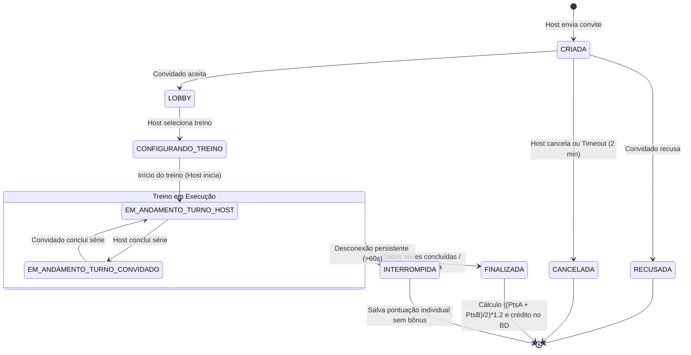
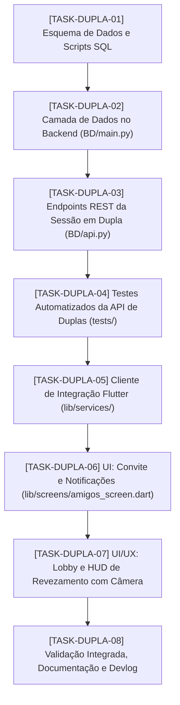

# Planejamento Técnico — Feature: Treinos em Dupla (Cooperative Turn-Based Workout)

> **Documento Normativo de Engenharia de Software**  
> **Nome da Feature:** Treino Cooperativo em Dupla com Revezamento por Série e Bônus de Gamificação  
> **Identificador da História de Usuário:** `US-DUPLA`  
> **Localização:** `./PLANEJAMENTO_TREINO_DUPLA.md`  
> **Alinhamento:** Diretrizes de Engenharia de Software ([`DIRETRIZES_DESENVOLVIMENTO.md`](./DIRETRIZES_DESENVOLVIMENTO.md)), Arquitetura da Branch ([`CONTEXTO_IA.md`](./CONTEXTO_IA.md)) e Instruções para Agentes ([`AGENTS.md`](./AGENTS.md)).

---

## 1. História de Usuário (User Story)

### 1.1. Narrativa
> **Como** usuário praticante de atividades físicas no PersonAI,  
> **Quero** convidar um amigo conectado para realizarmos um treino juntos em formato cooperativo, com revezamento a cada série e acompanhamento em tempo real de quem é a vez,  
> **Para que** possamos nos motivar mutuamente, manter a disciplina de treino e conquistar uma pontuação bonificada de 20% (multiplicador 1.2x) na gamificação ao final da sessão.

---

### 1.2. Critérios de Aceitação (BDD — Given / When / Then)

- **AC1 — Envio e Notificação de Convite:**
  - *Dado que* o usuário "A" está na página de amigos (`AmigosScreen`),
  - *Quando* ele clicar no botão "Treinar Juntos" referente ao amigo "B",
  - *Então* uma solicitação de sessão de treino em dupla é criada com status `pendente`, "A" assume o papel de **Host**, e o amigo "B" visualiza uma notificação/diálogo de convite em tempo real ou via polling.

- **AC2 — Resolução do Convite e Entrada no Lobby:**
  - *Dado que* o usuário "B" recebe o convite de "A",
  - *Quando* "B" aceitar o convite,
  - *Então* a sessão passa para o estado `aceito`/`lobby`, ambos os usuários são direcionados para o Lobby da Dupla, e caso "B" recuse, a sessão é cancelada com notificação explicativa para o Host.

- **AC3 — Seleção do Treino Exclusiva pelo Host:**
  - *Dado que* a dupla está no Lobby sincronizado,
  - *Quando* o Host navegar pelo catálogo e selecionar um treino (exercícios, séries e repetições),
  - *Então* a escolha é propagada instantaneamente para o dispositivo do Convidado, permitindo que ambos iniciem a execução simultaneamente.

- **AC4 — Alternância Estrita de Turnos por Série (Turn-Based Workout):**
  - *Dado que* a sessão de treino com câmera e IA foi iniciada,
  - *Quando* o atleta da vez (ex.: Host) estiver executando a Série $K$,
  - *Então* o seu app ativa a câmera e o motor de IA para avaliar os movimentos e contar repetições, enquanto o parceiro (Convidado) visualiza um indicativo claro: *"Vez do Parceiro [Nome] — Descanse e acompanhe o progresso"*.

- **AC5 — Passagem de Turno Automática ao Fim da Série:**
  - *Dado que* o atleta da vez conclui a sua série (atingindo a meta ou finalizando a série na IA),
  - *Quando* a série for consolidada,
  - *Então* o servidor/sessão atualiza o turno para o outro parceiro, emitindo feedback visual e sonoro de alternância nos dois dispositivos: *"Sua vez! Prepare-se para a Série $K$"*.

- **AC6 — Consolidação da Pontuação com Bônus Cooperativo (1.2x):**
  - *Dado que* todos os exercícios e séries do treino foram finalizados pela dupla,
  - *Quando* a sessão for encerrada,
  - *Então* o servidor calcula a pontuação somada da dupla, divide por dois e aplica o multiplicador de $1.2$ ($+20\%$ de bônus):
    $$\text{Pontos Final (cada um)} = \text{round}\left(\frac{\text{Pontos}_{\text{Host}} + \text{Pontos}_{\text{Convidado}}}{2} \times 1.2\right)$$
    e persiste o mesmo valor para ambos os usuários no Supabase/banco de dados, incrementando suas sequências (*streaks*) e atualizando o Leaderboard.

- **AC7 — Resiliência a Desconexão ou Abandono:**
  - *Dado que* um dos atletas desconecta ou fecha o aplicativo durante a sessão,
  - *Quando* decorrer o tempo limite de tolerância (timeout de 60 segundos),
  - *Então* o parceiro remanescente é avisado da desconexão e tem a opção de converter a sessão para treino individual (mantendo seus pontos sem o multiplicador cooperativo) ou encerrar a sessão.

---

## 2. Diagnóstico Técnico e Análise de Impacto

### 2.1. Estado Atual do Ecossistema
1. **Frontend Flutter:**
   - [`lib/screens/amigos_screen.dart`](./lib/screens/amigos_screen.dart): Lista amigos cadastrados e solicitações de amizade, mas ainda não possui botão de ação para iniciar treinos em conjunto.
   - [`lib/screens/camera_treino_screen.dart`](./lib/screens/camera_treino_screen.dart): Implementa fluxo individual de treino com captura ML Kit on-device e envio de ângulos via WebSocket (`IAWebSocketService`) ou REST. Não possui suporte a estados de turno (minha vez vs. vez do parceiro).
   - [`lib/services/api_service.dart`](./lib/services/api_service.dart): Possui chamadas REST para amizades e gamificação (`/pontuacao/diaria`, `/ia/finalizar-serie-e-pontuar`), mas não gerencia sessões de duplas.

2. **Backend FastAPI & Banco de Dados (Supabase):**
   - [`BD/api.py`](./BD/api.py): Centraliza rotas de autenticação, pontuação, amizades e IA.
   - [`BD/main.py`](./BD/main.py): Métodos de manipulação direta no Supabase (`adicionar_pontuacao_diaria`, `listar_amigos`, etc.).
   - Atualmente não existe tabela ou entidade no banco para persistir o ciclo de vida de **Sessões em Dupla** (`sessoes_treino_dupla`).

3. **Motor de IA & Gamificação:**
   - [`servico_ia_api.py`](./servico_ia_api.py) e [`avaliador_pontuacao.py`](./avaliador_pontuacao.py): Já operam instâncias isoladas por `usuario_id`, gerando pontuação justa baseada em FSM + DTW. O cálculo de bônus cooperativo será implementado na camada de consolidação da sessão em dupla.

---

## 3. Arquitetura da Solução

### 3.1. Diagrama de Fluxo Geral (End-to-End)

```mermaid
sequenceDiagram
    autonumber
    actor Host as Usuário A (Host)
    participant AppHost as Flutter App (Host)
    participant Backend as FastAPI + Supabase
    participant AppGuest as Flutter App (Convidado)
    actor Guest as Usuário B (Convidado)

    Host->>AppHost: Clica em "Treinar Juntos" no amigo B
    AppHost->>Backend: POST /dupla/convidar (host_id, convidado_id)
    Backend-->>AppHost: Sessão criada (status: pendente, id: sessao_123)
    
    Backend->>AppGuest: Notificação / Polling de Convite Pendente
    AppGuest->>Guest: Exibe diálogo: "A convidou você para treinar em dupla!"
    Guest->>AppGuest: Clica em "Aceitar"
    AppGuest->>Backend: POST /dupla/responder-convite (sessao_123, status: aceito)
    
    Backend-->>AppHost: Notifica: Convite aceito (Lobby Aberto)
    Backend-->>AppGuest: Notifica: Sessão iniciada (Lobby Aberto)

    Host->>AppHost: Escolhe Treino no Catálogo
    AppHost->>Backend: POST /dupla/selecionar-treino (sessao_123, treino_id, exercicios)
    Backend-->>AppGuest: Sincroniza dados do treino selecionado

    Note over Host,Guest: Fase de Execução com Revezamento por Série
    
    rect rgb(20, 35, 45)
        Note over Host: Turno 1: Host treina Série 1
        AppHost->>Host: HUD Câmera Ativa: "SUA VEZ! Série 1"
        AppGuest->>Guest: Tela de Espera: "VEZ DE [HOST] - Descanse"
        Host->>AppHost: Executa repetições com IA
        AppHost->>Backend: POST /dupla/concluir-serie (sessao_123, pontos_obtidos)
    end

    Backend-->>AppHost: Alterna Turno -> Vez do Convidado
    Backend-->>AppGuest: Alterna Turno -> Vez do Convidado

    rect rgb(35, 45, 20)
        Note over Guest: Turno 2: Convidado treina Série 1
        AppGuest->>Guest: HUD Câmera Ativa: "SUA VEZ! Série 1"
        AppHost->>Host: Tela de Espera: "VEZ DE [GUEST] - Descanse"
        Guest->>AppGuest: Executa repetições com IA
        AppGuest->>Backend: POST /dupla/concluir-serie (sessao_123, pontos_obtidos)
    end

    Note over Host,Guest: Repete o revezamento até a última série...

    Host->>AppHost: Finaliza Treino
    AppHost->>Backend: POST /dupla/encerrar-sessao (sessao_123)
    Note over Backend: Pontos = round(((Pts_Host + Pts_Guest) / 2) * 1.2)
    Backend->>Backend: Persiste Pontos Finais para Host e Convidado no Supabase
    Backend-->>AppHost: Resumo Final da Dupla (+20% Bônus)
    Backend-->>AppGuest: Resumo Final da Dupla (+20% Bônus)
```



---

### 3.2. Máquina de Estados da Sessão em Dupla (FSM de Sessão)



---

## 4. Modelagem de Dados

### 4.1. Esquema SQL para Supabase/PostgreSQL (`BD/script_treino_dupla.sql`)

```sql
-- TABELA DE SESSÕES DE TREINO EM DUPLA
CREATE TABLE IF NOT EXISTS public.sessoes_treino_dupla (
    id UUID PRIMARY KEY DEFAULT gen_random_uuid(),
    host_id UUID NOT NULL REFERENCES public.usuarios(id) ON DELETE CASCADE,
    convidado_id UUID NOT NULL REFERENCES public.usuarios(id) ON DELETE CASCADE,
    treino_id BIGINT REFERENCES public.treinos(id) ON DELETE SET NULL, -- Identificador compatível com public.treinos (bigint)
    dados_treino JSONB DEFAULT '{}'::jsonb, -- Cache da lista de exercícios e séries
    status VARCHAR(30) NOT NULL DEFAULT 'pendente', -- pendente, aceito, recusado, cancelado, em_andamento, finalizado, interrompido
    
    -- Controle de Turno e Progresso
    turno_usuario_id UUID REFERENCES public.usuarios(id),
    indice_exercicio_atual INT NOT NULL DEFAULT 0,
    serie_atual INT NOT NULL DEFAULT 1,
    total_series INT NOT NULL DEFAULT 3,
    
    -- Gamificação e Pontuações
    pontos_host INT NOT NULL DEFAULT 0,
    pontos_convidado INT NOT NULL DEFAULT 0,
    pontos_finais_cada INT NOT NULL DEFAULT 0,
    multiplicador_aplicado NUMERIC(3,2) NOT NULL DEFAULT 1.20,
    
    created_at TIMESTAMP WITH TIME ZONE DEFAULT NOW(),
    updated_at TIMESTAMP WITH TIME ZONE DEFAULT NOW(),
    finalizado_em TIMESTAMP WITH TIME ZONE,

    CONSTRAINT chk_dupla_distinta CHECK (host_id != convidado_id)
);

-- ÍNDICES PARA BUSCAS RÁPIDAS
CREATE INDEX IF NOT EXISTS idx_dupla_host ON public.sessoes_treino_dupla(host_id, status);
CREATE INDEX IF NOT EXISTS idx_dupla_convidado ON public.sessoes_treino_dupla(convidado_id, status);
```

---

### 4.2. Contratos REST e Modelos Pydantic (`BD/api.py`)

| Método | Endpoint | Responsabilidade | Payload / Parâmetros | Resposta |
| :--- | :--- | :--- | :--- | :--- |
| `POST` | `/dupla/convidar` | Host cria convite para amigo | `{ "host_id": "...", "convidado_id": "..." }` | `{ "sucesso": true, "sessao_id": "...", "status": "pendente" }` |
| `GET` | `/dupla/convites/pendentes` | Convidado busca convites recebidos | `?usuario_id=...` | `{ "sucesso": true, "convites": [ ... ] }` |
| `PATCH` | `/dupla/responder-convite` | Convidado aceita ou recusa | `{ "sessao_id": "...", "usuario_id": "...", "resposta": "aceito\|recusado" }` | `{ "sucesso": true, "status": "aceito" }` |
| `POST` | `/dupla/selecionar-treino` | Host define o treino da dupla | `{ "sessao_id": "...", "host_id": "...", "treino_id": "...", "dados_treino": { ... } }` | `{ "sucesso": true, "dados_treino": { ... } }` |
| `GET` | `/dupla/estado/{sessao_id}` | Obter estado atual da sessão (polling) | Path: `sessao_id` | `{ "status": "...", "turno_usuario_id": "...", "serie_atual": 1, ... }` |
| `POST` | `/dupla/concluir-serie` | Atleta da vez reporta série e pontuação | `{ "sessao_id": "...", "usuario_id": "...", "pontos_serie": 45, "proximo_turno_id": "..." }` | `{ "sucesso": true, "proximo_turno": "...", "pontos_acumulados": { ... } }` |
| `POST` | `/dupla/encerrar-sessao` | Finaliza treino, calcula $1.2x$ e credita no BD | `{ "sessao_id": "...", "solicitante_id": "..." }` | `{ "sucesso": true, "pontos_cada": 120, "bonus": "20%", "detalhes": { ... } }` |

---

## 5. Regra Matemática e Gamificação Cooperativa

A regra especificada determina:
1. Obter os pontos conquistados pelo Host durante suas séries com IA: $\text{Pontos}_{\text{Host}}$.
2. Obter os pontos conquistados pelo Convidado durante suas séries com IA: $\text{Pontos}_{\text{Convidado}}$.
3. Calcular a média aritmética e aplicar o bônus cooperativo de $20\%$ ($1.2\times$):
   $$\text{Pontos Base} = \frac{\text{Pontos}_{\text{Host}} + \text{Pontos}_{\text{Convidado}}}{2}$$
   $$\text{Pontos Finais} = \text{round}\left(\text{Pontos Base} \times 1.20\right)$$
4. **Exemplo Numérico:**
   - Host conquistou $90$ pontos.
   - Convidado conquistou $70$ pontos.
   - Total somado: $160$ pontos.
   - Média por atleta: $80$ pontos.
   - Bônus cooperativo ($+20\%$): $80 \times 1.20 = 96$ pontos.
   - **Resultado:** Ambos recebem **96 pontos** creditados em suas respectivas contas (ganho de $16$ pontos extras pelo treino cooperativo).

---

## 6. Decomposição em Tasks Atômicas Orientadas a Artefatos

Seguindo o rigor de Engenharia de Software do projeto, a implementação é dividida em 8 tasks atômicas com entrega incremental:



---

### `[TASK-DUPLA-01]` Criação do Esquema de Banco de Dados para Treinos em Dupla
- **Escopo Técnico:** Elaborar script SQL com a tabela `sessoes_treino_dupla`, índices de performance, constraints de integridade referencial e triggers para `updated_at`.
- **Artefatos Gerados/Modificados:**
  - `BD/script_treino_dupla.sql` (Criação do DDL completo da tabela de duplas).
- **Critério de Pronto (DoD):** Script executável sem erros de sintaxe e pronto para aplicação no Supabase.
- **Commit Incremental Planejado:** `feat(db): cria script sql para gerenciamento de sessoes de treino em dupla`

---

### `[TASK-DUPLA-02]` Métodos de Acesso a Dados no Backend (`BD/main.py` e `BD/supabase_client.py`)
- **Escopo Técnico:** Implementar funções CRUD e transacionais no arquivo de repositório de dados: criar convite, listar pendentes, atualizar resposta, atualizar turno/série, acumular pontos parciais e consolidar pontuação com bônus $1.2\times$.
- **Artefatos Gerados/Modificados:**
  - `BD/main.py` (Adição dos métodos: `criar_sessao_dupla`, `responder_convite_dupla`, `obter_sessao_dupla`, `atualizar_turno_dupla`, `finalizar_sessao_dupla`).
- **Critério de Pronto (DoD):** Métodos suportam chamadas locais e mockadas retornando dicionários padronizados com `sucesso: bool`.
- **Commit Incremental Planejado:** `feat(backend): implementa metodos de persistencia de treino em dupla`

---

### `[TASK-DUPLA-03]` Endpoints REST no Servidor FastAPI (`BD/api.py`)
- **Escopo Técnico:** Expor as rotas `/dupla/*` no servidor FastAPI unificado, definindo schemas Pydantic (`ConvidarDuplaRequest`, `ResponderConviteDuplaRequest`, `ConcluirSerieDuplaRequest`, `EncerrarDuplaRequest`). Integrar a regra matemática de cálculo de bônus ($\times 1.2$) e crédito via `adicionar_pontuacao_diaria`.
- **Artefatos Gerados/Modificados:**
  - `BD/api.py` (Novos endpoints REST com tags `["Treino em Dupla"]`).
- **Critério de Pronto (DoD):** Swagger `/docs` exibe as rotas documentadas e responde adequadamente a requisições HTTP de teste.
- **Commit Incremental Planejado:** `feat(api): expoe rotas rest para gestao de sessoes e pontuacao em dupla`

---

### `[TASK-DUPLA-04]` Suíte de Testes Automatizados no Backend (`pytest`)
- **Escopo Técnico:** Criar suíte completa de testes unitários e de integração mockada validando: criação de convite, aceite, alternância de turnos, cálculo exato da fórmula cooperativa $\text{round}(((A+B)/2)\times 1.2)$ e rejeição de estados inválidos.
- **Artefatos Gerados/Modificados:**
  - `tests/test_treino_dupla_api.py` (Nova suíte com pelo menos 6 testes automatizados).
- **Critério de Pronto (DoD):** Executar `pytest tests/test_treino_dupla_api.py -v` com 100% de testes aprovados.
- **Commit Incremental Planejado:** `test(api): adiciona testes automatizados para fluxo e calculo de treino em dupla`

---

### `[TASK-DUPLA-05]` Camada de Serviço e Modelos no Flutter (`lib/services/api_service.dart`)
- **Escopo Técnico:** Criar métodos no `ApiService` em Dart para consumir os endpoints da feature: `convidarParaTreinoEmDupla`, `listarConvitesTreinoPendentes`, `responderConviteTreino`, `obterEstadoSessaoDupla`, `concluirSerieDupla` e `encerrarSessaoDupla`.
- **Artefatos Gerados/Modificados:**
  - `lib/services/api_service.dart` (Novos métodos assíncronos e tratamento de respostas JSON).
  - `lib/models/sessao_dupla.dart` (Modelo de dados para representar a sessão no Flutter).
- **Critério de Pronto (DoD):** `flutter analyze` sem erros de sintaxe ou tipagem na camada de serviço.
- **Commit Incremental Planejado:** `feat(flutter-service): adiciona metodos de consumo da api de treino em dupla`

---

### `[TASK-DUPLA-06]` UI de Convite e Recepção na Página de Amigos (`lib/screens/amigos_screen.dart`)
- **Escopo Técnico:**
  1. Adicionar botão "Treinar Juntos" (ícone de cooperação/halteres duplos) no card de cada amigo listado em `_meusAmigos`.
  2. Implementar diálogo/banner de convite recebido quando houver convites pendentes de treino, permitindo "Aceitar" ou "Recusar".
  3. Redirecionar os participantes para a tela de Lobby após a confirmação.
- **Artefatos Gerados/Modificados:**
  - `lib/screens/amigos_screen.dart` (Botão de ação e listener/polling de convites de treino).
- **Critério de Pronto (DoD):** Interface renderiza o botão responsivo e aciona o fluxo de envio de convite.
- **Commit Incremental Planejado:** `feat(ui-amigos): adiciona botao treinar juntos e tratamento de convites recebidos`

---

### `[TASK-DUPLA-07]` Lobby de Treino em Dupla e HUD de Revezamento (`CameraTreinoScreen`)
- **Escopo Técnico:**
  1. Criar tela de preparação/Lobby (`lib/screens/lobby_dupla_screen.dart`): Host seleciona o treino e o Convidado aguarda sincronização com status "Pronto".
  2. Adaptar [`lib/screens/camera_treino_screen.dart`](./lib/screens/camera_treino_screen.dart):
     - Suportar modo `isModoDupla: true` com parâmetros de `sessaoDuplaId` e `idParceiro`.
     - Exibir banner dinâmico e proeminente no topo do HUD:
       - **Se for o meu turno:** Tarja Verde com texto *"🟢 SUA VEZ! Execute a Série X"*. Câmera e IA ativas.
       - **Se for a vez do parceiro:** Tarja Laranja com texto *"🟠 VEZ DO PARCEIRO! Descanse e hidrate-se"*. Câmera em pausa/overlay de descanso com cronômetro de repouso.
     - Ao concluir a série, enviar pontos da série para a sessão em dupla e alternar o indicativo.
     - Ao final de todas as séries, exibir diálogo com a pontuação final calculada com $+20\%$ de bônus cooperativo.
- **Artefatos Gerados/Modificados:**
  - `lib/screens/lobby_dupla_screen.dart` (Nova tela de Lobby e seleção).
  - `lib/screens/camera_treino_screen.dart` (Adaptação para alternância de turnos, indicativos visuais e pontuação conjunta).
- **Critério de Pronto (DoD):** Execução do treino em dupla com alternância fluida de turnos e tela de resumo final demonstrando o cálculo do bônus.
- **Commit Incremental Planejado:** `feat(ui-treino): implementa lobby da dupla e hud de revezamento de turnos com camera`

---

### `[TASK-DUPLA-08]` Homologação Integrada, Atualização do DEVLOG e Documentação
- **Escopo Técnico:** Testar o fluxo completo ponta a ponta (convite $\rightarrow$ lobby $\rightarrow$ revezamento $\rightarrow$ pontuação $\times 1.2$ no banco). Atualizar [`DEVLOG.md`](./DEVLOG.md) e [`EXPLICACAO_IA.md`](./EXPLICACAO_IA.md) com a explicação didática da nova funcionalidade.
- **Artefatos Gerados/Modificados:**
  - `DEVLOG.md` (Registro da entrega da sprint de Treino em Dupla).
  - `EXPLICACAO_IA.md` (Seção didática explicando a mecânica de treino cooperativo e o incentivo de gamificação).
- **Critério de Pronto (DoD):** Documentação 100% sincronizada com os commits efetuados e sem caminhos absolutos locais.
- **Commit Incremental Planejado:** `docs(dupla): homologa fluxo cooperativo e registra entrega no devlog`

---

## 7. Mockup Textual da Interface (UX/UI)

### 7.1. Botão na Lista de Amigos (`AmigosScreen`)
```text
+-----------------------------------------------------------+
| [Avatar] João Silva                                       |
|          ⚡ 5 dias   ⭐ 450 pts                           |
|          [ 🏋️ Treinar Juntos ]   [ ❌ Remover ]            |
+-----------------------------------------------------------+
```

### 7.2. HUD no Modo Dupla — Minha Vez (`CameraTreinoScreen`)
```text
+-----------------------------------------------------------+
| 🟢 SUA VEZ! (Série 1/3) — Exercício: Agachamento          |
| Parceiro: João Silva (Aguardando no descanso)             |
+-----------------------------------------------------------+
|                                                           |
|             [ Visão da Câmera + Esqueleto IA ]            |
|                                                           |
|   Reps: 8/10         Fase: Descida          Score: 92%    |
+-----------------------------------------------------------+
| [ Concluir Série e Passar a Vez ➡️ ]                      |
+-----------------------------------------------------------+
```

### 7.3. HUD no Modo Dupla — Vez do Parceiro
```text
+-----------------------------------------------------------+
| 🟠 VEZ DO JOÃO SILVA! (Série 1/3)                         |
| Descanse, respire e hidrate-se para a sua próxima série!  |
+-----------------------------------------------------------+
|                                                           |
|                 ⏱️ TEMPO DE DESCANSO                      |
|                        00:45                              |
|                                                           |
|           João está executando a série agora...           |
+-----------------------------------------------------------+
```

### 7.4. Diálogo de Encerramento e Bônus Cooperativo
```text
+-----------------------------------------------------------+
| 🎉 TREINO EM DUPLA CONCLUÍDO COM SUCESSO!                 |
+-----------------------------------------------------------+
| Seus pontos na série:       80 pts                        |
| Pontos do seu parceiro:     70 pts                        |
| Média da dupla:             75 pts                        |
|                                                           |
| 🔥 BÔNUS COOPERATIVO (1.2x): +15 pts (Ganho de +20%)      |
| --------------------------------------------------------- |
| TOTAL CREDITADO A CADA UM:  90 pts ⭐                     |
+-----------------------------------------------------------+
|                 [ Concluir e Voltar ao Início ]           |
+-----------------------------------------------------------+
```

---

## 8. Considerações de Segurança, Performance e Escalabilidade

1. **Integridade de Dados e Anti-Fraude:**
   - A fórmula de bônus $(\text{Pts}_A + \text{Pts}_B)/2 \times 1.2$ é executada exclusivamente no **backend** (`BD/api.py`), prevenindo manipulações locais no client Flutter.
   - A transição de turnos valida se a requisição partiu do usuário que detém o turno ativo na sessão.

2. **Baixo Consumo de Bateria e Processamento:**
   - Quando não for a vez do usuário (durante o descanso), a captura de frames da câmera e o processamento de landmarks via ML Kit são pausados (`_controller?.pausePreview()` ou desligamento temporário da inferência), economizando bateria e reduzindo o aquecimento do dispositivo móvel.

3. **Sincronização Resiliente:**
   - Para ambientes em nuvem com latência variável (como instâncias gratuitas no Render), o cliente Flutter adota um mecanismo híbrido: escuta de eventos via canal persistente com fallback automático de polling periódico a cada 2 segundos.

---

> **Aprovação e Próximos Passos:** Este planejamento está pronto para execução a partir da `[TASK-DUPLA-01]`. A aprovação deste plano permite iniciar o desenvolvimento com commits incrementais e semânticos.
