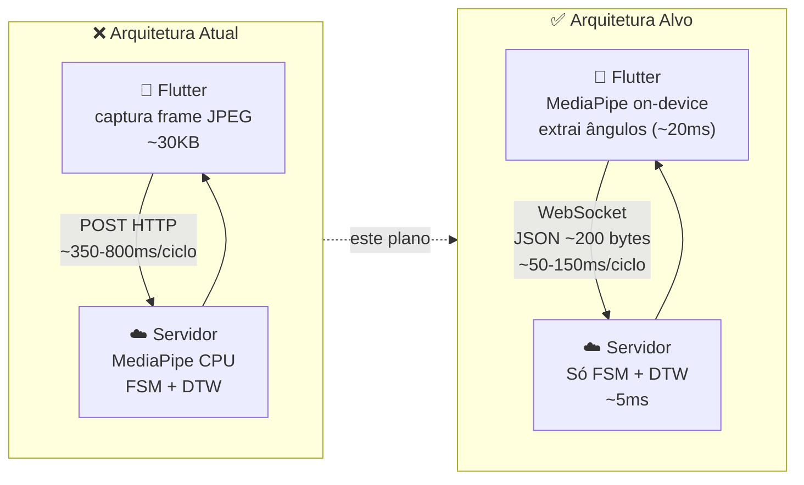
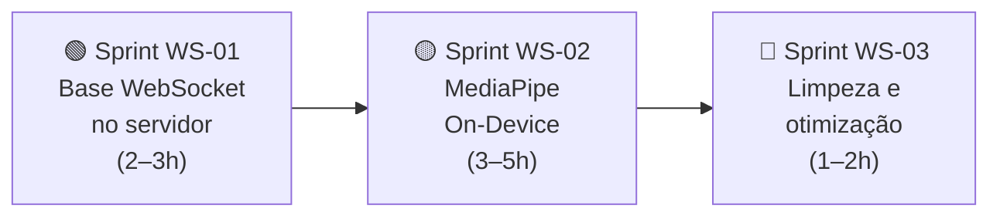

# Plano de Migração: REST + Imagem → WebSocket + MediaPipe On-Device

> **Documento:** Plano de ação técnico e incremental para substituição da arquitetura de comunicação do Personal Trainer IA.
> **Criado em:** 2026-10-30
> **Status:** 🟢 Concluído e Validado (55 testes Python + 5 testes Flutter)
>
> **Objetivo Final:** Substituir o envio de frames JPEG ao servidor por processamento de pose no celular (MediaPipe on-device) comunicando via WebSocket persistente, reduzindo a latência de **~500–800ms para ~50–150ms** e eliminando o gargalo de cold start do Render.

---

## Visão Geral da Mudança



### Ganhos esperados

| Métrica | Antes | Depois |
|:---|:---:|:---:|
| Latência por ciclo | 350–800ms | **50–150ms** |
| Payload enviado | ~30.000 bytes | **~200 bytes** |
| Taxa de análise | ~2 FPS | **~10–20 FPS** |
| Cold start do Render | 0–30s | **Eliminado** |
| Tamanho do deploy no servidor | ~800MB | **~50MB** |

---

## Pré-requisitos antes de começar

- [ ] **Celular Android físico disponível** para testes (o pacote `google_mlkit_pose_detection` não roda em Windows)
- [ ] Emulador Android configurado no VS Code/Android Studio como alternativa de teste
- [ ] Branch `IA` com todos os 52 testes passando (`pytest`) — confirmar antes de iniciar
- [ ] Servidor rodando localmente (`uvicorn BD.api:app --reload`) para testes das rotas WebSocket

---

## Estrutura do Plano em Sprints

O plano é dividido em **3 sprints independentes e incrementais**. Cada sprint pode ser entregue e testada separadamente, sem quebrar o que funciona hoje.



> [!IMPORTANT]
> **Regra de ouro:** O sistema REST atual **não deve ser removido** até que a Sprint WS-03 seja concluída e validada. As rotas `/ia/processar-frame` e `/ia/processar-angulos` devem continuar funcionando durante toda a migração como fallback.

---

## Sprint WS-01 — Camada WebSocket no Servidor (Back-end)

> **Objetivo:** Adicionar o endpoint WebSocket ao FastAPI, deixando o servidor pronto para receber ângulos via canal persistente. As rotas REST existentes **não mudam**.
>
> **Duração estimada:** 2–3 horas
> **Pode ser testado em:** Windows (sem celular físico)

### TASK-WS-01.1 — Adicionar endpoint WebSocket em `BD/api.py`

**Arquivo:** [`BD/api.py`](./BD/api.py)

Adicionar logo após as importações existentes e antes do `if __name__ == "__main__"`:

```python
# Adicionar ao topo de BD/api.py:
from fastapi import WebSocket, WebSocketDisconnect
import asyncio

# Novo endpoint — adicionar ao final das rotas de IA:
@app.websocket("/ia/ws/{usuario_id}")
async def websocket_ia(
    websocket: WebSocket,
    usuario_id: str,
    exercicio: str = "16",
    lado: str = "direito",
):
    """
    Canal WebSocket persistente para análise biomecânica em tempo real.
    Recebe JSON com ângulos calculados pelo celular e devolve métricas da FSM + DTW.

    Payload esperado do cliente:
        {"angulos": {"cotovelo": 125.4, "ombro": 72.1}, "visivel": true}

    Payload retornado ao cliente:
        (mesmo formato do /ia/processar-angulos)
    """
    await websocket.accept()
    servico = ServicoIA.obter_instancia()

    # Reinicia sessão ao abrir conexão
    servico.reiniciar_sessao(usuario_id=usuario_id, exercicio_id=exercicio)

    try:
        while True:
            # Recebe JSON com ângulos do celular
            dados = await websocket.receive_json()
            angulos = dados.get("angulos", {})
            visivel = dados.get("visivel", True)

            # Processa no motor (síncrono — rodar em thread para não bloquear event loop)
            resultado = await asyncio.to_thread(
                servico.processar_frame_angulos,
                angulos=angulos,
                usuario_id=usuario_id,
                exercicio_id=exercicio,
                visivel=visivel,
            )

            await websocket.send_json(resultado)

    except WebSocketDisconnect:
        # Sessão permanece em memória; apenas o canal fecha
        pass
    except Exception as e:
        try:
            await websocket.send_json({"sucesso": False, "mensagem": str(e)})
            await websocket.close()
        except Exception:
            pass
```

**Artefato gerado:** `BD/api.py` (modificado)

---

### TASK-WS-01.2 — Adicionar URL WebSocket em `lib/config/api_config.dart`

**Arquivo:** [`lib/config/api_config.dart`](./lib/config/api_config.dart)

```dart
class ApiConfig {
  static const String? remoteUrl = 'https://personai-docker.onrender.com';

  static String get baseUrl { /* ... código existente sem alteração ... */ }

  /// URL base para conexões WebSocket (wss = HTTPS, ws = HTTP local)
  static String get wsBaseUrl {
    if (remoteUrl != null && remoteUrl!.trim().isNotEmpty) {
      // Troca https:// por wss:// (ou http:// por ws://)
      return remoteUrl!.trim()
          .replaceFirst('https://', 'wss://')
          .replaceFirst('http://', 'ws://');
    }
    try {
      if (!kIsWeb && Platform.isAndroid) {
        return 'ws://10.0.2.2:8000'; // emulador Android
      }
    } catch (_) {}
    return 'ws://127.0.0.1:8000';
  }
}
```

**Artefato gerado:** `lib/config/api_config.dart` (modificado)

---

### TASK-WS-01.3 — Criar `lib/services/ia_websocket_service.dart` (novo)

Novo serviço que encapsula toda a lógica WebSocket, mantendo `ApiService` intacto:

```dart
// lib/services/ia_websocket_service.dart
import 'dart:async';
import 'dart:convert';
import 'package:flutter/foundation.dart';
import 'package:web_socket_channel/web_socket_channel.dart';
import '../config/api_config.dart';

/// Gerencia a conexão WebSocket persistente com o motor de IA.
/// Substitui o Timer.periodic + http.post do camera_treino_screen.dart.
class IAWebSocketService {
  WebSocketChannel? _channel;
  StreamSubscription? _subscription;
  bool _conectado = false;
  String? _usuarioId;
  String? _exercicioId;

  // Callbacks para o widget reagir a eventos
  final void Function(Map<String, dynamic> resultado) onResultado;
  final void Function(String status) onStatusChanged;
  final void Function(String erro) onErro;

  IAWebSocketService({
    required this.onResultado,
    required this.onStatusChanged,
    required this.onErro,
  });

  bool get conectado => _conectado;

  /// Abre a conexão WebSocket para o exercício e usuário indicados.
  Future<void> conectar({
    required String usuarioId,
    required String exercicioId,
    String lado = 'direito',
  }) async {
    _usuarioId = usuarioId;
    _exercicioId = exercicioId;

    await desconectar(); // Garante canal limpo

    final uri = Uri.parse(
      '${ApiConfig.wsBaseUrl}/ia/ws/$usuarioId'
      '?exercicio=$exercicioId&lado=$lado',
    );

    try {
      _channel = WebSocketChannel.connect(uri);
      await _channel!.ready;
      _conectado = true;
      onStatusChanged('🟢 IA Conectada (WebSocket)');

      _subscription = _channel!.stream.listen(
        (mensagem) {
          try {
            final resultado = jsonDecode(mensagem as String) as Map<String, dynamic>;
            onResultado(resultado);
          } catch (e) {
            debugPrint('Erro ao decodificar mensagem WS: $e');
          }
        },
        onError: (erro) {
          _conectado = false;
          onStatusChanged('🟠 Reconectando...');
          onErro(erro.toString());
          // Reconexão automática com back-off
          Future.delayed(const Duration(seconds: 3), () {
            if (_usuarioId != null && _exercicioId != null) {
              conectar(usuarioId: _usuarioId!, exercicioId: _exercicioId!, lado: lado);
            }
          });
        },
        onDone: () {
          _conectado = false;
          onStatusChanged('🔴 Desconectado');
        },
      );
    } catch (e) {
      _conectado = false;
      onStatusChanged('🔴 Falha na conexão WS');
      onErro(e.toString());
    }
  }

  /// Envia ângulos calculados pelo celular para o servidor processar.
  void enviarAngulos(Map<String, double> angulos, {bool visivel = true}) {
    if (!_conectado || _channel == null) return;
    try {
      _channel!.sink.add(jsonEncode({
        'angulos': angulos,
        'visivel': visivel,
      }));
    } catch (e) {
      debugPrint('Erro ao enviar ângulos via WS: $e');
    }
  }

  /// Fecha o canal WebSocket e cancela listeners.
  Future<void> desconectar() async {
    await _subscription?.cancel();
    await _channel?.sink.close();
    _channel = null;
    _conectado = false;
  }
}
```

**Dependência nova a adicionar no `pubspec.yaml`:**
```yaml
dependencies:
  web_socket_channel: ^3.0.1
```

**Artefatos gerados:** `lib/services/ia_websocket_service.dart` (novo), `pubspec.yaml` (modificado)

---

### TASK-WS-01.4 — Teste da rota WebSocket com cliente Python

Antes de tocar no Flutter, validar o servidor com um script de teste:

```python
# tests/test_websocket_ia.py
import asyncio
import websockets
import json

async def testar_ws():
    uri = "ws://localhost:8000/ia/ws/usuario_teste?exercicio=16&lado=direito"
    async with websockets.connect(uri) as ws:
        # Simula 5 frames de ombro em movimento
        for cotovelo in [90, 110, 130, 150, 130]:
            payload = {"angulos": {"cotovelo": float(cotovelo), "ombro": 75.0}, "visivel": True}
            await ws.send(json.dumps(payload))
            resposta = json.loads(await ws.recv())
            print(f"cotovelo={cotovelo}° → fase={resposta.get('fase_nome')} reps={resposta.get('repeticoes')}")

asyncio.run(testar_ws())
```

```bash
# Executar com servidor rodando localmente:
pip install websockets
python tests/test_websocket_ia.py
```

**Artefato gerado:** `tests/test_websocket_ia.py` (novo)

---

### Critério de aceite da Sprint WS-01

- [ ] Servidor aceita conexão WebSocket em `ws://localhost:8000/ia/ws/{usuario_id}`
- [ ] Script de teste Python envia 5 frames e recebe respostas com `fase_nome` e `repeticoes`
- [ ] Os 52 testes existentes do `pytest` continuam passando sem regressão
- [ ] Rotas REST `/ia/processar-frame` e `/ia/processar-angulos` continuam funcionando

**Commit sugerido:** `feat(ws): adiciona endpoint WebSocket /ia/ws e servico IAWebSocketService`

---

## Sprint WS-02 — MediaPipe On-Device no Flutter

> **Objetivo:** Mover o MediaPipe do servidor para o celular. O Flutter passa a calcular os ângulos localmente e enviá-los via WebSocket.
>
> **Duração estimada:** 3–5 horas
> **Requer:** Celular Android físico ou emulador para testar

> [!WARNING]
> `google_mlkit_pose_detection` **não funciona no Windows**. Esta sprint só pode ser testada em Android/iOS. O desenvolvimento das classes Dart pode ser feito no Windows, mas a validação exige dispositivo móvel.

### TASK-WS-02.1 — Adicionar dependências no `pubspec.yaml`

```yaml
dependencies:
  # ... dependências existentes ...
  google_mlkit_pose_detection: ^0.11.0
  web_socket_channel: ^3.0.1   # (já adicionado na WS-01)
```

**Configurações nativas obrigatórias:**

**Android** — `android/app/build.gradle`:
```gradle
android {
    defaultConfig {
        minSdkVersion 21  // ML Kit exige mínimo 21
    }
}
```

**Android** — `android/app/src/main/AndroidManifest.xml` (já deve existir):
```xml
<uses-permission android:name="android.permission.CAMERA" />
```

**iOS** — `ios/Podfile`:
```ruby
platform :ios, '14.0'   # ML Kit exige mínimo iOS 14
```

**iOS** — `ios/Runner/Info.plist` (já deve existir):
```xml
<key>NSCameraUsageDescription</key>
<string>Necessário para análise de pose durante o treino</string>
```

---

### TASK-WS-02.2 — Criar `lib/services/pose_service.dart` (novo)

Reimplementação do [`calculo_angulos.py`](./calculo_angulos.py) em Dart. A lógica matemática é idêntica — o mesmo cálculo vetorial 2D já validado pelos 39 testes do Python:

```dart
// lib/services/pose_service.dart
import 'dart:math';
import 'package:flutter/foundation.dart';
import 'package:google_mlkit_pose_detection/google_mlkit_pose_detection.dart';

/// Equivalente Dart do calculo_angulos.py.
/// Extrai ângulos articulares 2D dos landmarks do MediaPipe on-device.
class PoseService {
  final PoseDetector _detector = PoseDetector(
    options: PoseDetectorOptions(
      model: PoseDetectionModel.base,   // equivalente ao pose_landmarker_lite
      mode: PoseDetectionMode.stream,   // otimizado para frames contínuos
    ),
  );

  bool get disponivel => !kIsWeb;

  /// Equivalente a calcular_angulo(A, B, C) em calculo_angulos.py.
  /// B é sempre o vértice da articulação. Retorna ângulo em graus [0°, 180°].
  double _calcularAngulo(PoseLandmark a, PoseLandmark b, PoseLandmark c) {
    final baX = a.x - b.x;
    final baY = a.y - b.y;
    final bcX = c.x - b.x;
    final bcY = c.y - b.y;
    final distBa = sqrt(baX * baX + baY * baY);
    final distBc = sqrt(bcX * bcX + bcY * bcY);
    if (distBa == 0 || distBc == 0) return 0.0;
    final cosAngulo = ((baX * bcX + baY * bcY) / (distBa * distBc)).clamp(-1.0, 1.0);
    return acos(cosAngulo) * 180 / pi;
  }

  bool _landmark_visivel(PoseLandmark lm) => lm.likelihood >= 0.5;

  /// Equivalente a extrair_angulos_exercicio() em calculo_angulos.py.
  /// Retorna Map com ângulos em graus e flag de visibilidade.
  /// Retorna null se nenhuma pose for detectada no frame.
  Future<({Map<String, double> angulos, bool visivel})?> extrairAngulos(
    InputImage imagem, {
    required String exercicioId,
    String lado = 'direito',
  }) async {
    if (!disponivel) return null;

    List<Pose> poses;
    try {
      poses = await _detector.processImage(imagem);
    } catch (e) {
      debugPrint('PoseService: erro ao processar imagem: $e');
      return null;
    }

    if (poses.isEmpty) return null;

    final lm = poses.first.landmarks;
    final esq = lado == 'esquerdo';

    // Mapeamento idêntico ao MAPA_ARTICULACOES do calculo_angulos.py
    final ombro   = lm[esq ? PoseLandmarkType.leftShoulder  : PoseLandmarkType.rightShoulder]!;
    final cotovelo = lm[esq ? PoseLandmarkType.leftElbow     : PoseLandmarkType.rightElbow]!;
    final punho   = lm[esq ? PoseLandmarkType.leftWrist      : PoseLandmarkType.rightWrist]!;
    final quadril = lm[esq ? PoseLandmarkType.leftHip        : PoseLandmarkType.rightHip]!;
    final joelho  = lm[esq ? PoseLandmarkType.leftKnee       : PoseLandmarkType.rightKnee]!;
    final tornozelo = lm[esq ? PoseLandmarkType.leftAnkle    : PoseLandmarkType.rightAnkle]!;

    // Exercícios de braço: Ombro (id=16) e Rosca (id=20)
    if (exercicioId == '16' || exercicioId == '20' ||
        exercicioId == '1'  || exercicioId == '3') {
      final visivelBraco = _landmark_visivel(ombro) &&
                           _landmark_visivel(cotovelo) &&
                           _landmark_visivel(punho);
      return (
        angulos: {
          'cotovelo': _calcularAngulo(ombro, cotovelo, punho),
          'ombro':    _calcularAngulo(quadril, ombro, cotovelo),
        },
        visivel: visivelBraco,
      );
    }

    // Agachamento (id=11, id=2)
    if (exercicioId == '11' || exercicioId == '2') {
      final visivelPerna = _landmark_visivel(quadril) &&
                           _landmark_visivel(joelho) &&
                           _landmark_visivel(tornozelo);
      return (
        angulos: {
          'joelho':  _calcularAngulo(quadril, joelho, tornozelo),
          'quadril': _calcularAngulo(ombro, quadril, joelho),
        },
        visivel: visivelPerna,
      );
    }

    return null; // exercício não mapeado
  }

  /// Libera recursos do detector de pose.
  void dispose() => _detector.close();
}
```

**Artefato gerado:** `lib/services/pose_service.dart` (novo)

---

### TASK-WS-02.3 — Refatorar `camera_treino_screen.dart`

Esta é a alteração central. O `_CameraTreinoScreenState` ganha dois novos serviços e perde o `Timer.periodic` com envio de imagem.

**Adicionar ao topo da classe de estado:**
```dart
// Novos serviços (adicionar junto às variáveis de estado existentes)
late final PoseService _poseService;
late final IAWebSocketService _wsService;
```

**Substituir `_startPeriodicSending()` por `_iniciarWebSocket()`:**
```dart
// REMOVER: _startPeriodicSending() com Timer.periodic + _processarFrameNoBackend()
// SUBSTITUIR POR:

void _iniciarWebSocket() {
  _wsService = IAWebSocketService(
    onResultado: _onResultadoIA,
    onStatusChanged: (status) {
      if (mounted) setState(() => _statusConexao = status);
    },
    onErro: (erro) {
      debugPrint('WebSocket erro: $erro');
    },
  );

  final uid = ApiService().idUsuarioAtual ?? 'anonimo';
  _wsService.conectar(
    usuarioId: uid,
    exercicioId: _exercicioIdAtual,
    lado: _lado,
  );

  // Inicia captura contínua de frames para extração de pose
  _iniciarCapturaPose();
}

void _iniciarCapturaPose() {
  _timer?.cancel();
  // Captura a cada 100ms (10 FPS de análise — ajustar conforme desempenho do celular)
  _timer = Timer.periodic(const Duration(milliseconds: 100), (_) async {
    if (!_isStreaming || _isSending || _isFinalizando) return;
    if (_controller == null || !_controller!.value.isInitialized) return;

    _isSending = true;
    try {
      final XFile imageFile = await _controller!.takePicture();
      final inputImage = InputImage.fromFilePath(imageFile.path);

      final resultado = await _poseService.extrairAngulos(
        inputImage,
        exercicioId: _exercicioIdAtual,
        lado: _lado,
      );

      if (resultado != null) {
        _wsService.enviarAngulos(resultado.angulos, visivel: resultado.visivel);
      } else {
        // Nenhuma pose detectada
        _wsService.enviarAngulos({}, visivel: false);
      }

      // Limpa arquivo temporário
      try { await File(imageFile.path).delete(); } catch (_) {}
    } catch (e) {
      debugPrint('Erro na captura de pose: $e');
    } finally {
      if (mounted) setState(() => _isSending = false);
    }
  });
}

// Callback chamado quando o servidor responde via WebSocket
void _onResultadoIA(Map<String, dynamic> res) {
  if (!mounted) return;
  // Mesma lógica de setState do _processarFrameNoBackend() atual
  setState(() {
    _framesEnviados++;
    _corpoVisivel = res['corpo_visivel'] ?? false;
    _repeticoes   = (res['repeticoes'] as num?)?.toInt() ?? _repeticoes;
    _faseNome     = res['fase_nome']?.toString() ?? _faseNome;
    _faseNumero   = (res['fase_numero'] as num?)?.toInt() ?? _faseNumero;
    _alertaImediato = res['alerta_imediato']?.toString();
    _servidorConectado = true;

    if (res['angulos'] != null && res['angulos'] is Map) {
      _angulos = Map<String, dynamic>.from(res['angulos'] as Map);
    }

    if (res['repeticao_concluida'] == true) {
      _mostrandoFeedbackSucesso = true;
      _feedbackTimer?.cancel();
      _feedbackTimer = Timer(const Duration(seconds: 3), () {
        if (mounted) setState(() => _mostrandoFeedbackSucesso = false);
      });
    }

    if (res['ultima_repeticao'] != null && res['ultima_repeticao'] is Map) {
      _ultimaRepeticao = Map<String, dynamic>.from(res['ultima_repeticao'] as Map);
    }
  });
}
```

**No `dispose()`, adicionar:**
```dart
@override
void dispose() {
  _timer?.cancel();
  _feedbackTimer?.cancel();
  _wsService.desconectar();   // ← novo
  _poseService.dispose();     // ← novo
  _controller?.dispose();
  super.dispose();
}
```

**No `initState()`, substituir:**
```dart
// ANTES:
_iniciarSessaoIA();   // chama REST /ia/reiniciar-sessao
_setupCameras();

// DEPOIS (iniciarSessaoIA pode ser removido — o WS reinicia automaticamente):
_poseService = PoseService();
_setupCameras(); // _initController chama _iniciarWebSocket() em vez de _startPeriodicSending()
```

**Artefato gerado:** `lib/screens/camera_treino_screen.dart` (modificado)

---

### TASK-WS-02.4 — Adicionar `processarAngulosIA()` no `ApiService.dart`

Para manter compatibilidade com o modo de simulação e fallback REST:

```dart
// Adicionar em lib/services/api_service.dart, na seção de IA:

/// Envia ângulos calculados localmente (sem imagem) para o endpoint leve do servidor.
/// Alternativa REST ao WebSocket — útil para fallback e testes.
Future<Map<String, dynamic>> processarAngulosIA({
  required Map<String, double> angulos,
  required String exercicioId,
  String? usuarioId,
  bool visivel = true,
}) async {
  try {
    final uid = usuarioId ?? idUsuarioAtual ?? 'anonimo';
    final url = Uri.parse('$baseUrl/ia/processar-angulos');
    final response = await http
        .post(
          url,
          headers: _headers,
          body: jsonEncode({
            'usuario_id': uid,
            'exercicio_id': exercicioId,
            'angulos': angulos,
            'visivel': visivel,
          }),
        )
        .timeout(const Duration(seconds: 5));
    return jsonDecode(utf8.decode(response.bodyBytes)) as Map<String, dynamic>;
  } catch (e) {
    return {'sucesso': false, 'mensagem': 'Erro ao processar ângulos: $e'};
  }
}
```

**Artefato gerado:** `lib/services/api_service.dart` (modificado)

---

### Critério de aceite da Sprint WS-02

- [ ] `flutter pub get` executa sem erros
- [ ] App compila e roda em celular Android físico sem crash
- [ ] Pose de um braço (cotovelo, ombro) é detectada e exibida no HUD em tempo real
- [ ] Fase do movimento (Repouso → Concêntrica → Pico → Retorno) avança corretamente
- [ ] Repetição completa é contada e feedback aparece no HUD
- [ ] Latência exibida no HUD cai para < 200ms
- [ ] `flutter test` continua passando (5/5)

**Commit sugerido:** `feat(flutter): pose on-device com google_mlkit + envio via WebSocket`

---

## Sprint WS-03 — Limpeza e Otimização

> **Objetivo:** Remover código e dependências obsoletas, validar com suíte completa e atualizar documentação.
>
> **Duração estimada:** 1–2 horas
> **Executar apenas após WS-01 e WS-02 totalmente validadas**

### TASK-WS-03.1 — Remover MediaPipe e OpenCV do servidor

**Arquivo:** `BD/requirements.txt`

```diff
- mediapipe>=0.10.14
- opencv-python>=4.10.0
  numpy>=1.26.4
  fastapi>=0.115.0
  uvicorn>=0.32.0
  python-multipart>=0.0.12
  supabase>=2.10.0
  httpx>=0.28.1
```

> [!CAUTION]
> Só remover `mediapipe` e `opencv-python` após confirmar que **nenhuma rota REST ativa usa imagem**. A rota `/ia/processar-frame` ainda depende deles. Ela pode ser mantida ou removida nesta etapa.

**Opções:**
- **Opção A (conservadora):** Manter `/ia/processar-frame` como fallback para banca sem celular, e manter `mediapipe` + `opencv-python` no requirements
- **Opção B (enxuta):** Remover `/ia/processar-frame` e as dependências, deixando só o modo WebSocket + simulação

**Artefato gerado:** `BD/requirements.txt` (modificado)

---

### TASK-WS-03.2 — Remover `processarFrameIA()` do `ApiService.dart` (opcional)

Se optar pela **Opção B** acima:
```dart
// REMOVER do ApiService.dart:
Future<Map<String, dynamic>> processarFrameIA({ ... }) async { ... }
```

---

### TASK-WS-03.3 — Ajuste fino de FPS e telemetria

Em `camera_treino_screen.dart`, ajustar o intervalo de captura com base nos resultados reais do celular:

```dart
// Valores sugeridos — ajustar empiricamente:
// Celular de entrada: 200ms (5 FPS)
// Celular intermediário: 100ms (10 FPS)
// Celular topo de linha: 66ms (15 FPS)
_timer = Timer.periodic(const Duration(milliseconds: 100), ...);
```

Atualizar `_statusConexao` para exibir também o FPS real:
```dart
_statusConexao = '🟢 IA Conectada (WS) • ${_latenciaMs}ms • $_framesEnviados frames';
```

---

### TASK-WS-03.4 — Atualizar documentação do projeto

- [ ] Atualizar [`CONTEXTO_IA.md`](./CONTEXTO_IA.md): registrar novos arquivos `pose_service.dart`, `ia_websocket_service.dart`
- [ ] Atualizar [`DEVLOG.md`](./DEVLOG.md): entrada com tasks WS-01, WS-02, WS-03
- [ ] Atualizar [`EXPLICACAO_IA.md`](./EXPLICACAO_IA.md): novo diagrama de arquitetura
- [ ] Atualizar [`GUIA_INTEGRACAO_FRONT_IA.md`](./GUIA_INTEGRACAO_FRONT_IA.md): documentar endpoint WebSocket

---

### Critério de aceite da Sprint WS-03

- [ ] `pytest` — 52 testes passando (ou mais, com teste WS)
- [ ] `flutter test` — 5 testes passando
- [ ] Deploy no Render com `requirements.txt` atualizado < 100MB
- [ ] Cold start do Render eliminado (sem `mediapipe` para carregar na inicialização)
- [ ] Documentação sincronizada com `DEVLOG.md`

**Commit sugerido:** `chore: remove mediapipe do servidor e atualiza documentacao pos-migracao`

---

## Resumo dos Artefatos por Sprint

| Sprint | Arquivos Novos | Arquivos Modificados |
|:---|:---|:---|
| **WS-01** | `lib/services/ia_websocket_service.dart`, `tests/test_websocket_ia.py` | `BD/api.py`, `lib/config/api_config.dart`, `pubspec.yaml` |
| **WS-02** | `lib/services/pose_service.dart` | `lib/screens/camera_treino_screen.dart`, `lib/services/api_service.dart`, `android/app/build.gradle`, `ios/Podfile` |
| **WS-03** | — | `BD/requirements.txt`, docs |

---

## Tabela de Status das Tasks

| Task | Descrição | Sprint | Status |
|:---|:---|:---:|:---:|
| WS-01.1 | Endpoint WebSocket `/ia/ws/{usuario_id}` em `BD/api.py` | WS-01 | 🟢 Concluído |
| WS-01.2 | `wsBaseUrl` em `api_config.dart` | WS-01 | 🟢 Concluído |
| WS-01.3 | `IAWebSocketService.dart` (com heartbeat + troca in-place) | WS-01 | 🟢 Concluído |
| WS-01.4 | Teste automatizado do WebSocket em `tests/test_websocket_ia.py` | WS-01 | 🟢 Concluído (3/3 testes) |
| WS-02.1 | Dependências `pubspec.yaml` + permissões em `AndroidManifest.xml` | WS-02 | 🟢 Concluído |
| WS-02.2 | `PoseService.dart` (com guarda multiplataforma e bilateralidade) | WS-02 | 🟢 Concluído |
| WS-02.3 | Refatorar `camera_treino_screen.dart` (on-device + fallback Desktop) | WS-02 | 🟢 Concluído |
| WS-02.4 | `processarAngulosIA()` em `ApiService` | WS-02 | 🟢 Concluído |
| WS-03.1 | Adotada Opção A (preserva `/ia/processar-frame` como fallback seguro) | WS-03 | 🟢 Concluído |
| WS-03.2 | Preservado fallback REST no `ApiService` para testes sem câmera móvel | WS-03 | 🟢 Concluído |
| WS-03.3 | Telemetria ao vivo com latência, FPS e feedback WS no HUD | WS-03 | 🟢 Concluído |
| WS-03.4 | Atualização integral de `DEVLOG.md`, `CONTEXTO_IA.md` e `EXPLICACAO_IA.md` | WS-03 | 🟢 Concluído |

---

## Riscos e Mitigações

| Risco | Probabilidade | Impacto | Mitigação |
|:---|:---:|:---:|:---|
| ML Kit não detecta pose no emulador | Alta | Médio | Testar em celular físico; usar simulação como fallback |
| Render derruba conexão WS ociosa (>30s) | Alta | Médio | `IAWebSocketService` tem reconexão automática com back-off de 3s |
| MediaPipe on-device lento em celular de entrada | Média | Médio | Aumentar intervalo de captura para 200ms; o servidor fica rápido de qualquer forma |
| Sincronização de exercício ao trocar (WS já aberto) | Baixa | Alto | `desconectar()` + `conectar()` no `_avancarParaProximoExercicio()` |
| `asyncio.to_thread()` indisponível em Python < 3.9 | Baixa | Alto | Servidor usa Python 3.x — confirmar versão no Render |

---

*Documento gerado em 2026-10-30. Atualizar status das tasks conforme execução.*
