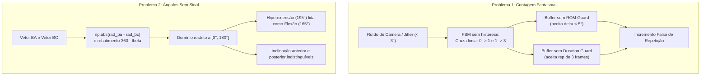
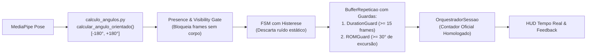

# Plano Técnico de Resolução — Eliminação de Repetições Falsas e Suporte a Ângulos Orientados (Positivos/Negativos)

> **Status:** Proposto / Planejado  
> **Data:** 2026-11-09  
> **Branch:** `IA`  
> **Alvo:** Motor de Visão Computacional, Geometria Articular, FSMs e Avaliação em Tempo Real  

---

## 1. Contexto e Motivação

Durante os testes em tempo real com câmera (webcam) e vídeos de execução dos 7 exercícios já implementados, foram identificadas duas anomalias críticas no pipeline biomecânico:

1. **Contagem de Repetições Sem Movimento Real ("Ghost Repetitions"):**  
   - O sistema incrementa o contador de repetições mesmo quando a pessoa está parada em frente à câmera, realizando apenas pequenos ajustes posturais (micro-oscilações de $\pm 2^\circ$), ou quando ninguém está no enquadramento.  
   - Pequenas variações de rastreamento do MediaPipe (ruído de alta frequência / *jitter*) cruzam os limiares estáticos de transição da FSM (`0 -> 1 -> 3 -> 0`), gerando ciclos em 2 a 5 quadros ($< 0.1$s) sem nenhuma excursão motora real.
2. **Incapacidade de Diferenciar Ângulos Positivos de Negativos (Orientação no Plano 2D):**  
   - A função `calcular_angulo` utiliza o produto escalar $\vec{u} \cdot \vec{v}$ e rebate valores maiores que $180^\circ$ com a fórmula `360.0 - angulo`, restringindo todos os resultados ao intervalo fechado $[0^\circ, 180^\circ]$.  
   - Com isso, o sistema perde o **sentido da rotação** (horário vs. anti-horário no plano da câmera), impedindo a diferenciação entre:
     - **Flexão vs. Hiperextensão:** Um cotovelo ou joelho hiperextendido além de $180^\circ$ (ex.: $195^\circ$) é lido como $165^\circ$, mascarando um risco ortopédico como se fosse uma leve flexão normal.
     - **Inclinação Anterior vs. Posterior:** Inclinar o tronco $20^\circ$ para a frente vs. deitar $20^\circ$ para trás (hiperextensão lombar na remada/desenvolvimento) produzem valores idênticos ou distorcidos.
     - **Abdução vs. Adução:** Elevação lateral vs. cruzamento do membro à frente do tronco.

---

## 2. Diagnóstico Técnico das Causas Raízes

### 2.1. Causa Raiz da Contagem Sem Movimento
- **Ausência de Range of Motion Guard (`ROMGuard`):** O `BufferRepeticao` não verifica a amplitude líquida $(\max(\theta) - \min(\theta))$ antes de validar a repetição. Uma oscilação de $3^\circ$ ao redor de um limiar gera um ciclo completo de estados.
- **Ausência de Duration Guard (`DurationGuard`):** Uma repetição humana leva entre $0.8$s e $3.0$s ($25$ a $90$ frames a 30 FPS). O buffer atualmente aceita ciclos fechados em apenas 2 ou 3 quadros.
- **Acoplamento do HUD ao Contador Bruto da FSM:** O HUD em `app_tempo_real.py` lê `orquestrador.fsm.repeticoes` diretamente, exibindo repetições que sequer passaram pelos critérios de validação do orquestrador ou que foram reprovadas por incompletude.
- **Injeção de Valores Padrão em Frames Sem Pose:** Quando `visivel=False` ou o MediaPipe não detecta nenhuma pessoa, a passagem de valores padrão (`0.0` ou `180.0`) gera deltas artificiais gigantescos na reentrada da pessoa no enquadramento.

### 2.2. Causa Raiz da Falta de Sinais Angulares
- **Perda do Produto Vetorial 2D (Determinante):** O produto escalar $\vec{u} \cdot \vec{v}$ informa apenas a abertura entre dois segmentos, mas omite a normal orientada:
  $$\text{cross}_{2D} = u_x v_y - u_y v_x$$
  $$\text{dot}_{2D} = u_x v_x + u_y v_y$$
  $$\theta_{\text{orientado}} = \text{atan2}(\text{cross}_{2D}, \; \text{dot}_{2D}) \in [-180^\circ, +180^\circ]$$
- Sem o sinal, o algoritmo não sabe se o ângulo ultrapassou o alinhamento reto ($180^\circ$) entrando na zona de hiperextensão patológica, nem se a flexão ocorreu no sentido anatômico correto.

---

## 3. Arquitetura da Solução Proposta

---

## 4. Decomposição em Tasks Atômicas de Implementação

Seguindo o protocolo de engenharia do projeto (`DIRETRIZES_DESENVOLVIMENTO.md`), a implementação é dividida em **6 tasks atômicas e incrementais**:

### `[TASK-CORR.01]` Geometria com Ângulos Orientados e Testes Unitários
- **Responsabilidade:** 
  - Expandir `Códigos/calculo_angulos.py` criando a função `calcular_angulo_orientado(ponto_a, ponto_b, ponto_c) -> float`, utilizando o produto vetorial 2D (`np.arctan2(cross, dot)`) com retorno em $[-180.0^\circ, +180.0^\circ]$.
  - Adicionar parâmetro retrocompatível `com_sinal: bool = False` em `calcular_angulo()`, garantindo que gabaritos e rotinas legadas continuem recebendo $[0.0^\circ, 180.0^\circ]$ sem quebras.
  - Implementar convenção anatômica documentada para membros superiores e tronco.
- **Artefatos:** `Códigos/calculo_angulos.py`, `tests/test_pipeline_pontuacao.py`.
- **Critério de Aceite:** Testes unitários cobrindo flexão normal, hiperextensão além de $180^\circ$, inclinação anterior vs. posterior e retrocompatibilidade total com as 70 suítes ativas.

---

### `[TASK-CORR.02]` Portão de Presença e Visibilidade (`PresenceGate`)
- **Responsabilidade:**
  - Em `Códigos/avaliador_pontuacao.py` e `Códigos/app_tempo_real.py`, implementar barreira estrita quando `visivel=False` ou quando nenhum marco anatômico estiver presente.
  - Quando o usuário não estiver na câmera ou a visibilidade cair abaixo de 0.5, a FSM **não processa deltas**, **não avança fases** e **não incrementa repetições**.
  - Evitar deltas espúrios ao reentrar no quadro redefinindo a âncora de deltas (`referencia_deltas.clear()`).
- **Artefatos:** `Códigos/avaliador_pontuacao.py`, `Códigos/app_tempo_real.py`, `tests/test_pipeline_pontuacao.py`.
- **Critério de Aceite:** Simulação determinística de entrada/saída de usuário do enquadramento com zero incremento de repetições fantasma.

---

### `[TASK-CORR.03]` Guardas Biomecânicas no Buffer (`ROMGuard` e `DurationGuard`)
- **Responsabilidade:**
  - Em `Códigos/buffer_repeticao.py`, adicionar validações de filtro na conclusão do ciclo:
    1. **`DurationGuard`:** Descartar qualquer ciclo com duração menor que `min_frames` (padrão: 15 frames a 30 FPS, ou seja, $\approx 0.5$s);
    2. **`ROMGuard`:** Verificar a amplitude real de excursão articular na repetição:
       $$\text{ROM} = \max(\theta_{\text{principal}}) - \min(\theta_{\text{principal}}) \ge \text{ROM}_{\min}$$
       (padrão: $\ge 30^\circ$ para cotovelo/joelho).
  - Ciclos descartados por ruído são limpos do buffer silenciosamente sem despachar repetição nem pontuação.
- **Artefatos:** `Códigos/buffer_repeticao.py`, `tests/test_pipeline_pontuacao.py`.
- **Critério de Aceite:** Repetições sintéticas com ruído de $5^\circ$ ou com apenas 4 frames são rejeitadas pelo buffer com 100% de precisão.

---

### `[TASK-CORR.04]` Histerese e Calibração das 7 FSMs
- **Responsabilidade:**
  - Em `Códigos/exercicios_fsm.py`, aplicar histerese nas condições de repouso e retorno de todos os 7 exercícios:
    - Desenvolvimento de Ombro, Agachamento, Rosca Bíceps, Elevação Lateral, Tríceps Corda, Flexão Diamante e Remada Baixa.
  - Ajustar as transições de aborto/incompletude ($1 \to 3$) para exigir deslocamento mínimo significativo antes de acusar repetição curta, eliminando transições instantâneas causadas por ruído estático na saída do repouso.
  - Desacoplar o incremento de repetições válidas para refletir apenas execuções que cumpriram o ciclo completo com aprovação das guardas.
- **Artefatos:** `Códigos/exercicios_fsm.py`, `tests/test_pipeline_pontuacao.py`.
- **Critério de Aceite:** Nenhuma FSM incrementa repetições em séries temporais estáticas com ruído gaussiano de $\pm 2.5^\circ$.

---

### `[TASK-CORR.05]` Detecção de Hiperextensão Articular
- **Responsabilidade:**
  - Utilizar o novo cálculo orientado para detectar **hiperextensão perigosa** em articulações vulneráveis:
    - Cotovelo em tríceps corda e flexão;
    - Joelho no agachamento;
    - Lombar/tronco na remada baixa e agachamento.
  - Criar o erro postural imediato `HIPEREXTENSAO_ARTICULAR` com penalidade pedagógica (-15.0 pts) e mensagem educativa ao usuário.
- **Artefatos:** `Códigos/exercicios_fsm.py`, `Códigos/avaliador_pontuacao.py`.
- **Critério de Aceite:** Testes unitários acionando alerta de hiperextensão quando o ângulo ultrapassar os limites anatômicos orientados.

---

### `[TASK-CORR.06]` Sincronização do HUD e Validação End-to-End
- **Responsabilidade:**
  - Atualizar o HUD em `Códigos/app_tempo_real.py` para exibir o contador de repetições homologadas pelo `OrquestradorSessao`, adicionando estado explícito:
    - `"Repouso / Pronto"`
    - `"Executando..."`
    - `"Aguardando Usuário no Enquadramento"` (quando invisível).
  - Executar a suíte de testes com `pytest` (alcançando $> 75$ testes aprovados).
  - Atualizar os documentos vivos `DEVLOG.md`, `CONTEXTO_IA.md` e `EXPLICACAO_IA.md`.
- **Artefatos:** `Códigos/app_tempo_real.py`, `DEVLOG.md`, `CONTEXTO_IA.md`, `EXPLICACAO_IA.md`.
- **Critério de Aceite:** 100% dos testes aprovados no `pytest`, com validação de zero falsos positivos na câmera sem praticante em movimento.

---

## 5. Tabela de Riscos e Mitigações

| Risco Técnico | Probabilidade | Impacto | Estratégia de Mitigação |
| :--- | :---: | :---: | :--- |
| **Quebra de gabaritos JSON legados** por alteração na assinatura de `calcular_angulo` | Alta | Alto | Manter `com_sinal=False` como padrão. O DTW e gabaritos existentes continuam em $[0^\circ, 180^\circ]$; novos ângulos com sinal são usados nas guardas e regras da FSM. |
| **Filtro de ROM muito estrito** rejeitar repetições parciais de usuários iniciantes | Média | Médio | Calibrar `ROMGuard` com margem tolerante (ex.: $30^\circ$, que é menos da metade da amplitude usual de $70^\circ - 90^\circ$). |
| **Atraso de processamento** por guardas adicionais no buffer | Baixa | Baixo | Todas as verificações de guardas operam em $O(1)$ sobre vetores NumPy já presentes em memória. |

---

## 6. Próximo Passo Imediato

Aprovação deste plano técnico pelo usuário para início da execução a partir da **`[TASK-CORR.01]`** (Geometria com Ângulos Orientados e Testes de Sinais).
