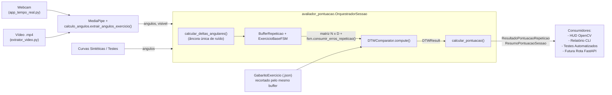

# Plano Técnico — Sprint `US-01`: Pontuação a partir da Comparação de Exercícios

> **História de Usuário (`US-01`):** *"Como usuário praticante de atividades físicas, quero receber uma pontuação clara e justa a partir da comparação da minha execução com a referência de um especialista, para que eu saiba quão correto foi meu movimento em cada repetição e ao final da série."*
>
> **Visão de Engenharia & Alinhamento com o Ecossistema do Projeto (PersonAI):**
> O PersonAI é composto por App Flutter + Backend FastAPI + Supabase (`origin/Banco-de-Dados`), onde treinos e exercícios possuem catálogo com identificadores textuais/numéricos, pontuações e repetições. O motor de Visão Computacional/IA precisa operar como um **domínio autônomo, desacoplado e extensível**, permitindo cadastrar e avaliar **quaisquer novos exercícios físicos** (agachamento, flexão, elevação lateral, afundo, etc.) seguindo os princípios de POO (**OCP, DIP, Strategy Pattern**) sem acoplamento a hardware (webcam), sistema operacional ou interfaces específicas.

---

## 1. Avaliação Arquitetural: Generalização para Exercícios Quaisquer (Design POO)

Para que o sistema suporte o reconhecimento e avaliação de **quaisquer exercícios futuros**, o pipeline foi desenhado sob 4 pilares de Orientação a Objetos:

1. **Aberto/Fechado (Open/Closed Principle - OCP):**
   - Para adicionar um novo exercício (ex.: *Flexão de Braço*, *Afundo* ou *Elevação Lateral*), **nenhuma linha do orquestrador, do DTW ou do avaliador precisa ser modificada**.
   - Basta criar uma nova subclasse herdando de `ExercicioBaseFSM` e registrá-la no `CATALOGO_EXERCICIOS` com suas articulações, gabarito e penalidades.
2. **Inversão de Dependência e Desacoplamento (DIP):**
   - O núcleo biomecânico (`exercicios_fsm.py`, `buffer_repeticao.py`, `dtw_evaluator.py`, `avaliador_pontuacao.py`) não importa `cv2` (OpenCV) nem `mediapipe`.
   - Ele consome apenas tipos primitivos e estruturas padrão (`Dict[str, float]` com ângulos em graus). Isso permite alimentar o motor via Webcam, Vídeo Gravado `.mp4`, endpoints FastAPI recebendo frames/coordenadas do App Flutter ou simulações sintéticas de testes.
3. **Padrão Strategy + Registry (Catálogo Extensível de Exercícios):**
   - O `CATALOGO_EXERCICIOS` atua como um Registro (*Registry*) configurável onde cada exercício declara seu `id` (compatível com as tabelas do backend/Supabase e rotas `/exercicios`), nome amigável, classe de FSM, articulações e arquivo de gabarito.
   - O `OrquestradorSessao` aceita tanto o `id` cadastral (`"desenvolvimento_ombro"`, `"agachamento"`, `"rosca_biceps"`) quanto a chave de seleção rápida (`"1"`, `"2"`, `"3"`).
4. **Alinhamento com o Modelo de Dados do Projeto (`PersonAI`):**
   - O backend em `BD/main.py` e `BD/api.py` calcula pontos e gerencia treinos com séries e repetições.
   - O `ResumoPontuacaoSessao` entrega os campos exatos que a API de gamificação necessita: `total_repeticoes`, `repeticoes_aprovadas`, `score_medio` (0 a 100%) e `pontos_gamificacao` compatíveis com os endpoints `/pontuacao/diaria`.

---

## 2. Diagnóstico (6 Problemas Concretos a Sanar)

1. **FSMs duplicadas e arquivos legados:** [`dev_ombro-inicial.py`](./dev_ombro-inicial.py) (hífen no nome, importado via `importlib` por [`comparar_exercicio.py`](./comparar_exercicio.py) e [`exemplo_integracao.py`](./exemplo_integracao.py)) tem lógica idêntica a `DesenvolvimentoOmbro` em [`exercicios_fsm.py`](./exercicios_fsm.py). Coexistem ainda `exercícios_fsm.py` (cópia com acento) e `Modularização.py` (importa módulo inexistente).
2. **Erros posturais perdidos:** [`buffer_repeticao.py`](./buffer_repeticao.py) devolve apenas o erro do frame de fechamento (fase `0`), perdendo erros das fases `1–3`. A cadeia `elif` em `classificar()` também oculta erros simultâneos.
3. **Bug no filtro de deltas:** [`app_tempo_real.py`](./app_tempo_real.py) atualiza o ângulo de referência a cada frame, mesmo quando `abs(diff) < 1.2°`. Em repetições lentas (≈ 200 frames) o delta fica sempre zero e a repetição **não é detectada**. Já [`extrator_video.py`](./extrator_video.py) calcula deltas **sem** filtro, gerando comportamentos distintos entre canais.
4. **DTW duplicado:** coexistem [`dtw_inicial.py`](./dtw_inicial.py) (tupla posicional de 5 itens) e [`dtw_evaluator.py`](./dtw_evaluator.py) (`DTWResult` + `DTWComparator` com matriz de custo vetorizada, além de `MovementTemplate`/`ExerciseDTWEvaluator`, que duplicam `GabaritoExercicio`).
5. **Gabarito recortado de forma diferente do aluno:** os JSONs de [`gabarito.py`](./gabarito.py) vão de repouso a repouso, mas o `BufferRepeticao` só grava a partir da transição `0 → 1`. Uma execução **idêntica** ao gabarito tira ~90 em vez de 100.
6. **Pontuação espalhada e quebra de contrato:** cada script decide aprovação e limiares por conta própria, sem descontar erros da FSM. Além disso, `comparar_exercicio.py` (linhas 106 e 166) chama `ExtratorVideo(lado=lado)` sem `articulacoes`, o que gera `TypeError`.

---

## 3. Arquitetura Alvo do Pipeline



**Contrato Único de Entrada do Orquestrador:**
```python
alerta_imediato, resultado_rep = orquestrador.processar_frame(angulos=angulos_dict, visivel=True)
```
Nenhum consumidor calcula deltas, DTW ou notas manualmente.

### 3.1. Regra de Pontuação Padronizada

| Dimensão | Regra de Cálculo |
| :--- | :--- |
| **Similaridade Espaço-Temporal (DTW)** | $S_{\text{DTW}} = 100 \cdot e^{-d_{\text{norm}}/\tau}$, com tolerância $\tau = 15^\circ$ por articulação |
| **Penalidades da FSM ($P_{\text{FSM}}$)** | Somatório de `PENALIDADES_ERRO[codigo]` para erros únicos da repetição. Incompletude (`REPETICAO_INCOMPLETA`, `AGACHAMENTO_CURTO`, `SUBIDA_INCOMPLETA`): **$-25$ pts**; Erros posturais (`OMBRO_CAIDO`, `DESCIDA_EXCESSIVA`, `TRONCO_MUITO_INCLINADO`, `OMBRO_INSTAVEL`): **$-15$ pts** |
| **Score Final da Repetição ($S_{\text{final}}$)** | $S_{\text{final}} = \text{clip}(S_{\text{DTW}} - P_{\text{FSM}}, 0.0, 100.0)$ |
| **Aprovação da Repetição** | `aprovado = score_final >= 70.0` |
| **Faixas de Classificação** | $\ge 85$: `EXCELENTE` · $\ge 70$: `BOM` · $\ge 50$: `REGULAR` · $< 50$: `INCORRETO` |
| **Feedback Diagnóstico** | 1º erro da FSM traduzido amigavelmente · se limpo e desvio de alguma articulação $> 12^\circ$, aponta a articulação crítica · caso contrário, aprovação motivacional |
| **Métricas Informativas** | Amplitude por articulação (`max − min` em graus) e razão de cadência (`frames_usuario / frames_gabarito`), mantidas no laudo sem interferir na nota |

### 3.2. Critérios de Aceite Mensuráveis (`US-01`)

- **AC1 (Execução Ideal nos 3 Exercícios):** Repetição com padrão motor idêntico ao gabarito atinge `score_final >= 95.0%`, `aprovado == True` e `erros_fsm == []`.
- **AC2 (Invariância Temporal / Cadência Livre):** Execução correta realizada em cadência lenta (65 frames) e muito lenta (150 frames) mantém `score_final >= 85.0%` e `aprovado == True`.
- **AC3 (Detecção e Punição de Incompletude):** Movimento interrompido antes do pico registra erro de transição da FSM, aplica penalidade de 25 pontos e resulta em `aprovado == False`.
- **AC4 (Preservação de Erro Postural Transiente):** Compensação postural ocorrida no meio da repetição é retida no fechamento do ciclo em repouso e aplica desconto de 15 pontos.
- **AC5 (Consolidação da Série / Resumo):** Série com múltiplas repetições calcula acuradamente média das notas, percentual de aprovadas e aponta recomendação prioritária.
- **AC6 (Consistência e Generalização entre Canais):** Vídeo gravado CLI, Webcam e Testes usam exatamente o mesmo `OrquestradorSessao`, sem duplicações de cálculo.
- **AC7 (Extensibilidade POO para Novos Exercícios):** Adição de um novo exercício de teste ao catálogo (`ExercicioDummyTeste`) valida que o orquestrador o instancia e processa sem alterar o código do motor.

---

## 4. Decomposição em Tasks Atômicas (1 Task = 1 Commit Semântico)

### `[TASK-00]` Documentação Base, Contexto e Plano da Sprint — **[CONCLUÍDA]**
- **Status:** ✅ **Concluída** (Commit `0afd9ee` — `adiciona planejamento da sprint, skills, contexto e log`)
- **Objetivo:** Versionar a documentação de contexto da branch `IA`, regras de engenharia de software e o plano da `US-01`.
- **Artefatos:** `CONTEXTO_IA.md`, `DIRETRIZES_DESENVOLVIMENTO.md`, `DEVLOG.md`, `AGENTS.md`, `PLANO_SPRINT_US01.md`.
- **Critério de Pronto (DoD):** Arquivos versionados na raiz do repositório.
- **Commit Realizado:** `0afd9ee` / `adiciona planejamento da sprint, skills, contexto e log`

### `[TASK-01]` Configuração de Dependências, Proteção do Repositório e Guia Didático — **[CONCLUÍDA]**
- **Status:** ✅ **Concluída** (Commit `c340b65` — `chore(repo): configura dependencias em requirements.txt e atualiza gitignore`)
- **Objetivo:** Padronizar dependências, proteger o repositório contra arquivos pesados/temporários e disponibilizar guia explicativo didático da IA.
- **Escopo Executado:**
  - Criado `requirements.txt` com versões (`numpy>=1.24.0`, `opencv-python>=4.8.0`, `mediapipe>=0.10.0`, `pytest>=7.4.0`).
  - Atualizado `.gitignore` para ignorar `__pycache__/`, `.venv/`, `venv/`, `.pytest_cache/`, `*.mp4`, `*.avi`, `gabarito_especialista_gerado.json` e a pasta aninhada `EngSoftTrabalho_Personal_TrainerIA/`.
  - Versionado o documento didático `EXPLICACAO_IA.md`.
  - *Decisão de Engenharia:* Atendendo à diretriz explícita do usuário, os arquivos legados (`exercícios_fsm.py`, `Modularização.py`, `dev_ombro-inicial.py`, `dtw_inicial.py`) foram mantidos intactos no repositório até que os novos módulos unificados sejam desenvolvidos e testados.
- **Critério de Pronto (DoD):** Dependências e gitignore configurados; workspace protegido.
- **Commit Realizado:** `c340b65` / `chore(repo): configura dependencias em requirements.txt e atualiza gitignore`

### `[TASK-02]` Centralização de Deltas com Âncora de Ruído (`calculo_angulos.py`) — **[CONCLUÍDA]**
- **Status:** ✅ **Concluída** (Commit `7151ad3` — `correção cálculo de ângulos`)
- **Objetivo:** Corrigir a perda de detecção em movimentos lentos e padronizar o cálculo de deltas em uma única fonte de verdade geométrica.
- **Escopo Executado:**
  - Adicionada em `calculo_angulos.py` a função pura com tipagem explícita:
    ```python
    def calcular_deltas_angulares(angulos: Dict[str, float], referencia: Dict[str, float], limiar_graus: float = 1.2) -> Dict[str, float]
    ```
    que atualiza a referência da articulação apenas quando `abs(diff) >= limiar_graus`, acumulando variações lentas com precisão.
  - Criado `pytest.ini` e iniciada a suíte de testes `tests/test_pipeline_pontuacao.py` cobrindo geometria básica, rejeição de jitter e acumulação em cadências lentas.
- **Critério de Pronto (DoD):** `python -m pytest tests/test_pipeline_pontuacao.py` aprovado (5 testes com 100% de sucesso).
- **Commit Realizado:** `7151ad3` / `correção cálculo de ângulos`

### `[TASK-03]` Generalização da FSM com Acúmulo de Erros por Repetição (`exercicios_fsm.py`) — **[CONCLUÍDA]**
- **Status:** ✅ **Concluída** (Commit `f085106` — `acumula erros por repeticao e define penalidades por exercicio`)
- **Objetivo:** Capacitar `ExercicioBaseFSM` a reter todos os erros ocorridos durante o ciclo e suportar qualquer novo exercício extensível via herança e dicionário de penalidades.
- **Escopo Executado:**
  - Em `ExercicioBaseFSM`:
    - Adicionada lista `erros_repeticao_atual: List[str]`, métodos `registrar_erro()`, `consumir_erros_repeticao() -> List[str]` e atributo de classe `PENALIDADES_ERRO: Dict[str, float]`.
  - Nas subclasses (`DesenvolvimentoOmbro`, `Agachamento`, `RoscaBiceps`):
    - Configuradas `PENALIDADES_ERRO` específicas (Incompletude: 25 pts, Postural: 15 pts).
    - Trocadas cadeias `elif` por verificações `if` independentes para registrar múltiplos erros simultâneos ou transientes sem mascaramento.
    - Adicionada função utilitária `obter_config_exercicio(identificador)` no catálogo.
  - Adicionados testes de unidade em `tests/test_pipeline_pontuacao.py` validando retenção de erros transientes até o retorno ao repouso e consumo limpo do buffer da repetição.
- **Critério de Pronto (DoD):** `python -m pytest` aprovado (9 testes com 100% de sucesso).
- **Commit Realizado:** `f085106` / `acumula erros por repeticao e define penalidades por exercicio`

### `[TASK-04]` Padronização do Motor DTW Único e Vetorizado (`dtw_evaluator.py`) — **[PENDENTE]**
- **Status:** ⏳ **Pendente** (Próxima da fila ao retomar)
- **Objetivo:** Adotar o `DTWComparator` (vetorizado em NumPy e com suporte a restrição temporal) como o único motor de alinhamento matemático do projeto.
- **Escopo Técnico:**
  - Versionar `dtw_evaluator.py` (atualmente untracked).
  - Adicionar testes em `tests/test_pipeline_pontuacao.py` cobrindo cálculo exato de distâncias, invariância com séries de diferentes tamanhos e validação dimensional.
- **Critério de Pronto (DoD):** Testes unitários do DTW aprovados no `pytest`.
- **Commit Previsto:** `feat(dtw): versiona DTWComparator como motor unico de alinhamento`

### `[TASK-05]` Segmentador Canônico e Recorte Uniforme de Gabaritos (`buffer_repeticao.py`, `gabarito.py`, `extrator_video.py`) — **[PENDENTE]**
- **Status:** ⏳ **Pendente**
- **Objetivo:** Garantir que o gabarito padrão e as repetições do usuário passem exatamente pelo mesmo recorte temporal da FSM, eliminando a penalidade espúria em movimentos perfeitos.
- **Escopo Técnico:**
  - Criar função utilitária em `buffer_repeticao.py`:
    ```python
    def extrair_primeira_repeticao(classe_fsm, articulacoes: List[str], serie_angulos: List[Dict[str, float]]) -> Optional[np.ndarray]
    ```
  - Refatorar `extrator_video.py` para utilizar `extrair_primeira_repeticao()`, eliminando código duplicado.
  - Atualizar `gabarito.py` para recortar as curvas senoidais com `extrair_primeira_repeticao()` antes de salvar os JSONs.
  - Regenerar os 3 arquivos `gabarito_especialista_*.json`.
  - Adicionar teste em `tests/test_pipeline_pontuacao.py` comprovando que o gabarito confrontado contra si mesmo atinge `score == 100.0%`.
- **Critério de Pronto (DoD):** Execução ideal resulta em nota máxima 100 no teste automatizado.
- **Commit Previsto:** `fix(gabarito): recorta gabaritos com o mesmo segmentador da execucao do aluno`

### `[TASK-06]` Implementação do Motor de Pontuação e Orquestrador de Sessão Multi-Exercício (`avaliador_pontuacao.py`) — **[PENDENTE]**
- **Status:** ⏳ **Pendente**
- **Objetivo:** Entregar o núcleo da `US-01`: cálculo padronizado da pontuação e gerenciamento desacoplado da sessão de treino para qualquer exercício do catálogo, com suporte nativo a processamento fotograma por fotograma enviado por outros módulos do projeto.
- **Escopo Técnico:**
  - Criar `avaliador_pontuacao.py`:
    - `@dataclass ResultadoPontuacaoRepeticao`: nota final, score DTW, penalidade, lista de erros, mensagens traduzidas, desvios por articulação, amplitudes, cadência, classificação e feedback motivacional/biomecânico.
    - `@dataclass ResumoPontuacaoSessao`: total de repetições, contagem de aprovadas, média da série, recomendação prioritária e histórico.
    - Função pura `calcular_pontuacao(...)`: aplica as regras da Seção 3.1.
    - Classe `OrquestradorSessao(identificador_exercicio: str)`: carrega o exercício por chave (`"1"`, `"2"`, `"3"`) ou ID cadastral (`"desenvolvimento_ombro"`, `"agachamento"`, `"rosca_biceps"`).
    - Método `processar_frame(angulos: Dict[str, float], visivel: bool = True) -> Tuple[Optional[str], Optional[ResultadoPontuacaoRepeticao]]`.
    - Método `gerar_resumo_sessao() -> ResumoPontuacaoSessao`.
  - Adicionar testes de pontuação e orquestração em `tests/test_pipeline_pontuacao.py`.
- **Critério de Pronto (DoD):** Orquestrador processa fluxos completos de repetições com testes automatizados passando.
- **Commit Previsto:** `feat(pontuacao): cria avaliador_pontuacao com regra de nota e orquestrador de sessao`

### `[TASK-07]` Integração no Comparador de Vídeo CLI (`comparar_exercicio.py`, `extrator_video.py`) — **[PENDENTE]**
- **Status:** ⏳ **Pendente**
- **Objetivo:** Corrigir o defeito de assinatura do extrator de vídeo e conectar a CLI de comparação ao `OrquestradorSessao`.
- **Escopo Técnico:**
  - Em `extrator_video.py`: ajustar `extrair_serie_temporal` para retornar `angulos` e `visivel` por frame (delegando deltas ao orquestrador).
  - Em `comparar_exercicio.py`:
    - Corrigir a chamada para `ExtratorVideo(articulacoes=..., lado=lado)`.
    - Adicionar argumento CLI `--exercicio` permitindo avaliar qualquer exercício do catálogo.
    - Utilizar `OrquestradorSessao` e exibir o laudo padronizado via `ResultadoPontuacaoRepeticao` e `ResumoPontuacaoSessao`.
- **Critério de Pronto (DoD):** `python comparar_exercicio.py` (modo simulado) e `python comparar_exercicio.py video.mp4 --exercicio 1` executam sem exceções exibindo relatório completo.
- **Commit Previsto:** `fix(cli): corrige extrator e integra comparar_exercicio ao orquestrador`

### `[TASK-08]` Integração no Script de Demonstração e Remoção de Wrappers Obsoletos (`exemplo_integracao.py`, `dtw_evaluator.py`) — **[PENDENTE]**
- **Status:** ⏳ **Pendente**
- **Objetivo:** Refatorar a demonstração arquitetural para usar o `OrquestradorSessao` oficial e remover classes redundantes de DTW.
- **Escopo Técnico:**
  - Em `exemplo_integracao.py`: substituir a classe local `SessionOrchestrator` pelo `OrquestradorSessao` oficial, demonstrando os cenários Ideal, Lento e Incompleto.
  - Em `dtw_evaluator.py`: remover as classes `MovementTemplate` e `ExerciseDTWEvaluator` que foram substituídas diretamente por `GabaritoExercicio` e `DTWComparator`.
  - Versionar `exemplo_integracao.py`.
- **Critério de Pronto (DoD):** `python exemplo_integracao.py` executa e demonstra os 3 cenários com vereditos corretos.
- **Commit Previsto:** `refactor(demo): migra exemplo_integracao para o orquestrador e remove wrappers DTW`

### `[TASK-09]` Integração na Aplicação em Tempo Real (Webcam) e Aposentadoria de `dtw_inicial.py` (`app_tempo_real.py`) — **[PENDENTE]**
- **Status:** ⏳ **Pendente**
- **Objetivo:** Conectar a webcam ao pipeline unificado e aposentar o módulo legado `dtw_inicial.py`.
- **Escopo Técnico:**
  - Em `app_tempo_real.py`:
    - Substituir o controle manual de FSM, buffer, cálculo manual de deltas e DTW pelo `OrquestradorSessao`.
    - Exibir no HUD o `score_final`, o `feedback_principal` da última repetição e a média da série.
  - Com todos os novos módulos e testes aprovados, proceder com a remoção segura de `dtw_inicial.py`.
- **Critério de Pronto (DoD):**
  - Execução e checklist manual registrado no DEVLOG: alternância entre exercícios `[1]`, `[2]`, `[3]`, contagem fluida de repetições e exibição correta do HUD.
- **Commit Previsto:** `refactor(webcam): integra app_tempo_real ao orquestrador e remove dtw_inicial`

### `[TASK-10]` Suíte de Testes Automatizados End-to-End dos Critérios de Aceite (`tests/test_pipeline_pontuacao.py`) — **[PENDENTE]**
- **Status:** ⏳ **Pendente**
- **Objetivo:** Garantir regressão zero e validação integral dos critérios de aceite da História de Usuário `US-01` e extensibilidade para novos exercícios.
- **Escopo Técnico:**
  - Consolidar em `tests/test_pipeline_pontuacao.py` os testes para:
    - **AC1:** Execução ideal em Desenvolvimento de Ombro, Agachamento e Rosca Bíceps ($\ge 95\%$).
    - **AC2:** Invariância de cadência (65 e 150 frames) mantendo aprovação ($\ge 85\%$).
    - **AC3:** Repetição incompleta punida e reprovada.
    - **AC4:** Erros posturais no meio da repetição retidos e descontados.
    - **AC5:** Métricas consolidadas da série no resumo.
    - **AC6:** Verificação estática de ausência de duplicação de regras ou DTW nos consumidores.
    - **AC7:** Teste de extensão criando um novo exercício sintético no catálogo sem alterar classes centrais (Princípio Aberto/Fechado).
- **Critério de Pronto (DoD):** 100% dos testes passando no `pytest`.
- **Commit Previsto:** `test(pontuacao): adiciona testes de aceite AC1 a AC7 da US-01`

### `[TASK-11]` Atualização Final de Contexto e Fechamento no Devlog (`CONTEXTO_IA.md`, `DEVLOG.md`) — **[EM ANDAMENTO / PARCIAL]**
- **Status:** 🔄 **Parcialmente realizada nas pausas de desenvolvimento** (Commit `1c6ccf6` — `atualização de logs e contexto`)
- **Objetivo:** Manter a documentação viva sincronizada com o código entregue e registrar o histórico completo de commits da sprint.
- **Artefatos:** `CONTEXTO_IA.md`, `DEVLOG.md`, `PLANO_SPRINT_US01.md`.
- **Critério de Pronto (DoD):** `CONTEXTO_IA.md` refletindo o pipeline único e débitos técnicos zerados; `DEVLOG.md` com entrada formal da US-01.
- **Commit Previsto (Fechamento):** `docs(devlog): registra entrega final da US-01 e atualiza contexto`

---

## 5. Resumo da Sequência de Commits Incrementais e Estado Atual

| Ordem | Task | Status | Hash | Mensagem do Commit Realizado / Previsto | Impacto Concreto nos Arquivos |
| :---: | :---: | :---: | :---: | :--- | :--- |
| **1º** | `TASK-00` | ✅ Concluída | `0afd9ee` | `adiciona planejamento da sprint, skills, contexto e log` | Versionamento de `CONTEXTO_IA.md`, `DIRETRIZES_DESENVOLVIMENTO.md`, `DEVLOG.md`, `AGENTS.md`, `PLANO_SPRINT_US01.md` |
| **2º** | `TASK-01` | ✅ Concluída | `c340b65` | `chore(repo): configura dependencias em requirements.txt e atualiza gitignore` | `requirements.txt`, `.gitignore` (ignora venv, caches, vídeos, pasta aninhada) e `EXPLICACAO_IA.md` (legados mantidos por diretriz) |
| **3º** | `TASK-02` | ✅ Concluída | `7151ad3` | `correção cálculo de ângulos` | `calculo_angulos.py` (`calcular_deltas_angulares`), criação de `pytest.ini` e `tests/test_pipeline_pontuacao.py` (5 testes unitários) |
| **4º** | `TASK-03` | ✅ Concluída | `f085106` | `acumula erros por repeticao e define penalidades por exercicio` | `exercicios_fsm.py` (acumulador, penalidades, sem mascaramento `elif`, `obter_config_exercicio`), expansão em `tests/` (9 testes no total) |
| **—** | *Doc/Log* | ✅ Concluída | `1c6ccf6` | `atualização de logs e contexto` | Sincronização de `DEVLOG.md` (`[Entrada #002]`) e `CONTEXTO_IA.md` na pausa de sprint |
| **5º** | `TASK-04` | ⏳ Pendente | — | `feat(dtw): versiona DTWComparator como motor unico de alinhamento` | `dtw_evaluator.py`, incremento em `tests/` |
| **6º** | `TASK-05` | ⏳ Pendente | — | `fix(gabarito): recorta gabaritos com o mesmo segmentador da execucao do aluno` | `buffer_repeticao.py`, `extrator_video.py`, `gabarito.py`, `*.json`, testes |
| **7º** | `TASK-06` | ⏳ Pendente | — | `feat(pontuacao): cria avaliador_pontuacao com regra de nota e orquestrador de sessao` | criação de `avaliador_pontuacao.py` com interface frame a frame, testes |
| **8º** | `TASK-07` | ⏳ Pendente | — | `fix(cli): corrige extrator e integra comparar_exercicio ao orquestrador` | `comparar_exercicio.py`, `extrator_video.py` |
| **9º** | `TASK-08` | ⏳ Pendente | — | `refactor(demo): migra exemplo_integracao para o orquestrador e remove wrappers DTW` | `exemplo_integracao.py`, limpeza em `dtw_evaluator.py` |
| **10º** | `TASK-09` | ⏳ Pendente | — | `refactor(webcam): integra app_tempo_real ao orquestrador e remove dtw_inicial` | `app_tempo_real.py`, aposentadoria de `dtw_inicial.py` |
| **11º** | `TASK-10` | ⏳ Pendente | — | `test(pontuacao): adiciona testes de aceite AC1 a AC7 da US-01` | consolidação de `tests/test_pipeline_pontuacao.py` |
| **12º** | `TASK-11` | 🔄 Parcial | `1c6ccf6` / — | `docs(devlog): registra entrega da US-01 e atualiza contexto` | `CONTEXTO_IA.md`, `DEVLOG.md`, `PLANO_SPRINT_US01.md` |
