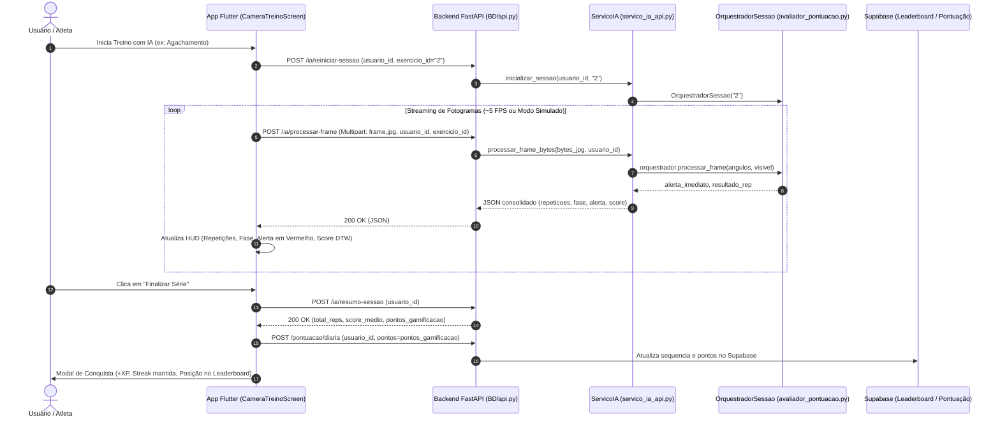

# Plano Técnico — Sprint `US-02`: Demonstração Funcional Integrada (Frontend Flutter + FastAPI + Motor IA)

> **História de Usuário (`US-02`):**  
> *"Como atleta praticante utilizando o aplicativo móvel Personal Trainer IA, quero executar meus exercícios em frente à câmera recebendo contagem automática de repetições, alertas posturais imediatos e nota técnica pedagógica no HUD do celular, concluindo a série com envio da pontuação real para o Leaderboard e atualização da minha sequência diária."*

---

## 1. Visão Geral da Demonstração e Objetivos

O objetivo desta sprint é unificar as três frentes do projeto em uma **demo funcional de ponta a ponta**:
1. **Frontend (Flutter):** Interface do usuário (`CameraTreinoScreen` adaptada para desktop e mobile) transmitindo frames e recebendo feedback biomecânico em tempo real.
2. **Backend Intermediário (FastAPI):** Servidor REST expondo rotas `/ia/*` com decodificação de imagem em memória e orquestração de sessões por usuário e exercício.
3. **Motor Biomecânico (Branch `IA`):** Pipeline híbrido (`MediaPipe PoseLandmarker` + `OrquestradorSessao` FSM + DTW) avaliando repetições e gerando `ResultadoPontuacaoRepeticao` e `ResumoPontuacaoSessao`.
4. **Gamificação & Persistência (Supabase):** Envio dos pontos calculados pelo motor (`pontos_gamificacao`) para os endpoints de pontuação diária (`POST /pontuacao/diaria`), refletindo no ranking e streak.

---

## 2. Arquitetura da Solução Integrada



---

## 3. Especificação do Contrato de Dados da API (`/ia/*`)

### 3.1. `POST /ia/processar-frame`
- **Entrada (Multipart/Form-Data):**
  - `frame`: Arquivo de imagem (`.jpg` ou `.png`).
  - `usuario_id`: String (UUID do usuário logado ou `"anonimo"`).
  - `exercicio`: String (`"1"` para Ombro, `"2"` para Agachamento, `"3"` para Rosca).
  - `lado`: String (`"direito"` ou `"esquerdo"`).
- **Processamento:**
  - Imagem decodificada em memória com `cv2.imdecode(np.frombuffer(conteudo, np.uint8), cv2.IMREAD_COLOR)` **sem gravação em disco**, eliminando lentidão de I/O.
  - Extração de pose via `detector.detect()` em modo `IMAGE`.
  - Passagem dos ângulos para `orquestrador.processar_frame(angulos, visivel)`.
- **Saída (JSON — 200 OK):**
  ```json
  {
    "sucesso": true,
    "repeticoes": 3,
    "fase_numero": 2,
    "fase_nome": "Pico do Movimento",
    "corpo_visivel": true,
    "angulos": {
      "joelho": 95.4,
      "quadril": 88.2
    },
    "alerta_imediato": "Mantenha o tronco alinhado",
    "ultima_repeticao": {
      "numero_repeticao": 3,
      "score_final": 94.5,
      "aprovado": true,
      "classificacao": "EXCELENTE",
      "feedback_principal": "Excelente repetição! Padrão motor e amplitude alinhados à referência."
    },
    "sessao": {
      "total_repeticoes": 3,
      "repeticoes_aprovadas": 3,
      "score_medio": 93.1,
      "pontos_gamificacao": 27.9
    }
  }
  ```

### 3.2. `POST /ia/simular-repeticao` (Recurso Chave para a Apresentação da Demo)
- **Motivação:** Em apresentações ao vivo, câmeras de celular ou iluminação ambiente podem introduzir atrasos ou ruído de captura. Esse endpoint envia uma série de frames canônicos pré-calculados (ideal ou com erro postural) para o `OrquestradorSessao` do usuário, atualizando a UI do Flutter em tempo real com garantia de sucesso na demo.
- **Entrada (JSON):**
  `{"usuario_id": "...", "exercicio": "1", "tipo_cenario": "ideal" | "incompleto" | "postural"}`

---

## 4. Decomposição em Tasks Atômicas da Sprint `US-02`

### `[TASK-02.1]` Adaptador de Sessão IA em Memória (`./servico_ia_api.py`)
- **Escopo Técnico:**
  - Criar o serviço `ServicoIA` que encapsula o `PoseLandmarker` do MediaPipe (modo `IMAGE`) e mantém um dicionário de sessões ativas `sessoes[usuario_id] = OrquestradorSessao(exercicio)`.
  - Implementar método `processar_bytes_imagem(bytes_img, usuario_id, exercicio, lado)` com decodificação direta via `cv2.imdecode` (zero overhead de disco).
  - Implementar método `simular_cenario(usuario_id, exercicio, cenario)` para apoio à demo.
- **Artefatos Gerados:**
  - [`./servico_ia_api.py`](./servico_ia_api.py) (Novo módulo de serviço)
  - [`tests/test_servico_ia_api.py`](tests/test_servico_ia_api.py) (Testes unitários do adaptador)
- **Critério de Pronto (DoD):** `python -m pytest tests/test_servico_ia_api.py` aprovado sem erros.
- **Commit:** `feat(ia-api): cria servico_ia_api com sessoes em memoria e decodificacao de imagens`

### `[TASK-02.2]` Integração das Rotas de IA no Backend FastAPI (`./BD/api.py`)
- **Escopo Técnico:**
  - Conectar as rotas `/ia/processar-frame`, `/ia/reiniciar-sessao`, `/ia/resumo-sessao` e `/ia/simular-repeticao` ao `servico_ia_api`.
  - Atualizar dependências em `./BD/requirements.txt` (`opencv-python`, `mediapipe`, `numpy`, `python-multipart`).
  - Adicionar suporte para CORS e documentação Swagger (`/docs`).
- **Artefatos Modificados:**
  - `./BD/api.py`
  - `./BD/requirements.txt`
- **Critério de Pronto (DoD):** Requisições cURL para `POST /ia/processar-frame` e `POST /ia/simular-repeticao` respondem status 200 com métricas biomecânicas.
- **Commit:** `feat(api): conecta rotas /ia do FastAPI ao OrquestradorSessao`

### `[TASK-02.3]` Evolução da `CameraTreinoScreen` no Flutter com HUD Biomecânico
- **Escopo Técnico:**
  - Em `lib/screens/camera_treino_screen.dart`:
    - Adicionar seletor visual de exercício no topo (`Desenvolvimento de Ombro`, `Agachamento`, `Rosca Bíceps`) e alternância de lado (`Direito` / `Esquerdo`).
    - Configurar streaming responsivo de frames (dispara o próximo frame ~150-200ms após o retorno da API, evitando sobrecarga de rede).
    - Exibir HUD com: **Contador de Repetições**, **Fase Atual**, **Banner de Alerta Postural**, **Score DTW da Última Repetição**.
    - Botão **"Simular Execução IA"** (atalho de apresentação para a banca avaliadora).
    - Botão **"Finalizar Treino"**: envia `pontos_gamificacao` para `ApiService().adicionarPontuacaoDiaria()` e abre o modal de pontuação conquistada.
- **Artefatos Modificados:**
  - `lib/screens/camera_treino_screen.dart`
  - `lib/config/api_config.dart`
- **Critério de Pronto (DoD):** `flutter analyze` sem erros; HUD atualizado dinamicamente com respostas da API.
- **Commit:** `feat(camera-ui): implementa HUD biomecanico e conclusao de treino com gamificacao`

### `[TASK-02.4]` Integração da Navegação de Treino para a Câmera IA
- **Escopo Técnico:**
  - Em `lib/screens/treino_selecionado_screen.dart`:
    - Adicionar botão **"Executar com IA (Câmera)"** ao lado de cada exercício da lista.
    - Ao clicar, navega para `CameraTreinoScreen` passando o exercício selecionado.
  - Em `lib/screens/home_screen.dart`:
    - Adicionar atalho rápido **"Treino Rápido com IA"**.
- **Artefatos Modificados:**
  - `lib/screens/treino_selecionado_screen.dart`
  - `lib/screens/home_screen.dart`
- **Critério de Pronto (DoD):** Fluxo de navegação completo sem quebras: *Home $\rightarrow$ Treino $\rightarrow$ Câmera IA $\rightarrow$ Pontuação no Leaderboard*.
- **Commit:** `feat(nav): conecta telas de treino e home a CameraTreinoScreen`

### `[TASK-02.5]` Testes de Integração e Roteiro de Apresentação da Demo
- **Escopo Técnico:**
  - Criar testes de integração automatizados simulando a chamada HTTP completa do Flutter ao FastAPI.
  - Criar o guia `ROTEIRO_DEMO.md` com o passo a passo para ligar o servidor e demonstrar todas as funcionalidades para professores e avaliadores.
- **Artefatos Gerados:**
  - `tests/test_integracao_demo.py`
  - `ROTEIRO_DEMO.md`
  - Atualização em `DEVLOG.md` e `CONTEXTO_IA.md`
- **Critério de Pronto (DoD):** Testes de integração passando e roteiro da demo validado.
- **Commit:** `docs(demo): adiciona roteiro da demo e testes de integracao da api`

---

## 5. Resumo da Sequência de Tasks e Commits Planejados

| Task | Responsabilidade | Artefatos Principais | Commit Previsto |
| :---: | :--- | :--- | :--- |
| `[TASK-02.1]` | Adaptador de Sessão IA em Memória | `servico_ia_api.py`, `tests/test_servico_ia_api.py` | `feat(ia-api): cria servico_ia_api com sessoes em memoria` |
| `[TASK-02.2]` | Rotas de IA no FastAPI | `BD/api.py`, `BD/requirements.txt` | `feat(api): conecta rotas /ia do FastAPI ao OrquestradorSessao` |
| `[TASK-02.3]` | HUD Biomecânico na Câmera Flutter | `lib/screens/camera_treino_screen.dart`, `lib/config/api_config.dart` | `feat(camera-ui): implementa HUD biomecanico e gamificacao` |
| `[TASK-02.4]` | Navegação no App para a Câmera | `lib/screens/treino_selecionado_screen.dart`, `lib/screens/home_screen.dart` | `feat(nav): conecta telas de treino e home a CameraTreinoScreen` |
| `[TASK-02.5]` | Testes de Integração e Roteiro | `tests/test_integracao_demo.py`, `ROTEIRO_DEMO.md` | `docs(demo): adiciona roteiro da demo e testes integrados` |
