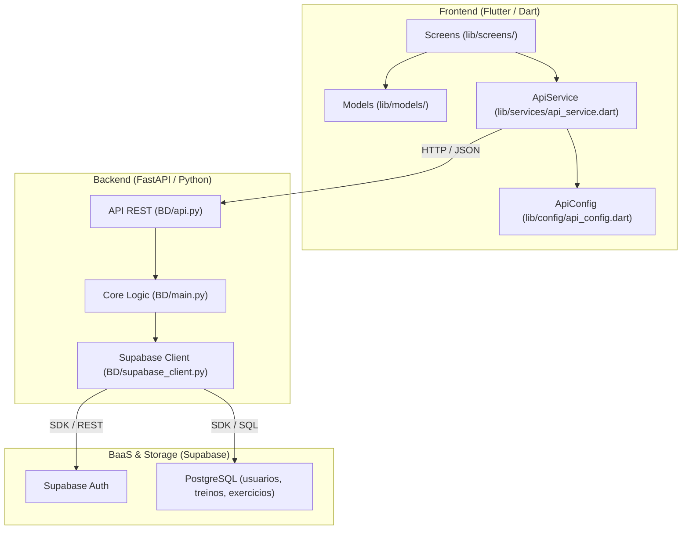

# 🗺️ Guia de Contexto do Projeto: Personal Trainer IA

> **Última Atualização:** 2026-10-23  
> **Status do Projeto:** Em Desenvolvimento / Integração  
> **Versão:** 1.0.0+1  

---

## 📖 Visão Geral

O **Personal Trainer IA** é uma solução completa desenvolvida para auxiliar praticantes de atividades físicas na gestão, acompanhamento e personalização de seus treinos. O ecossistema é composto por um aplicativo mobile moderno construído em **Flutter**, integrado a um back-end intermediário em **FastAPI (Python)** e armazenamento persistente com autenticação segura provido pelo **Supabase (PostgreSQL)**.

### Objetivos Principais
1. **Autenticação & Gestão de Usuários:** Cadastro, login com recuperação de senha e gestão de perfil.
2. **Rotinas e Planos de Treino:** Seleção de treinos por grupamento muscular, níveis de dificuldade e rotinas personalizadas.
3. **Criação e Gestão de Exercícios:** Interface flexível para criar, listar e vincular exercícios aos treinos.
4. **Arquitetura Assistida por Agentes de IA:** Governança técnica orientada por agentes locais e regras de engenharia de software.

---

## 🏗️ Arquitetura & Fluxo de Dados

A arquitetura segue o modelo em camadas, desacoplando a interface visual móvel da regra de acesso a banco e serviços terceiros através de uma API REST:



---

## 💻 Stack Tecnológica

| Componente | Tecnologia | Versão | Descrição |
| :--- | :--- | :--- | :--- |
| **Mobile Frontend** | Flutter / Dart | Dart 3.13+ / Flutter SDK | Interface móvel nativa multi-plataforma (Android, iOS, Web) |
| **Backend REST API** | FastAPI / Uvicorn | FastAPI >= 0.110 | Camada de rotas assíncronas e serialização com Pydantic |
| **Banco de Dados & Auth** | Supabase / PostgreSQL | Supabase Python >= 2.3 | Autenticação gerenciada, triggers e tabelas relacionais |
| **Orquestração IA** | Google Antigravity | Custom Agents & Skills | Subagentes (`context-navigator`, `code-architect`) |

---

## 📁 Estrutura de Pastas e Módulos

```text
EngSoftTrabalho_Personal_TrainerIA/
├── .agents/                 # Governança de agentes, subagentes e skills locais
│   ├── agents/              # Definições dos agentes (context-navigator, code-architect)
│   ├── skills/              # Habilidades reutilizáveis (ai-context, human-context)
│   └── config.json          # Registro dos agentes e skills do workspace
├── .ai_context.md           # Contexto denso e ultraconciso consumido pela IA
├── PROJECT_CONTEXT.md       # Este guia de contexto voltado a humanos
├── BD/                      # Servidor backend Python e scripts de banco
│   ├── api.py               # Servidor FastAPI com rotas REST e documentação Swagger
│   ├── main.py              # Funções de interação direta com o Supabase
│   ├── supabase_client.py   # Inicialização da conexão com Supabase
│   ├── requirements.txt     # Dependências Python
│   └── .env                 # Variáveis de ambiente (chaves de API e URLs)
├── lib/                     # Código-fonte principal da aplicação Flutter
│   ├── config/              # Configurações de conexão (api_config.dart)
│   ├── models/              # Estruturas e classes de modelo (exercicio_treino.dart)
│   ├── screens/             # Telas de UI (login, cadastro, perfil, treinos, etc.)
│   ├── services/            # Serviços HTTP e sessão de usuário (api_service.dart)
│   └── main.dart            # Ponto de entrada do aplicativo Flutter
└── pubspec.yaml             # Dependências e metadados do projeto Flutter
```

---

## 🚀 Como Executar o Projeto

### 1. Inicializar o Back-end (FastAPI)
Certifique-se de ter o Python 3.10+ instalado e o ambiente virtual ativo:

```bash
# 1. Acessar a pasta do backend
cd BD

# 2. Instalar as dependências
pip install -r requirements.txt

# 3. Iniciar o servidor de desenvolvimento
uvicorn api:app --reload --host 0.0.0.0 --port 8000
```
> Documentação interativa da API estará disponível em: `http://localhost:8000/docs`

### 2. Inicializar o Front-end (Flutter)
Em outro terminal, certifique-se de ter o Flutter configurado:

```bash
# 1. Instalar as dependências
flutter pub get

# 2. Executar no emulador ou dispositivo conectado
flutter run
```

> [!NOTE]
> Se estiver utilizando o emulador Android, a conexão com a API local é feita automaticamente pelo IP `10.0.2.2:8000`, conforme configurado em `lib/config/api_config.dart`.

---

## 🛡️ Regras e Padrões de Projeto

1. **Camada de Serviço Centralizada:** Nenhuma tela em `lib/screens/` deve realizar chamadas `http` diretas; utilize sempre métodos dentro de `lib/services/api_service.dart`.
2. **Governança de IA (`code-architect`):** Nenhum arquivo de código funcional deve ser alterado sem um alinhamento prévio e aprovação expressa do usuário.
3. **Segurança de Credenciais:** Arquivos `.env` e chaves sensíveis do Supabase jamais devem ser incluídos em commits ou expostos abertamente.
