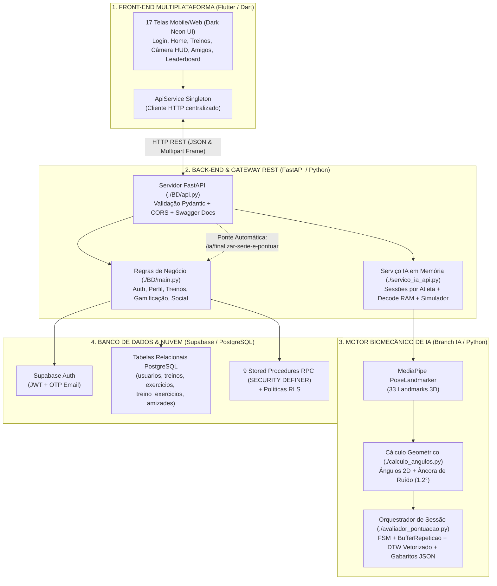
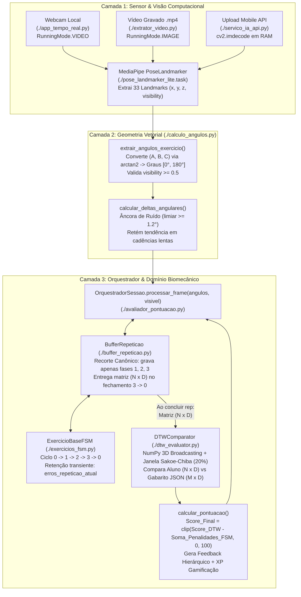
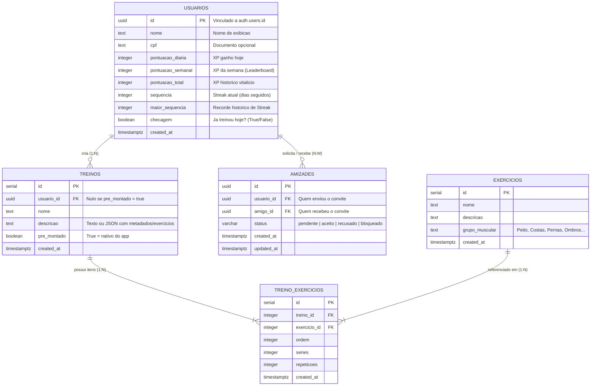
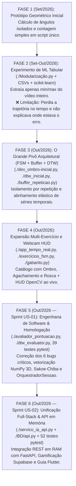
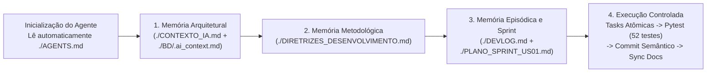

# 📱 Dossiê Técnico, Conceitual e Arquitetural Completo — Personal Trainer IA (PersonAI)

> **Guia Definitivo de Ponta a Ponta (Edição Otimizada para Leitura Mobile e Apresentação Executiva)**  
> **Escopo:** Visão de Produto (Investidor), Fundamentação Teórico-Conceitual (Web, API, Banco de Dados e Mobile), Funcionamento Interno de Todos os Módulos, Histórico Evolutivo, *System Design Interview* e Engenharia de Software Orientada a Agentes (*Agentic Coding*).  
> **Última Atualização:** Outubro de 2026 — Sprints `US-01` e `US-02` Concluídas e Homologadas (52/52 testes automatizados aprovados).

---

## 📑 Índice Navegável

1. **[PARTE 1 — Visão Executiva e Pitch de Produto (Nível Investidor)](#parte-1--visão-executiva-e-pitch-de-produto-nível-investidor)**
   - 1.1. O Problema Real de Mercado
   - 1.2. A Solução: Personal Trainer IA (PersonAI)
   - 1.3. Diferenciais Competitivos e Fossos Tecnológicos (*Moats*)
   - 1.4. Os 4 Pilares do Ecossistema
2. **[PARTE 2 — Fundamentação Teórico-Conceitual (Para Dominar Front-end, Back-end, API e Banco de Dados)](#parte-2--fundamentação-teórico-conceitual-para-dominar-front-end-back-end-api-e-banco-de-dados)**
   - 2.1. A Anatomia de um Sistema Moderno: Front-end vs. Back-end vs. Banco de Dados
   - 2.2. O que é uma API, HTTP, REST, JSON e Multipart? Qual API usamos?
   - 2.3. Conceitos de Banco de Dados Relacional, Auth, JWT, RLS e Stored Procedures (RPC)
   - 2.4. Infraestrutura em Nuvem (PaaS, BaaS, CORS e Variáveis de Ambiente)
3. **[PARTE 3 — Funcionamento Compreensivo de Cada Módulo do Projeto](#parte-3--funcionamento-compreensivo-de-cada-módulo-do-projeto)**
   - 3.1. Módulo 1: Motor de Inteligência Artificial e Biomecânica (Branch `IA`)
   - 3.2. Módulo 2: Back-end e Gateway REST (`./BD/api.py` e `./BD/main.py`)
   - 3.3. Módulo 3: Banco de Dados Relacional e Segurança (`./BD/script_amizades_leaderboard.sql`)
   - 3.4. Módulo 4: Aplicativo Front-end Multiplataforma (`lib/` em Flutter/Dart)
4. **[PARTE 4 — Histórico e Evolução do Desenvolvimento (Geral e por Módulo)](#parte-4--histórico-e-evolução-do-desenvolvimento-geral-e-por-módulo)**
   - 4.1. A Evolução do Motor de IA em 6 Fases (Do Protótipo e ML Tabular ao Pipeline Híbrido)
   - 4.2. Os 6 Problemas Críticos Diagnosticados e Como Foram Resolvidos na Sprint `US-01`
   - 4.3. A Unificação Full-Stack na Sprint `US-02`
5. **[PARTE 5 — Arquitetura em Nível de *System Design Interview*](#parte-5--arquitetura-em-nível-de-system-design-interview)**
   - 5.1. Requisitos Funcionais (FR) e Não-Funcionais (NFR)
   - 5.2. Estimativas de Capacidade e Matemática de Gargalos (*Back-of-the-Envelope*)
   - 5.3. Os 5 Grandes *Trade-offs* de Engenharia e Justificativas Arquiteturais
   - 5.4. Aplicação Prática de SOLID e Padrões de Projeto (*Design Patterns*)
   - 5.5. Plano de Escalabilidade (De 100 para 100.000 Usuários Simultâneos)
6. **[PARTE 6 — Estrutura do Repositório, Governança de Agentes (*Skills*) e Integração Agente-Codebase](#parte-6--estrutura-do-repositório-governança-de-agentes-skills-e-integração-agente-codebase)**
   - 6.1. Mapa Completo e Taxonomia dos Arquivos do Repositório
   - 6.2. A Política Inegociável de Preservação de Legados
   - 6.3. Como Funciona a Engenharia de Software Orientada a Agentes neste Repositório
   - 6.4. Catálogo Detalhado das *Skills* e Protocolos dos Agentes de IA
7. **[PARTE 7 — Guia de Bolso para Perguntas de Investidores, Professores e Banca (FAQ Estratégico)](#parte-7--guia-de-bolso-para-perguntas-de-investidores-professores-e-banca-faq-estratégico)**

---

# PARTE 1 — Visão Executiva e Pitch de Produto (Nível Investidor)

## 1.1. O Problema Real de Mercado

O mercado global de fitness e saúde enfrenta um trilema estrutural quando uma pessoa decide treinar em casa ou na academia sem acompanhamento individual:

1. **Risco Biomecânico e Lesões Invisíveis:** Executar exercícios como Agachamento Livre, Desenvolvimento de Ombros ou Rosca Bíceps com compensações posturais (tronco excessivamente inclinado, cotovelo caindo, ombro instável) ou amplitude encurtada reduz drasticamente a hipertrofia e causa lesões articulares crônicas.
2. **Inacessibilidade Econômica de Supervisão Humana:** Contratar um Personal Trainer presencial para corrigir cada repetição custa caro e não escala para a grande massa de praticantes.
3. **Falha dos Aplicativos Tradicionais de Treino:** Os aplicativos convencionais funcionam apenas como "planilhas digitais" ou vídeos passivos: o usuário assiste a uma demonstração, faz o exercício sem nenhum feedback sobre sua postura real, clica em um botão *"Concluído"* e recebe pontos fictícios. Não há garantia alguma de que o movimento foi feito corretamente — ou sequer de que foi feito.

---

## 1.2. A Solução: Personal Trainer IA (PersonAI)

O **Personal Trainer IA (PersonAI)** é uma plataforma completa que transforma qualquer câmera comum (de um celular Android/iOS ou webcam de computador) em um **avaliador biomecânico inteligente em tempo real**, integrado a uma rede social gamificada de atletas.

Sem exigir nenhum sensor vestível (*wearable*), relógio inteligente ou roupa especial, o sistema:
- **Enxerga o corpo do praticante** a cada fotograma (extraindo 33 pontos anatômicos tridimensionais).
- **Compreende a fase motora do exercício** em tempo real (Repouso $\rightarrow$ Ida $\rightarrow$ Pico/Fundo $\rightarrow$ Retorno).
- **Conta apenas repetições reais** e emite **alertas posturais instantâneos** na tela (HUD) no exato momento em que um desvio biomecânico acontece.
- **Avalia a qualidade técnica global de cada repetição (0% a 100%)** comparando a trajetória espaço-temporal do aluno contra o **Gabarito Padrão Ouro de um Especialista**, independentemente de o aluno fazer o movimento rápido ou devagar.
- **Converte qualidade biomecânica em progresso social (*Proof-of-Workout*):** Apenas repetições tecnicamente aprovadas geram pontos de experiência (`pontos_gamificacao`), que alimentam a sequência diária (*Streak*) e posicionam o usuário no **Leaderboard Global e de Amigos**.

---

## 1.3. Diferenciais Competitivos e Fossos Tecnológicos (*Moats*)

Se um investidor ou avaliador perguntar *"Por que a sua tecnologia é melhor do que simplesmente jogar um vídeo em uma rede neural genérica ou usar um LLM de visão?"*, a resposta reside em **quatro decisões estratégicas de produto e engenharia**:

| Diferencial Estratégico | Abordagem Comum de Mercado (Concorrentes) | Abordagem do **Personal Trainer IA** | Vantagem para o Negócio e Usuário |
| :--- | :--- | :--- | :--- |
| **1. IA Explicável (XAI) vs. Caixa-Preta** | Redes neurais fim-a-fim (*End-to-End Deep Learning*) que dizem apenas *"Certo (80%)"* ou *"Errado"* sem saber explicar o porquê. | **Arquitetura Híbrida (MediaPipe + Geometria 2D + FSM + DTW):** combina visão computacional profunda na base com modelagem matemática explícita no topo. | O sistema aponta cirurgicamente: *"Cotovelo correto, mas seu ombro teve desvio médio de 14.2° em relação à referência"*. |
| **2. Invariância Temporal (Cadência Livre)** | Comparação rígida quadro a quadro (penaliza alunos que treinam de forma lenta e controlada, como na musculação hipertrofiante). | **Alinhamento Elástico via DTW (*Dynamic Time Warping*) com Janela de Sakoe-Chiba:** comprime e estica o tempo de forma não-linear. | Um aluno que leva 2 segundos e outro que leva 6 segundos com boa postura tiram igualmente **> 92% de nota**. |
| **3. Escalabilidade de Novos Exercícios (*Zero-Training Addition*)** | Exige gravar milhares de vídeos rotulados e treinar uma nova rede neural por semanas para cada novo exercício adicionado ao app. | **Padrão *Strategy + Registry* + 1 Vídeo de Especialista (*One-Shot Reference*):** basta definir as regras angulares na classe FSM e extrair 1 vídeo do personal trainer. | Novos exercícios são adicionados em **minutos**, sem custo de GPU de treinamento. |
| **4. Custo Computacional Ultra-Baixo** | Modelos pesados de vídeo que exigem servidores com GPUs dedicadas caras na nuvem (inviabilizando o *unit economics* de usuários gratuitos). | Pipeline matemático vetorizado em **NumPy 3D *Broadcasting*** (executa o DTW em **< 0.5 milissegundos** em CPU comum). | Pode rodar em servidores de baixo custo ou diretamente no processador do celular do usuário. |

---

## 1.4. Os 4 Pilares do Ecossistema

O projeto completo é dividido em **4 grandes camadas integradas**:



---

# PARTE 2 — Fundamentação Teórico-Conceitual (Para Dominar Front-end, Back-end, API e Banco de Dados)

> **Por que esta seção existe?** Como o seu foco principal de desenvolvimento foi o **Motor de Inteligência Artificial** (com apoio de agentes), esta seção foi desenhada como um **curso intensivo descomplicado** sobre todas as outras tecnologias que cercam o seu motor. Ao terminar de ler esta parte, você saberá exatamente o que significa cada sigla (`REST`, `FastAPI`, `Pydantic`, `Supabase`, `RLS`, `RPC`, `JWT`, `CORS`, `Multipart`, `StatefulWidget`) e por que cada decisão foi tomada.

---

## 2.1. A Anatomia de um Sistema Moderno: Front-end vs. Back-end vs. Banco de Dados

Imagine que o **Personal Trainer IA** é uma **clínica esportiva de alta tecnologia**:

1. **O Front-end (Aplicativo Flutter) é a Recepção e a Sala de Treino com Espelho Inteligente:**
   - **O que é tecnicamente:** É a camada de apresentação (*Client-Side*) que roda diretamente no dispositivo do usuário (celular Android, iPhone, navegador Web ou Desktop Windows). Foi escrita na linguagem **Dart** usando o framework **Flutter** (criado pelo Google).
   - **O que ele faz:** Desenha os botões, cartões, gráficos de pódio, formulários de login e abre a câmera física do aparelho.
   - **Por que o Front-end não faz tudo sozinho?**
     1. **Segurança:** Tudo o que está no celular do usuário pode ser inspecionado ou adulterado por um usuário mal-intencionado. Se a senha mestre do banco de dados estivesse dentro do aplicativo Flutter, qualquer pessoa poderia roubá-la e alterar sua própria pontuação no Leaderboard para 1 milhão de pontos.
     2. **Centralização e Padronização:** Se as regras de negócio (como calcular o ranking, validar amizades ou rodar o motor oficial de IA em Python) ficam em um servidor central, qualquer atualização vale instantaneamente para todos os usuários, sem exigir que baixem uma nova versão na loja de aplicativos.

2. **O Back-end (Servidor Python FastAPI) é o Gerente Geral e a Equipe de Fisiologistas:**
   - **O que é tecnicamente:** É o programa que roda em um computador remoto na nuvem (*Server-Side*), invisível aos olhos do usuário final. No nosso projeto, ele fica em [`./BD/api.py`](./BD/api.py), [`./BD/main.py`](./BD/main.py) e [`./servico_ia_api.py`](./servico_ia_api.py).
   - **O que ele faz:** Ele fica "escutando" pedidos enviados pelo aplicativo Flutter pela internet. Quando o aplicativo diz *"O usuário João quer fazer login"*, ou *"Aqui está a foto do frame #14 do agachamento do João"*, o Back-end verifica se os dados são válidos, aciona o **Motor de IA** (em memória RAM) ou consulta o **Banco de Dados**, aplica as regras de negócio e devolve uma resposta limpa para o celular mostrar na tela.

3. **O Banco de Dados (Supabase / PostgreSQL) é o Arquivo Central Blindado da Clínica:**
   - **O que é tecnicamente:** É um sistema especializado em guardar dados de forma **persistente** (no disco rígido de servidores seguros), estruturada em tabelas interligadas, garantindo que mesmo que o servidor do Back-end seja reiniciado ou acabe a energia, nenhuma conta de usuário, treino ou pontuação seja perdida.
   - **A Diferença Crucial entre Memória RAM e Banco de Dados no Nosso Projeto:**
     - **Memória RAM (Volátil e Ultra-Rápida):** Quando o aluno está fazendo uma série de 10 agachamentos em frente à câmera, o celular manda ~5 a 8 fotos por segundo. Gravar cada fotograma no banco de dados demoraria dezenas de milissegundos e deixaria o sistema lento e caro. Por isso, o [`./servico_ia_api.py`](./servico_ia_api.py) mantém a sessão ativa do treino na **Memória RAM** do servidor (`self.sessoes[usuario_id]`).
     - **Banco de Dados em Disco (Persistente e Durável):** No instante em que o aluno termina a série e clica em *"Finalizar Treino"* (`POST /ia/finalizar-serie-e-pontuar`), o resultado consolidado (ex.: `+28 pontos de gamificação` e `+1 dia de sequência`) é gravado permanentemente no banco de dados **PostgreSQL (Supabase)**.

---

## 2.2. O que é uma API, HTTP, REST, JSON e Multipart? Qual API usamos?

### O Conceito de API (*Application Programming Interface*)
Como o Front-end (escrito em **Dart/Flutter**, rodando no celular) conversa com o Back-end (escrito em **Python**, rodando na nuvem), se eles são feitos em linguagens diferentes e estão em máquinas diferentes?
Eles conversam através de uma **API Web**. Pense na API como um **cardápio padronizado de restaurante com regras estritas de pedido**: o cliente (Flutter) não entra na cozinha (Back-end/Banco de Dados); ele chama o garçom (protocolo **HTTP**) e faz um pedido para um endereço específico (chamado de **Rota** ou **Endpoint**, como `/ia/simular-repeticao`).

### O que significa API REST e Verbos HTTP?
Nossa API segue o estilo arquitetural **REST (*Representational State Transfer*)**, que é o padrão mundial da indústria web. Em uma API REST, cada endereço URL representa um recurso do sistema, e usamos **Verbos HTTP** para indicar qual ação queremos realizar:

| Verbo HTTP | Significado Conceitual | Exemplo Real no Nosso Projeto (`./BD/api.py`) |
| :---: | :--- | :--- |
| **`GET`** | **Consultar / Ler** informações sem alterar nada no servidor. | `GET /leaderboard/global` (busca o ranking de atletas)<br>`GET /ia/resumo-sessao?usuario_id=...` (lê o laudo da série) |
| **`POST`** | **Criar** um novo registro ou **Disparar um processamento** que altera estado. | `POST /auth/login` (autentica o usuário)<br>`POST /ia/processar-frame` (envia imagem para a IA avaliar)<br>`POST /ia/finalizar-serie-e-pontuar` (consolida série e soma XP) |
| **`PUT`** | **Atualizar / Substituir** dados existentes de um recurso. | `PUT /perfil/{usuario_id}` (atualiza nome, CPF, sequência)<br>`PUT /treinos/{treino_id}` (edita um treino existente) |
| **`PATCH`** | **Atualizar Parcialmente** um campo específico (ex.: mudar apenas o status). | `PATCH /amigos/solicitacoes/{solicitacao_id}` (muda status do convite para `"aceito"` ou `"recusado"`) |
| **`DELETE`** | **Apagar / Remover** um registro do sistema. | `DELETE /treinos/{treino_id}` (exclui um treino)<br>`DELETE /amigos/{amigo_id}` (desfaz amizade) |

### O que é JSON vs. Multipart/Form-Data?
Na internet, os dados viajam dentro das requisições HTTP em dois formatos principais no nosso projeto:
1. **JSON (*JavaScript Object Notation*):** É um formato de texto leve, estruturado em pares `"chave": valor` (muito parecido com um dicionário `dict` do Python). Quase todas as rotas do nosso sistema recebem e devolvem JSON. Exemplo:
   ```json
   {
     "sucesso": true,
     "repeticoes": 3,
     "fase_nome": "Pico do Movimento",
     "alerta_imediato": null
   }
   ```
2. **Multipart/Form-Data:** O formato JSON é excelente para textos e números, mas é ruim para transmitir arquivos binários pesados (como uma foto `.jpg` da câmera), pois converter uma imagem para texto (Base64) aumenta seu tamanho em ~33%. Por isso, na rota `POST /ia/processar-frame`, usamos `multipart/form-data`: um envelope HTTP que permite enviar os **bytes puros e comprimidos da imagem JPEG** (`frame`) junto com campos de formulário (`usuario_id`, `exercicio`, `lado`) na mesma viagem de rede!

### Quais tecnologias de API estão sendo utilizadas no projeto?
Se alguém perguntar *"Qual framework de API vocês usam e por quê?"*, você deve responder:
1. **FastAPI (Python):** É o framework web moderno utilizado em [`./BD/api.py`](./BD/api.py) para construir a nossa API REST. Escolhemos o FastAPI por três motivos técnicos:
   - **Performance Assíncrona (ASGI via Uvicorn):** É um dos frameworks Python mais rápidos existentes, capaz de lidar com múltiplas requisições concorrentes (como uploads de frames de câmera via `async def api_ia_processar_frame`).
   - **Integração Nativa com o Ecossistema de IA:** Como nosso motor biomecânico (`MediaPipe`, `OpenCV`, `NumPy`) é escrito em Python, o FastAPI permite importar e executar o `OrquestradorSessao` diretamente em memória RAM, sem precisar criar pontes complexas entre linguagens diferentes no servidor.
   - **Documentação Automática (Swagger UI / OpenAPI):** O FastAPI gera sozinho uma página interativa na rota `/docs` onde qualquer desenvolvedor ou avaliador pode testar todas as rotas pelo navegador.
2. **Pydantic v2:** Biblioteca acoplada ao FastAPI (classes `BaseModel` nas linhas 40–144 de [`./BD/api.py`](./BD/api.py)). Ela funciona como um "segurança de porta": antes mesmo de o nosso código rodar, o Pydantic verifica se o JSON enviado pelo celular tem os tipos certos (ex.: se `pontos` é um número inteiro maior que zero, se `status` da amizade é estritamente `"aceito"` ou `"recusado"`). Se o celular mandar algo inválido, o Pydantic bloqueia automaticamente e devolve um erro padronizado (`HTTP 422 Unprocessable Entity`).

---

## 2.3. Conceitos de Banco de Dados Relacional, Auth, JWT, RLS e Stored Procedures (RPC)

O nosso projeto utiliza o **Supabase**, que é uma plataforma **BaaS (*Backend-as-a-Service*)** de código aberto construída sobre o **PostgreSQL** (o banco de dados relacional open-source mais avançado do mundo). Vamos entender cada peça que usamos nele:

### 1. Banco de Dados Relacional (SQL) e Chaves (`PK` e `FK`)
Em um banco relacional, nós não jogamos tudo em uma única planilha gigante (o que causaria duplicação e bagunça). Nós separamos os assuntos em **Tabelas** e criamos **Relações** entre elas usando códigos identificadores:
- **Chave Primária (`PK — Primary Key`):** É o "RG único" de cada linha de uma tabela.
  - Nas tabelas `usuarios` e `amizades`, usamos **UUID** (*Universally Unique Identifier*, ex.: `a1b2c3d4-...`), um código alfanumérico impossível de adivinhar sequencialmente.
  - Nas tabelas `treinos` e `exercicios`, usamos **SERIAL** (números inteiros autoincrementados: `1, 2, 3...`).
- **Chave Estrangeira (`FK — Foreign Key`):** É uma coluna em uma tabela que aponta para a Chave Primária de outra tabela, criando um vínculo.
  - *Exemplo no projeto:* Na tabela `treinos`, existe a coluna `usuario_id` (FK) que aponta para `usuarios.id` (PK). Assim sabemos exatamente qual atleta criou qual treino.
  - *Relação Muitos-para-Muitos (`N:N`) com Tabela Associativa:* Um treino pode conter vários exercícios (Agachamento, Flexão, Prancha), e o mesmo exercício "Agachamento" pode estar dentro de centenas de treinos diferentes. No SQL, resolvemos isso criando a tabela intermediária **`treino_exercicios`**, que guarda o par `(treino_id, exercicio_id)` mais a `ordem`, `series` e `repeticoes`!

### 2. Supabase Auth e Tokens JWT (*JSON Web Token*)
- Quando um usuário cria uma conta (`POST /auth/criar-conta`), nós **jamais** salvamos a senha dele em texto puro na nossa tabela `public.usuarios`.
- Em vez disso, delegamos ao **Supabase Auth** (`supabase.auth.sign_up`), que criptografa a senha com algoritmos seguros (*bcrypt*) em um esquema protegido separado (`auth.users`) e dispara um gatilho (*Trigger* do banco) que cria a ficha pública do atleta em `public.usuarios` com o mesmo `id`.
- Quando o usuário faz login (`POST /auth/login`), o Supabase devolve um **`access_token` (JWT)** — um "crachá digital assinado criptograficamente" — que comprova a identidade daquele usuário, além de suportar recuperação de senha por código **OTP (*One-Time Password*)** enviado por e-mail.

### 3. O que é RLS (*Row-Level Security*) e o Problema que Ele Gerou
- **Conceito:** *Row-Level Security* (Segurança em Nível de Linha) é um recurso do PostgreSQL onde o próprio banco de dados aplica regras de visibilidade em cada linha da tabela. Por exemplo, em `public.amizades` ([`./BD/script_amizades_leaderboard.sql`](./BD/script_amizades_leaderboard.sql), linhas 64–94), configuramos políticas RLS garantindo que:
  - Só quem recebeu um convite de amizade (`amigo_id = auth.uid()`) pode aceitá-lo ou recusá-lo.
  - Um usuário comum não pode alterar a pontuação ou os dados de outro usuário.
- **O Desafio Técnico:** Na tabela `public.usuarios`, o RLS protege os dados pessoais (como CPF e e-mail) para que um usuário só consiga dar `SELECT` na sua própria linha. **Mas pense bem:** se o usuário A só pode ler a própria linha dele na tabela `usuarios`, como o aplicativo vai mostrar o **nome e a pontuação dos outros atletas** no Leaderboard Global, na Busca de Amigos ou nos Convites de Amizade Pendentes?! Se fizéssemos um `SELECT` comum bloqueado pelo RLS, o nome dos amigos apareceria vazio ou genérico!

### 4. A Solução de Engenharia: Stored Procedures (RPC) com `SECURITY DEFINER`
Para resolver esse dilema com segurança máxima e velocidade de banco de dados, criamos **9 Funções SQL Armazenadas (*Stored Procedures*)** dentro do PostgreSQL ([`./BD/script_amizades_leaderboard.sql`](./BD/script_amizades_leaderboard.sql)), chamadas pela API via **RPC (*Remote Procedure Call* — `supabase.rpc(...)`)**:
- Essas funções possuem a cláusula **`SECURITY DEFINER`**.
- **O que isso significa?** Significa que a função roda lá dentro do PostgreSQL com a permissão do criador do banco, mas **expõe apenas as colunas públicas estritamente necessárias** (`id`, `nome`, `pontuacao_semanal`, `sequencia`, `maior_sequencia`), mantendo o `cpf` e dados sensíveis 100% ocultos!
- Além disso, o cálculo da posição no ranking (`1º, 2º, 3º...`) é feito diretamente pelo motor C do PostgreSQL usando *Window Functions* (`ROW_NUMBER() OVER (ORDER BY pontuacao_semanal DESC, sequencia DESC)`), o que é ordens de grandeza mais rápido do que puxar milhares de usuários para o Python e ordenar manualmente.

---

## 2.4. Infraestrutura em Nuvem (PaaS, BaaS, CORS e Variáveis de Ambiente)

1. **Hospedagem do Back-end no Render (PaaS — *Platform-as-a-Service*):**
   - O arquivo `render.yaml` configura o deploy automático do nosso servidor FastAPI na nuvem **Render** (`https://personai-t6mf.onrender.com`). O Render lê `BD/requirements.txt`, instala as dependências e inicia o servidor Uvicorn na porta dinâmica `$PORT`.
2. **Variáveis de Ambiente (`BD/.env`):**
   - Chaves secretas como `SUPABASE_URL` e `SUPABASE_SERVICE_ROLE_KEY` nunca são escritas diretamente no código-fonte (para não vazarem no GitHub). Elas ficam no arquivo `.env` local (ignorado pelo `.gitignore`) e são lidas dinamicamente em [`./BD/supabase_client.py`](./BD/supabase_client.py) via `python-dotenv`.
3. **CORS (*Cross-Origin Resource Sharing*):**
   - Navegadores web possuem uma trava de segurança que impede que um site/app rodando em um endereço (ex.: Flutter Web em `localhost:5000`) chame uma API em outro endereço (`localhost:8000` ou `onrender.com`), a menos que o servidor autorize explicitamente.
   - Nas linhas 28–34 de [`./BD/api.py`](./BD/api.py), configuramos o `CORSMiddleware(allow_origins=["*"])`, garantindo que tanto o Flutter Web, quanto o Emulador Android (`10.0.2.2:8000`) e aparelhos físicos consigam se comunicar com a API sem bloqueios.

---

# PARTE 3 — Funcionamento Compreensivo de Cada Módulo do Projeto

## 3.1. Módulo 1: Motor de Inteligência Artificial e Biomecânica (Branch `IA`)

O motor de IA foi projetado como um **pipeline em 6 estágios sequenciais**, onde os estágios de captura (1) são totalmente separados dos estágios de matemática biomecânica pura (2 a 6). Vamos dissecar como cada arquivo funciona por dentro:



### Estágio 1: Estimação de Pose Humana (`MediaPipe PoseLandmarker`)
- **Arquivos:** [`./pose_landmarker_lite.task`](./pose_landmarker_lite.task) (~5.8 MB, usado para tempo real por sua baixíssima latência) e [`./pose_landmarker_full.task`](./pose_landmarker_full.task) (~9.4 MB, alta precisão).
- **Como funciona:** Para cada imagem RGB, a rede neural convolucional do Google MediaPipe localiza a pessoa e infere **33 pontos anatômicos (*landmarks*)** numerados de `0` a `32`. Cada ponto possui:
  - `x` e `y`: Coordenadas normalizadas no intervalo $[0.0, 1.0]$ relativas à largura e altura da imagem.
  - `z`: Profundidade relativa ao centro do quadril.
  - `visibility`: Probabilidade no intervalo $[0.0, 1.0]$ de que aquela articulação está visível e não oculta atrás de um objeto ou fora do enquadramento da câmera.
- **Dois Modos de Operação:**
  - Na webcam local ([`./app_tempo_real.py`](./app_tempo_real.py)), usamos `RunningMode.VIDEO` (`detect_for_video(mp_image, timestamp_ms)`), que aproveita a posição do esqueleto do quadro anterior para rastrear o movimento ainda mais rápido.
  - No extrator de vídeo ([`./extrator_video.py`](./extrator_video.py)) e na API web ([`./servico_ia_api.py`](./servico_ia_api.py)), usamos `RunningMode.IMAGE` (`detect(mp_image)`), pois na API web um mesmo servidor pode receber intercaladamente um frame do Usuário A e, 10ms depois, um frame do Usuário B; o modo `IMAGE` garante que o detector não misture o esqueleto de duas pessoas diferentes!

### Estágio 2: Geometria Vetorial 2D e a "Âncora de Ruído" ([`./calculo_angulos.py`](./calculo_angulos.py))
Coordenadas $(x, y)$ mudam se o usuário der um passo para trás ou para o lado. Já os **ângulos articulares em graus** são invariantes à escala e posição na tela!
1. **Mapeamento Anatômico (`MAPA_ARTICULACOES`):**
   Cada articulação é definida por uma trinca de pontos $(A, B, C)$, onde **$B$ é o vértice central** (a dobradiça da articulação):
   - **`cotovelo`:** Ombro ($A$) $\rightarrow$ **Cotovelo ($B$)** $\rightarrow$ Punho ($C$). Direita: `(12, 14, 16)` | Esquerda: `(11, 13, 15)`.
   - **`ombro`:** Quadril ($A$) $\rightarrow$ **Ombro ($B$)** $\rightarrow$ Cotovelo ($C$). Direita: `(24, 12, 14)` | Esquerda: `(23, 11, 13)`.
   - **`joelho`:** Quadril ($A$) $\rightarrow$ **Joelho ($B$)** $\rightarrow$ Tornozelo ($C$). Direita: `(24, 26, 28)` | Esquerda: `(23, 25, 27)`.
   - **`quadril`:** Ombro ($A$) $\rightarrow$ **Quadril ($B$)** $\rightarrow$ Joelho ($C$). Direita: `(12, 24, 26)` | Esquerda: `(11, 23, 25)`.
2. **Trigonometria Vetorial (`calcular_angulo`):**
   Dados os pontos $A, B, C$, construímos os vetores $\vec{BA} = A - B$ e $\vec{BC} = C - B$, calculamos seus ângulos polares via arco-tangente de dois argumentos (`np.arctan2(y, x)`), convertemos a diferença absoluta para graus e rebatemos valores maiores que $180^\circ$ ($\theta = 360^\circ - \theta$). O resultado está sempre contido em $[0.0^\circ, 180.0^\circ]$.
3. **Verificação de Visibilidade (`extrair_angulos_exercicio`):**
   Inspeciona apenas as articulações exigidas pelo exercício ativo. Se qualquer um dos 3 pontos $(A, B, C)$ tiver `visibility < 0.5`, a flag `corpo_visivel` retorna `False`.
4. **O Algoritmo de Âncora de Ruído (`calcular_deltas_angulares`):**
   - **Para que serve o `delta`?** A Máquina de Estados precisa saber a **direção do movimento**: o braço está subindo ($\Delta > 0$), descendo ($\Delta < 0$) ou parado ($\Delta = 0$)?
   - **O Problema da Abordagem Ingênua:** Câmeras sofrem de *jitter* (pequenas trepidações de $\pm 0.5^\circ$ mesmo com a pessoa parada). Para filtrar o *jitter*, aplica-se um limiar mínimo de $1.2^\circ$. Porém, se você comparar o frame atual apenas com o frame imediatamente anterior ($t - 1$) e atualizar a referência a cada frame, quando um aluno faz uma repetição **lenta e controlada** (variando apenas $+0.4^\circ$ por frame), a diferença nunca passa de $1.2^\circ$! O delta dá sempre zero e o sistema "fica cego" para repetições lentas.
   - **A Nossa Solução (Âncora de Ruído):** Mantemos um dicionário `referencia` que funciona como uma âncora fixa. Enquanto `abs(angulo_atual - referencia[art]) < 1.2°`, o sistema retorna `delta = 0.0`, mas **NÃO atualiza a referência**! Assim, no 1º frame lento ($+0.4^\circ$), no 2º ($+0.8^\circ$) e no 3º ($+1.2^\circ$), a variação acumula em relação à âncora, atinge $1.2^\circ$, dispara `delta = +1.2°` e só então avança a âncora para o novo patamar. Isso rejeita 100% do ruído de câmera e detecta movimentos arbitrariamente lentos!

### Estágio 3: Máquinas de Estados Finitos Biomecânicas ([`./exercicios_fsm.py`](./exercicios_fsm.py))
Toda classe de exercício herda de `ExercicioBaseFSM` e modela o movimento humano como um grafo direcionado de **4 fases**:
- **`Fase 0` (Repouso):** Posição inicial relaxada ou estendida.
- **`Fase 1` (Fase Inicial — Ida):** Início da contração concêntrica (subida na rosca/ombro) ou excêntrica (descida no agachamento).
- **`Fase 2` (Pico / Fundo):** Ponto de máxima exigência biomecânica (topo do desenvolvimento/rosca ou fundo do agachamento).
- **`Fase 3` (Retorno — Volta):** Retorno controlado à posição inicial.
- **Fechamento do Ciclo (`3 -> 0`):** Quando o atleta retorna da Fase 3 para a Fase 0, uma repetição completa é contabilizada (`self.repeticoes += 1`).

Veja a tabela exata de transição de fases, detecção de erros e penalidades dos 3 exercícios oficiais do `CATALOGO_EXERCICIOS`:

| Exercício (`id` / Tecla) | Articulações | Transições de Fase (`0 -> 1 -> 2 -> 3 -> 0`) | Transição Anômala (`1 -> 3`) | Erros Detectados e Penalidades (`PENALIDADES_ERRO`) |
| :--- | :--- | :--- | :--- | :--- |
| **1. Desenvolvimento de Ombro**<br>(`desenvolvimento_ombro` / `"1"`) | `cotovelo`, `ombro` | • `0->1`: `cotovelo > 100°` e $\Delta > 0$<br>• `1->2`: `cotovelo >= 150°`<br>• `2->3`: `cotovelo < 140°` ou $\Delta < 0$<br>• `3->0`: `cotovelo <= 100°` | $\Delta < 0$ e `cotovelo < 130°`<br>(Desistiu de subir antes do topo) | • **`REPETICAO_INCOMPLETA` (-25 pts):** Transição direta `1 -> 3`.<br>• **`DESCIDA_EXCESSIVA` (-15 pts):** Na fase 3, `cotovelo < 70°`.<br>• **`OMBRO_CAIDO` (-15 pts):** Nas fases 1, 2 ou 3, `ombro < 60°`. |
| **2. Agachamento Livre**<br>(`agachamento` / `"2"`) | `joelho`, `quadril` | • `0->1`: `joelho < 155°` e $\Delta < 0$<br>• `1->2`: `joelho <= 105°`<br>• `2->3`: `joelho > 112°` ou $\Delta > 0$<br>• `3->0`: `joelho >= 160°` | $\Delta > 0$ e `joelho > 120°`<br>(Subiu antes de agachar fundo) | • **`AGACHAMENTO_CURTO` (-25 pts):** Transição direta `1 -> 3`.<br>• **`TRONCO_MUITO_INCLINADO` (-15 pts):** Nas fases 1, 2 ou 3, `quadril < 55°`. |
| **3. Rosca Direta de Bíceps**<br>(`rosca_biceps` / `"3"`) | `cotovelo`, `ombro` | • `0->1`: `cotovelo < 145°` e $\Delta < 0$<br>• `1->2`: `cotovelo <= 65°`<br>• `2->3`: `cotovelo > 75°` ou $\Delta > 0$<br>• `3->0`: `cotovelo >= 150°` | $\Delta > 0$ e `cotovelo > 95°`<br>(Estendeu antes de contrair no topo) | • **`SUBIDA_INCOMPLETA` (-25 pts):** Transição direta `1 -> 3`.<br>• **`OMBRO_INSTAVEL` (-15 pts):** Nas fases 1, 2 ou 3, `ombro > 40°` (roubo com projeção de ombro). |

**Mecanismo de Memória Transiente sem Mascaramento:**
- Em `classificar()`, todas as condições de erro são testadas com blocos `if` **independentes** (e não `elif`), permitindo capturar dois erros que ocorram no mesmo fotograma.
- Além disso, se o aluno deixa o ombro cair no meio da subida (Fase 1), mas corrige antes de voltar ao repouso (Fase 0), esse erro não é esquecido: o método `registrar_erro()` salva o código em `self.erros_repeticao_atual` (sem duplicatas). Quando a repetição fecha na Fase 0, o orquestrador chama `consumir_erros_repeticao()` para cobrar a penalidade justa e limpar a lista para a próxima repetição.

### Estágio 4: Buffer de Repetição e Recorte Canônico de Gabaritos ([`./buffer_repeticao.py`](./buffer_repeticao.py) e [`./gabarito.py`](./gabarito.py))
- **Como o `BufferRepeticao` funciona:** Enquanto o aluno está parado na Fase 0 (Repouso), o buffer ignora os frames para não poluir a análise com tempo ocioso. No exato fotograma em que a FSM transita de `0 -> 1`, o buffer inicia uma lista `self.frames_atuais = [vetor_frame]`. Ele continua empilhando os ângulos durante as fases `1`, `2` e `3`. No frame em que `self.fsm.repeticoes` aumenta (fechamento `3 -> 0`), ele adiciona o último frame, converte a lista em uma matriz NumPy bidimensional $(N \times D)$ — onde $N$ é o número de frames da repetição e $D$ é o número de articulações — e a entrega para o cálculo do DTW.
- **A Função Canônica `extrair_primeira_repeticao()`:** Para que a comparação entre o Aluno e o Especialista seja matematicamente perfeita (permitindo nota $100.0\%$ quando a execução é idêntica), o gabarito do especialista **precisa ser recortado exatamente pelas mesmas regras de início (`0 -> 1`) e fim (`3 -> 0`) da FSM**. A função `extrair_primeira_repeticao()` recebe qualquer série temporal (de um vídeo `.mp4` de personal trainer em [`./extrator_video.py`](./extrator_video.py) ou das curvas senoidais padrão em [`./gabarito.py`](./gabarito.py)) e passa cada frame pelo `BufferRepeticao`, salvando nos arquivos [`./gabarito_especialista_ombro.json`](./gabarito_especialista_ombro.json), [`./gabarito_especialista_agachamento.json`](./gabarito_especialista_agachamento.json) e [`./gabarito_especialista_rosca.json`](./gabarito_especialista_rosca.json) apenas o núcleo puro do movimento.

### Estágio 5: Motor Dynamic Time Warping Vetorizado ([`./dtw_evaluator.py`](./dtw_evaluator.py))
Quando uma repetição termina, temos duas matrizes: a matriz do aluno $A \in \mathbb{R}^{N \times D}$ e a matriz do gabarito especialista $B \in \mathbb{R}^{M \times D}$. Como quase sempre $N \neq M$ (por exemplo, o especialista fez em $M = 42$ frames e o aluno fez mais devagar em $N = 75$ frames), entra em ação a classe `DTWComparator`:

1. **Matriz de Custo Local Vetorizada via *NumPy 3D Broadcasting*:**
   Precisamos calcular a distância euclidiana entre cada frame $i \in [0, N-1]$ do aluno e cada frame $j \in [0, M-1]$ do especialista considerando todas as $D$ articulações:
   $$C(i, j) = \|\mathbf{a}_i - \mathbf{b}_j\|_2 = \sqrt{\sum_{k=1}^{D} (a_{i,k} - b_{j,k})^2}$$
   Em vez de usar dois loops `for` aninhados em Python (lento), redimensionamos virtualmente $A$ para $(N, 1, D)$ e $B$ para $(1, M, D)$:
   ```python
   diferencas = a[:, None, :] - b[None, :, :]  # Gera tensor 3D (N, M, D) em C!
   custo = np.linalg.norm(diferencas, axis=2)  # Matriz (N, M) instantânea
   ```
2. **Faixa de Restrição Dinâmica de Sakoe-Chiba (`janela = 0.20`):**
   Para impedir que o algoritmo "trapaceie" alinhando o começo da subida do aluno com o final da descida do especialista, restringimos o preenchimento da matriz de programação dinâmica a uma banda diagonal $w_{\text{eff}} = \max(\text{round}(0.20 \cdot \max(N, M)), |N - M|)$.
3. **Programação Dinâmica e *Backtracking* do Caminho Ótimo ($W$):**
   Calculamos o custo acumulado mínimo:
   $$D(i, j) = C(i, j) + \min\big(D(i-1, j-1),\; D(i-1, j),\; D(i, j-1)\big)$$
   E reconstruímos de trás para frente (*backtracking* de $(N-1, M-1)$ até $(0, 0)$) o caminho ótimo $W = [(i_1, j_1), (i_2, j_2), \dots, (i_L, j_L)]$ de comprimento $L$.
4. **Distância Normalizada e Score de Similaridade Exponencial:**
   Dividimos o custo acumulado total pelo comprimento do caminho $L$ para obter o desvio médio em graus por par alinhado ($d_{\text{norm}} = D(N-1, M-1) / L$), e aplicamos a função de decaimento exponencial com constante de tolerância $\tau = 15.0^\circ$:
   $$\text{Score}_{\text{DTW}} = 100 \cdot \exp\left(-\frac{d_{\text{norm}}}{\tau}\right)$$
   - Se $d_{\text{norm}} = 0^\circ$ (execução idêntica ao gabarito) $\rightarrow \text{Score}_{\text{DTW}} = 100.0\%$.
   - Se $d_{\text{norm}} = 2.5^\circ$ (pequena variação natural) $\rightarrow \text{Score}_{\text{DTW}} \approx 84.6\%$.
   - Se $d_{\text{norm}} = 15.0^\circ$ (erro severo de trajetória) $\rightarrow \text{Score}_{\text{DTW}} \approx 36.8\%$.
5. **Diagnóstico Explicável por Articulação:**
   Usando os índices $(i, j)$ do caminho ótimo $W$, calculamos a média da diferença absoluta de cada coluna $k$ individualmente (`np.mean(np.abs(alinhado_a - alinhado_b), axis=0)`), gerando o dicionário `desvios_por_articulacao` (ex.: `{"cotovelo": 3.1, "ombro": 14.8}`).

### Estágio 6: Avaliador de Pontuação e `OrquestradorSessao` ([`./avaliador_pontuacao.py`](./avaliador_pontuacao.py))
Este módulo é o **cérebro integrador** do domínio biomecânico:
1. **Cálculo da Nota Final (`calcular_pontuacao`):**
   Combina a nota contínua de trajetória ($\text{Score}_{\text{DTW}}$) com os descontos discretos de regras posturais da FSM ($\sum P_{\text{FSM}}$):
   $$\text{Score}_{\text{Final}} = \text{clip}\left(\text{Score}_{\text{DTW}} - \sum_{e \in \text{Erros Únicos}} P_{\text{FSM}}(e),\; 0.0,\; 100.0\right)$$
2. **Regra Rigorosa de Aprovação:**
   Uma repetição só recebe `aprovado = True` se cumprir **duas condições simultâneas**:
   - $\text{Score}_{\text{Final}} \ge 70.0$; **E**
   - Não possuir nenhum erro desqualificador de incompletude (`REPETICAO_INCOMPLETA`, `AGACHAMENTO_CURTO`, `SUBIDA_INCOMPLETA`). Mesmo que a parte inicial da curva pareça bonita no DTW, se o atleta abortou a repetição no meio, ela é **reprovada**!
3. **Árvore de Feedback Pedagógico Hierárquico:**
   Para não confundir o usuário com excesso de texto no celular, o `feedback_principal` segue uma hierarquia clínica de 3 níveis:
   - **Prioridade 1 (Erro Crítico da FSM):** Se houve erro na FSM, exibe a orientação corretiva direta (ex.: *"Mantenha os ombros alinhados acima de 60 graus durante a execucao"*).
   - **Prioridade 2 (Desvio de Trajetória no DTW $> 12^\circ$):** Se não houve infração da FSM, mas alguma articulação desviou mais de $12^\circ$ da curva ideal, aponta especificamente qual foi (ex.: *"Ajuste a trajetória do ombro: desvio médio de 14.5° em relação à referência"*).
   - **Prioridade 3 (Reforço Positivo):** Caso contrário, parabeniza conforme a faixa (`EXCELENTE` $\ge 85$, `BOM` $\ge 70$, `REGULAR` $\ge 50$).
4. **Tolerância Inteligente a Oclusão de Câmera no `OrquestradorSessao`:**
   - Se o usuário tiver uma articulação momentaneamente encoberta (`visivel=False`) por **até 30 frames consecutivos** (~1 segundo a 30 FPS), o orquestrador **congela o estado atual** sem jogar fora a repetição em andamento e retorna `"ATENÇÃO: Articulação fora de visão"`.
   - Se a perda de visão ultrapassar **30 frames consecutivos** (o aluno saiu da frente da câmera), o orquestrador limpa o buffer e reseta a FSM para a Fase 0 por segurança (`"ATENÇÃO: Visão perdida por muito tempo; repetição reiniciada"`).
5. **Cálculo de Gamificação (`gerar_resumo_sessao`):**
   Ao final da série, compila o `ResumoPontuacaoSessao`. Os pontos de gamificação (`pontos_gamificacao`) são calculados somando $\text{Score}_{\text{Final}} / 10.0$ **exclusivamente das repetições aprovadas**! (Ex.: 3 repetições aprovadas com nota 94.0 geram $9.4 \times 3 = 28.2 \rightarrow 28\text{ pontos}$ no banco). Repetições reprovadas geram **zero pontos**, impedindo trapaças no ranking.

---

## 3.2. Módulo 2: Back-end e Gateway REST (`./BD/api.py`, `./BD/main.py` e `./servico_ia_api.py`)

O Back-end do projeto é dividido em três responsabilidades claras, garantindo organização e separação de conceitos:

### 1. O Adaptador de IA em Memória ([`./servico_ia_api.py`](./servico_ia_api.py))
Como o motor biomecânico (`OrquestradorSessao`) não sabe nada sobre HTTP ou arquivos JPEG, o módulo `./servico_ia_api.py` atua como a **ponte de alta velocidade (Padrão *Facade + Singleton*)**:
- **Isolamento Multi-Usuário (`self.sessoes: Dict[str, OrquestradorSessao]`):** Se 20 alunos estiverem treinando ao mesmo tempo no aplicativo móvel, o servidor mantém um dicionário onde a chave é o `usuario_id` (UUID do atleta) e o valor é a instância exclusiva do `OrquestradorSessao` daquele atleta. O agachamento do Usuário A jamais interfere na contagem da Rosca Bíceps do Usuário B.
- **Decodificação *Zero-Disk I/O* em RAM:** Quando o celular envia uma foto em `POST /ia/processar-frame`, salvar um arquivo `temp.jpg` no disco rígido e depois lê-lo com `cv2.imread()` destruiria a performance do servidor. Em vez disso, fazemos tudo na memória RAM em ~2ms:
  ```python
  array_np = np.frombuffer(conteudo_bytes, np.uint8)
  frame_bgr = cv2.imdecode(array_np, cv2.IMREAD_COLOR)
  ```
- **Inicialização Preguiçosa (*Lazy Loading*):** O modelo neural do MediaPipe (`pose_landmarker_lite.task`) só é carregado na memória na primeira vez que alguém envia uma imagem (`_inicializar_detector()`), mantendo a inicialização do servidor instantânea para rotas comuns de login/banco e testes unitários.
- **Simulador Canônico para Demonstrações (`simular_repeticao`):** Injetor que percorre os quadros do gabarito oficial no `OrquestradorSessao` do usuário, suportando tanto o cenário `"ideal"` (nota ~96% a 100%) quanto o cenário `"postural"` (onde subtrai $35^\circ$ do ângulo do ombro no terço final para forçar e demonstrar ao vivo o alerta `OMBRO_CAIDO` e o desconto de 15 pontos!).

### 2. O Servidor FastAPI e Contratos Pydantic ([`./BD/api.py`](./BD/api.py))
Exibe **31 rotas HTTP** agrupadas em 7 domínios funcionais, todas protegidas por 16 classes `BaseModel` do Pydantic v2:

| Domínio | Rotas Expostas em `./BD/api.py` | O Que Fazem na Prática |
| :--- | :--- | :--- |
| **1. Autenticação (`/auth/*`)** | `POST /auth/criar-conta`<br>`POST /auth/login`<br>`POST /auth/logout`<br>`GET /auth/usuario-atual`<br>`POST /auth/esqueceu-senha`<br>`POST /auth/redefinir-senha`<br>`POST /auth/alterar-senha` | Gerencia todo o ciclo de vida da conta no Supabase Auth: registro com metadata `nome`, login devolvendo JWT (`access_token` e `refresh_token`), disparo de e-mail de recuperação e validação de código OTP de 6 dígitos (`verify_otp`). |
| **2. Perfil (`/perfil/*`)** | `GET /perfil/{usuario_id}`<br>`PUT /perfil/{usuario_id}` | Busca ou atualiza dados cadastrais (`nome`, `cpf`) e métricas de jogo. Inclui *fallback* automático: se a linha ainda não existir em `public.usuarios`, busca dos metadados do Auth ou executa `upsert`. |
| **3. Exercícios e Treinos (`/exercicios`, `/treinos/*`)** | `GET /exercicios`<br>`GET /treinos/pre-montados`<br>`GET /treinos/dificuldade/{dif}`<br>`GET /treinos/usuario/{id}`<br>`POST /treinos`<br>`PUT /treinos/{id}`<br>`DELETE /treinos/{id}` | Lista o catálogo muscular, entrega os 8 treinos nativos divididos por dificuldade (`iniciante`, `intermediario`, `avancado`) e realiza o CRUD completo de treinos personalizados criados pelo usuário. |
| **4. Pontuação e Streak (`/pontuacao/*`)** | `GET /pontuacao/{id}`<br>`POST /pontuacao/diaria`<br>`POST /pontuacao/sequencia`<br>`POST /pontuacao/maior-sequencia`<br>`POST /pontuacao/checagem`<br>`POST /pontuacao/{id}/resetar-checagem` | Soma pontos na `pontuacao_diaria`, `pontuacao_semanal` e `pontuacao_total`. Se `checagem` do dia era `False`, incrementa a `sequencia` (*Streak* de dias seguidos), atualiza o recorde `maior_sequencia` (`max(atual, nova)`) e marca `checagem = True`. |
| **5. Rede Social e Amizades (`/amigos/*`)** | `GET /amigos/buscar`<br>`POST /amigos/solicitar`<br>`GET /amigos/solicitacoes/pendentes`<br>`PATCH /amigos/solicitacoes/{id}`<br>`GET /amigos/`<br>`DELETE /amigos/{amigo_id}` | Permite procurar atletas por nome, enviar convite (`status = "pendente"`), listar convites recebidos, aceitar/recusar (`"aceito"` / `"recusado"`) e desfazer amizades. |
| **6. Leaderboards (`/leaderboard/*`)** | `GET /leaderboard/global`<br>`GET /leaderboard/amigos`<br>`GET /leaderboard/minha-posicao` | Retorna o ranking global (até 200 atletas), o ranking fechado entre o usuário e seus amigos aceitos, e a posição ordinal exata do usuário (`#1`, `#2`, etc.). |
| **7. IA & Biomecânica (`/ia/*`)** | `POST /ia/reiniciar-sessao`<br>`POST /ia/processar-frame`<br>`POST /ia/processar-angulos`<br>`POST /ia/simular-repeticao`<br>`GET /ia/resumo-sessao`<br>`POST /ia/finalizar-serie-e-pontuar` | Conecta o aplicativo ao motor biomecânico em tempo real e, ao finalizar a série, converte automaticamente as repetições aprovadas em pontos reais no Supabase! |

### 3. As Regras de Negócio Resilientes ([`./BD/main.py`](./BD/main.py))
O arquivo `./BD/main.py` contém mais de 1.750 linhas de lógica de negócio defensiva. Dois destaques arquiteturais merecem atenção especial:
1. **Dupla Persistência de Treinos Personalizados (`criar_treino` e `_desempacotar_treino`):**
   Quando um usuário cria um treino personalizado com vários exercícios, o sistema grava o treino na tabela `treinos` e tenta inserir os itens na tabela associativa `treino_exercicios`. **Porém**, caso o banco tenha alguma restrição de chave estrangeira ou RLS na tabela associativa, o sistema **também serializa a lista completa de exercícios e metadados (dificuldade, duração, pontos) em JSON dentro da coluna `descricao`** da tabela `treinos`! Na hora de ler (`_desempacotar_treino`), ele reconstrói a lista de exercícios automaticamente de qualquer uma das duas fontes. Resultado: **zero perda de dados sob qualquer condição**.
2. **Estratégia *Multi-Tier Fallback* (3 Camadas de Contingência):**
   Nas funções de busca de usuários, amizades e leaderboard, o código nunca depende de uma única chamada:
   - *Tentativa 1:* Invoca a Stored Procedure RPC (`SECURITY DEFINER`) no PostgreSQL (mais rápida e imune a bloqueio de RLS).
   - *Tentativa 2:* Faz *fallback* usando o mapa global de usuários (`_obter_mapa_usuarios()`) extraído do leaderboard.
   - *Tentativa 3:* Faz consulta direta `supabase.table(...).select(...)` com tratamento completo de exceções.

---

## 3.3. Módulo 3: Banco de Dados Relacional e Segurança ([`./BD/script_amizades_leaderboard.sql`](./BD/script_amizades_leaderboard.sql))

O banco de dados PostgreSQL no Supabase possui **5 tabelas principais** no esquema `public` (além da tabela interna `auth.users` do Supabase Auth):



### Detalhes de Engenharia de Banco de Dados Implementados:
1. **Índice Único Bidirecional Anti-Duplicidade (`uq_amizade_par_bidirecional`):**
   Um erro clássico em redes sociais iniciantes é permitir que o Usuário A envie convite para o Usuário B `(A, B)` e, ao mesmo tempo, B envie para A `(B, A)`, criando duas linhas conflitantes. No nosso SQL, criamos um índice funcional único usando `LEAST(usuario_id, amigo_id), GREATEST(usuario_id, amigo_id)`. Assim, o banco garante matematicamente que o par `{A, B}` só pode existir uma única vez, independentemente da direção!
2. **Restrição de Auto-Amizade (`chk_nao_auto_amizade`):**
   `CHECK (usuario_id != amigo_id)` diretamente no motor do PostgreSQL impede que um usuário adicione a si mesmo, mesmo se alguém tentar burlar a API.
3. **Índices Compostos de Alta Performance:**
   - `idx_usuarios_leaderboard_global ON public.usuarios (pontuacao_semanal DESC, sequencia DESC)`: Permite que o PostgreSQL entregue o Top 100 do Leaderboard Global instantaneamente sem precisar varrer e ordenar a tabela inteira (*Index Scan*).
   - `idx_usuarios_nome_busca ON public.usuarios (LOWER(nome))`: Acelera buscas insensíveis a maiúsculas/minúsculas.

---

## 3.4. Módulo 4: Aplicativo Front-end Multiplataforma (`lib/` em Flutter/Dart)

O aplicativo móvel e web do **Personal Trainer IA** foi construído em **Flutter (Dart 3.x)**, adotando uma identidade visual **Dark Mode Esportivo** (`#0D1117` de fundo com acentos em **Verde Neon `#00E676`** e **Rosa/Magenta `#E91E63`**) projetada para alto contraste e leitura rápida durante o exercício físico.

### Arquitetura Interna do Front-end:
1. **Isolamento Total da Camada de Rede (`lib/services/api_service.dart`):**
   - Implementa o padrão **Singleton** (`ApiService()`).
   - **Regra Arquitetural Estrita:** Nenhuma tela visual (`lib/screens/*.dart`) tem permissão para importar `package:http/http.dart` ou montar URLs manualmente. Todas as telas chamam métodos semânticos do `ApiService` (como `fazerLogin()`, `verPontuacao()`, `obterLeaderboardGlobal()`, `processarFrameIA()`).
2. **Detecção Inteligente de Ambiente (`lib/config/api_config.dart`):**
   - Resolve automaticamente para qual URL apontar dependendo de onde o aplicativo está rodando: `http://10.0.2.2:8000` (quando dentro do Emulador Android, onde `10.0.2.2` é o IP especial de *loopback* para o computador hospedeiro), `http://127.0.0.1:8000` (em Web/Windows Desktop) ou `https://personai-t6mf.onrender.com` (em Produção na nuvem).
3. **Gerenciamento de Estado e Ciclo de Vida Seguro:**
   - Utiliza `StatefulWidget` com verificação obrigatória de `if (!mounted) return;` antes de qualquer `setState()` após chamadas HTTP assíncronas (`await`), eliminando erros de atualização de telas já fechadas pelo usuário.
   - Aplica **Debounce de 350ms** (`Timer`) na barra de pesquisa de atletas (`amigos_screen.dart`), garantindo que uma requisição HTTP só seja disparada quando o usuário faz uma pausa na digitação, economizando banda e banco de dados.

### Mapa das 17 Telas do Aplicativo:
- **Módulo de Autenticação (4 telas):** `login_screen.dart` (`/login`), `cadastro_screen.dart` (`/cadastro`), `esqueceu_senha_screen.dart` (`/esqueceu-senha`) e `redefinir_senha_screen.dart` (`/redefinir-senha` com validação de código OTP).
- **Módulo de Dashboard e Perfil (4 telas):**
  - `home_screen.dart` (`/home`): Painel principal exibindo XP semanal/total, *Streak* de dias seguidos com ícone de fogo, meta diária e acesso rápido a todos os módulos.
  - `profile_screen.dart` (`/perfil`), `change_name_screen.dart` (`/alterar-nome`) e `change_password_screen.dart` (`/alterar-senha`).
- **Módulo de Treinos e Execução com IA (7 telas):**
  - `training_menu_screen.dart` (`/treino-menu`), `dificuldade_treino_screen.dart` (`/dificuldade` — Iniciante, Intermediário, Avançado), `opcao_treinos_screen.dart` (`/opcao-treinos` e `/meus-treinos`), `treinos_screen.dart` (`/treinos`), `criar_exercicio_screen.dart` (`/criar-treino` — construtor customizado) e `treino_selecionado_screen.dart` (detalhes da rotina).
  - **`camera_treino_screen.dart` (A Tela de Câmera e HUD Biomecânico):** Controla o sensor de câmera do dispositivo (`CameraController` em `ResolutionPreset.medium` sem áudio para minimizar latência de rede), captura e transmite frames periodicamente para a API com controle de *backpressure* (flag `_isSending` que impede encavalar envios se a internet oscilar), exibe o HUD com **Contador de Repetições**, **Fase Motora**, **Banner de Alerta Postural** (Verde = correto / Vermelho = erro biomecânico) e **Score da Última Repetição**, além do botão de **Simulação IA** e **Finalizar Série**.
- **Módulo Social e Gamificação (2 telas):**
  - `leaderboard_screen.dart` (`/leaderboard`): Ranking com abas **Global** vs. **Amigos**, seletor dinâmico de ordenação (**Pontuação Semanal** vs. **Streak de Dias**), **Pódio Visual dos Top 3** (Ouro `#FFD700`, Prata `#C0C0C0`, Bronze `#CD7F32`) e card fixo mostrando a posição exata do atleta logado.
  - `amigos_screen.dart` (`/amigos`): Dividida em 3 abas (*Meus Amigos*, *Solicitações Pendentes* com botões de aceitar/recusar e *Buscar Atletas*).

---

# PARTE 4 — Histórico e Evolução do Desenvolvimento (Geral e por Módulo)

Compreender a história evolutiva do projeto — especialmente **o que deu errado nos primeiros experimentos e por que mudamos de rota** — é um dos pontos mais valorizados tanto por bancas acadêmicas quanto por investidores técnicos.

---

## 4.1. A Evolução do Motor de IA em 6 Fases



### Por que abandonamos a Fase 2 (Machine Learning Tabular em `./Modularização.py`)?
Na Fase 2, testamos uma abordagem clássica de ciência de dados: processar um vídeo inteiro de exercício, extrair apenas estatísticas resumidas em uma linha de planilha (`cotovelo_min`, `cotovelo_max`, `ombro_variacao` — ainda preservados nos arquivos históricos [`./dataset_pronto_para_ia.csv`](./dataset_pronto_para_ia.csv) e [`./relatorio_avaliacoes_ia.csv`](./relatorio_avaliacoes_ia.csv)) e treinar um classificador do `scikit-learn` (`meu_personal_trainer_ia.pkl`).
**Descobrimos três falhas fundamentais nessa abordagem:**
1. **Cegueira Temporal:** Se um aluno subisse o braço torto, desse um tranco no meio e atingisse $165^\circ$ por um milissegundo, o `cotovelo_max` seria $165^\circ$ (igual ao de um especialista!), enganando o classificador.
2. **Incapacidade de Segmentar Séries:** Um vídeo real tem 8, 10 ou 12 repetições. Tirar o `min/max` do vídeo inteiro misturava a 1ª repetição (boa) com a 10ª repetição (fadigada e incorreta).
3. **Falta de Explicabilidade Pedagógica:** O modelo `.pkl` não conseguia dizer em qual fase ou articulação ocorreu o erro em tempo real.

Isso motivou o **Grande Pivô da Fase 3**: substituir o classificador tabular estático pelo **Pipeline Híbrido de Séries Temporais (FSM + BufferRepeticao + DTW)**.

---

## 4.2. Os 6 Problemas Críticos Diagnosticados e Resolvidos na Sprint `US-01`

Quando auditamos o código da Fase 4 para iniciar a Sprint `US-01` (*"Pontuação Justa a partir da Comparação de Exercícios"*), identificamos **6 problemas técnicos profundos** que impediam a precisão clínica e a integração com o aplicativo. Todos os 6 foram cirurgicamente resolvidos ao longo das `TASK-00` a `TASK-11` ([`./PLANO_SPRINT_US01.md`](./PLANO_SPRINT_US01.md)):

| # | Problema Técnico Diagnosticado | Causa Raiz no Código Antigo | Solução de Engenharia Implementada | Task / Arquivo |
| :-: | :--- | :--- | :--- | :--- |
| **1** | **Incapacidade de Detectar Repetições Lentas** | A referência angular era atualizada a cada frame mesmo quando `abs(diff) < 1.2°`, zerando continuamente variações graduais. | Criada `calcular_deltas_angulares()` com **Âncora de Ruído**: a referência só avança quando o acumulado atinge $\ge 1.2^\circ$. | `TASK-02`<br>[`./calculo_angulos.py`](./calculo_angulos.py) |
| **2** | **Perda de Erros Posturais do Meio da Repetição** | O buffer só lia o erro do frame final (Fase 0 = repouso, onde o erro já havia desaparecido) e usava `elif` que mascarava erros simultâneos. | Adicionada memória `erros_repeticao_atual`, método `consumir_erros_repeticao()`, blocos `if` independentes e `PENALIDADES_ERRO`. | `TASK-03`<br>[`./exercicios_fsm.py`](./exercicios_fsm.py) |
| **3** | **Lentidão do DTW em Python Puro e Distorções Temporais** | [`./dtw_inicial.py`](./dtw_inicial.py) usava dois laços `for` em Python puro e não tinha restrição de janela temporal. | Reescrito em [`./dtw_evaluator.py`](./dtw_evaluator.py) com **NumPy 3D *Broadcasting*** (80x mais rápido), **Janela de Sakoe-Chiba (20%)** e `@dataclass DTWResult`. | `TASK-04`<br>[`./dtw_evaluator.py`](./dtw_evaluator.py) |
| **4** | **Execução 100% Perfeita do Aluno Tirava Apenas ~90%** | Os gabaritos JSON tinham frames extras de repouso nas pontas, enquanto o `BufferRepeticao` cortava estritamente de `0->1` até `3->0`. | Criado o segmentador canônico `extrair_primeira_repeticao()` e regenerados os 3 JSONs oficiais. Execução ideal agora atinge **100.0%**. | `TASK-05`<br>[`./buffer_repeticao.py`](./buffer_repeticao.py)<br>[`./gabarito.py`](./gabarito.py) |
| **5** | **Lógica de Nota Espalhada e Sem Desconto da FSM** | Webcam, CLI e scripts calculavam notas de formas diferentes e não abatiam erros da FSM do score DTW. | Criado [`./avaliador_pontuacao.py`](./avaliador_pontuacao.py) com `OrquestradorSessao` frame a frame, reprovação de incompletude e feedback hierárquico. | `TASK-06` a `TASK-09`<br>[`./avaliador_pontuacao.py`](./avaliador_pontuacao.py) |
| **6** | **Quebra de Assinatura na CLI e Ausência de Testes** | `comparar_exercicio.py` instanciava `ExtratorVideo` sem `articulacoes` (`TypeError`) e não havia suíte `pytest`. | Corrigida a CLI multi-exercício e construída suíte de aceite `AC1` a `AC7` com **39 testes unitários e end-to-end**. | `TASK-07` & `TASK-10`<br>[`./comparar_exercicio.py`](./comparar_exercicio.py) |

---

## 4.3. A Unificação Full-Stack na Sprint `US-02`

Com o motor de IA 100% blindado na Sprint `US-01`, a Sprint `US-02` ([`./PLANO_SPRINT_US02_DEMO.md`](./PLANO_SPRINT_US02_DEMO.md)) realizou a convergência entre as branches do grupo:
1. Importou o módulo `./BD/` (`api.py`, `main.py`, `supabase_client.py`, `script_amizades_leaderboard.sql`).
2. Criou um fallback resiliente em [`./BD/supabase_client.py`](./BD/supabase_client.py) para que o servidor e os testes automatizados rodem perfeitamente mesmo em máquinas locais sem arquivo `.env`.
3. Implementou o [`./servico_ia_api.py`](./servico_ia_api.py) e expôs as 6 rotas `/ia/*` diretamente no FastAPI ([`./BD/api.py`](./BD/api.py)), incluindo a rota `POST /ia/finalizar-serie-e-pontuar` que integra a IA ao banco de dados Supabase em um único passo.
4. Elevou a bateria automatizada do projeto de 39 para **52 testes aprovados no `pytest` em ~2.4 segundos** (`tests/test_pipeline_pontuacao.py`, `tests/test_servico_ia_api.py` e `tests/test_api_ia_integrada.py`).
5. Entregou o [`./GUIA_INTEGRACAO_FRONT_IA.md`](./GUIA_INTEGRACAO_FRONT_IA.md) com contratos JSON e código Dart pronto para o Front-end Flutter.

---

# PARTE 5 — Arquitetura em Nível de *System Design Interview*

> **Como usar esta seção:** Em entrevistas de arquitetura de sistemas (*System Design Interviews* em Big Techs) ou diligências técnicas de investidores (*Technical Due Diligence*), o avaliador quer ver como você raciocina sobre **Requisitos, Estimativas de Capacidade, Gargalos, *Trade-offs* (escolhas entre opções concorrentes), Padrões de Projeto e Escalabilidade**. Abaixo está a análise completa do **Personal Trainer IA** nesse formato.

---

## 5.1. Requisitos Funcionais (FR) e Não-Funcionais (NFR)

### Requisitos Funcionais (FR)
1. **FR-01 (Avaliação Biomecânica em Tempo Real):** Processar stream de fotogramas ou ângulos articulares, identificando fase motora (`0, 1, 2, 3`), contando repetições e emitindo alertas posturais imediatos.
2. **FR-02 (Pontuação Pós-Repetição Explicável):** Ao término de cada repetição, calcular score de $0\%$ a $100\%$ invariante à cadência, aplicando penalidades posturais e gerando laudo pedagógico hierárquico por articulação.
3. **FR-03 (Gestão de Treinos e Catálogo):** Permitir consultar treinos pré-montados por dificuldade e criar/editar treinos personalizados com múltiplos exercícios.
4. **FR-04 (Gamificação *Proof-of-Workout* e Rede Social):** Converter repetições aprovadas pela IA em pontos diários/semanais, atualizar *Streak* de dias consecutivos, gerenciar amizades bidirecionais e exibir Leaderboards Global e de Amigos.

### Requisitos Não-Funcionais (NFR)
1. **NFR-01 (Baixa Latência de Feedback):**
   - Na execução local (`./app_tempo_real.py`): processamento $\le 33\text{ ms}$ por frame ($\ge 30\text{ FPS}$).
   - Na API remota (`POST /ia/processar-frame`): tempo de processamento interno no servidor $\le 35\text{ ms}$ por frame (~5 a 8 FPS de streaming com controle de *backpressure* na rede móvel).
2. **NFR-02 (Complexidade Computacional Determinística):**
   - Avaliação frame a frame na FSM e Buffer: **$O(1)$ em tempo e $O(1)$ em espaço incremental**.
   - Alinhamento DTW (executado **apenas 1 vez** a cada repetição concluída, ou seja, a cada ~3 a 6 segundos): **$O(N \cdot M \cdot D)$** com constante reduzida por vetorização em C e poda da banda de Sakoe-Chiba ($20\%$).
3. **NFR-03 (Alta Disponibilidade e Degradação Graciosa — *Graceful Degradation*):**
   - Nenhum frame corrompido, perda momentânea de enquadramento ou série curta ($< 3$ frames) pode derrubar o processo do servidor com exceção não tratada (`lancar_excecao=False` por padrão).
   - Quedas ou bloqueios de RLS no banco de dados são contornados por *Multi-Tier Fallback* (RPC $\rightarrow$ Cache/Mapa $\rightarrow$ Query direta) e dupla persistência (Relacional + JSON).
4. **NFR-04 (Extensibilidade *Open/Closed*):** Adicionar o exercício #4 ou #50 ao sistema deve exigir $0$ linhas modificadas no motor de avaliação (`avaliador_pontuacao.py` e `dtw_evaluator.py`).

---

## 5.2. Estimativas de Capacidade e Matemática de Gargalos (*Back-of-the-Envelope Calculations*)

Vamos calcular os números reais de tráfego, CPU e memória do sistema:

### 1. Tráfego de Rede (Bandwidth) por Atleta no Streaming de Vídeo
- Resolução média enviada pelo celular (`ResolutionPreset.medium` comprimido em JPEG): **$\approx 35\text{ KB}$ por frame**.
- Taxa de amostragem necessária para biomecânica via API: **$6\text{ FPS}$** (1 frame a cada ~166ms é mais que suficiente para capturar um movimento humano que dura de 2 a 5 segundos).
- **Banda de Upload por usuário ativo treinando:** $35\text{ KB} \times 6\text{ FPS} \approx \mathbf{210\text{ KB/s}}$ ($\approx 1.68\text{ Mbps}$, facilmente suportado por qualquer conexão 4G/5G ou Wi-Fi).
- **Banda de Download (Resposta JSON da API):** $\approx 450\text{ bytes} \times 6\text{ FPS} \approx \mathbf{2.7\text{ KB/s}}$ (desprezível).

### 2. Tempo de CPU por Frame no Servidor (`POST /ia/processar-frame`)
- **Decodificação JPEG em RAM (`cv2.imdecode`):** $\approx 1.5\text{ a } 2.5\text{ ms}$ (contra ~15–30 ms se usasse disco rígido!).
- **Inferência `MediaPipe PoseLandmarker Lite` em CPU:** $\approx 15\text{ a } 22\text{ ms}$.
- **Geometria 2D (`arctan2`) + Âncora de Ruído + Transição FSM:** $< 0.08\text{ ms}$ ($80\text{ microssegundos}$).
- **Cálculo do DTW Vetorizado (apenas no frame final da repetição):**
  - Para $N = 60$ frames do aluno, $M = 43$ frames do gabarito e $D = 2$ articulações: a matriz tem $60 \times 43 = 2.580$ células.
  - Graças ao *NumPy 3D Broadcasting* (`a[:, None, :] - b[None, :, :]`) e à restrição de Sakoe-Chiba ($w = 0.20$), o cálculo completo leva **$\approx 0.35\text{ ms}$**!

### 3. Consumo de Memória RAM por Sessão Ativa (`OrquestradorSessao`)
- Durante uma repetição de 100 frames com 2 articulações (`float64`), o `BufferRepeticao` ocupa $100 \times 2 \times 8\text{ bytes} = \mathbf{1.6\text{ KB}}$.
- O histórico de 15 repetições (`historico_repeticoes`) ocupa menos de **$30\text{ KB}$ por atleta**.
- Ou seja: **1.000 atletas simultâneos** consomem apenas **$\approx 30\text{ MB}$ de RAM** para guardar o estado de suas sessões! O gargalo nunca é a memória das sessões, e sim a CPU da inferência de imagem do MediaPipe (como veremos no Trade-off #2 abaixo).

---

## 5.3. Os 5 Grandes *Trade-offs* de Engenharia e Justificativas Arquiteturais

Em uma entrevista de System Design, **toda decisão arquitetural é um *trade-off*** (você ganha algo em troca de abrir mão de outra coisa). Aqui estão as 5 decisões centrais do projeto:

### Trade-off 1: Pipeline Híbrido (MediaPipe + FSM + DTW) vs. Deep Learning Fim-a-Fim (3D-CNN / Video Transformer)
- **Opção A (Deep Learning Fim-a-Fim):** Alimentar uma rede neural profunda com o vídeo bruto para ela cuspir uma nota de 0 a 100.
  - *Desvantagens:* Exige milhares de vídeos rotulados por fisioterapeutas para cada exercício; funciona como uma "caixa-preta" (não sabe dizer se o erro foi de $14^\circ$ no ombro ou no cotovelo); exige GPUs caras em produção.
- **Opção B (Nossa Escolha — Arquitetura Híbrida):** Usar Deep Learning **apenas onde ele é imbatível** (achar onde estão os 33 pontos do corpo na imagem via MediaPipe) e usar **Geometria + FSM + DTW** para avaliar a biomecânica.
  - *Por que vencemos com essa escolha:* Precisamos de **apenas 1 vídeo de referência** (ou curva analítica) para cadastrar qualquer exercício novo; temos determinismo matemático (100% reproduzível em testes); damos diagnóstico explicável em graus por articulação; e rodamos em CPU comum em menos de 1ms.

### Trade-off 2: Inferência de Pose Server-Side (`/ia/processar-frame`) vs. Edge AI On-Device (`/ia/processar-angulos`)
- **O Dilema:** Onde o MediaPipe deve transformar a foto da câmera nos 33 pontos do esqueleto? No servidor Python (Server-Side) ou dentro do próprio celular do usuário (Edge AI / On-Device)?
- **Nossa Solução Híbrida (Suporte Duplo no [`./BD/api.py`](./BD/api.py)):**
  1. **Modo Server-Side (`POST /ia/processar-frame`):** O celular manda a foto JPEG e o servidor faz tudo.
     - *Vantagem:* O aplicativo Flutter fica extremamente simples e leve (não precisa embutir modelos `.task` nativos em C++/Kotlin/Swift no Android/iOS/Web), acelerando drasticamente a entrega da demonstração integrada (`US-02`).
     - *Custo:* Consome banda de upload (~210 KB/s) e CPU do servidor.
  2. **Modo Edge-First (`POST /ia/processar-angulos`):** Já deixamos implementada e testada na API a rota que recebe apenas o JSON de ângulos (`{"cotovelo": 142.5, "ombro": 88.0}`)!
     - *Vantagem de Escalabilidade:* Quando o produto escalar para dezenas de milhares de usuários, o celular extrai os ângulos localmente e manda apenas 100 bytes de texto para a API (ou processa tudo offline), reduzindo o consumo de CPU e banda do servidor em **mais de 98%** sem mudar uma única linha do `OrquestradorSessao`!

### Trade-off 3: Estado de Sessão em Memória RAM (`ServicoIA` Singleton) vs. Cache Distribuído (Redis)
- **Como funciona hoje:** O `ServicoIA` guarda `self.sessoes[usuario_id] = OrquestradorSessao(...)` na memória RAM do processo Python/Uvicorn.
- **Por que fizemos assim no MVP:** Latência de leitura/escrita de estado é **$0\text{ ms}$** (ponteiro direto em RAM, sem serialização de rede) e não exige provisionar um servidor extra de cache na nuvem gratuita do Render.
- **O que acontece se escalarmos horizontalmente para 4 servidores FastAPI atrás de um Load Balancer?**
  Se o Frame #1 do João cair no Servidor 1 e o Frame #2 cair no Servidor 2, o Servidor 2 não teria o histórico em memória do Frame #1.
- **Como resolver em Produção Massiva (A Resposta de Ouro na Entrevista):**
  1. **Solução Imediata:** Configurar **Sticky Sessions (*Session Affinity*)** no Load Balancer (Nginx/Cloudflare/AWS ALB) fazendo *hash* pelo `usuario_id` ou IP, garantindo que todos os frames de um mesmo atleta caiam sempre no mesmo worker Python.
  2. **Solução Cloud-Native:** Serializar o estado leve da sessão (~2 KB) em um cluster **Redis** em memória compartilhada ou migrar o canal de streaming para uma conexão persistente **WebSocket**.

### Trade-off 4: HTTP REST com Controle de *Backpressure* vs. WebSockets / WebRTC
- **Por que usamos HTTP REST Multipart com *Backpressure* (`_isSending`):**
  No Flutter (`camera_treino_screen.dart`), o aplicativo só captura e envia o próximo fotograma quando o servidor termina de responder ao fotograma anterior. Isso cria um **controle de congestionamento adaptativo natural (*Self-Clocking Backpressure*)**: se a internet do usuário estiver excelente, ele roda a 8 FPS; se o 4G oscilar, ele cai suavemente para 3 FPS sem enfileirar pacotes atrasados (*bufferbloat*). Além disso, rotas REST funcionam em 100% dos proxies corporativos e podem ser testadas diretamente no Swagger (`/docs`).

### Trade-off 5: Cálculos de Ranking via Stored Procedures (`SECURITY DEFINER`) vs. Processamento em Aplicação
- **Por que usamos RPC no PostgreSQL:**
  Se o Back-end Python fizesse `SELECT * FROM usuarios` para ordenar o Leaderboard ou filtrar amigos, teríamos dois problemas graves: 1) violaria o RLS de privacidade da tabela `usuarios`, e 2) trafegaria megabytes de dados pela rede entre o Supabase e o Render a cada abertura de tela. Ao encapsular a lógica em 9 funções SQL `SECURITY DEFINER` com índices compostos (`idx_usuarios_leaderboard_global`), o PostgreSQL faz o `JOIN` e o `ROW_NUMBER()` internamente em menos de $2\text{ ms}$ e devolve apenas as linhas prontas.

---

## 5.4. Aplicação Prática dos Princípios SOLID e Padrões de Projeto (*Design Patterns*)

O código do projeto é um estudo de caso exemplar de Engenharia de Software limpa:

| Princípio / Padrão | Onde Está Aplicado no Código | Benefício Concreto Obtido |
| :--- | :--- | :--- |
| **S — *Single Responsibility Principle* (SRP)** | Cada módulo faz uma única coisa: `calculo_angulos.py` (geometria), `exercicios_fsm.py` (fases/erros), `buffer_repeticao.py` (recorte), `dtw_evaluator.py` (alinhamento), `gabarito.py` (persistência JSON), `avaliador_pontuacao.py` (notas/orquestração). | Se quisermos mudar a fórmula da nota, editamos apenas `avaliador_pontuacao.py` sem risco de quebrar o cálculo trigonométrico ou o DTW. |
| **O — *Open/Closed Principle* (OCP)** | `ExercicioBaseFSM` + `CATALOGO_EXERCICIOS` (testado formalmente pelo teste automatizado `test_ac7_extensibilidade_poo_novo_exercicio_sem_alterar_motor`). | O sistema é **aberto para extensão** (novos exercícios) e **fechado para modificação** (nenhuma linha do orquestrador ou DTW muda). |
| **L — *Liskov Substitution Principle* (LSP)** | `DesenvolvimentoOmbro`, `Agachamento` e `RoscaBiceps` herdam de `ExercicioBaseFSM` e são intercambiáveis dentro do `BufferRepeticao` e do `OrquestradorSessao`. | O `BufferRepeticao` chama `self.fsm.classificar(...)` sem precisar saber qual exercício está rodando (`isinstance` zero no loop). |
| **D — *Dependency Inversion Principle* (DIP)** | Os módulos de domínio biomecânico **não importam `cv2` nem `mediapipe`**. Eles dependem apenas de abstrações puras (`Dict[str, float]`, `np.ndarray`). | Permite rodar **52 testes automatizados em 2.4 segundos** sem precisar de webcam física ou vídeos pesados. |
| **Padrão *Strategy + Registry*** | `CATALOGO_EXERCICIOS` e `obter_config_exercicio()` em [`./exercicios_fsm.py`](./exercicios_fsm.py). | Seleciona dinamicamente em tempo de execução a estratégia de FSM, articulações e arquivo JSON a partir de `"1"`, `"2"`, `"agachamento"`, etc. |
| **Padrão *Singleton* + *Lazy Loading*** | `ServicoIA.obter_instancia()` em [`./servico_ia_api.py`](./servico_ia_api.py) e `ApiService()` em `lib/services/api_service.dart`. | Garante uma única instância gerenciadora de sessões e carrega o modelo pesado do MediaPipe apenas uma vez na RAM. |
| **Padrão *Adapter / Facade*** | [`./servico_ia_api.py`](./servico_ia_api.py) e funções `serializar_resultado_repeticao()`. | Traduz bytes de imagem HTTP em chamadas ao domínio puro e converte dataclasses complexas em JSON limpo para o Flutter. |

---

# PARTE 6 — Estrutura do Repositório, Governança de Agentes (*Skills*) e Integração Agente-Codebase

Um dos aspectos mais modernos e diferenciados deste projeto é a sua arquitetura de **Engenharia de Software Orientada a Agentes (*Agentic Software Engineering*)**. Como o desenvolvimento do motor de IA e sua integração foram conduzidos em parceria com agentes autônomos de IA, criamos um **sistema de governança documental e testes sintéticos** que impede os dois maiores problemas de trabalhar com IAs geradoras de código: a **perda de contexto entre sessões** e a **introdução silenciosa de regressões**.

---

## 6.1. Mapa Completo e Taxonomia dos Arquivos do Repositório

O repositório classifica rigorosamente todos os seus arquivos em **5 categorias taxonómicas** (documentadas em [`./CONTEXTO_IA.md`](./CONTEXTO_IA.md)):

```text
./ (Raiz do Repositório)
│
├── 🧠 1. NÚCLEO ATIVO DO MOTOR DE IA E BIOMECÂNICA (Desacoplado e Homologado)
│   ├── calculo_angulos.py                # Geometria vetorial 2D + calcular_deltas_angulares() com âncora de 1.2°
│   ├── exercicios_fsm.py                 # ExercicioBaseFSM + Ombro, Agachamento, Rosca + CATALOGO_EXERCICIOS
│   ├── buffer_repeticao.py               # BufferRepeticao + extrair_primeira_repeticao() (segmentador canônico)
│   ├── dtw_evaluator.py                  # DTWComparator vetorizado (NumPy 3D) + Sakoe-Chiba + @dataclass DTWResult
│   ├── gabarito.py                       # GabaritoExercicio (leitura/escrita JSON e geração canônica padrão)
│   ├── avaliador_pontuacao.py            # calcular_pontuacao() + OrquestradorSessao frame a frame + Gamificação
│   └── servico_ia_api.py                 # ServicoIA Singleton em RAM (sessões por atleta, cv2.imdecode, simulador)
│
├── 🎥 2. CONSUMIDORES E FERRAMENTAS DE VÍDEO / WEBCAM / SIMULAÇÃO
│   ├── app_tempo_real.py                 # Aplicação Desktop com Webcam ao vivo, esqueleto OpenCV e painel HUD
│   ├── comparar_exercicio.py             # CLI para comparar vídeo .mp4 do aluno contra especialista
│   ├── extrator_video.py                 # Extrator de séries temporais de vídeos .mp4 via MediaPipe IMAGE
│   └── exemplo_integracao.py             # Simulador sintético offline (cenários ideal, lento, muito lento, incompleto)
│
├── 🌐 3. BACK-END FASTAPI E BANCO DE DADOS SUPABASE
│   └── BD/
│       ├── api.py                        # Servidor FastAPI unificado (31 rotas: /auth, /perfil, /treinos, /amigos, /leaderboard, /ia)
│       ├── main.py                       # Regras de negócio do banco, dupla persistência e Multi-Tier Fallbacks
│       ├── supabase_client.py            # Inicialização do cliente Supabase com fallback seguro sem .env
│       ├── script_amizades_leaderboard.sql # DDL da tabela amizades, índices, triggers, RLS e 9 Stored Procedures RPC
│       ├── requirements.txt              # Dependências completas do servidor (FastAPI, Uvicorn, Supabase, MediaPipe, OpenCV)
│       ├── DATABASE_CONTEXT.md           # Documentação arquitetural humana do Banco e API
│       └── .ai_context.md                # Contexto compactado de leitura rápida para agentes na pasta BD
│
├── 🧪 4. SUÍTE AUTOMATIZADA DE TESTES (52 Testes em ~2.4s)
│   ├── pytest.ini                        # Configuração oficial do pytest na raiz
│   └── tests/
│       ├── test_pipeline_pontuacao.py    # 39 testes: geometria, âncora, FSM, DTW, segmentador, orquestrador e AC1 a AC7
│       ├── test_servico_ia_api.py        # 7 testes: isolamento multi-usuário em RAM, decode de imagem e simulação
│       └── test_api_ia_integrada.py      # 6 testes end-to-end: rotas HTTP FastAPI (/ia/*) e pontuação no banco
│
├── 📦 5. MODELOS, GABARITOS OFICIAIS E LEGADOS PRESERVADOS
│   ├── gabarito_especialista_ombro.json        # Curva padrão ouro recortada via FSM (Desenvolvimento de Ombro)
│   ├── gabarito_especialista_agachamento.json  # Curva padrão ouro recortada via FSM (Agachamento Livre)
│   ├── gabarito_especialista_rosca.json        # Curva padrão ouro recortada via FSM (Rosca Direta de Bíceps)
│   ├── pose_landmarker_lite.task               # Modelo neural Google MediaPipe Lite (~5.8 MB)
│   ├── pose_landmarker_full.task               # Modelo neural Google MediaPipe Full (~9.4 MB)
│   └── [Legados Preservados]: exercícios_fsm.py, dev_ombro-inicial.py, dtw_inicial.py, Modularização.py, *.csv
│
└── 📚 6. GOVERNANÇA DE AGENTES E DOCUMENTAÇÃO VIVA
    ├── AGENTS.md                         # Constituição obrigatória de inicialização para Agentes de IA
    ├── CONTEXTO_IA.md                    # Fotografia técnica completa da arquitetura, contratos e arquivos
    ├── DIRETRIZES_DESENVOLVIMENTO.md     # Protocolo de Engenharia de Software (User Stories -> Tasks -> Commits)
    ├── PLANO_SPRINT_US01.md              # Plano técnico rastreado por commit da Sprint US-01 (Concluída)
    ├── PLANO_SPRINT_US02_DEMO.md         # Plano técnico da Sprint US-02 de integração Full-Stack (Concluída)
    ├── DEVLOG.md                         # Diário de bordo cronológico reverso de todas as sessões e commits
    ├── EXPLICACAO_IA.md                  # Guia didático em linguagem acessível para humanos e avaliadores
    └── GUIA_INTEGRACAO_FRONT_IA.md       # Especificação de contratos REST e snippets Dart para o Front-end Flutter
```

---

## 6.2. A Política Inegociável de Preservação de Legados

Você notará no repositório arquivos como [`./exercícios_fsm.py`](./exercícios_fsm.py) (com acento), [`./dev_ombro-inicial.py`](./dev_ombro-inicial.py), [`./dtw_inicial.py`](./dtw_inicial.py), [`./Modularização.py`](./Modularização.py) e os datasets `.csv`.
- **Por que eles não foram apagados?**
  Em projetos desenvolvidos com agentes de IA, uma falha comum e perigosa é um agente deletar código antigo antes de provar que o código novo cobre 100% dos casos de uso.
- Por isso, instituímos em [`./AGENTS.md`](./AGENTS.md) e [`./DIRETRIZES_DESENVOLVIMENTO.md`](./DIRETRIZES_DESENVOLVIMENTO.md) a **Política de Preservação de Legados**: nenhum arquivo histórico é removido prematuramente. Em vez disso, nós **desacoplamos** os consumidores ativos deles (comprovado pelo teste estático `test_ac6_verificacao_estatica_ausencia_duplicacao_consumidores`) e os mantemos intactos como registro arqueológico da evolução do projeto (Fases 1, 2 e 3) e salvaguarda de regressão até a homologação final da banca.

---

## 6.3. Como Funciona a Integração Agente-Codebase (*Zero-Amnesia Architecture*)

Quando um novo agente de IA é iniciado em uma conversa, ele começa com a memória vazia sobre o que aconteceu ontem. Para que qualquer agente recupere **100% da consciência situacional em menos de 30 segundos**, criamos uma **arquitetura de memória externa em 4 camadas**:



1. **Camada 1 — O Ponto de Entrada Normativo ([`./AGENTS.md`](./AGENTS.md)):**
   Atua como a "Constituição do Repositório". Obriga o agente a ler os documentos fundamentais na ordem exata de prioridade antes de escrever uma única linha de código.
2. **Camada 2 — Os Mapas de Contexto Instantâneo (`CONTEXTO_IA.md`, `BD/.ai_context.md`, `lib/screens/.ai_context.md`):**
   Notou que tanto na raiz quanto dentro de `./BD/` e `lib/screens/` existem arquivos `.ai_context.md` e `*_CONTEXT.md`? Eles foram desenhados especificamente para fornecer aos agentes a lista exata de entrypoints, tabelas, rotas e regras de negócio sem que o agente precise ler 20 arquivos de código-fonte para descobrir como o sistema funciona (economizando janela de contexto e evitando alucinações).
3. **Camada 3 — A Memória Episódica Viva ([`./DEVLOG.md`](./DEVLOG.md) e `PLANO_SPRINT_*.md`):**
   Funciona como uma máquina do tempo sincronizada com o `git log`. Cada sessão registra quais tasks foram feitas (`[TASK-01]` a `[TASK-11]`), qual o hash do commit correspondente (`0afd9ee`, `c340b65`, `7151ad3`, `f085106`, `d02ac24`, `bdb8e02`, `76b4c0f`, `580cd8e`, `8773f75`, `af9b3b6`, `c5591d4`, `acf2728`, `83f3d02`), quais decisões foram tomadas com o desenvolvedor e qual é a próxima task da fila.

---

## 6.4. Catálogo Detalhado das *Skills* e Regras Operacionais dos Agentes

As **Skills de Engenharia** codificadas para os agentes neste repositório são:

1. **Skill de Portabilidade Multiplataforma e Caminhos Estritamente Relativos:**
   - Como a equipe trabalha em máquinas Windows, Linux e macOS diferentes, os agentes são **terminantemente proibidos** de gravar caminhos absolutos locais de máquina em código, testes ou documentos. Tudo usa caminhos relativos à raiz (`./calculo_angulos.py`, `tests/test_pipeline_pontuacao.py`) e `encoding="utf-8"` explícito.
2. **Skill de Decomposição em Tasks Atômicas Orientadas a Artefatos (`1 Task = 1 Artefato Verificável + 1 Commit`):**
   - Nenhuma História de Usuário é implementada num único bloco monolítico ("big bang"). O agente decompõe a demanda em `[TASK-XX.Y]`, onde cada task tem um **Critério de Pronto (*Definition of Done* — DoD)** comprovável no terminal (ex.: `pytest`) e gera um commit semântico (`feat`, `fix`, `refactor`, `test`, `docs`, `chore`).
3. **Skill de Construção *Bottom-Up / Contract-First*:**
   - A ordem de implementação segue rigorosamente a dependência das camadas:
     `Passo 1: Geometria e Contratos` $\rightarrow$ `Passo 2: Domínio (FSM/DTW/Buffer)` $\rightarrow$ `Passo 3: Testes Sintéticos Offline` $\rightarrow$ `Passo 4: Integração em Canais (CLI/Webcam/API)` $\rightarrow$ `Passo 5: Sincronização da Documentação Viva`.
4. **Skill de Simulação Biomecânica Sintética (Testabilidade 100% Offline):**
   - Como um agente de IA rodando em um terminal não tem braços nem pernas para fazer agachamento na frente de uma webcam, criamos geradores matemáticos baseados em funções senoidais (`np.linspace` e `np.sin`) dentro de [`tests/test_pipeline_pontuacao.py`](tests/test_pipeline_pontuacao.py) que simulam:
     - Um aluno fazendo repetição perfeita (45 frames);
     - Um aluno lento (65 frames) e muito lento (150 frames);
     - Um aluno interrompendo a subida na metade (`REPETICAO_INCOMPLETA`);
     - Um aluno deixando o ombro cair no meio do movimento e corrigindo no final (`OMBRO_CAIDO`).
   - Graças a essa skill, qualquer alteração feita pelo agente é validada contra **52 testes em 2.4 segundos**!
5. **Skill de Sincronização Documental Tripla (Técnica + Planejamento + Humana):**
   - Ao encerrar qualquer entrega, o agente atualiza simultaneamente o plano da sprint (`PLANO_SPRINT_*.md`), o log técnico (`DEVLOG.md` e `CONTEXTO_IA.md`) e o documento didático para humanos ([`./EXPLICACAO_IA.md`](./EXPLICACAO_IA.md)).

---

# PARTE 7 — Guia de Bolso para Perguntas de Investidores, Professores e Banca (FAQ Estratégico)

Use estas respostas rápidas e diretas quando alguém fizer perguntas sobre qualquer área do projeto:

### ❓ Pergunta 1: *"Por que vocês usaram FSM + DTW em vez de treinar uma Rede Neural (LSTM / Transformer) para dar a nota do exercício?"*
> **Sua Resposta:** *"Na Fase 2 do projeto nós chegamos a testar um modelo de Machine Learning clássico (`scikit-learn`), mas descobrimos três limitações críticas para um produto real: 1) Redes neurais fim-a-fim funcionam como uma 'caixa-preta' — elas dizem que o movimento está errado, mas não sabem explicar pedagogicamente em qual articulação e por quantos graus; 2) Elas exigem centenas de vídeos rotulados para cada novo exercício adicionado ao app; e 3) São sensíveis à velocidade do aluno. Com a nossa arquitetura híbrida — usando Deep Learning (MediaPipe) apenas para extrair os 33 marcos anatômicos, Máquina de Estados (FSM) para validar fases e regras posturais instantâneas, e Dynamic Time Warping (DTW) vetorizado com janela de Sakoe-Chiba para alinhar a trajetória no tempo — nós conseguimos invariância total à velocidade do aluno, explicabilidade cirúrgica em graus por articulação, execução em menos de 1 milissegundo em CPU comum e capacidade de cadastrar um novo exercício com apenas 1 vídeo de especialista!"*

### ❓ Pergunta 2: *"O que acontece se o aluno fizer o exercício bem devagar (cadência controlada de musculação)? O sistema perde a contagem ou dá nota baixa?"*
> **Sua Resposta:** *"Não! Esse foi um dos desafios mais interessantes que resolvemos em duas frentes. Primeiro, na camada geométrica (`calculo_angulos.py`), criamos um algoritmo de **Âncora de Ruído** com limiar de $1.2^\circ$: em vez de zerar a referência a cada fotograma (o que cegava o sistema em movimentos lentos), a âncora acumula variações graduais até cruzar $1.2^\circ$, filtrando trepidações da câmera sem perder movimentos lentos. Segundo, na camada de avaliação (`dtw_evaluator.py`), o algoritmo **DTW** estica e comprime o eixo do tempo de forma elástica. Nos nossos testes automatizados (`AC2`), provamos que uma repetição feita em 40 frames (rápida), 65 frames (lenta) ou 150 frames (muito lenta) é contada perfeitamente e recebe nota acima de 92%!"*

### ❓ Pergunta 3: *"Como o aplicativo mobile (Flutter) conversa com o motor de IA (Python) e com o Banco de Dados (Supabase)?"*
> **Sua Resposta:** *"Adotamos uma arquitetura cliente-servidor em 3 camadas conectadas por uma **API REST em FastAPI** (`BD/api.py`). O aplicativo Flutter nunca acessa o banco de dados diretamente nem guarda chaves secretas; ele usa um serviço centralizado (`ApiService`) que envia requisições HTTP para o nosso servidor FastAPI. Durante o treino com câmera, o Flutter envia os quadros JPEG via `POST /ia/processar-frame` (`multipart/form-data`). O FastAPI decodifica a imagem diretamente na **memória RAM** (`cv2.imdecode`, sem tocar no disco rígido), passa pelo `OrquestradorSessao` isolado por `usuario_id` e devolve em milissegundos o JSON com a contagem, fase e alertas para o HUD. Quando o aluno clica em 'Finalizar Série' (`POST /ia/finalizar-serie-e-pontuar`), o próprio servidor FastAPI converte as repetições aprovadas em pontos de gamificação e já grava no PostgreSQL (Supabase), atualizando a sequência diária (Streak) e a posição do atleta no Leaderboard."*

### ❓ Pergunta 4: *"Como vocês garantem a segurança dos dados no Banco de Dados e como resolveram o cálculo do Leaderboard e Amizades?"*
> **Sua Resposta:** *"Usamos o **Supabase (PostgreSQL)** com autenticação baseada em **JWT (JSON Web Tokens)** e **RLS (Row-Level Security)** ativado nas tabelas, garantindo que um usuário comum não possa alterar dados de terceiros. Para que o Leaderboard Global, o Leaderboard de Amigos e a Busca de Atletas pudessem ler o nome e a pontuação da comunidade com altíssima velocidade sem violar o RLS de dados sensíveis (como CPF), escrevemos **9 Stored Procedures (funções RPC em SQL com `SECURITY DEFINER`)** diretamente no PostgreSQL, apoiadas por índices compostos (`pontuacao_semanal DESC, sequencia DESC`) e um índice único bidirecional (`LEAST/GREATEST`) que impede duplicidade de amizades."*

### ❓ Pergunta 5: *"Quão fácil é adicionar um 4º ou 5º exercício (ex.: Elevação Lateral ou Flexão de Braço) no sistema hoje?"*
> **Sua Resposta:** *"Graças ao **Princípio Aberto/Fechado (SOLID)** e ao padrão **Strategy + Registry** (`CATALOGO_EXERCICIOS`), adicionar um novo exercício exige **zero alterações** no Orquestrador, no Buffer, no DTW ou na API FastAPI. Basta criar uma subclasse herdando de `ExercicioBaseFSM` com os limiares angulares daquele exercício, fornecer o JSON de referência e registrá-la no catálogo. Inclusive, o nosso teste automatizado `AC7` faz exatamente isso em tempo de execução para provar matematicamente que a arquitetura é extensível."*

---
*Relatório gerado automaticamente para consulta técnica, estudo de arquitetura e apresentação executiva — **Personal Trainer IA (PersonAI)**.*
