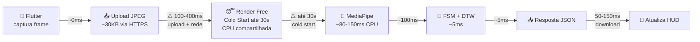
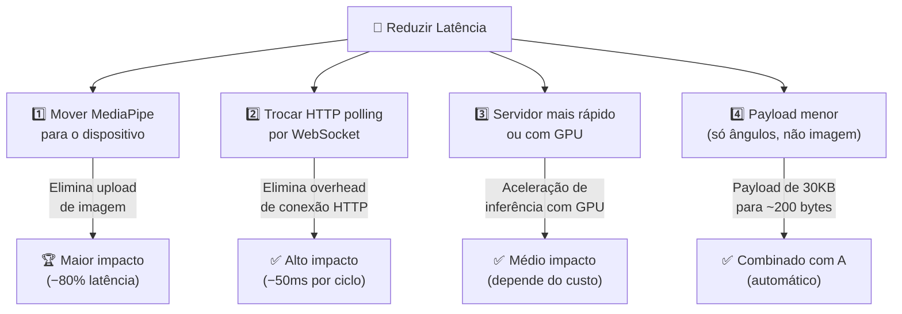
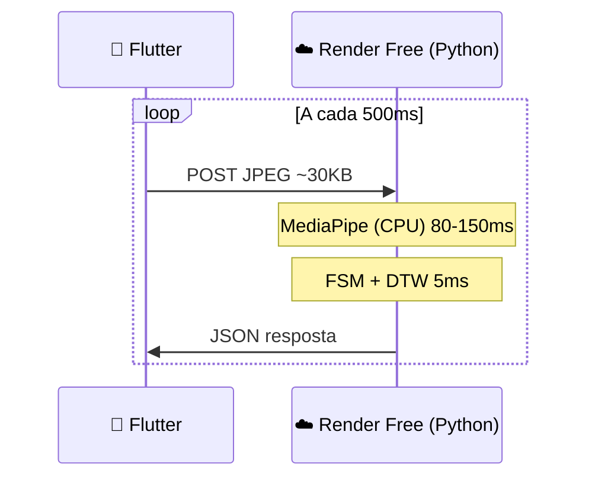
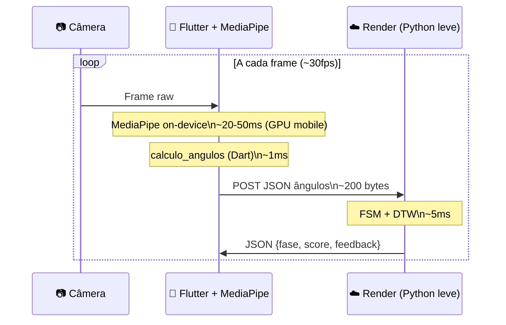
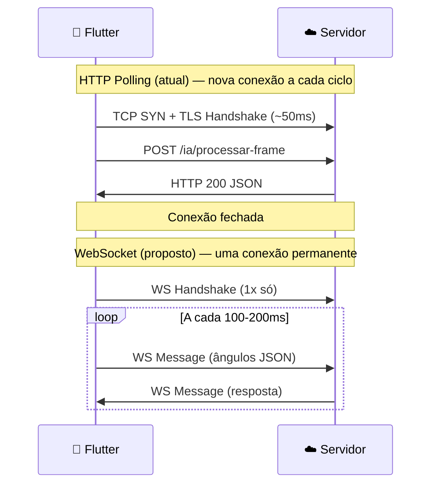
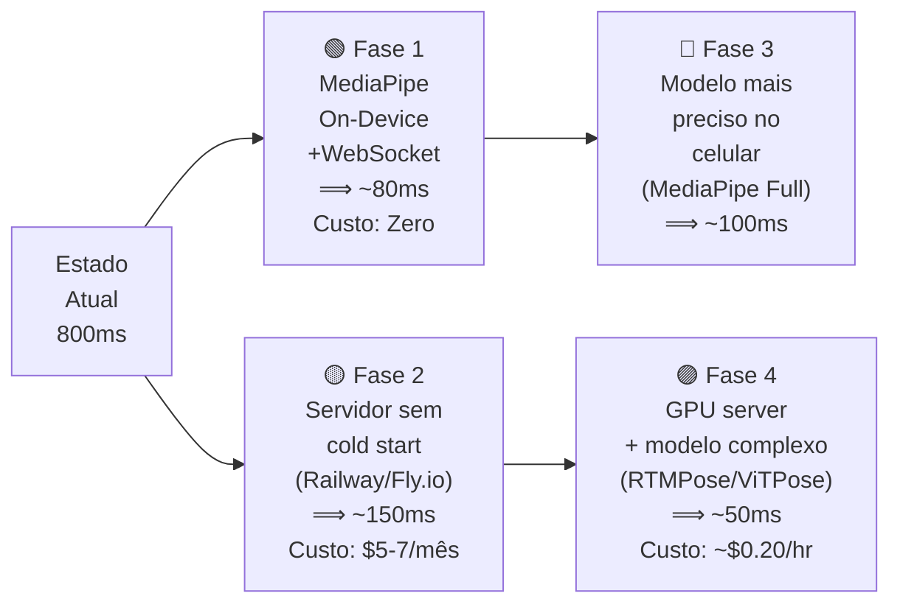
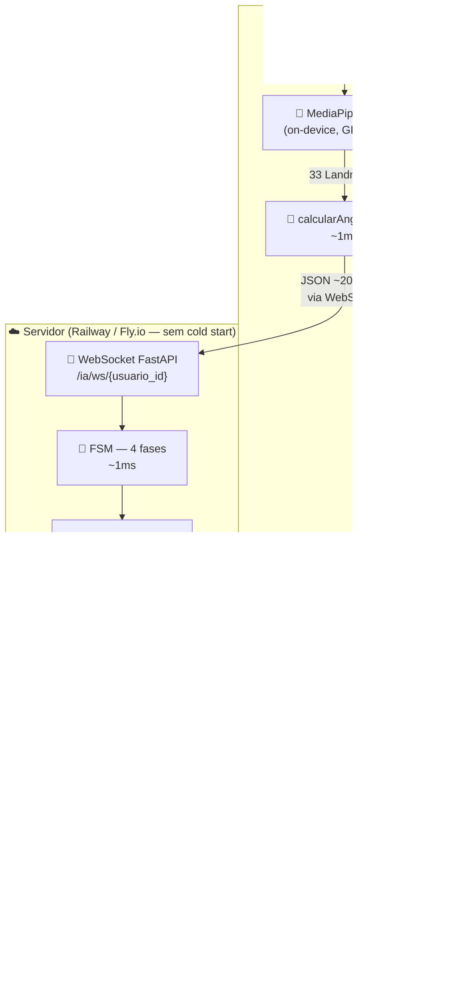

# 🚀 Estratégia de Redução de Latência e Escalabilidade — Personal Trainer IA

## O Problema Atual: Onde Está a Latência?

Antes de propor soluções, é essencial entender **onde o tempo é perdido** no ciclo atual:



### Decomposição do Tempo por Etapa

| Etapa | Tempo Estimado | Gargalo? |
|:---|:---:|:---:|
| Captura do frame no celular | ~0ms | ❌ |
| **Upload JPEG ~30KB via HTTPS (Render)** | **100–400ms** | ⚠️ Alto |
| **Cold start do servidor Render (free)** | **0 a 30 segundos** | 🔴 Crítico |
| MediaPipe inferência (CPU, sem GPU) | 80–150ms | ⚠️ Médio |
| FSM + DTW (NumPy puro) | ~5ms | ✅ Rápido |
| Download da resposta JSON | 50–150ms | ⚠️ Médio |
| **Total por ciclo (sem cold start)** | **~350–800ms** | ⚠️ |
| **Timer atual no Flutter** | **500ms fixo** | — |

> [!CAUTION]
> O **cold start do Render Free** é o pior gargalo: o servidor "dorme" após 15 minutos de inatividade e pode levar até 30 segundos para acordar. Durante uma sessão de treino isso é catastrófico.

---

## As 4 Grandes Alavancas de Melhoria



---

## Arquitetura 1 — Atual (Baseline)

> **Custo:** Grátis (Render Free) | **Latência:** ~350–800ms | **Cold Start:** 🔴 Sim



**Problemas:**
- Cold start arruína a primeira experiência de cada sessão
- Upload de imagem pesada a cada 500ms
- CPU compartilhada e limitada (sem GPU)
- Servidor hiberna após inatividade

---

## Arquitetura 2 — MediaPipe On-Device (Recomendada ⭐)

> **Custo:** Zero adicional | **Latência total:** ~50–150ms | **Cold Start:** ✅ Eliminado para pose

### Conceito

O MediaPipe possui **SDK oficial para Flutter/mobile** (`google_mlkit_pose_detection` ou `mediapipe` Flutter package). Em vez de enviar a imagem para o servidor, o **celular mesmo extrai os 33 landmarks** e envia **apenas os ângulos calculados** (um JSON de ~200 bytes) ao servidor.



### O que muda no pipeline

| Componente | Atual | Com On-Device |
|:---|:---|:---|
| **Payload enviado** | JPEG 30KB | JSON ~200 bytes |
| **MediaPipe** | Servidor (CPU) | Celular (GPU Neural Engine) |
| **`calculo_angulos.py`** | Servidor | Reimplementar em Dart (~20 linhas) |
| **FSM + DTW** | Servidor | Continua no servidor |
| **Servidor necessário** | CPU pesada | CPU levíssima (só FSM+DTW) |
| **Latência de rede** | ~250–550ms | **~20–80ms** |
| **Cold start impacta?** | Sim (pose parada) | **Não** (pose roda local) |

### Cálculo de ângulo em Dart (trivial de reimplementar)

```dart
// Equivalente ao calculo_angulos.py — ~20 linhas
double calcularAngulo(Offset a, Offset b, Offset c) {
  final ba = Offset(a.dx - b.dx, a.dy - b.dy);
  final bc = Offset(c.dx - b.dx, c.dy - b.dy);
  final cosAngle = (ba.dx * bc.dx + ba.dy * bc.dy) /
      (ba.distance * bc.distance);
  return (acos(cosAngle.clamp(-1.0, 1.0)) * 180 / pi);
}
```

### Pacotes Flutter disponíveis

| Pacote | Landmarks | GPU? | Multiplataforma |
|:---|:---:|:---:|:---:|
| `google_mlkit_pose_detection` | 33 pontos | ✅ Sim | Android + iOS |
| `mediapipe` (Google oficial) | 33 pontos | ✅ Sim | Android + iOS + Web |

> [!TIP]
> Com MediaPipe on-device, o servidor fica tão leve (só FSM + DTW em ~5ms) que o **Render Free deixa de ser um problema sério** — uma requisição de 200 bytes nunca vai causar timeout.

---

## Arquitetura 3 — WebSocket Persistente (Complementar)

> **Custo:** Zero adicional | **Ganho:** ~50–100ms por ciclo | **Complexidade:** Média

### Problema com HTTP Polling atual

A cada 500ms, o Flutter abre **uma nova conexão TCP + TLS**, envia os dados e fecha. Isso adiciona ~50–150ms de overhead de handshake em cada ciclo.



### Implementação no FastAPI

```python
# BD/api.py — adicionar endpoint WebSocket
from fastapi import WebSocket

@app.websocket("/ia/ws/{usuario_id}")
async def websocket_ia(websocket: WebSocket, usuario_id: str):
    await websocket.accept()
    servico_ia.reiniciar_sessao(usuario_id, exercicio_id="1")
    try:
        while True:
            data = await websocket.receive_json()
            angulos = data["angulos"]
            visivel = data.get("visivel", True)
            resultado = servico_ia.processar_angulos(usuario_id, angulos, visivel)
            await websocket.send_json(resultado)
    except Exception:
        await websocket.close()
```

### Implementação no Flutter

```dart
// Substituir Timer + http.post por WebSocket
final channel = WebSocketChannel.connect(
  Uri.parse('wss://personai-docker.onrender.com/ia/ws/$userId'),
);

// Enviar ângulos calculados localmente
channel.sink.add(jsonEncode({'angulos': angulos, 'visivel': true}));

// Receber feedback
channel.stream.listen((data) {
  final resultado = jsonDecode(data);
  setState(() => _atualizarHUD(resultado));
});
```

---

## Arquitetura 4 — Servidor com GPU (Para Modelos Complexos)

> **Para quando quiser usar modelos pesados como ViTPose, HRNet, etc.**

### Comparativo de Provedores

| Provedor | Plano | GPU? | Latência MediaPipe | Custo/mês | Cold Start |
|:---|:---|:---:|:---:|:---:|:---:|
| **Render Free** | Atual | ❌ CPU | ~100ms | Grátis | 🔴 30s |
| **Render Starter** | $7/mês | ❌ CPU | ~80ms | $7 | ✅ Não |
| **Railway** | $5/mês | ❌ CPU | ~60ms | $5 | ✅ Não |
| **Fly.io** | Free tier | ❌ CPU | ~50ms | Grátis+ | ✅ Não |
| **Google Cloud Run** | Pay-per-use | ❌ CPU | ~40ms | ~$0-10 | ⚠️ Médio |
| **Modal.com** | Pay-per-use | ✅ GPU | **~15ms** | ~$0.10/hr GPU | ✅ Não |
| **RunPod** | Spot GPU | ✅ GPU | **~10ms** | ~$0.20/hr | ✅ Não |
| **Google Colab** | Grátis | ✅ GPU | **~10ms** | Grátis (limite) | ✅ Não |

> [!NOTE]
> Para o **MediaPipe Lite** atual, GPU no servidor não traz ganho proporcional ao custo — o modelo já é pequeno. GPU só valeria para modelos como **ViTPose-H**, **HRNet-W48** ou **RTMPose-L** que exigem 4–10GB de VRAM.

### Modelos Mais Complexos Disponíveis

| Modelo | Precisão | Tempo (CPU) | Tempo (GPU) | Parâmetros |
|:---|:---:|:---:|:---:|:---:|
| MediaPipe Lite (atual) | ★★★☆☆ | ~100ms | N/A | ~5MB |
| MediaPipe Full | ★★★★☆ | ~200ms | N/A | ~9MB |
| MediaPipe Heavy | ★★★★☆ | ~400ms | N/A | ~25MB |
| **RTMPose-M** | ★★★★☆ | ~300ms | **~15ms** | ~13MB |
| **ViTPose-S** | ★★★★★ | ~800ms | **~20ms** | ~26MB |
| **HRNet-W32** | ★★★★★ | ~1200ms | **~30ms** | ~29MB |

---

## Roadmap de Melhorias — Do Mais ao Menos Impactante



### Priorização por Esforço × Impacto

| # | Melhoria | Impacto na Latência | Esforço | Custo |
|:---:|:---|:---:|:---:|:---:|
| 1️⃣ | **MediaPipe on-device (Flutter)** | 🔴→🟢 −80% | Alto | Zero |
| 2️⃣ | **WebSocket em vez de HTTP polling** | −50ms/ciclo | Médio | Zero |
| 3️⃣ | **Servidor sem cold start (Railway/Fly.io)** | −0 a 30s! | Baixo | $5–7/mês |
| 4️⃣ | **Endpoint `/ia/processar-angulos`** (já existe!) | −70% payload | Baixíssimo | Zero |
| 5️⃣ | **GPU server + modelo pesado** | −50ms inferência | Alto | $0.10–0.20/hr |

---

## ✅ Vitória Rápida: Usar `/ia/processar-angulos` já existente!

> [!IMPORTANT]
> Seu projeto **já tem** o endpoint `/ia/processar-angulos` que recebe ângulos calculados pelo cliente, sem precisar enviar imagem! Isso já está pronto no `BD/api.py`.

Se o Flutter já calcular os ângulos localmente (com MediaPipe on-device), basta trocar de:

```dart
// ATUAL — envia imagem pesada
final request = http.MultipartRequest('POST', uri);
request.files.add(await http.MultipartFile.fromPath('imagem', imagePath));
```

Para:

```dart
// MELHORADO — envia só os ângulos (~200 bytes)
final response = await http.post(
  Uri.parse('$baseUrl/ia/processar-angulos'),
  headers: {'Content-Type': 'application/json'},
  body: jsonEncode({
    'usuario_id': userId,
    'exercicio_id': exercicioId,
    'angulos': {'cotovelo': 125.4, 'ombro': 72.1},
    'visivel': true,
  }),
);
```

Essa troca **sozinha** reduz o payload de **~30.000 bytes para ~200 bytes** — uma redução de 99.3% no dado enviado.

---

## Arquitetura Alvo Recomendada (Fase 1 + Fase 2)



### Resultado esperado

| Métrica | Atual | Alvo (Fase 1+2) |
|:---|:---:|:---:|
| Latência por ciclo | 350–800ms | **50–120ms** |
| Cold start | 0–30s | **Zero** |
| Payload enviado | 30KB | **~200 bytes** |
| Taxa de atualização do HUD | ~2 FPS | **~8–15 FPS** |
| Servidor necessário | CPU pesada | **CPU levíssima** |
| Custo servidor | Grátis | **$5–7/mês ou grátis (Fly.io)** |

