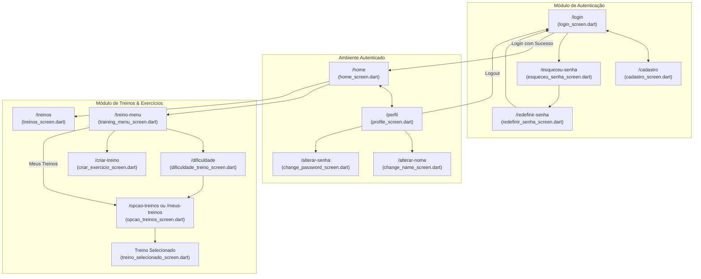

# 📱 Guia de Contexto de Telas (UI): Personal Trainer IA

> **Última Atualização:** 2026-10-23  
> **Camada:** Front-end (Flutter / Dart)  
> **Status:** Ativo / Consolidado  

---

## 1. 📖 Visão Geral da Interface

A camada visual do aplicativo **Personal Trainer IA** é desenvolvida em **Flutter**, utilizando o padrão de design escuro (*Dark Theme*) moderno com detalhes em verde neon, voltado para foco e alto contraste em ambientes de treino.

A navegação é predominantemente estruturada em **Rotas Nomeadas** centralizadas em [`lib/main.dart`](file:///C:/Users/davil/OneDrive/Documents/Personal%20AI/EngSoftTrabalho_Personal_TrainerIA/lib/main.dart), combinada com navegações dinâmicas com passagem de argumentos via `MaterialPageRoute` quando é necessário transitar dados complexos (como o objeto completo do treino selecionado).

---

## 2. 🗺️ Mapa e Fluxo de Navegação



---

## 3. 📋 Catálogo Completo de Telas

| Arquivo | Rota Nomeada | Módulo | Descrição & Responsabilidade | Integração com `ApiService` |
| :--- | :--- | :--- | :--- | :--- |
| [`login_screen.dart`](file:///C:/Users/davil/OneDrive/Documents/Personal%20AI/EngSoftTrabalho_Personal_TrainerIA/lib/screens/login_screen.dart) | `/login` | Autenticação | Tela inicial para inserção de e-mail e senha, com validação de campos e redirecionamentos. | `fazerLogin(email, senha)` |
| [`cadastro_screen.dart`](file:///C:/Users/davil/OneDrive/Documents/Personal%20AI/EngSoftTrabalho_Personal_TrainerIA/lib/screens/cadastro_screen.dart) | `/cadastro` | Autenticação | Formulário de criação de conta com nome completo, e-mail e confirmação de senha. | `criarConta(nome, email, senha)` |
| [`esqueceu_senha_screen.dart`](file:///C:/Users/davil/OneDrive/Documents/Personal%20AI/EngSoftTrabalho_Personal_TrainerIA/lib/screens/esqueceu_senha_screen.dart) | `/esqueceu-senha` | Autenticação | Solicitação de recuperação de senha; envia código OTP para o e-mail informado. | `solicitarRecuperacaoSenha(email)` |
| [`redefinir_senha_screen.dart`](file:///C:/Users/davil/OneDrive/Documents/Personal%20AI/EngSoftTrabalho_Personal_TrainerIA/lib/screens/redefinir_senha_screen.dart) | `/redefinir-senha` | Autenticação | Validação do código numérico de 6 dígitos recebido por e-mail e definição da nova senha. | `redefinirSenhaComCodigo(...)` |
| [`home_screen.dart`](file:///C:/Users/davil/OneDrive/Documents/Personal%20AI/EngSoftTrabalho_Personal_TrainerIA/lib/screens/home_screen.dart) | `/home` | Dashboard | Painel central do usuário exibindo métricas de gamificação (pontos semanais, totais, streak atual, maior sequência e meta do dia). | `verPontuacao(id)` |
| [`profile_screen.dart`](file:///C:/Users/davil/OneDrive/Documents/Personal%20AI/EngSoftTrabalho_Personal_TrainerIA/lib/screens/profile_screen.dart) | `/perfil` | Usuário | Exibição das informações da conta, streak acumulado, opções de segurança e botão de encerramento de sessão (*logout*). | `verPerfil(id)`, `deslogar()` |
| [`change_name_screen.dart`](file:///C:/Users/davil/OneDrive/Documents/Personal%20AI/EngSoftTrabalho_Personal_TrainerIA/lib/screens/change_name_screen.dart) | `/alterar-nome` | Usuário | Formulário simplificado para alteração do nome de exibição do usuário na tabela `usuarios`. | `editarPerfil(id, nome: ...)` |
| [`change_password_screen.dart`](file:///C:/Users/davil/OneDrive/Documents/Personal%20AI/EngSoftTrabalho_Personal_TrainerIA/lib/screens/change_password_screen.dart) | `/alterar-senha` | Usuário | Alteração de senha quando o usuário já se encontra autenticado. | `alterarSenha(novaSenha, senhaAtual)` |
| [`training_menu_screen.dart`](file:///C:/Users/davil/OneDrive/Documents/Personal%20AI/EngSoftTrabalho_Personal_TrainerIA/lib/screens/training_menu_screen.dart) | `/treino-menu` | Treinos | Hub visual de treinos: atalhos para escolher nível de dificuldade, acessar treinos salvos ou criar treino do zero. | Navegação local |
| [`dificuldade_treino_screen.dart`](file:///C:/Users/davil/OneDrive/Documents/Personal%20AI/EngSoftTrabalho_Personal_TrainerIA/lib/screens/dificuldade_treino_screen.dart) | `/dificuldade` | Treinos | Cards seletivos de intensidade: Iniciante (Verde), Intermediário (Laranja) e Avançado (Vermelho). | Navegação com passagem de flag |
| [`opcao_treinos_screen.dart`](file:///C:/Users/davil/OneDrive/Documents/Personal%20AI/EngSoftTrabalho_Personal_TrainerIA/lib/screens/opcao_treinos_screen.dart) | `/opcao-treinos` / `/meus-treinos` | Treinos | Lista os treinos correspondentes ao filtro. Carrega dados do backend com fallback para catálogo offline estruturado. | `listarTreinosPreMontados()`, `listarTreinosUsuario(id)` |
| [`treino_selecionado_screen.dart`](file:///C:/Users/davil/OneDrive/Documents/Personal%20AI/EngSoftTrabalho_Personal_TrainerIA/lib/screens/treino_selecionado_screen.dart) | *(Push Dinâmico)* | Treinos | Detalhes completos do treino: duração, pontuação esperada, lista de exercícios com séries e repetições. Permite salvar e executar o treino. | `criarTreino(...)`, `adicionarPontuacaoDiaria(...)` |
| [`criar_exercicio_screen.dart`](file:///C:/Users/davil/OneDrive/Documents/Personal%20AI/EngSoftTrabalho_Personal_TrainerIA/lib/screens/criar_exercicio_screen.dart) | `/criar-treino` | Treinos | Construtor interativo de treinos personalizados, permitindo nomear, definir séries, repetições e agrupar exercícios. | `listarExercicios()`, `criarTreino(...)` |
| [`treinos_screen.dart`](file:///C:/Users/davil/OneDrive/Documents/Personal%20AI/EngSoftTrabalho_Personal_TrainerIA/lib/screens/treinos_screen.dart) | `/treinos` | Treinos | Visualização de rotinas rápidas organizadas por categorias e grupamentos musculares. | Navegação e filtros |

---

## 4. 🎨 Padrões de Design e UI/UX

O aplicativo implementa o tema definido no `ThemeData` de [`lib/main.dart`](file:///C:/Users/davil/OneDrive/Documents/Personal%20AI/EngSoftTrabalho_Personal_TrainerIA/lib/main.dart):

| Token Visual | Valor Hexadecimal | Aplicação |
| :--- | :--- | :--- |
| **Scaffold Background** | `#0D1117` | Fundo principal de todas as telas (Dark GitHub/Terminal style). |
| **Surface / Card Background**| `#1E232A` | Fundo de containers, caixas de diálogo, cartões de treino e inputs. |
| **Primary Color** | `#00E676` | Verde neon de destaque: botões principais, status de sucesso, streaks ativos. |
| **Secondary / Accent** | `#E91E63` | Rosa/magenta para destaques secundários e badges de intensidade alta. |
| **Text Primary** | `#FFFFFF` | Títulos e textos de alto contraste. |
| **Text Secondary / Muted** | `#8B949E` | Rótulos, descrições secundárias e placeholders. |

---

## 5. ⚙️ Gerenciamento de Estado & Ciclo de Vida

1. **Padrão Utilizado:** Todas as telas com dados assíncronos utilizam `StatefulWidget` com controle local de `setState`.
2. **Boas Práticas de Carregamento Assíncrono:**
   * Uso da propriedade `mounted` antes de qualquer chamada a `setState` após um `await`, prevenindo exceções de componentes desmontados:
     ```dart
     final res = await ApiService().verPerfil(usuarioId);
     if (mounted && res['sucesso'] == true) {
       setState(() { ... });
     }
     ```
3. **Padrão de Feedback ao Usuário:**
   * Mensagens de sucesso ou erro devem utilizar `ScaffoldMessenger.of(context).showSnackBar()` com tempo de exibição curto e cor de fundo correspondente (`#00E676` para sucesso, `#E53935` para erro).

---

## 6. 🚀 Como Adicionar uma Nova Tela

1. **Criar o Widget:** Crie o arquivo em `lib/screens/minha_nova_screen.dart` herdando de `StatefulWidget` ou `StatelessWidget`.
2. **Centralizar Requisições:** Não faça chamadas `http` diretas; se a tela consome dados, adicione o método correspondente em [`lib/services/api_service.dart`](file:///C:/Users/davil/OneDrive/Documents/Personal%20AI/EngSoftTrabalho_Personal_TrainerIA/lib/services/api_service.dart).
3. **Registrar a Rota:** Abra [`lib/main.dart`](file:///C:/Users/davil/OneDrive/Documents/Personal%20AI/EngSoftTrabalho_Personal_TrainerIA/lib/main.dart) e adicione o caminho no mapa `routes`:
   ```dart
   routes: {
     ...
     '/minha-rota': (context) => const MinhaNovaScreen(),
   }
   ```
4. **Sincronizar:** Atualize o arquivo [`lib/screens/.ai_context.md`](file:///C:/Users/davil/OneDrive/Documents/Personal%20AI/EngSoftTrabalho_Personal_TrainerIA/lib/screens/.ai_context.md) e este guia para refletir a nova tela.
