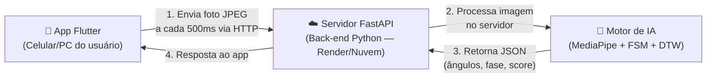
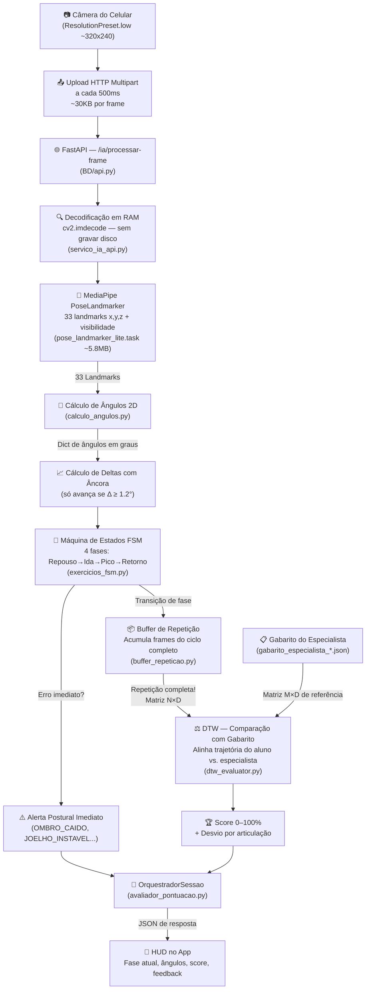
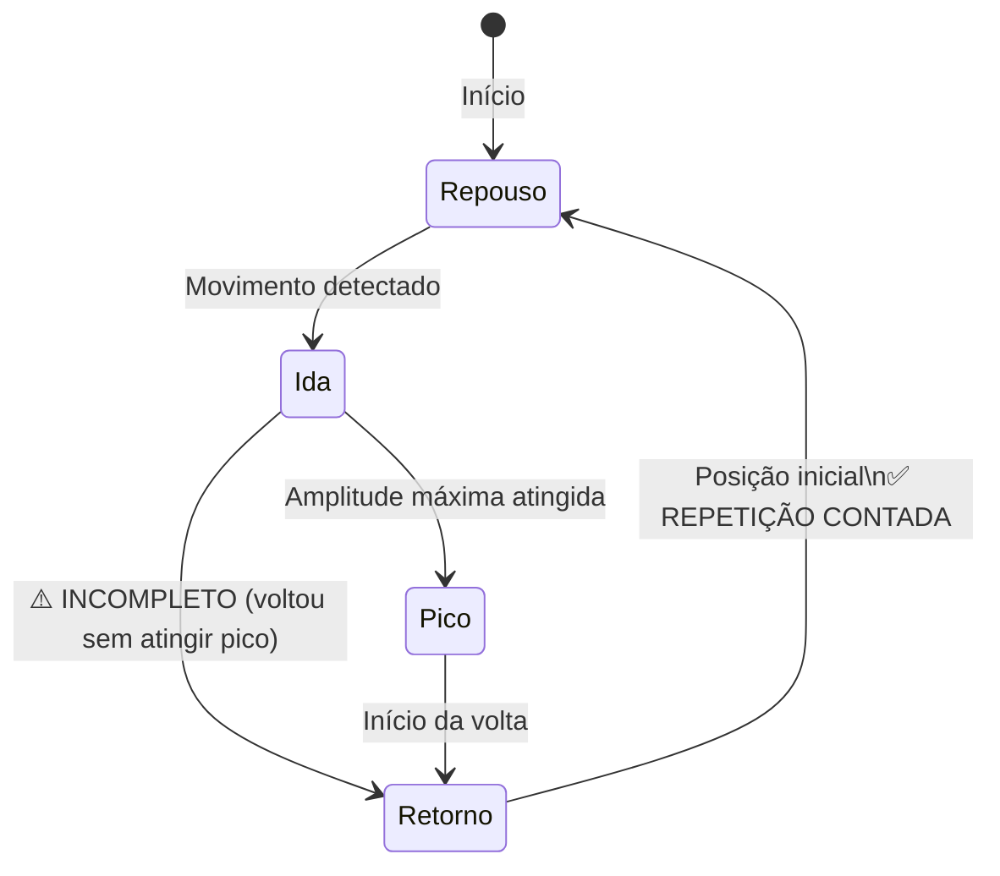
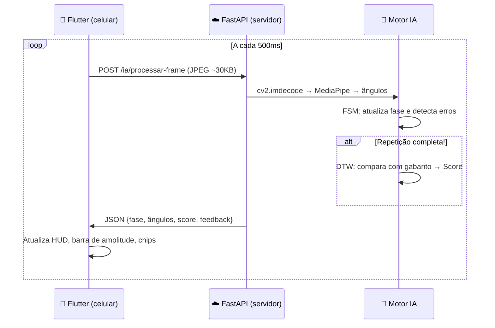

# 🧠 Como funciona a IA do Personal Trainer: Do Frame à Pontuação

## Onde a IA é processada?

> [!IMPORTANT]
> **Toda a IA roda em um servidor remoto (Python/FastAPI), NÃO no celular/PC do usuário.**

O sistema usa uma arquitetura **cliente-servidor** em 3 camadas:



| Componente | Onde roda | O que faz |
|:---|:---:|:---|
| **App Flutter** | 📱 Celular/PC do usuário | Captura câmera, envia frames, mostra HUD |
| **FastAPI (`BD/api.py`)** | ☁️ Servidor remoto (Render) | Recebe imagens, orquestra o motor de IA |
| **Motor de IA Python** | ☁️ Mesmo servidor | MediaPipe + FSM + DTW (processamento pesado) |

---

## Pipeline Completo: Do Frame à Pontuação

### Visão Geral



---

## Detalhamento de cada etapa

### Etapa 1 — Captura e Envio (Flutter, no celular)

- A câmera captura em resolução baixa (`~320×240px`, ~30KB por foto).
- A cada **500ms**, o frame é enviado como `multipart/form-data` via HTTP POST para `/ia/processar-frame` no servidor.
- O app **não processa nenhuma IA localmente** — ele é apenas um "olho" que manda fotos.

---

### Etapa 2 — Estimação de Pose (MediaPipe, no servidor)

O servidor usa o modelo **MediaPipe Pose Landmarker Lite** (`pose_landmarker_lite.task`, ~5.8MB) para detectar **33 pontos corporais** (landmarks) na imagem:

- Cada landmark tem coordenadas `(x, y, z)` + score de `visibilidade`.
- Se os pontos estiverem fora do frame ou obscurecidos, o pipeline entra em modo de tolerância (congela por até 30 frames antes de descartar).

| Landmark ID | Parte do corpo |
|:---:|:---|
| 11/12 | Ombros |
| 13/14 | Cotovelos |
| 15/16 | Punhos |
| 23/24 | Quadris |
| 25/26 | Joelhos |
| 27/28 | Tornozelos |

---

### Etapa 3 — Cálculo de Ângulos 2D (`calculo_angulos.py`)

Com os landmarks, calcula-se o **ângulo em graus** de cada articulação monitorada:

$$\text{ângulo}(A, B, C) = \arctan2\!\left(\vec{BA}, \vec{BC}\right) \in [0°, 180°]$$

Onde `B` é o vértice da articulação (ex.: cotovelo) e `A`, `C` são os pontos vizinhos (ombro e punho).

| Articulação | Pontos (direito) | Pontos (esquerdo) |
|:---|:---:|:---:|
| `cotovelo` | `(12, 14, 16)` | `(11, 13, 15)` |
| `ombro` | `(24, 12, 14)` | `(23, 11, 13)` |
| `joelho` | `(24, 26, 28)` | `(23, 25, 27)` |
| `quadril` | `(12, 24, 26)` | `(11, 23, 25)` |

---

### Etapa 4 — Cálculo de Deltas com Âncora de Ruído

> [!NOTE]
> Este foi um problema real resolvido na TASK-02: em movimentos **lentos**, o delta frame a frame era quase zero e o sistema "achava" que o usuário estava parado.

A solução foi usar uma **âncora de ruído**: a referência angular só avança quando a variação acumulada for `≥ 1.2°`. Isso acumula corretamente movimentos lentos sem ruído de tremor.

---

### Etapa 5 — Máquina de Estados Finitos — FSM (`exercicios_fsm.py`)

A FSM opera **frame a frame** (complexidade $O(1)$) e rastreia em qual fase do exercício o aluno está:



**Erros detectados em tempo real (por exercício):**

| Exercício | Erro | Condição |
|:---|:---|:---|
| Desenvolvimento de Ombro | `REPETICAO_INCOMPLETA` | Voltou sem atingir 150° no cotovelo |
| Desenvolvimento de Ombro | `OMBRO_CAIDO` | Ombro < 60° nas fases 1, 2, 3 |
| Desenvolvimento de Ombro | `DESCIDA_EXCESSIVA` | Cotovelo < 70° na descida |
| Agachamento | `AGACHAMENTO_CURTO` | Não desceu até 105° no joelho |
| Agachamento | `TRONCO_MUITO_INCLINADO` | Quadril < 55° |
| Rosca Bíceps | `SUBIDA_INCOMPLETA` | Voltou sem contrair até 65° |
| Rosca Bíceps | `OMBRO_INSTAVEL` | Ombro > 40° (cotovelo saindo do corpo) |

---

### Etapa 6 — Buffer de Repetição (`buffer_repeticao.py`)

O buffer acumula os ângulos de **todos os frames** entre o início da fase 1 (Ida) e o retorno à fase 0 (Repouso). Quando o ciclo fecha:

- É gerada uma **matriz temporal** de dimensão `N × D`, onde:
  - `N` = número de frames da repetição
  - `D` = número de articulações (ex.: 2 para ombro: `[cotovelo, ombro]`)

Essa matriz é passada para o DTW.

---

### Etapa 7 — Dynamic Time Warping — DTW (`dtw_evaluator.py`)

O DTW compara a trajetória do aluno com a do **especialista** (gabarito JSON), de forma **independente da velocidade**:

```
Trajetória do aluno  →  [90°, 110°, 140°, 165°, 155°, 130°, 100°]  (rápido, N frames)
Gabarito especialista → [88°, 105°, 130°, 155°, 170°, 160°, 140°, 120°, 100°]  (M frames)
                                              ↑
                              Alinhamento elástico DTW
```

**A pontuação final segue uma fórmula de decaimento exponencial:**

$$\text{Score} = 100 \cdot \exp\!\left(-\frac{d_{\text{norm}}}{\tau}\right)$$

Onde:
- $d_{\text{norm}}$ = distância média ao longo do caminho de alinhamento (em graus)
- $\tau$ = tolerância padrão de **15°** (biomecânico: variações menores que 15° são naturais)

| Score | Interpretação |
|:---:|:---|
| 95–100% | Execução perfeita |
| 80–94% | Boa execução, pequenos desvios |
| 60–79% | Execução regular |
| < 60% | Erros significativos de trajetória |

> [!TIP]
> O DTW também identifica **qual articulação desviou mais** do padrão, permitindo feedback específico como "seu cotovelo desviou 18° da referência".

---

### Etapa 8 — OrquestradorSessao e Pontuação Final (`avaliador_pontuacao.py`)

O orquestrador combina tudo e gera a nota final da repetição:

```
Nota Final = Score DTW (0–100) - Penalidades FSM
```

| Erro FSM | Penalidade |
|:---|:---:|
| `REPETICAO_INCOMPLETA` / `AGACHAMENTO_CURTO` / `SUBIDA_INCOMPLETA` | **Desqualificação** (Score = 0, reprovada) |
| `OMBRO_CAIDO` | -15 pontos |
| `OMBRO_INSTAVEL` | -15 pontos |
| `TRONCO_MUITO_INCLINADO` | -15 pontos |

Ao final da sessão, o orquestrador retorna um **resumo** com:
- Média ponderada de todas as repetições
- Taxa de aprovação
- Pontos de gamificação (proporcional às repetições aprovadas)
- Articulação com maior desvio médio

---

### Etapa 9 — HUD no App Flutter (de volta ao celular)

O servidor retorna um JSON com todos os dados e o app Flutter renderiza o HUD em tempo real:

```json
{
  "fase_atual": 1,
  "angulos": {"cotovelo": 125.4, "ombro": 72.1},
  "score_ultima_rep": 91.3,
  "repeticoes": 3,
  "feedback": "Bom trabalho! Cotovelo desviou apenas 8° da referência.",
  "alerta": null
}
```

---

## Resumo Visual do Fluxo de Tempo



---

## Por que NÃO rodar no próprio celular?

| Razão | Explicação |
|:---|:---|
| **Modelo MediaPipe** | O `.task` de 5.8MB precisaria rodar em tempo real no celular — exige muito da CPU/GPU mobile |
| **Python + NumPy + DTW** | O stack de IA é em Python puro com NumPy; rodar isso no celular exigiria uma porta nativa complexa |
| **Centralização do modelo** | Um servidor único facilita atualização do gabarito e parâmetros sem forçar update no app |
| **Isolamento de sessões** | O `ServicoIA` gerencia sessões independentes por usuário em RAM, algo impraticável em app mobile |

